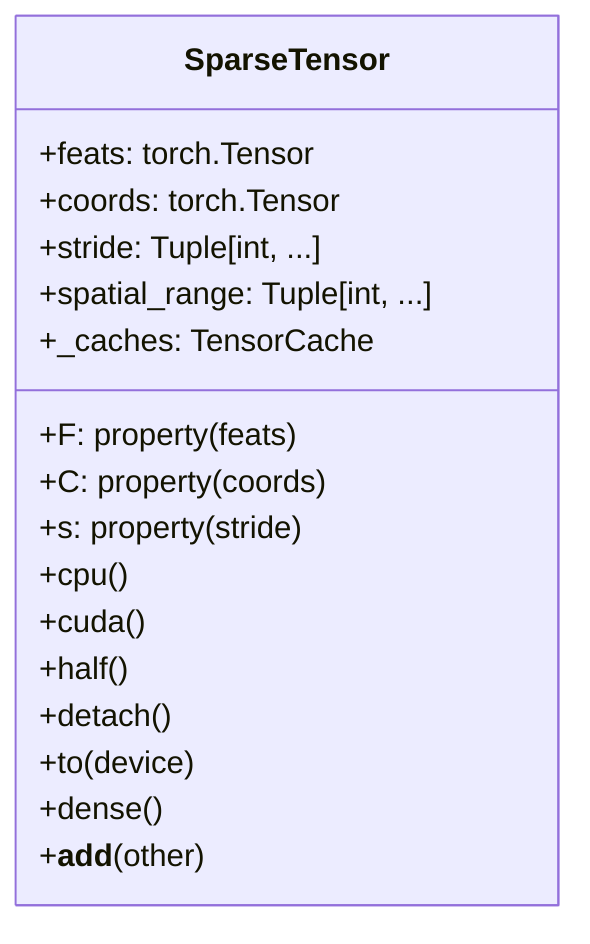
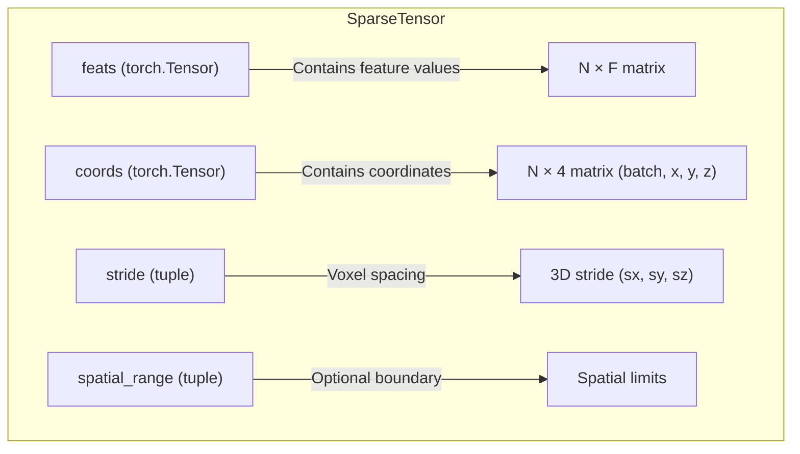
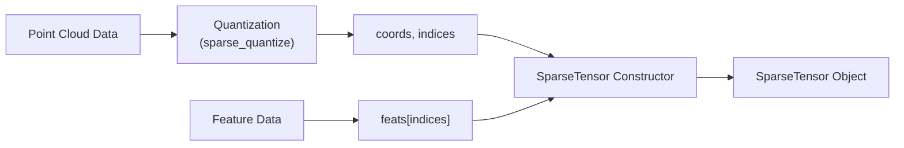
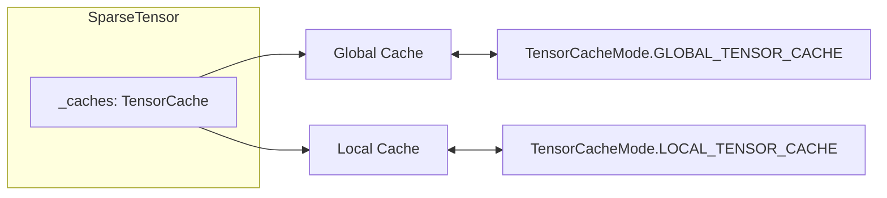
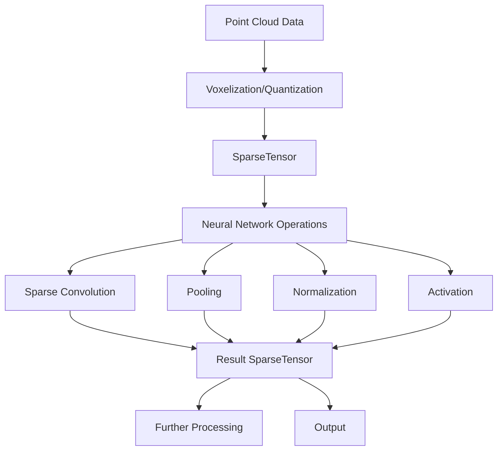
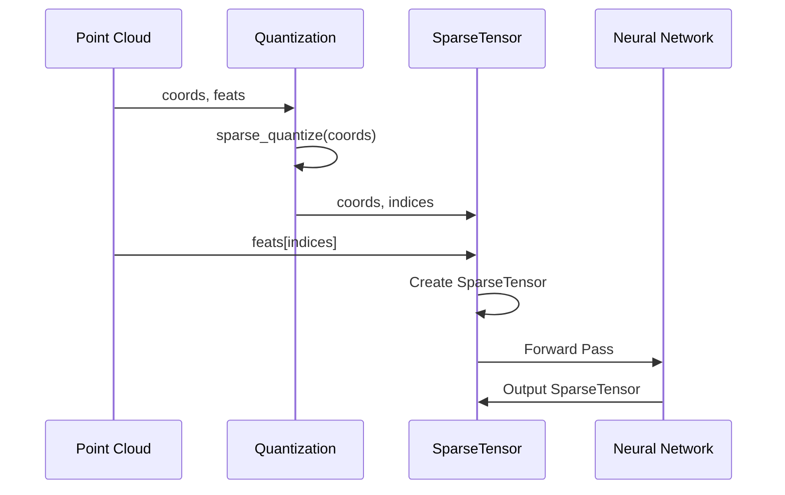
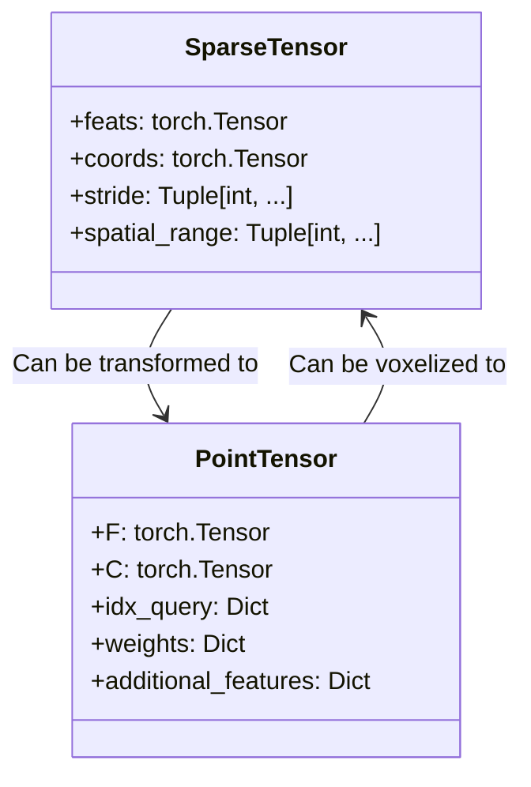

<!-- source: DeepWiki mcp.deepwiki.com · repo mit-han-lab/torchsparse · page 2.1 SparseTensor Data Structure · fetched 2026-10-30 -->

# SparseTensor Data Structure

<details>
<summary>Relevant source files</summary>

The following files were used as context for generating this wiki page:

- [examples/example.py](examples/example.py)
- [torchsparse/tensor.py](torchsparse/tensor.py)

</details>


## Purpose and Scope

This document details the `SparseTensor` data structure, which is the foundational representation in TorchSparse for efficiently handling sparse point cloud data. It covers the internal structure, initialization, properties, and methods of this class. For information about backend implementations that operate on this data structure, see [Backend System](#2.2). For neural network operations that use this data structure, see [Neural Network Modules](#3).

## Core Concept

The `SparseTensor` is designed to represent sparse 3D data (such as point clouds) in a memory-efficient format. Unlike dense tensors that allocate memory for all possible positions in a volume, the `SparseTensor` only stores information for occupied voxels, making it ideal for processing sparse 3D data.



Sources: [torchsparse/tensor.py:29-114](). This represents the main `SparseTensor` class defined in the codebase.

## Data Structure Components

The `SparseTensor` consists of four main components:

1. **Features Tensor (`feats`)**: Contains the feature values for each point/voxel
2. **Coordinates Tensor (`coords`)**: Stores the spatial coordinates of each point/voxel
3. **Stride (`stride`)**: Determines the spacing between voxels
4. **Spatial Range (`spatial_range`)**: Defines the boundaries of the spatial domain



Sources: [torchsparse/tensor.py:30-43]()

### Features Tensor

The `feats` attribute stores the actual data values (features) at each point in the sparse tensor. It's a regular PyTorch tensor with shape `(N, C)`, where:
- `N` is the number of points/voxels
- `C` is the number of feature channels

### Coordinates Tensor

The `coords` attribute stores the coordinates of each point/voxel. It's a regular PyTorch tensor with shape `(N, D+1)`, where:
- `N` is the number of points/voxels
- `D+1` includes batch dimension plus spatial dimensions (typically 4 for 3D data: batch, x, y, z)

### Stride and Spatial Range

- **stride**: A 3-tuple specifying the spacing between voxels in each dimension.
- **spatial_range**: An optional tuple defining the spatial boundaries of the tensor.

## Initialization

```python
SparseTensor(
    feats: torch.Tensor,
    coords: torch.Tensor,
    stride: Union[int, Tuple[int, ...]] = 1,
    spatial_range: Union[int, Tuple[int, ...]] = None
)
```

Creating a `SparseTensor` requires features and coordinates at minimum:



Sources: [examples/example.py:28-37](), [torchsparse/tensor.py:30-43]()

## Properties and Aliases

The `SparseTensor` class provides convenient property accessors:

| Property | Access to | Description |
|----------|-----------|-------------|
| `F` | `feats` | Feature tensor containing data values |
| `C` | `coords` | Coordinate tensor containing spatial positions |
| `s` | `stride` | Tensor stride (voxel spacing) |

Sources: [torchsparse/tensor.py:54-76]()

## Tensor Cache Integration

Each `SparseTensor` maintains a `TensorCache` that stores intermediate tensors computed during operations to avoid redundant calculations:



Sources: [torchsparse/tensor.py:45-52]()

## Methods

The `SparseTensor` provides several methods for common operations:

### Device Movement

```python
tensor = SparseTensor(...)
tensor = tensor.cuda()  # Move to GPU
tensor = tensor.cpu()   # Move to CPU
tensor = tensor.to(device)  # Move to specific device
```

Sources: [torchsparse/tensor.py:78-100]()

### Data Type and State

```python
tensor = SparseTensor(...)
tensor = tensor.half()    # Convert features to half precision
tensor = tensor.detach()  # Detach from computation graph
```

Sources: [torchsparse/tensor.py:88-95]()

### Conversion

```python
tensor = SparseTensor(...)
dense_tensor = tensor.dense()  # Convert to dense tensor
```

The `dense()` method requires that `spatial_range` is set, as it defines the dimensions of the output dense tensor.

Sources: [torchsparse/tensor.py:102-104]()

### Operations

```python
tensor1 = SparseTensor(...)
tensor2 = SparseTensor(...)
tensor3 = tensor1 + tensor2  # Element-wise addition
```

Currently, the `SparseTensor` class directly supports element-wise addition through the `__add__` method. Other operations are handled through the functional API.

Sources: [torchsparse/tensor.py:106-114]()

## Integration with Neural Network Operations

The `SparseTensor` is designed to work seamlessly with TorchSparse's neural network operations. Here's how it connects to the broader system:



Sources: [examples/example.py:65-79](), [examples/example.py:85-91]()

## Usage Example

A typical workflow for creating and using a `SparseTensor`:

1. Start with point cloud data (coordinates and features)
2. Quantize the coordinates to voxels
3. Create a `SparseTensor`
4. Process through neural network operations



Sources: [examples/example.py:25-38](), [examples/example.py:85-91]()

## Relation to PointTensor

TorchSparse also provides a `PointTensor` class for working with unquantized point clouds directly:



While `SparseTensor` represents voxelized data, `PointTensor` represents raw points with additional lookup information.

Sources: [torchsparse/tensor.py:116-145]()

## Difference from PyTorch's Sparse Tensors

TorchSparse's `SparseTensor` differs from PyTorch's native sparse tensors:

| Feature | TorchSparse `SparseTensor` | PyTorch Native Sparse Tensor |
|---------|--------------------------|---------------------------|
| Design Target | 3D point clouds | General sparse data |
| Efficiency | Optimized for 3D convolutions | General sparse operations |
| Coordinate Format | Explicit coordinates tensor | COO or CSR format |
| Operations | Specialized 3D operations | Limited to basic operations |
| Backend | Custom CUDA kernels | PyTorch back-end |

Sources: [torchsparse/tensor.py:29-114]()

## Summary

The `SparseTensor` is the fundamental data structure in TorchSparse, designed specifically for efficient representation and processing of sparse 3D data. It combines feature and coordinate information with spatial metadata, enabling memory-efficient operations on point cloud data. The class provides intuitive interfaces for tensor manipulation and integrates seamlessly with TorchSparse's neural network operations.

---

