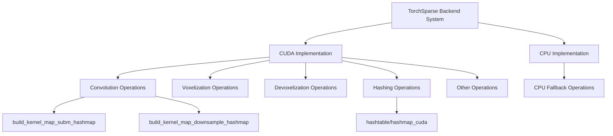
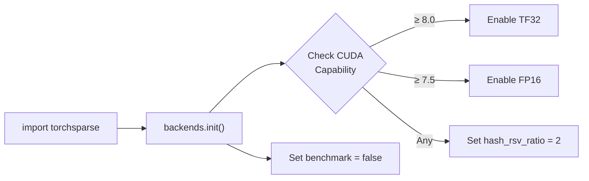
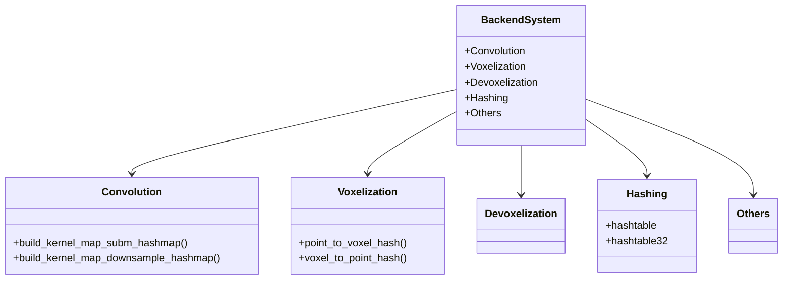
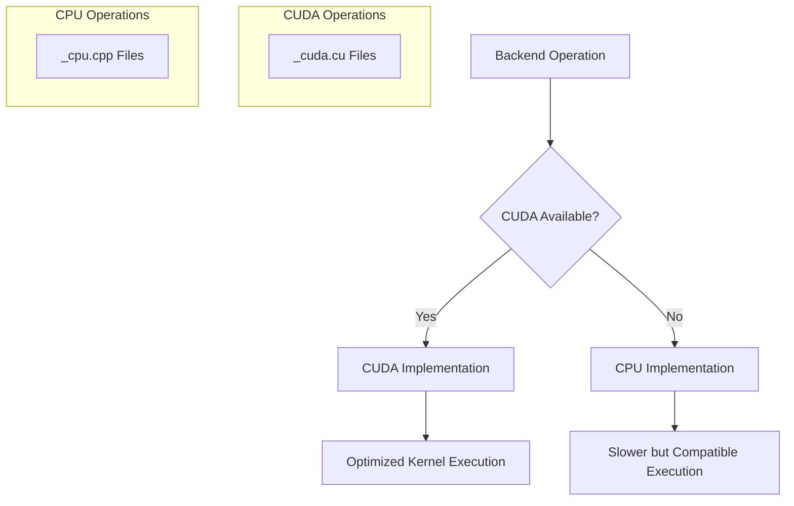
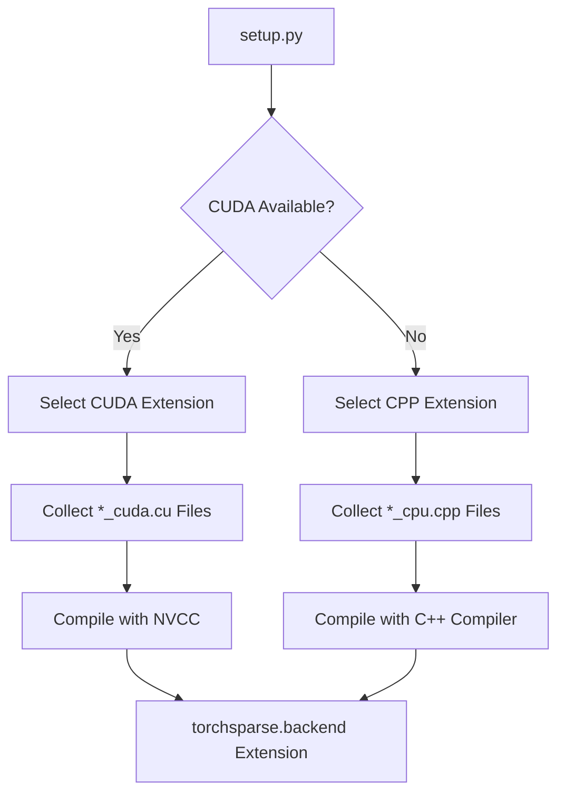
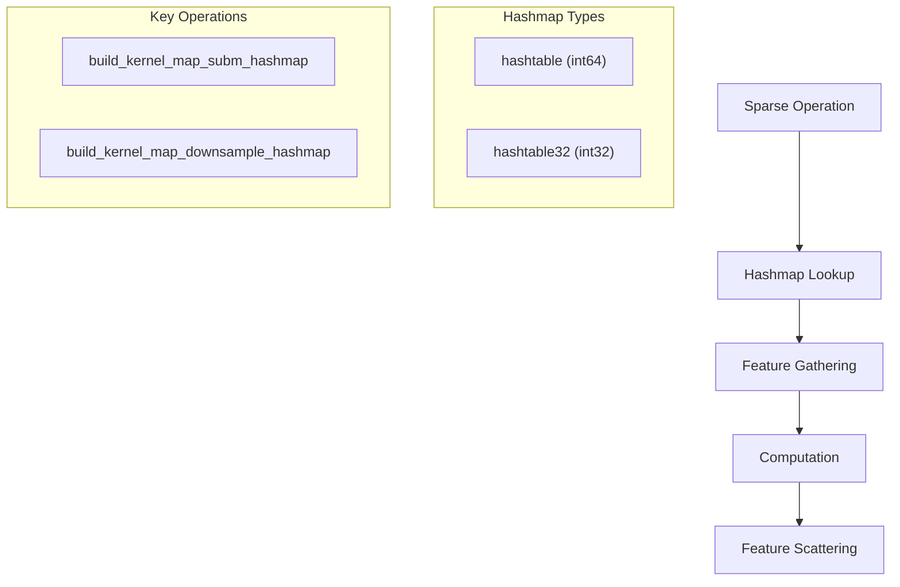
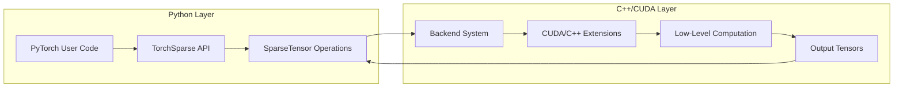

<!-- source: DeepWiki mcp.deepwiki.com · repo mit-han-lab/torchsparse · page 2.2 Backend System · fetched 2026-10-30 -->

# Backend System

Relevant source files

The following files were used as context for generating this wiki page:

- [setup.py](setup.py)
- [torchsparse/__init__.py](torchsparse/__init__.py)
- [torchsparse/backend/others/sparsemapping_cuda.h](torchsparse/backend/others/sparsemapping_cuda.h)
- [torchsparse/backends.py](torchsparse/backends.py)

The TorchSparse Backend System provides the underlying computational infrastructure that powers efficient sparse tensor operations. This system is responsible for the high-performance implementation of core operations such as sparse convolution, voxelization, and hashing. For information about the SparseTensor data structure that these operations work with, see [SparseTensor Data Structure](#2.1).

## Overview

The backend system in TorchSparse provides optimized implementations for sparse operations on both CUDA-enabled GPUs and CPUs. It forms the computational foundation that makes sparse point cloud processing efficient.

Sources: [setup.py:20-27](), [torchsparse/backend/others/sparsemapping_cuda.h:1-32]()

## Backend Initialization

The backend system is automatically initialized when TorchSparse is imported. The initialization process configures various parameters based on the available hardware capabilities.

Sources: [torchsparse/__init__.py:1-9](), [torchsparse/backends.py:1-12]()

### Backend Configuration Options

The backend initialization sets several important configuration parameters:

| Parameter | Description | Default Value |
|-----------|-------------|---------------|
| benchmark | Performance benchmarking mode | False |
| allow_tf32 | Enable TensorFloat32 format (for Ampere+ GPUs) | True if device capability ≥ 8.0 |
| allow_fp16 | Enable half-precision operations | True if device capability ≥ 7.5 |
| hash_rsv_ratio | Hashmap reserve ratio for downsampling | 2 (reserves 2x original point space) |
| device_capability | GPU compute capability | Automatically detected |

Sources: [torchsparse/backends.py:4-11]()

## Backend Components

The backend system consists of several key components that implement different operations. These components are organized by functionality and hardware target.

### Core Operations

Sources: [torchsparse/backend/others/sparsemapping_cuda.h:10-32]()

### Hardware-Specific Implementations

The backend system provides both CUDA and CPU implementations for its operations, automatically selecting the appropriate implementation based on hardware availability.

Sources: [setup.py:19-36]()

## Backend Build System

The TorchSparse backend is built using PyTorch's C++/CUDA extension mechanisms. The build system automatically detects hardware capabilities and compiles the appropriate implementation.

### Build Process

Sources: [setup.py:19-49]()

### Compilation Options

The backend system uses specific compilation flags to optimize performance:

| Compiler | Flags | Purpose |
|----------|-------|---------|
| C++ | -g -O3 -fopenmp -lgomp | Enable OpenMP parallelization with optimization |
| NVCC | -O3 -std=c++17 | C++17 standard with optimization |

Sources: [setup.py:37-40]()

## Implementation Details

The backend system is structured around key operations that form the foundation of sparse tensor processing.

### Hashmap-Based Operations

A core component of the backend system is the hashmap implementation used for efficient sparse tensor operations. This is particularly important for operations like sparse convolution that need to quickly find neighboring points.

Sources: [torchsparse/backend/others/sparsemapping_cuda.h:4-32]()

### Kernel Map Building

The backend provides specialized functions to build kernel maps for different types of sparse operations:

1. **Submanifold Operations**: Maintain spatial resolution with `build_kernel_map_subm_hashmap`
2. **Downsampling Operations**: Reduce spatial resolution with `build_kernel_map_downsample_hashmap`

Both operations are available in int32 and int64 variants to accommodate different coordinate system requirements.

Sources: [torchsparse/backend/others/sparsemapping_cuda.h:10-32]()

## Integration with PyTorch

The TorchSparse backend integrates with PyTorch's extension system to provide seamless compatibility while maintaining high performance.

Sources: [setup.py:42-66](), [torchsparse/__init__.py:1-9]()

## Performance Considerations

The backend system includes several features designed to optimize performance based on hardware capabilities.

### Hardware-Specific Optimizations

TorchSparse's backend automatically detects GPU compute capability and enables advanced features when available:

1. **TensorFloat32 (TF32)**: Enabled on Ampere and newer GPUs (compute capability ≥ 8.0)
2. **Half-Precision (FP16)**: Enabled on devices with compute capability ≥ 7.5

These optimizations can significantly accelerate sparse operations while maintaining acceptable numerical precision.

Sources: [torchsparse/backends.py:7-10]()

### Hashmap Reserves

The backend uses a reserve ratio (`hash_rsv_ratio`) to allocate additional space in hashmaps. This prevents frequent rehashing operations during downsampling, improving performance at the cost of additional memory usage.

Sources: [torchsparse/backends.py:11]()

## Conclusion

The TorchSparse Backend System provides the computational foundation that enables efficient sparse tensor operations. By leveraging both CUDA and CPU implementations, and automatically adapting to hardware capabilities, it delivers high-performance processing of point cloud data. The system's architecture balances performance with flexibility, allowing it to support a wide range of sparse operations while maintaining compatibility with the PyTorch ecosystem.

---

