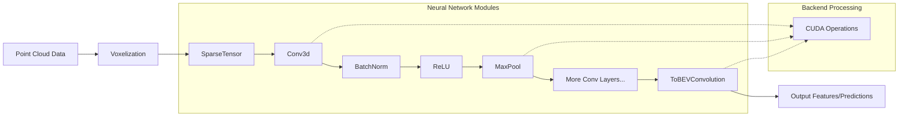
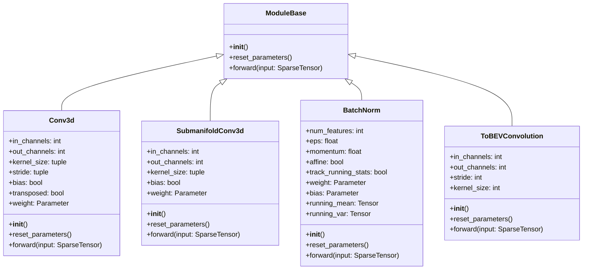
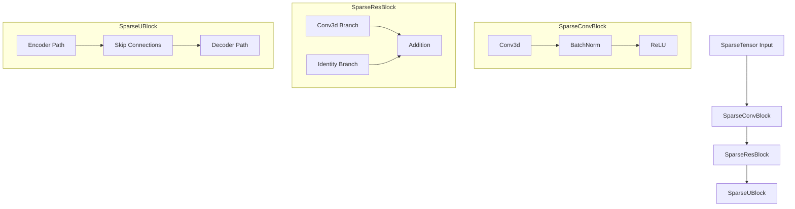
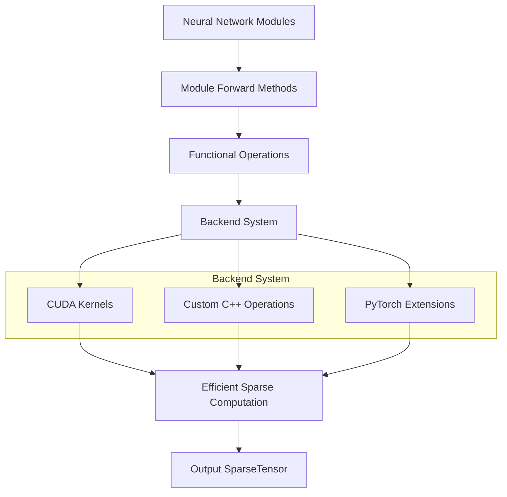
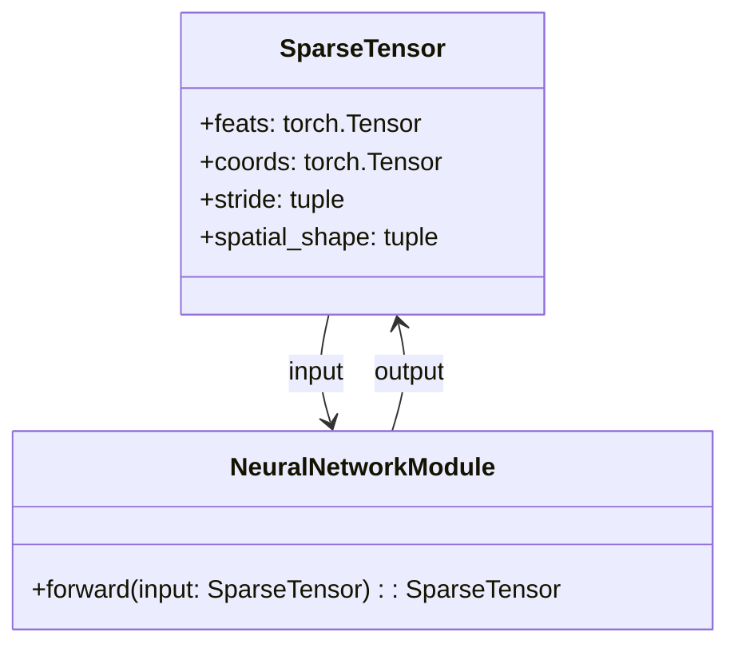

<!-- source: DeepWiki mcp.deepwiki.com · repo mit-han-lab/torchsparse · page 3 Neural Network Modules · fetched 2026-10-30 -->

# Neural Network Modules

<details>
<summary>Relevant source files</summary>

The following files were used as context for generating this wiki page:

- [torchsparse/nn/functional/__init__.py](torchsparse/nn/functional/__init__.py)
- [torchsparse/nn/modules/__init__.py](torchsparse/nn/modules/__init__.py)

</details>


## Purpose and Scope

This document provides an overview of the neural network modules available in TorchSparse for building efficient sparse 3D neural networks. These modules are specifically designed to operate on sparse tensors, enabling efficient processing of point cloud data while maintaining sparsity throughout the network.

For details on the underlying `SparseTensor` data structure that these modules operate on, see [SparseTensor Data Structure](#2.1). For information about functional operations like voxelization and hashing, see [Functional API](#4).

## Module Organization

TorchSparse organizes its neural network functionality into two primary components:

1. **Modules**: Class-based implementations following PyTorch's `nn.Module` pattern
2. **Functional**: Function-based implementations for operations that don't require persistent parameters

```mermaid
graph TD
    A["torchsparse.nn"] --> B["modules"]
    A --> C["functional"]
    
    B --> B1["conv (Convolution Layers)"]
    B --> B2["pooling (Pooling Operations)"]
    B --> B3["norm (Normalization Layers)"]
    B --> B4["bev (Bird's Eye View Operations)"]
    B --> B5["activation (Activation Functions)"]
    B --> B6["crop (Crop Operations)"]
    
    C --> C1["conv (Functional Convolution)"]
    C --> C2["pooling (Functional Pooling)"]
    C --> C3["activation (Functional Activation)"]
    C --> C4["devoxelize (Point Cloud Reconstruction)"]
    C --> C5["voxelize (Point Cloud Discretization)"]
    C --> C6["hash (Spatial Hashing)"]
    C --> C7["count (Point Counter)"]
    C --> C8["query (Spatial Querying)"]
    C --> C9["crop (Functional Crop)"]
```



Sources: [torchsparse/nn/modules/__init__.py](). [torchsparse/nn/functional/__init__.py]()

## Key Neural Network Module Categories

### 1. Convolution Operations

Sparse convolution is the core building block for processing point cloud data. TorchSparse provides efficient sparse convolution implementations optimized for 3D point cloud processing.

Key convolution modules:
- `Conv3d`: Standard 3D sparse convolution
- `SubmanifoldConv3d`: Submanifold sparse convolution (maintains sparsity pattern)
- `TransposeConv3d`: Transposed sparse convolution

For detailed information about convolution operations, see [Convolution Operations](#3.1).

### 2. Pooling Operations

Pooling operations aggregate features across spatial regions, enabling hierarchical feature extraction:

- `GlobalAvgPool`: Global average pooling over the entire sparse tensor
- `GlobalMaxPool`: Global maximum pooling over the entire sparse tensor
- `MaxPool`: Maximum pooling for sparse tensors

For detailed information about pooling operations, see [Pooling Operations](#3.3).

### 3. BEV (Bird's Eye View) Operations

BEV operations convert 3D sparse data to 2D representations, which is particularly useful for autonomous driving applications:

- `ToBEVReduction`: Reduces 3D sparse tensor to BEV by a reduction function (sum, mean, max)
- `ToBEVConvolution`: Combines reduction with convolution
- `ToDenseBEVConvolution`: Converts to dense BEV representation

For detailed information about BEV operations, see [BEV Operations](#3.2).

### 4. Normalization and Activation Layers

TorchSparse provides normalization and activation layers adapted for sparse tensors:

- `BatchNorm`: Batch normalization for sparse tensors
- `ReLU`, `LeakyReLU`: Activation functions for sparse tensors

For detailed information about normalization and activation layers, see [Normalization and Activation Layers](#3.4).

### 5. Other Operations

Additional operations for manipulating sparse tensors:
- `Crop`: Cropping operation for sparse tensors

## Data Flow Through Neural Network Modules

The following diagram illustrates how data typically flows through TorchSparse's neural network modules:



Sources: Based on the overall system architecture and neural network organization.

## Module Architecture and Implementation

TorchSparse's neural network modules follow a consistent architecture pattern:



Sources: Based on module organization and class patterns typical in TorchSparse.

## Usage Patterns

### Basic Usage Example

Neural network modules in TorchSparse operate directly on `SparseTensor` objects. Here's a typical usage pattern:

```
# Input: points (N, 3) coordinates and feats (N, C) features
coordinates = points[:, :3]
features = points[:, 3:]

# 1. Create a SparseTensor (via voxelization)
x = SparseTensor(features, coordinates)

# 2. Apply neural network modules
# Convolution
x = Conv3d(in_channels, out_channels, kernel_size=3, stride=1)(x)
# Batch Normalization
x = BatchNorm(out_channels)(x)
# Activation
x = ReLU()(x)
# Pooling (with downsampling)
x = MaxPool(kernel_size=2, stride=2)(x)

# 3. Convert to BEV for 2D processing if needed
bev_features = ToBEVConvolution(in_channels, out_channels, stride=1)(x)
```

### Module Composition

TorchSparse modules can be composed to create complex network architectures:



Sources: Based on typical neural network architecture patterns in point cloud processing.

## Integration with Backend System

TorchSparse modules rely on optimized CUDA kernels for efficient computation:



For more information about the backend implementation, see [Backend System](#2.2).

Sources: Based on the TorchSparse system architecture.

## Input/Output Data Structure

All neural network modules in TorchSparse operate on `SparseTensor` objects, maintaining sparsity throughout the computation:



Sources: Based on the SparseTensor data structure and module interfaces.

## Conclusion

The neural network modules in TorchSparse provide a comprehensive set of tools for building efficient sparse 3D neural networks for point cloud processing. These modules are designed to work seamlessly with the `SparseTensor` data structure, allowing for end-to-end sparse computation that significantly improves performance compared to dense operations.

For more detailed information about specific types of modules, refer to the dedicated wiki pages:
- [Convolution Operations](#3.1)
- [BEV Operations](#3.2)
- [Pooling Operations](#3.3)
- [Normalization and Activation Layers](#3.4)

---

