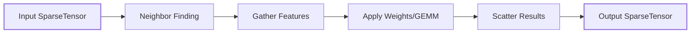
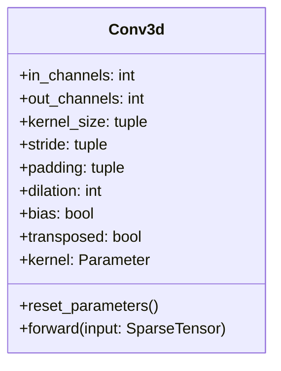
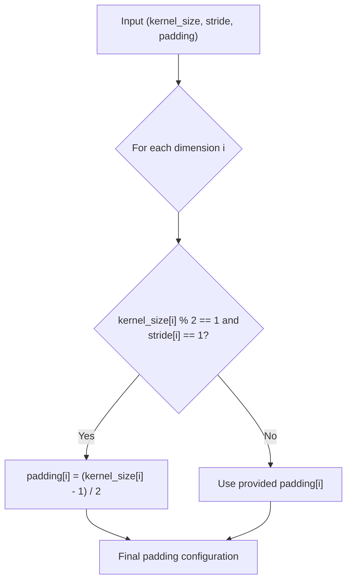
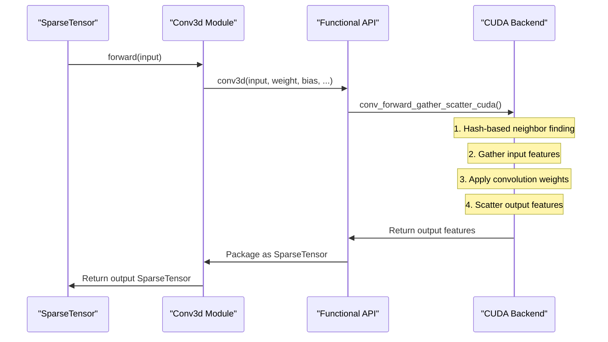
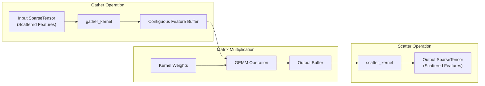
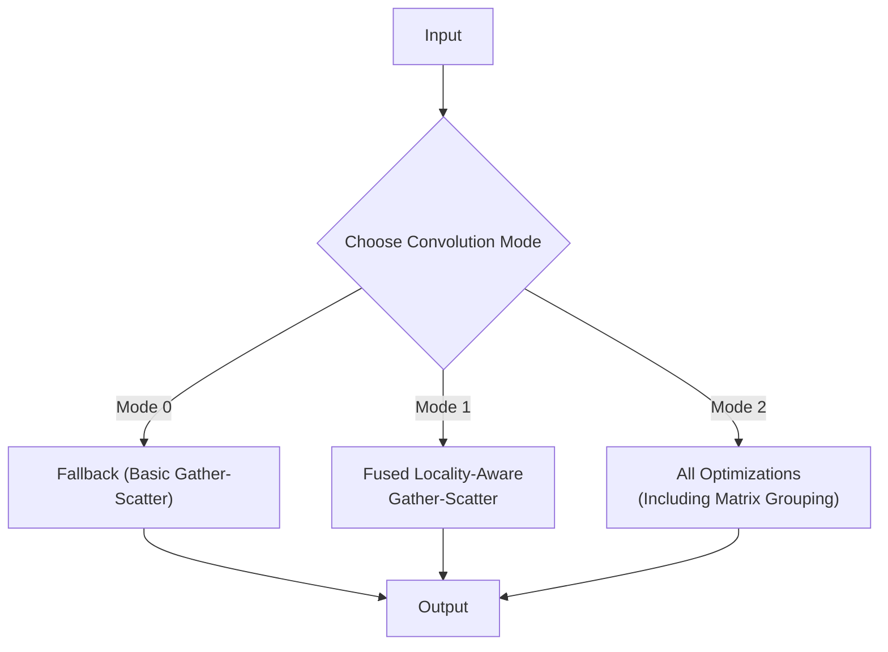
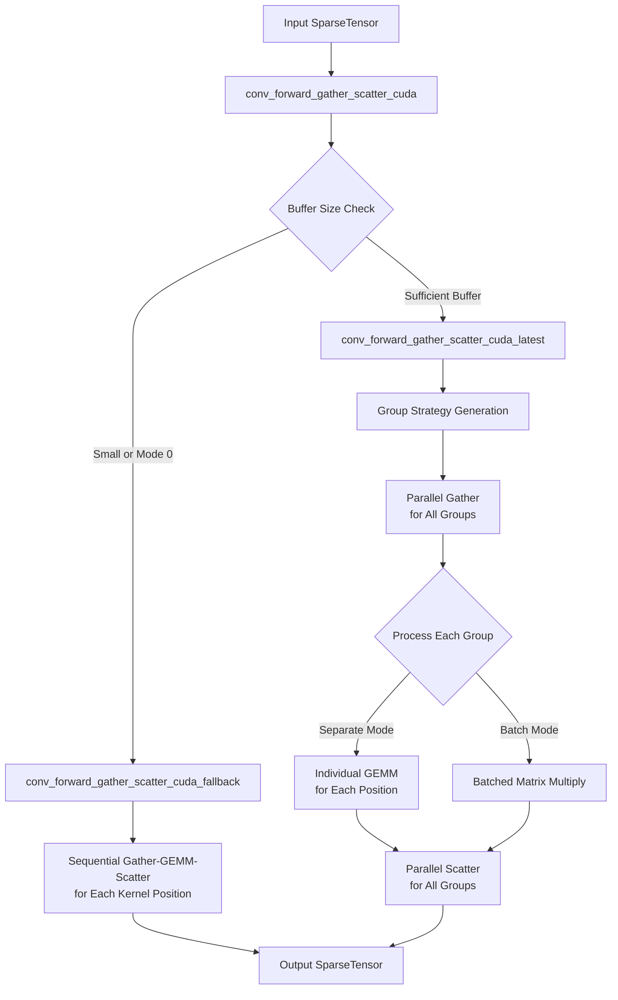

<!-- source: DeepWiki mcp.deepwiki.com · repo mit-han-lab/torchsparse · page 3.1 Convolution Operations · fetched 2026-10-30 -->

# Convolution Operations

<details>
<summary>Relevant source files</summary>

The following files were used as context for generating this wiki page:

- [requirements.txt](requirements.txt)
- [tests/python/test_single_layer_conv.py](tests/python/test_single_layer_conv.py)
- [tests/test.py](tests/test.py)
- [torchsparse/backend/convolution/convolution_gather_scatter_cuda.cu](torchsparse/backend/convolution/convolution_gather_scatter_cuda.cu)
- [torchsparse/backend/devoxelize/devoxelize_cuda.cu](torchsparse/backend/devoxelize/devoxelize_cuda.cu)
- [torchsparse/backend/voxelize/voxelize_cuda.cu](torchsparse/backend/voxelize/voxelize_cuda.cu)
- [torchsparse/nn/modules/conv.py](torchsparse/nn/modules/conv.py)

</details>


Convolution operations are core components of TorchSparse that enable efficient processing of sparse 3D point cloud data. This page describes the implementation and functionality of sparse convolutions in TorchSparse, including the Conv3d module, backend operations, and optimization mechanisms.

For information about pooling operations, see [Pooling Operations](#3.3). For BEV-specific operations, see [BEV Operations](#3.2).

## 1. Sparse Convolution Fundamentals

Sparse convolutions differ from dense convolutions by only computing values at active sites where data exists, dramatically reducing computation and memory usage for sparse point cloud data.



Sources: [torchsparse/nn/modules/conv.py:21-110]()

The key characteristics of sparse convolution in TorchSparse:

1. **Memory Efficiency**: Only processes non-zero elements
2. **Hash-based Implementation**: Uses hash tables to find neighbors quickly
3. **CUDA Acceleration**: Leverages optimized CUDA kernels for performance
4. **Multiple Kernel Size Support**: Works with various kernel sizes and strides

## 2. The Conv3d Module

The primary convolution operation in TorchSparse is the `Conv3d` module, which handles 3D sparse convolutions.



Sources: [torchsparse/nn/modules/conv.py:22-110]()

### 2.1 Initialization Parameters

The `Conv3d` module accepts the following parameters:

| Parameter | Type | Description |
|-----------|------|-------------|
| in_channels | int | Number of input feature channels |
| out_channels | int | Number of output feature channels |
| kernel_size | int or tuple | Size of the convolving kernel |
| stride | int or tuple | Stride of the convolution |
| padding | int or tuple | Zero-padding added to input boundaries |
| dilation | int | Spacing between kernel elements |
| bias | bool | If True, adds a learnable bias to the output |
| transposed | bool | If True, performs transposed convolution |
| generative | bool | If True and transposed, generates new coordinates |

Sources: [torchsparse/nn/modules/conv.py:23-51]()

### 2.2 Implementation Details

The kernel weights are stored as a parameter tensor with shape:
- `[kernel_volume, in_channels, out_channels]` for kernel_volume > 1
- `[in_channels, out_channels]` for 1×1×1 convolution

The module also handles padding calculation automatically for odd-sized kernels with stride=1:



Sources: [torchsparse/nn/modules/conv.py:42-48]()

## 3. Forward Operation

When a SparseTensor is passed through the Conv3d module, the forward operation performs several key steps:



Sources: [torchsparse/nn/modules/conv.py:96-110](), [torchsparse/backend/convolution/convolution_gather_scatter_cuda.cu:279-814]()

The actual convolution process involves:

1. **Neighbor Finding**: Identifying neighboring points for each output point
2. **Gathering**: Collecting scattered input features into a contiguous buffer
3. **Convolution**: Matrix multiplication of gathered features with kernel weights
4. **Scattering**: Distributing the results back to the sparse output tensor

## 4. Backend Implementation

The backend implementation uses CUDA kernels for efficiency, with two main approaches:

### 4.1 Gather-Scatter Pattern



Sources: [torchsparse/backend/convolution/convolution_gather_scatter_cuda.cu:17-66](), [torchsparse/backend/convolution/convolution_gather_scatter_cuda.cu:681-814]()

The gather-scatter pattern:
- **Gather**: Collects features from non-contiguous memory locations into a contiguous buffer
- **Matrix Multiplication**: Applies convolution weights to the gathered features
- **Scatter**: Distributes results back to non-contiguous memory locations

### 4.2 Optimization Techniques

TorchSparse implements several optimizations for sparse convolutions:

1. **Fused Gather-Scatter**: Combines gather and scatter operations to reduce memory transfers
2. **Adaptive Matrix Multiplication Grouping**: Groups computations to reduce redundant work
3. **Precomputation for Central Weights**: For identity mapping in kernel center
4. **Memory Padding**: Ensures alignment for efficient GPU operations



Sources: [torchsparse/backend/convolution/convolution_gather_scatter_cuda.cu:272-310]()

## 5. Performance Configurations

TorchSparse offers configuration options to tune convolution performance:

| Parameter | Description |
|-----------|-------------|
| epsilon | Tolerance for redundant computation in matrix grouping |
| mm_thresh | Threshold for matrix multiplication workload size |
| conv_mode | Backend implementation selection (0, 1, or 2) |
| precompute_mid | Whether to precompute central kernel weights |

These options allow users to balance performance, memory usage, and computational efficiency.

Sources: [torchsparse/backend/convolution/convolution_gather_scatter_cuda.cu:266-278](), [tests/python/test_single_layer_conv.py:227-232]()

## 6. Usage Example

Here is a simple example of how to use Conv3d in a network:

```python
# Create a sparse convolutional layer
conv = spnn.Conv3d(
    in_channels=16,
    out_channels=32,
    kernel_size=3,
    stride=1,
    padding=1
)

# Apply to a SparseTensor
input_tensor = torchsparse.SparseTensor(features, coordinates)
output_tensor = conv(input_tensor)
```

A complete implementation example can be found in the test files, where convolution is tested against dense implementation for validation.

Sources: [tests/python/test_single_layer_conv.py:17-52](), [tests/python/test_single_layer_conv.py:138-202]()

## 7. Backend Data Flow

The data flow through the convolution backend shows how features are processed:



Sources: [torchsparse/backend/convolution/convolution_gather_scatter_cuda.cu:279-814]()

This implementation allows TorchSparse to handle sparse convolutions efficiently by:
1. Choosing the appropriate backend based on buffer size and configuration
2. Grouping similar operations to reduce redundant computation
3. Utilizing CUDA parallelism for gather and scatter operations
4. Optimizing memory access patterns

---

