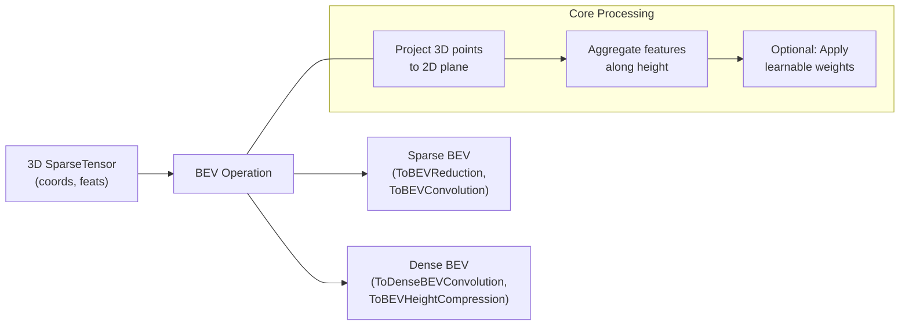
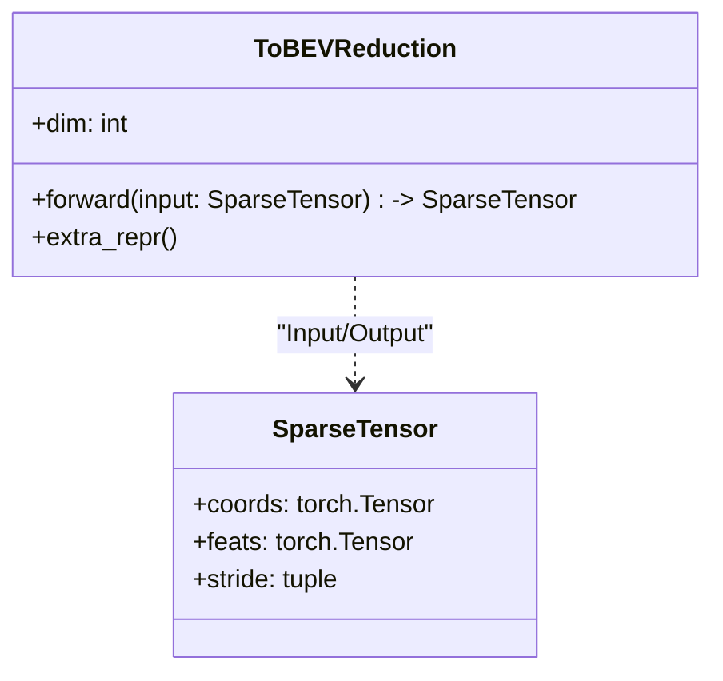
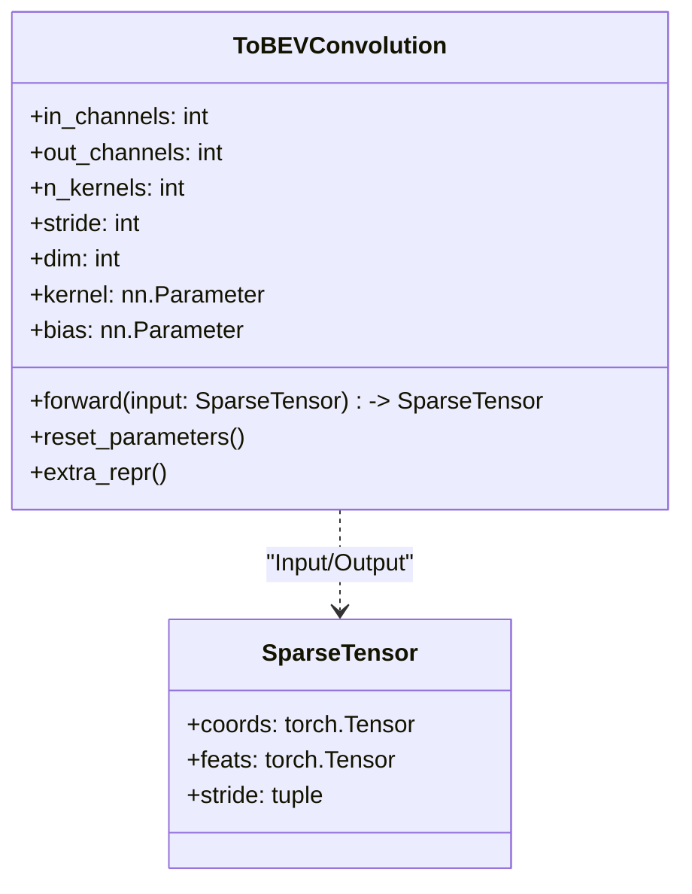
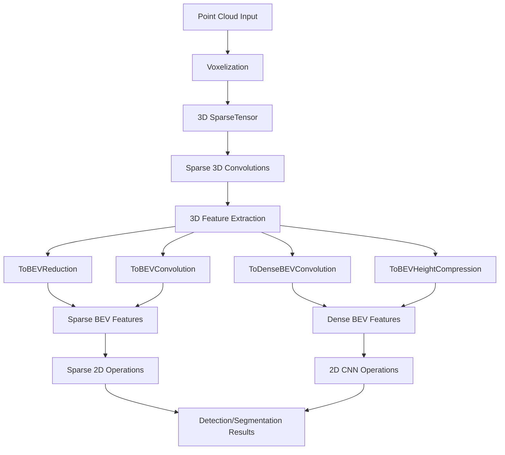

<!-- source: DeepWiki mcp.deepwiki.com · repo mit-han-lab/torchsparse · page 3.2 BEV (Bird's Eye View) Operations · fetched 2026-10-30 -->

# BEV (Bird's Eye View) Operations

<details>
<summary>Relevant source files</summary>

The following files were used as context for generating this wiki page:

- [torchsparse/nn/modules/bev.py](torchsparse/nn/modules/bev.py)

</details>


## Introduction

Bird's Eye View (BEV) operations transform 3D point cloud data into 2D top-down representations, which are essential for tasks such as autonomous driving, object detection, and scene understanding. TorchSparse provides specialized modules to efficiently convert sparse 3D tensor data into BEV feature maps, enabling seamless integration of 3D point cloud processing with 2D convolutional networks.

For information about Convolution Operations, see [Convolution Operations](#3.1).

Sources: [torchsparse/nn/modules/bev.py:1-14]()

## Overview of BEV Operations

TorchSparse implements four primary BEV transformation modules:

| Module | Description | Output Type | Memory Usage |
|--------|-------------|-------------|-------------|
| `ToBEVReduction` | Simple reduction along height dimension | SparseTensor | Low |
| `ToBEVConvolution` | Applies learned weights based on height values | SparseTensor | Medium |
| `ToDenseBEVConvolution` | Converts to dense BEV feature map with learned weights | Dense Tensor | High |
| `ToBEVHeightCompression` | Preserves height information in channel dimension | Dense Tensor | Medium |

These modules provide different trade-offs between feature representation power, memory consumption, and computational efficiency.

Sources: [torchsparse/nn/modules/bev.py:9-14]()

## BEV Transformation Process

The following diagram illustrates the general process of converting a 3D sparse point cloud into a 2D BEV representation:



Sources: [torchsparse/nn/modules/bev.py:17-222]()

## BEV Module Implementations

### ToBEVReduction

`ToBEVReduction` performs a simple average pooling operation along the height dimension to create a bird's eye view representation while maintaining the sparse tensor format.



**Key Operations:**
1. Set all coordinates along the specified dimension (default: dim=1) to zero
2. Concatenate a ones tensor to the features for normalization
3. Create a sparse tensor and convert to dense for aggregation
4. Normalize features by dividing by the count
5. Return a new SparseTensor with BEV coordinates and aggregated features

**Usage Example:**
```python
bev_reduction = ToBEVReduction(dim=1)  # Height dimension (z-axis in KITTI)
bev_features = bev_reduction(sparse_3d_tensor)
```

Sources: [torchsparse/nn/modules/bev.py:17-34]()

### ToBEVConvolution

`ToBEVConvolution` transforms a 3D SparseTensor into a sparse BEV representation while applying learnable weights based on the height values. It maintains the sparse representation in the output.



**Key Operations:**
1. Apply different kernels based on the height (z-coordinate) values
2. Set height coordinates to zero to create BEV projection
3. Optionally downsample in the x-y plane if stride > 1
4. Aggregate features within the same BEV grid cell
5. Return a new SparseTensor with BEV coordinates and transformed features

Sources: [torchsparse/nn/modules/bev.py:114-161]()

### ToDenseBEVConvolution

`ToDenseBEVConvolution` converts a 3D SparseTensor into a dense 2D BEV feature map, applying learnable weights based on height values. This is useful for integrating with 2D CNN architectures.

```mermaid
classDiagram
    class ToDenseBEVConvolution {
        +in_channels: int
        +out_channels: int
        +shape: torch.Tensor
        +offset: torch.Tensor
        +dim: int
        +n_kernels: int
        +bev_dims: list
        +bev_shape: torch.Tensor
        +kernel: nn.Parameter
        +bias: nn.Parameter
        +forward(input: SparseTensor) -> torch.Tensor
        +reset_parameters()
        +extra_repr()
    }
    
    class SparseTensor {
        +coords: torch.Tensor
        +feats: torch.Tensor
        +stride: tuple
    }
    
    ToDenseBEVConvolution ..> SparseTensor : "Input"
    ToDenseBEVConvolution ..> "torch.Tensor" : "Output"
```

**Key Operations:**
1. Group points with the same height value and apply corresponding FC kernel
2. Project points to the BEV plane by dividing by stride
3. Create sparse tensor and convert to dense
4. Reshape output to [batch_size, channels, height, width] format

**Note:** This module consumes more memory than `ToBEVHeightCompression` but allows for learned feature transformation.

Sources: [torchsparse/nn/modules/bev.py:37-111]()

### ToBEVHeightCompression

`ToBEVHeightCompression` creates a dense BEV representation that preserves height information by flattening it into the channel dimension. This approach is more memory-efficient than `ToDenseBEVConvolution`.

```mermaid
classDiagram
    class ToBEVHeightCompression {
        +channels: int
        +shape: torch.Tensor
        +offset: torch.Tensor
        +dim: int
        +bev_dims: list
        +bev_shape: torch.Tensor
        +forward(input: SparseTensor) -> torch.Tensor
        +extra_repr()
    }
    
    class SparseTensor {
        +coords: torch.Tensor
        +feats: torch.Tensor
        +stride: tuple
    }
    
    ToBEVHeightCompression ..> SparseTensor : "Input"
    ToBEVHeightCompression ..> "torch.Tensor" : "Output"
```

**Key Operations:**
1. Project 3D coordinates to BEV plane while preserving height index
2. Clamp height values to valid range
3. Compute flattened indices for sparse tensor creation
4. Convert to dense and reshape to [batch_size, channels×height_values, width, length]

**Note:** The output channels equal the input channels multiplied by the number of discretized height values.

Sources: [torchsparse/nn/modules/bev.py:163-222]()

## Architectural Data Flow

The following diagram shows how BEV operations fit into a typical 3D point cloud processing pipeline:



Sources: [torchsparse/nn/modules/bev.py:17-222]()

## Performance Considerations

When choosing a BEV operation module, consider these trade-offs:

| Module | Pros | Cons | Best For |
|--------|------|------|----------|
| `ToBEVReduction` | Memory efficient, Fast | Simple averaging only | Basic feature aggregation |
| `ToBEVConvolution` | Learnable weights, Sparse output | Limited feature transformation | Memory-constrained applications |
| `ToDenseBEVConvolution` | Powerful feature transformation | High memory usage | Rich feature extraction |
| `ToBEVHeightCompression` | Preserves height information | Increases channel dimension | Height-aware detection |

The BEV operation choice can significantly impact both memory usage and downstream task performance. For memory-constrained environments, sparse outputs (`ToBEVReduction`, `ToBEVConvolution`) are preferred, while feature-rich tasks may benefit from dense outputs (`ToDenseBEVConvolution`, `ToBEVHeightCompression`).

Sources: [torchsparse/nn/modules/bev.py:37-44](), [torchsparse/nn/modules/bev.py:163-172]()

## Implementation Details

The BEV operation modules make extensive use of PyTorch's sparse tensor functionality. The height dimension (typically z-axis, represented by `dim=1` in KITTI coordinate system) is the primary axis for feature aggregation or transformation.

```mermaid
classDiagram
    class "nn.Module" {
        +forward()
    }
    
    class "BEV Operations" {
        +forward(input: SparseTensor)
    }
    
    "nn.Module" <|-- "BEV Operations"
    "BEV Operations" <|-- "ToBEVReduction"
    "BEV Operations" <|-- "ToBEVConvolution"
    "BEV Operations" <|-- "ToDenseBEVConvolution"
    "BEV Operations" <|-- "ToBEVHeightCompression"
```

All BEV operations extend `nn.Module` and implement the `forward` method that takes a `SparseTensor` as input. The output format varies depending on the specific operation.

Sources: [torchsparse/nn/modules/bev.py:17-222]()

---

