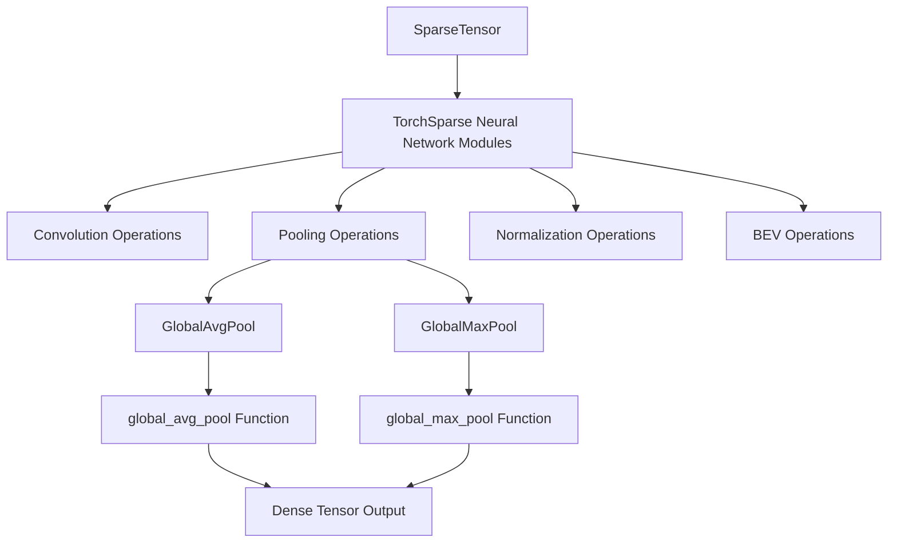
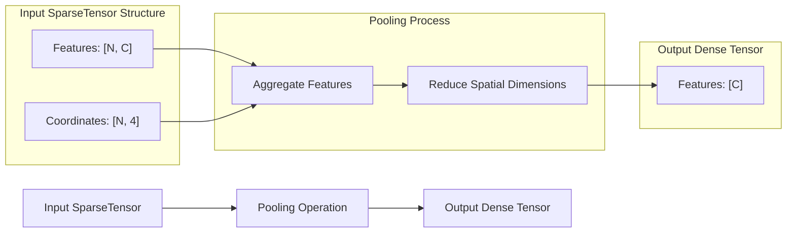

<!-- source: DeepWiki mcp.deepwiki.com · repo mit-han-lab/torchsparse · page 3.3 Pooling Operations · fetched 2026-10-30 -->

# Pooling Operations

<details>
<summary>Relevant source files</summary>

The following files were used as context for generating this wiki page:

- [torchsparse/nn/modules/__init__.py](torchsparse/nn/modules/__init__.py)
- [torchsparse/nn/modules/pooling.py](torchsparse/nn/modules/pooling.py)

</details>


Pooling operations in TorchSparse provide mechanisms for aggregating features from sparse point cloud data. These operations transform `SparseTensor` objects into dense tensors by applying statistical aggregation functions across all points, collapsing the spatial dimensions while preserving feature channels.

Unlike traditional pooling in dense neural networks, TorchSparse's pooling operations are specifically designed for sparse tensors representing point clouds. They serve as an essential bridge between the sparse convolutional layers and dense layers (like fully connected layers) used in classification or other downstream tasks.

For information about other neural network operations in TorchSparse, see:
- [Convolution Operations](#3.1)
- [BEV Operations](#3.2)
- [Normalization and Activation Layers](#3.4)

## Available Pooling Operations

TorchSparse provides two global pooling operations:

| Operation | Description | Input | Output |
|-----------|-------------|-------|--------|
| `GlobalAvgPool` | Computes the average of features across all points | `SparseTensor[N, C]` | `torch.Tensor[C]` |
| `GlobalMaxPool` | Computes the maximum value for each feature across all points | `SparseTensor[N, C]` | `torch.Tensor[C]` |

Both operations reduce a `SparseTensor` with shape `[N, C]` (where N is the number of points and C is the number of channels) to a dense tensor with shape `[C]`, effectively computing a single value per feature channel.

Sources: [torchsparse/nn/modules/pooling.py:10-17]()

## Implementation Details

The pooling modules in TorchSparse are implemented as lightweight wrappers around functional APIs. Each module's `forward` method simply delegates to the corresponding function from `torchsparse.nn.functional`:

- `GlobalAvgPool.forward(input)` calls `F.global_avg_pool(input)`
- `GlobalMaxPool.forward(input)` calls `F.global_max_pool(input)`

This design follows PyTorch's convention of providing both module-based and functional interfaces for operations, allowing flexibility in how these operations are used.

Sources: [torchsparse/nn/modules/pooling.py:10-17]()

## Pooling in Neural Networks

Global pooling operations are typically used in the later stages of neural networks, after several sparse convolution layers have processed the point cloud data. They serve as a transition from spatial feature maps to global feature vectors.

### TorchSparse Pooling Architecture



Sources: [torchsparse/nn/modules/__init__.py:1-6](), [torchsparse/nn/modules/pooling.py:7-17]()

## Data Flow Through Pooling Operations

The following diagram illustrates how data flows through the pooling operations, transforming from a sparse representation to a dense feature vector:



Sources: [torchsparse/nn/modules/pooling.py:10-17]()

## Code Structure of Pooling Operations

The following class diagram illustrates the relationship between the pooling classes and their dependencies:

```mermaid
classDiagram
    class SparseTensor {
        +feats: torch.Tensor
        +coords: torch.Tensor
        +stride: Tuple[int, ...]
        +spatial_range: Tuple[int, ...]
    }
    
    class GlobalAvgPool {
        +forward(input: SparseTensor): torch.Tensor
    }
    
    class GlobalMaxPool {
        +forward(input: SparseTensor): torch.Tensor
    }
    
    class FunctionalAPI {
        +global_avg_pool(input: SparseTensor): torch.Tensor
        +global_max_pool(input: SparseTensor): torch.Tensor
    }
    
    SparseTensor --> GlobalAvgPool: "input to"
    SparseTensor --> GlobalMaxPool: "input to"
    GlobalAvgPool --> FunctionalAPI: "calls"
    GlobalMaxPool --> FunctionalAPI: "calls"
    FunctionalAPI --> "torch.Tensor": "returns"
```

Sources: [torchsparse/nn/modules/pooling.py:1-17]()

## Usage Example

Here's how pooling operations would typically be used in a point cloud classification network:

```python
class PointCloudClassifier(nn.Module):
    def __init__(self, in_channels, num_classes):
        super().__init__()
        self.conv1 = torchsparse.nn.Conv3d(in_channels, 64, kernel_size=3)
        self.conv2 = torchsparse.nn.Conv3d(64, 128, kernel_size=3)
        self.global_pool = torchsparse.nn.GlobalMaxPool()  # Global pooling layer
        self.fc = nn.Linear(128, num_classes)
        
    def forward(self, x):
        # x is a SparseTensor
        x = self.conv1(x)
        x = self.conv2(x)
        # Apply global pooling to get a feature vector
        features = self.global_pool(x)  # features is a dense tensor with shape [batch_size, 128]
        # Pass through fully connected layer for classification
        return self.fc(features)
```

By using global pooling operations, the network can effectively transition from processing sparse spatial data to making predictions based on global features.

Sources: [torchsparse/nn/modules/pooling.py:1-17]()

---

