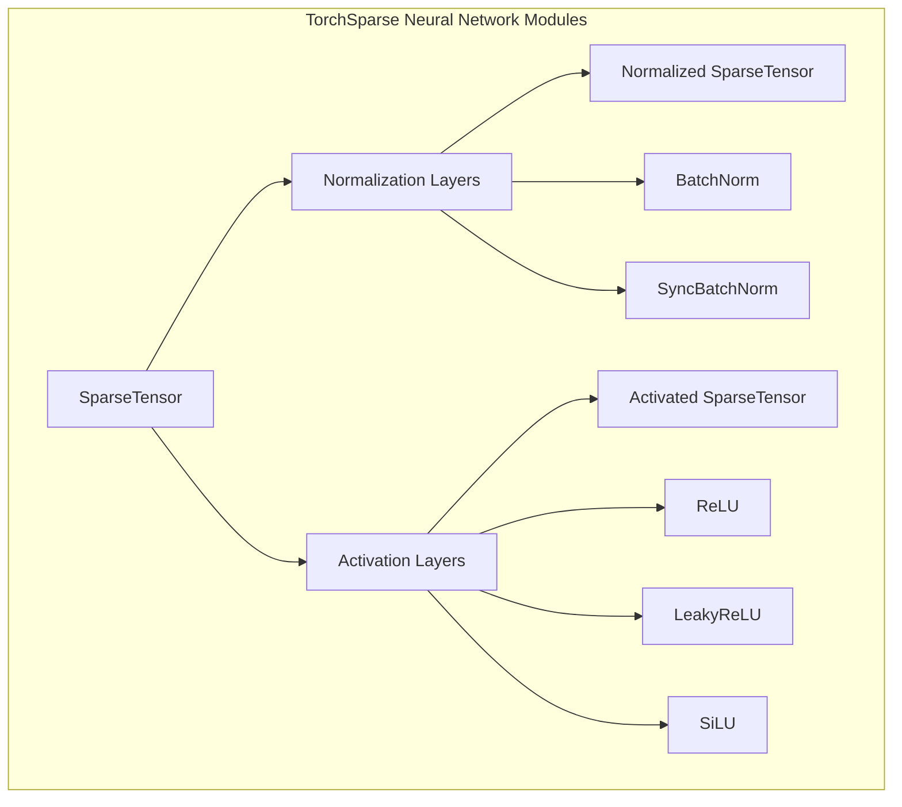
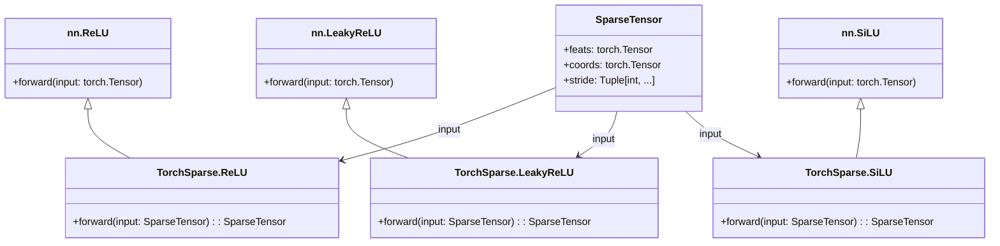
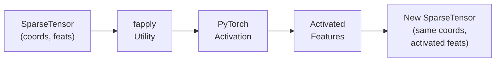
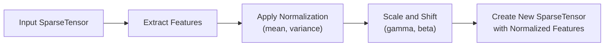
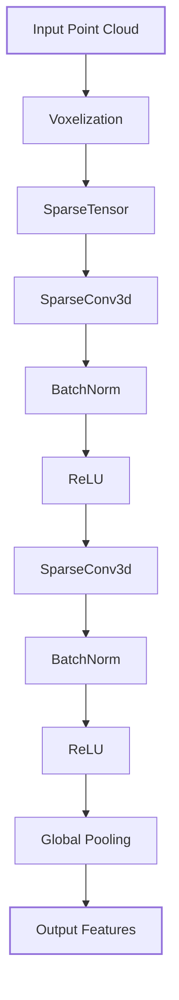

<!-- source: DeepWiki mcp.deepwiki.com · repo mit-han-lab/torchsparse · page 3.4 Normalization and Activation Layers · fetched 2026-10-30 -->

# Normalization and Activation Layers

<details>
<summary>Relevant source files</summary>

The following files were used as context for generating this wiki page:

- [torchsparse/nn/functional/count.py](torchsparse/nn/functional/count.py)
- [torchsparse/nn/functional/hash.py](torchsparse/nn/functional/hash.py)
- [torchsparse/nn/functional/query.py](torchsparse/nn/functional/query.py)
- [torchsparse/nn/modules/__init__.py](torchsparse/nn/modules/__init__.py)
- [torchsparse/nn/modules/activation.py](torchsparse/nn/modules/activation.py)

</details>


## Purpose and Scope

This document covers the normalization and activation layers implemented in TorchSparse for processing sparse tensors. These layers adapt standard PyTorch normalization and activation functions to work with the `SparseTensor` data structure. For information about convolutional operations, see [Convolution Operations](#3.1), and for pooling operations, see [Pooling Operations](#3.3).

## Overview

Normalization and activation layers are essential components in neural networks for processing point cloud data. In TorchSparse, these operations are designed to directly work with the sparse representation, allowing efficient computation by only processing non-zero elements.



Sources: [torchsparse/nn/modules/__init__.py:1-6](), [torchsparse/nn/modules/activation.py:1-22]()

## Activation Layers

TorchSparse provides sparse-compatible versions of common PyTorch activation functions, including ReLU, LeakyReLU, and SiLU (also known as Swish).

### Implementation Architecture

Each activation layer in TorchSparse follows a consistent pattern:

1. It inherits from the corresponding PyTorch nn module
2. It overrides the `forward` method to handle `SparseTensor` inputs
3. It applies the underlying PyTorch activation function to the features of the `SparseTensor` using the `fapply` utility



Sources: [torchsparse/nn/modules/activation.py:1-22]()

### Available Activation Functions

| Class | Description | Implementation |
|-------|-------------|----------------|
| `ReLU` | Rectified Linear Unit activation | Inherits from `nn.ReLU` |
| `LeakyReLU` | Leaky Rectified Linear Unit with a small slope for negative input | Inherits from `nn.LeakyReLU` |
| `SiLU` | Sigmoid Linear Unit (Swish) activation | Inherits from `nn.SiLU` |

Sources: [torchsparse/nn/modules/activation.py:9-21]()

### Working with SparseTensor

The key to understanding these activation layers is how they operate on `SparseTensor` instances. The `fapply` utility function is used to apply standard PyTorch operations to the features of a `SparseTensor` while preserving the sparse structure:



Sources: [torchsparse/nn/modules/activation.py:9-21]()

## Normalization Layers

TorchSparse includes sparse-compatible normalization layers that adapt standard PyTorch normalization functions for sparse data. The implementation follows a similar pattern to the activation layers.

### Available Normalization Layers

Based on the import in the `__init__.py` file, TorchSparse provides normalization layers for sparse tensors. These likely include:

- `BatchNorm`: Batch normalization for sparse tensors
- `SyncBatchNorm`: Synchronized batch normalization for multi-GPU training

These normalization layers are critical for stabilizing and accelerating training of deep neural networks that process sparse point cloud data.

Sources: [torchsparse/nn/modules/__init__.py:5]()

### Normalization Operation Flow



Sources: [torchsparse/nn/modules/__init__.py:5]()

## Usage Examples

### Using Activation Layers

```python
import torch
from torchsparse import SparseTensor
from torchsparse.nn.modules import ReLU, LeakyReLU, SiLU

# Create a sparse tensor
feats = torch.randn(100, 32)  # 100 points with 32 features each
coords = torch.randint(0, 100, (100, 4))  # Batch index + 3D coordinates
input_tensor = SparseTensor(feats=feats, coords=coords)

# Apply activation functions
relu = ReLU()
leaky_relu = LeakyReLU(negative_slope=0.1)
silu = SiLU()

output_relu = relu(input_tensor)  # Apply ReLU to sparse tensor
output_leaky = leaky_relu(input_tensor)  # Apply LeakyReLU to sparse tensor
output_silu = silu(input_tensor)  # Apply SiLU to sparse tensor
```

### Using Normalization Layers

```python
import torch
from torchsparse import SparseTensor
from torchsparse.nn.modules import BatchNorm

# Create a sparse tensor
feats = torch.randn(100, 32)  # 100 points with 32 features each
coords = torch.randint(0, 100, (100, 4))  # Batch index + 3D coordinates
input_tensor = SparseTensor(feats=feats, coords=coords)

# Apply batch normalization
bn = BatchNorm(32)  # 32 is the number of features
normalized_tensor = bn(input_tensor)
```

## Integration with Neural Network Pipelines

Normalization and activation layers are typically used in combination with convolution and pooling operations to build complete neural networks for point cloud processing.



Sources: [torchsparse/nn/modules/__init__.py:1-6](), [torchsparse/nn/modules/activation.py:1-22]()

## Performance Considerations

- Normalization and activation operations in TorchSparse are optimized to work efficiently with sparse data
- They only compute values for non-zero elements, which can significantly reduce computation time compared to dense operations
- The implementation leverages the underlying PyTorch operations, ensuring compatibility with PyTorch's automatic differentiation system

## Summary

TorchSparse's normalization and activation layers adapt standard neural network components to work efficiently with sparse point cloud data. By inheriting from PyTorch's implementation and adding sparse tensor compatibility, these layers provide essential functionality for building deep learning models for 3D perception tasks.

Sources: [torchsparse/nn/modules/__init__.py:1-6](), [torchsparse/nn/modules/activation.py:1-22]()

---

