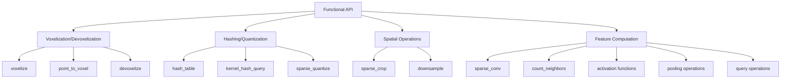
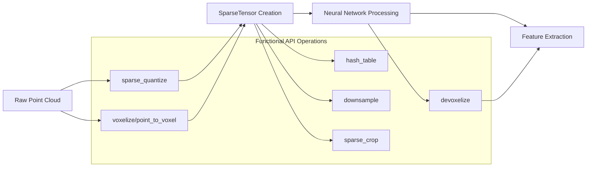
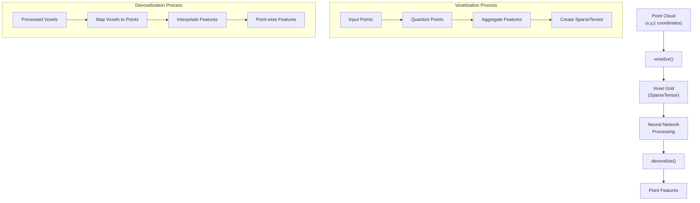
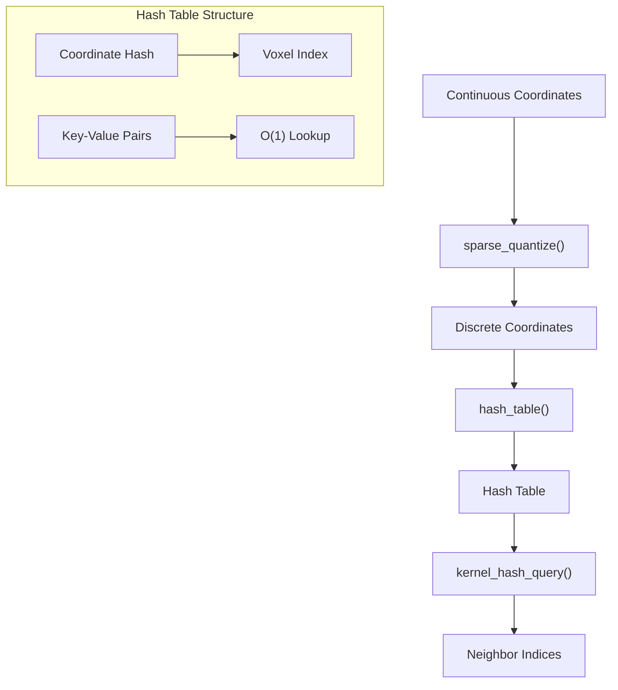
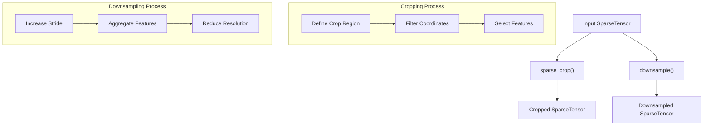
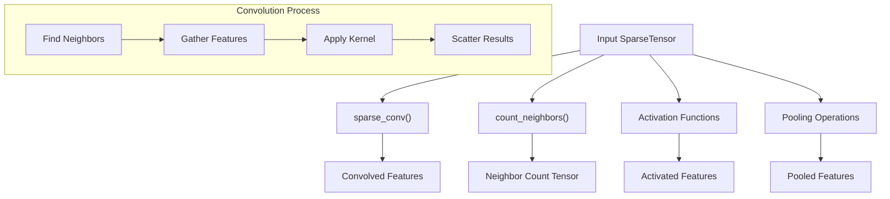
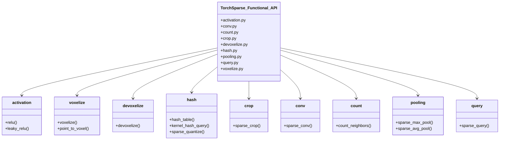
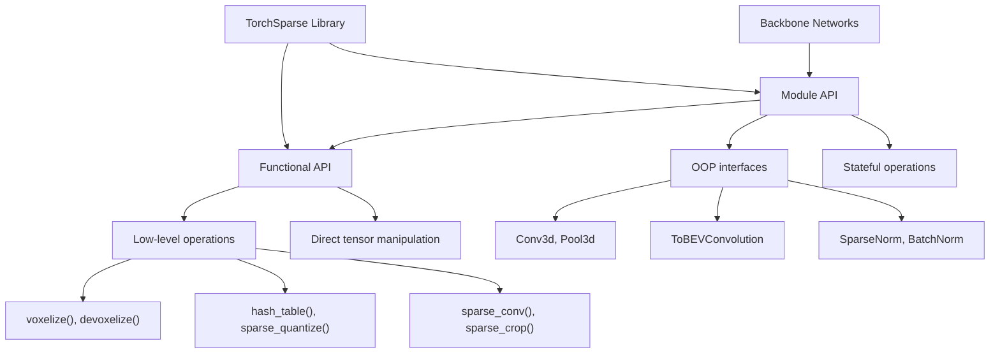

<!-- source: DeepWiki mcp.deepwiki.com · repo mit-han-lab/torchsparse · page 4 Functional API · fetched 2026-10-30 -->

# Functional API

Relevant source files

The following files were used as context for generating this wiki page:

- [torchsparse/nn/functional/__init__.py](torchsparse/nn/functional/__init__.py)

## Purpose and Scope

The Functional API in TorchSparse provides low-level operations for manipulating point cloud data and sparse tensors. These functions serve as the foundational building blocks upon which the higher-level neural network modules are built. The Functional API enables efficient point cloud processing through operations such as voxelization, devoxelization, hashing, and quantization.

For information about neural network modules that use these functional operations, see [Neural Network Modules](#3). For details about the SparseTensor data structure that these functions operate on, see [SparseTensor Data Structure](#2.1).

Sources: [torchsparse/nn/functional/__init__.py:1-10]()

## Functional Operations Overview

The Functional API includes several categories of operations that can be directly applied to point clouds and sparse tensors:

These functional operations form the foundation of TorchSparse's processing capabilities, allowing for efficient manipulation of sparse 3D data.

Sources: [torchsparse/nn/functional/__init__.py:1-10]()

## Relation to Processing Pipeline

In the TorchSparse processing pipeline, functional operations are applied at different stages:

The diagram shows how functional operations are used throughout the point cloud processing workflow, from initial quantization to final feature extraction.

Sources: [torchsparse/nn/functional/__init__.py:1-10]()

## Core Functional Operations

### Voxelization and Devoxelization

Voxelization converts continuous point cloud data into a discrete voxel grid representation, while devoxelization performs the reverse operation.

Voxelization functions include:
- `voxelize`: Converts points to voxels
- `point_to_voxel`: Maps points to voxel indices
- `devoxelize`: Converts voxels back to point features

Sources: [torchsparse/nn/functional/__init__.py:5-9]()

### Hashing and Quantization

Hashing and quantization are fundamental operations for efficient sparse tensor processing. These functions enable fast neighbor finding and coordinate space discretization.

Key hashing and quantization functions:
- `sparse_quantize`: Discretizes continuous coordinates
- `hash_table`: Creates a hash table for fast coordinate lookup
- `kernel_hash_query`: Queries the hash table for neighbor finding

Sources: [torchsparse/nn/functional/__init__.py:6]()

### Spatial Operations

Spatial operations manipulate the geometry of sparse tensors through operations like cropping and downsampling.

Key spatial operations:
- `sparse_crop`: Extracts a spatial region from a sparse tensor
- `downsample`: Reduces the resolution of a sparse tensor by increasing stride

Sources: [torchsparse/nn/functional/__init__.py:4]()

## Feature Computation Operations

Feature computation operations process the features of sparse tensors without changing their spatial structure.

Feature computation functions include:
- Sparse convolution operations
- Activation functions (ReLU, LeakyReLU, etc.)
- Pooling operations (max pooling, average pooling)
- Count operations for neighborhood analysis

Sources: [torchsparse/nn/functional/__init__.py:1-3]()

## Code Structure and Organization

The functional API is organized into several Python modules within the TorchSparse codebase:

Each module in the functional API contains related operations and is imported through the `__init__.py` file to provide a unified interface.

Sources: [torchsparse/nn/functional/__init__.py:1-10]()

## Functional API vs. Module API

The TorchSparse library provides both a functional API and a module API. The relationship between them is illustrated below:

The functional API provides the core building blocks that are used by the module API to implement higher-level neural network components.

| API Type | Characteristics | Example Operations | Usage Context |
|----------|----------------|-------------------|---------------|
| Functional API | Stateless, Pure functions | `voxelize()`, `sparse_quantize()` | Direct tensor manipulation, Custom operations |
| Module API | Stateful, OOP interfaces | `Conv3d`, `Pool3d` | Neural network building, Training loops |

Sources: [torchsparse/nn/functional/__init__.py:1-10]()

## Summary

The TorchSparse Functional API provides the fundamental operations needed for efficient point cloud processing. These operations include:

1. Voxelization and devoxelization for converting between point clouds and voxel grids
2. Hashing and quantization for efficient neighbor finding and coordinate processing
3. Spatial operations like cropping and downsampling for manipulating tensor geometry
4. Feature computation operations for processing sparse tensor features

These functional operations form the foundation upon which the higher-level neural network modules are built. For more detailed information on specific operations, refer to the dedicated pages:
- [Voxelization and Devoxelization](#4.1)
- [Hashing and Quantization](#4.2)
- [Downsampling and Cropping](#4.3)

Sources: [torchsparse/nn/functional/__init__.py:1-10]()

---

