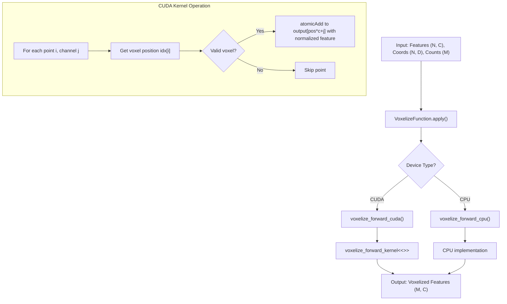
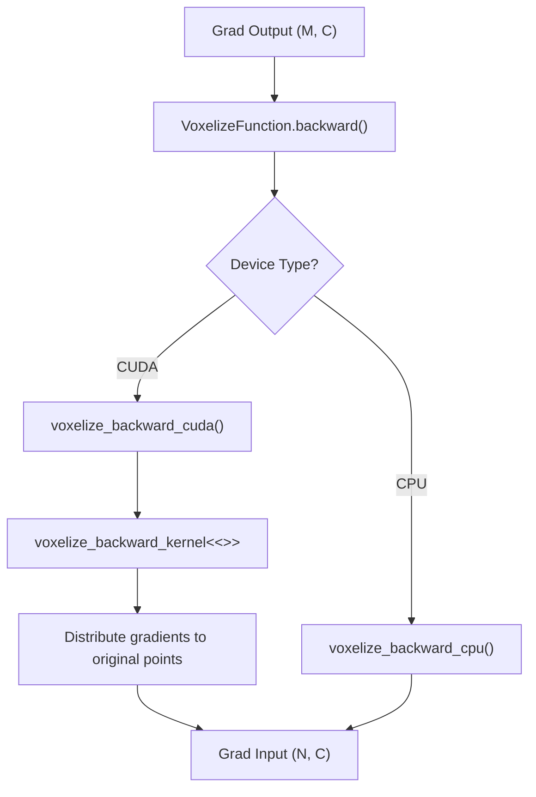
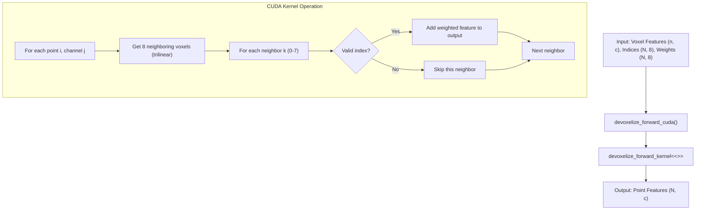
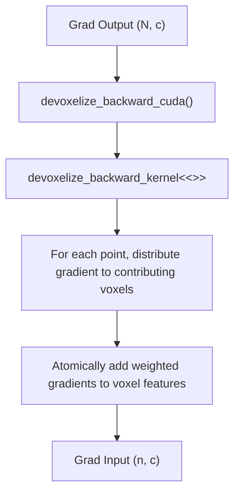
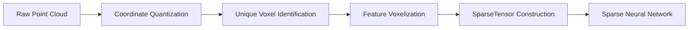

<!-- source: DeepWiki mcp.deepwiki.com · repo mit-han-lab/torchsparse · page 4.1 Voxelization and Devoxelization · fetched 2026-10-30 -->

# Voxelization and Devoxelization

<details>
<summary>Relevant source files</summary>

The following files were used as context for generating this wiki page:

- [torchsparse/backend/convolution/convolution_gather_scatter_cuda.cu](torchsparse/backend/convolution/convolution_gather_scatter_cuda.cu)
- [torchsparse/backend/devoxelize/devoxelize_cuda.cu](torchsparse/backend/devoxelize/devoxelize_cuda.cu)
- [torchsparse/backend/voxelize/voxelize_cuda.cu](torchsparse/backend/voxelize/voxelize_cuda.cu)
- [torchsparse/nn/functional/voxelize.py](torchsparse/nn/functional/voxelize.py)

</details>


## Introduction

Voxelization and devoxelization are fundamental operations in point cloud processing that convert between continuous point representations and discretized voxel grid representations. In TorchSparse, these operations form the bridge between raw point cloud data and the `SparseTensor` data structure (see [SparseTensor Data Structure](#2.1)), enabling efficient sparse convolution networks.

This document explains the implementation, usage, and technical details of voxelization and devoxelization in TorchSparse.

Sources: [torchsparse/nn/functional/voxelize.py:1-60]()

## Overview of Data Flow


Voxelization converts raw point cloud data into a sparse voxel representation, which is then used to create a `SparseTensor`. After processing through sparse neural networks, the resulting `SparseTensor` can optionally be converted back to point-level features through devoxelization.

Sources: [torchsparse/nn/functional/voxelize.py:56-59](), [torchsparse/backend/voxelize/voxelize_cuda.cu:39-113](), [torchsparse/backend/devoxelize/devoxelize_cuda.cu:10-57]()

## Voxelization

Voxelization quantizes continuous point coordinates into discrete voxel grid coordinates and aggregates point features that fall into the same voxel.

### Implementation Details



The voxelization process:

1. The `spvoxelize` function in TorchSparse provides a high-level interface
2. It uses `VoxelizeFunction` which is a custom autograd function for differentiable voxelization
3. Based on the device type, it calls the appropriate backend implementation
4. The CUDA implementation atomically aggregates features of points that map to the same voxel

The kernel operation is defined in `voxelize_forward_kernel` and performs the following steps:
- For each input point and channel, it finds the corresponding voxel position
- If the position is valid, it atomically adds the point's feature to the voxel's feature, normalized by the count of points in that voxel

Sources: [torchsparse/nn/functional/voxelize.py:11-32](), [torchsparse/backend/voxelize/voxelize_cuda.cu:39-95]()

### Backward Pass

During the backward pass, gradients flow from the voxelized features back to the original point features:



The backward implementation distributes the gradient of each voxel's feature to all points that contributed to that voxel, with normalization based on the point count.

Sources: [torchsparse/nn/functional/voxelize.py:33-53](), [torchsparse/backend/voxelize/voxelize_cuda.cu:97-114]()

## Devoxelization

Devoxelization is the reverse process that maps voxel-based features back to point-level features, typically through interpolation.

### Implementation Details



The devoxelization process:

1. For each point, identify up to 8 neighboring voxels (for trilinear interpolation)
2. Compute interpolation weights based on the point's position relative to voxel centers
3. Interpolate the voxel features based on these weights to produce the point's feature

The CUDA kernel implements this by:
- Processing each point and feature channel
- For each of the 8 potential neighboring voxels, checking if it exists
- Adding the voxel's feature to the point's feature, weighted by the interpolation weight

Sources: [torchsparse/backend/devoxelize/devoxelize_cuda.cu:10-57]()

### Backward Pass



During the backward pass, gradients are distributed from points back to voxels based on the interpolation weights. This is implemented using atomic operations to handle the case where multiple points contribute to the same voxel.

Sources: [torchsparse/backend/devoxelize/devoxelize_cuda.cu:36-98]()

## Technical Details and Optimizations

### Voxelization Implementation

The `voxelize_forward_kernel` defined in [torchsparse/backend/voxelize/voxelize_cuda.cu:39-56]() includes several optimizations:

1. **Atomic operations**: Uses `atomicAdd` to safely accumulate features from multiple points to the same voxel
2. **Normalization**: Divides each feature by the count of points in that voxel for averaging
3. **Efficient parallelization**: Each CUDA thread processes one point and channel combination

### Devoxelization Implementation

The `devoxelize_forward_kernel` defined in [torchsparse/backend/devoxelize/devoxelize_cuda.cu:10-33]() implements:

1. **Trilinear interpolation**: Uses up to 8 neighboring voxels (2³ for trilinear in 3D space)
2. **Weighted aggregation**: Applies interpolation weights to voxel features
3. **Null checking**: Handles cases where some neighboring voxels don't exist

## Usage Example

Here's a typical usage pattern for voxelization in TorchSparse:

```python
import torch
import torchsparse.nn.functional as F

# Point cloud features and coordinates
point_features = torch.randn(1000, 64)  # 1000 points with 64-dim features
point_coords = torch.randn(1000, 3)     # 3D coordinates

# Quantize coordinates to voxel indices
voxel_size = 0.1
coords = torch.floor(point_coords / voxel_size).int()

# Get unique voxels and counts
unique_coords, inverse, counts = torch.unique(coords, dim=0, return_inverse=True, return_counts=True)
num_voxels = unique_coords.shape[0]

# Voxelize the features
voxel_features = F.spvoxelize(point_features, inverse, counts)

# The result is a tensor of shape (num_voxels, 64)
```

For devoxelization, you would typically:
1. Determine interpolation indices for each point (which voxels to sample from)
2. Compute interpolation weights
3. Call the devoxelization function

## Performance Considerations

When using voxelization and devoxelization:

1. **Batch processing**: Process points in batches to maximize GPU utilization
2. **Voxel size selection**: Choose voxel size carefully - too small increases memory requirements, too large loses detail
3. **Data preparation**: Pre-compute quantized coordinates and counts when possible
4. **Memory management**: For large point clouds, monitor memory usage as atomicAdd operations can be memory-intensive

## Integration with SparseTensor

Voxelization is a prerequisite for creating a `SparseTensor` in TorchSparse. The typical workflow is:



After processing through sparse neural networks, devoxelization can be used to map features back to the original points if point-level predictions are required.

Sources: [torchsparse/nn/functional/voxelize.py:56-59](), [torchsparse/backend/voxelize/voxelize_cuda.cu:78-95](), [torchsparse/backend/devoxelize/devoxelize_cuda.cu:61-78]()

---

