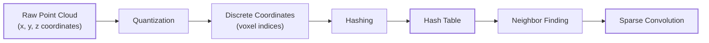
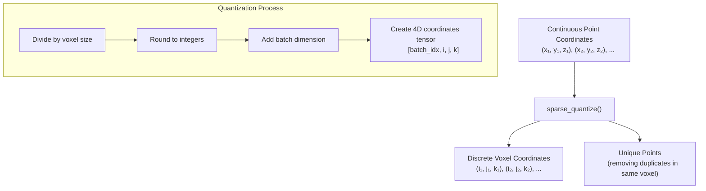
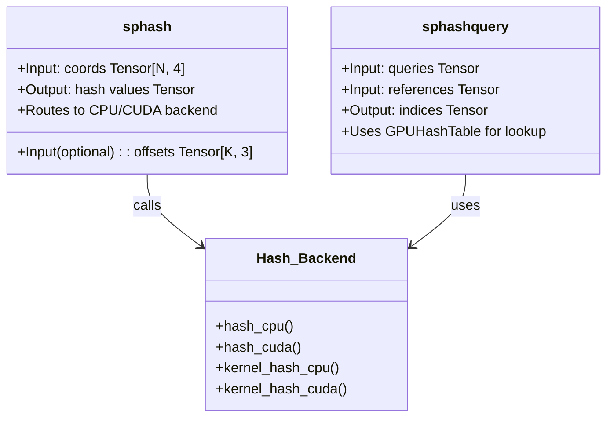
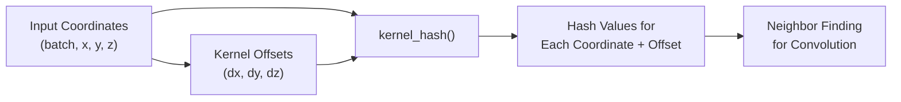
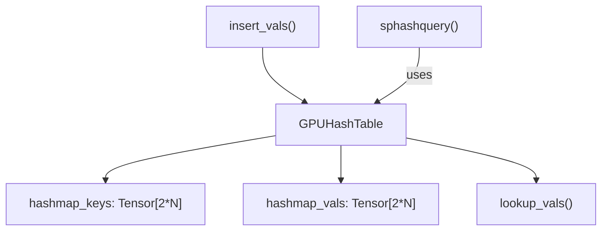
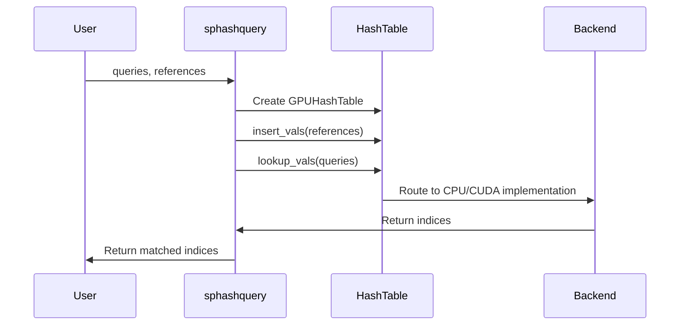
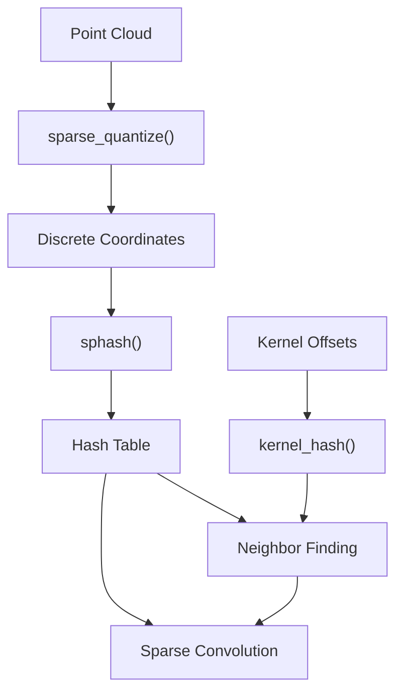

<!-- source: DeepWiki mcp.deepwiki.com · repo mit-han-lab/torchsparse · page 4.2 Hashing and Quantization · fetched 2026-10-30 -->

# Hashing and Quantization

<details>
<summary>Relevant source files</summary>

The following files were used as context for generating this wiki page:

- [torchsparse/backend/hash/hash_cpu.cpp](torchsparse/backend/hash/hash_cpu.cpp)
- [torchsparse/nn/functional/count.py](torchsparse/nn/functional/count.py)
- [torchsparse/nn/functional/hash.py](torchsparse/nn/functional/hash.py)
- [torchsparse/nn/functional/query.py](torchsparse/nn/functional/query.py)
- [torchsparse/nn/modules/activation.py](torchsparse/nn/modules/activation.py)

</details>


This document provides detailed information about the hashing and quantization mechanisms in TorchSparse. These fundamental operations enable efficient sparse tensor operations by transforming continuous point cloud coordinates into discrete representations and providing fast neighbor lookup capabilities. For information about voxelization operations which use these mechanisms, see [Voxelization and Devoxelization](#4.1).

## 1. Overview

Hashing and quantization are critical components in TorchSparse's sparse tensor processing pipeline. They provide the foundation for efficient sparse operations by:

1. Converting continuous point coordinates to discrete voxel coordinates (quantization)
2. Efficiently indexing and querying these discrete coordinates using hash functions (hashing)

These operations are essential for building efficient sparse convolutional networks for point cloud processing.



**Sources:** [torchsparse/nn/functional/hash.py:1-40](), [torchsparse/nn/functional/query.py:1-38]()

## 2. Coordinate Quantization

Quantization in TorchSparse refers to the process of converting continuous point cloud coordinates into discrete voxel indices. This is a prerequisite step before applying sparse convolution operations.

### 2.1 Coordinate Quantization Process



The quantization process includes:

1. Scaling continuous coordinates by dividing by the voxel size
2. Rounding to integers to get discrete voxel indices
3. Adding a batch dimension to form the 4D coordinate tensor used in TorchSparse
4. Removing duplicate points that fall into the same voxel

## 3. Hashing Mechanism

After quantization, TorchSparse uses hashing to efficiently index and query discrete coordinates. The hashing mechanism is implemented in both CPU and CUDA backends.

### 3.1 Hashing Functions

TorchSparse provides several key hashing functions:

- `sphash`: Computes hash values for coordinate tensors
- `sphashquery`: Queries coordinates using hash tables
- `spcount`: Counts occurrences of coordinates



**Sources:** [torchsparse/nn/functional/hash.py:10-39](), [torchsparse/nn/functional/query.py:8-37]()

### 3.2 Hash Algorithm

The hashing algorithm used in TorchSparse is a variant of the FNV-1a hash function, which is particularly suitable for hashing integers. The implementation is shown in the CPU backend:

```
1. Initialize hash = 14695981039346656037UL (FNV offset basis)
2. For each coordinate component (x, y, z, batch):
   a. XOR hash with the component value
   b. Multiply hash by 1099511628211UL (FNV prime)
3. Finalize: hash = (hash >> 60) ^ (hash & 0xFFFFFFFFFFFFFFF)
```

This hash function is designed to minimize collisions while being computationally efficient.

**Sources:** [torchsparse/backend/hash/hash_cpu.cpp:7-18](), [torchsparse/backend/hash/hash_cpu.cpp:20-39]()

### 3.3 Kernel Hashing

TorchSparse also provides kernel hashing functionality, which computes hash values for coordinates with kernel offsets. This is crucial for convolutional operations that need to find neighboring points.



**Sources:** [torchsparse/backend/hash/hash_cpu.cpp:20-39](), [torchsparse/nn/functional/hash.py:26-39]()

## 4. Hash Table Implementation

TorchSparse uses a custom GPU hash table implementation for efficient coordinate lookup.

### 4.1 Hash Table Structure



The hash table implementation:
1. Allocates space for both keys and values (twice the size of the input for collision handling)
2. Provides `insert_vals` method to populate the table
3. Provides `lookup_vals` method to query the table

**Sources:** [torchsparse/nn/functional/query.py:15-23]()

### 4.2 Hash Table Operations



**Sources:** [torchsparse/nn/functional/query.py:8-37]()

## 5. Integration with Sparse Convolution

Hashing and quantization are fundamental to sparse convolution operations in TorchSparse. The process flow is:

1. Raw point cloud coordinates are quantized to discrete voxel coordinates
2. Coordinates are hashed for efficient indexing and lookup
3. During convolution, kernel offsets are applied to find neighboring points
4. Hash-based neighbor finding enables efficient gathering of input features
5. Convolution is performed only on active sites, significantly reducing computation



## 6. Usage Examples

### 6.1 Computing Hash Values for Coordinates

```python
import torch
from torchsparse.nn.functional import sphash

# Create a 4D coordinate tensor (batch_idx, x, y, z)
coords = torch.tensor([
    [0, 1, 2, 3],
    [0, 4, 5, 6],
    [1, 7, 8, 9]
], dtype=torch.int)

# Compute hash values
hash_values = sphash(coords)
```

### 6.2 Querying Coordinates Using Hash Table

```python
import torch
from torchsparse.nn.functional import sphashquery

# Reference coordinates
references = torch.tensor([
    [0, 1, 2, 3],
    [0, 4, 5, 6],
    [1, 7, 8, 9]
], dtype=torch.int)

# Query coordinates
queries = torch.tensor([
    [0, 1, 2, 3],
    [0, 10, 11, 12]
], dtype=torch.int)

# Find matching indices (-1 if not found)
indices = sphashquery(queries, references)
```

## 7. Performance Considerations

- The hashing algorithm is designed to minimize collisions while being computationally efficient
- The hash table is allocated with twice the size of the input to handle collisions
- Both CPU and CUDA implementations are provided for different deployment scenarios
- For large point clouds, the CUDA implementation provides significant performance benefits

**Sources:** [torchsparse/nn/functional/hash.py:10-39](), [torchsparse/backend/hash/hash_cpu.cpp:7-59]()

## 8. Conclusion

Hashing and quantization are core operations in TorchSparse that enable efficient sparse tensor processing. They transform continuous point cloud data into discrete representations and provide fast neighbor lookup capabilities, which are essential for sparse convolution operations. By understanding these mechanisms, users can better leverage TorchSparse for point cloud processing tasks.

---

