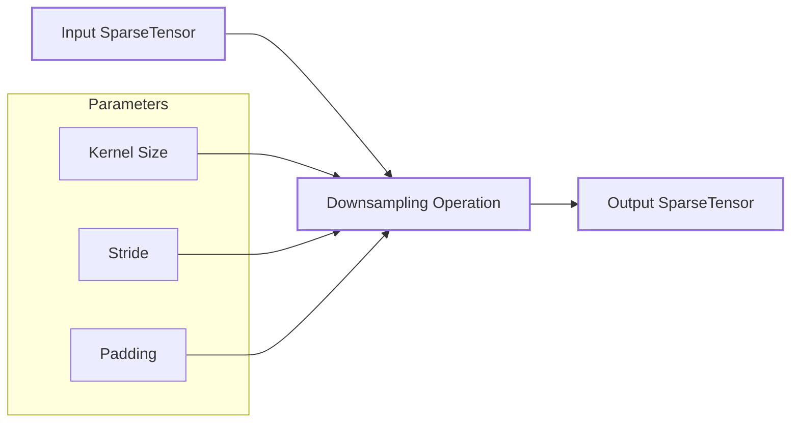
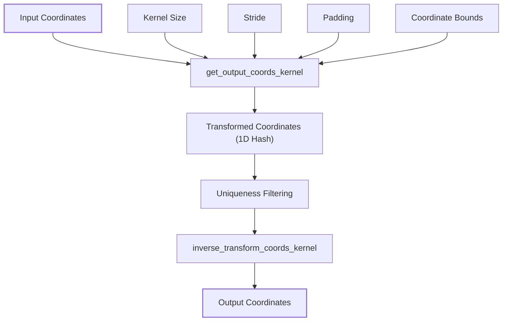
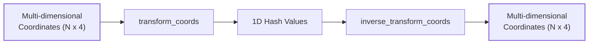
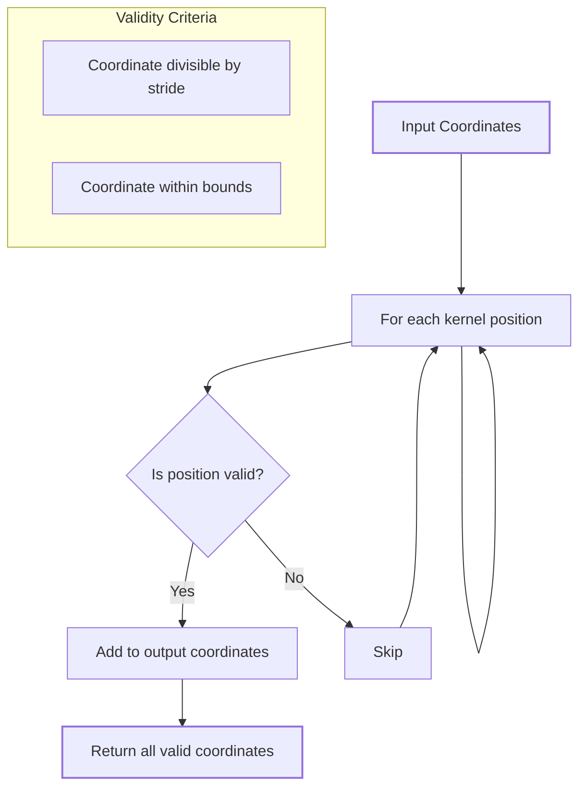
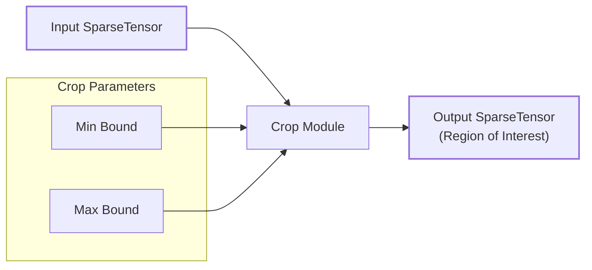
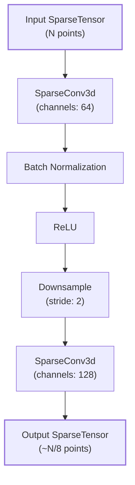

<!-- source: DeepWiki mcp.deepwiki.com · repo mit-han-lab/torchsparse · page 4.3 Downsampling and Cropping · fetched 2026-10-30 -->

# Downsampling and Cropping

<details>
<summary>Relevant source files</summary>

The following files were used as context for generating this wiki page:

- [torchsparse/backend/others/downsample_cuda.cu](torchsparse/backend/others/downsample_cuda.cu)

</details>


This document covers the downsampling and cropping operations available in TorchSparse for sparse tensor processing. These operations allow you to reduce the spatial resolution of sparse tensors and extract specific regions of interest, which are essential for building hierarchical neural networks for point cloud processing.

For information about voxelization and devoxelization, see [Voxelization and Devoxelization](#4.1). For hashing and quantization details, see [Hashing and Quantization](#4.2).

## Introduction to Downsampling in Sparse Tensors

Downsampling in the context of sparse tensors refers to the process of reducing spatial resolution while maintaining the sparse structure. Unlike dense tensors where downsampling can be applied uniformly across a regular grid, sparse tensor downsampling must account for the irregular distribution of non-zero elements.



Sources: [torchsparse/backend/others/downsample_cuda.cu:147-190]()

## CUDA Implementation of Downsampling

The downsampling operation in TorchSparse is implemented using optimized CUDA kernels for high performance. The process involves several key steps:

1. Transforming sparse coordinates to 1D hash values
2. Determining valid output coordinates based on kernel size, stride, and padding
3. Applying uniqueness filtering to avoid duplicates
4. Transforming the hash values back to multi-dimensional coordinates



Sources: [torchsparse/backend/others/downsample_cuda.cu:111-141](), [torchsparse/backend/others/downsample_cuda.cu:147-190]()

## Coordinate Transformation Process

The downsampling operation relies on efficient coordinate transformation between multi-dimensional spaces and 1D hash values:



Sources: [torchsparse/backend/others/downsample_cuda.cu:22-35](), [torchsparse/backend/others/downsample_cuda.cu:44-57]()

### Transform Coordinates Function

The `transform_coords` function converts multi-dimensional coordinates into a 1D hash value, which makes it easier to identify unique coordinates:

```
Hash = (((x - x_min) * size_y + (y - y_min)) * size_z + (z - z_min)) * size_b + (b - b_min)
```

Where:
- `x, y, z, b` are the coordinates (3D spatial + batch)
- `x_min, y_min, z_min, b_min` are the minimum coordinate values
- `size_x, size_y, size_z, size_b` are the coordinate ranges (max - min + 1)

Sources: [torchsparse/backend/others/downsample_cuda.cu:22-35]()

### Inverse Transform Coordinates Function

The `inverse_transform_coords` function converts the 1D hash back to multi-dimensional coordinates, which is necessary after uniqueness filtering:

Sources: [torchsparse/backend/others/downsample_cuda.cu:44-57]()

## Downsampling Parameters

The downsampling operation takes several important parameters that control its behavior:

| Parameter | Description |
|-----------|-------------|
| `in_coords` | Input coordinates tensor (N x 4, where 4 represents batch + 3D spatial coordinates) |
| `coords_max` | Maximum coordinate values along each dimension |
| `coords_min` | Minimum coordinate values along each dimension |
| `kernel_sizes` | Size of the downsampling kernel for each dimension |
| `stride` | Stride value for each dimension |
| `padding` | Padding value for each dimension |

Sources: [torchsparse/backend/others/downsample_cuda.cu:147-159]()

## Output Coordinate Generation

A key aspect of the downsampling operation is determining which output coordinates are valid. This is handled by the `get_output_coords` function:



A coordinate is considered valid if:
1. It is divisible by the stride value for that dimension
2. It falls within the specified coordinate bounds

Sources: [torchsparse/backend/others/downsample_cuda.cu:62-109]()

## The Main Downsampling Function

The main `downsample_cuda` function orchestrates the entire downsampling process:

1. Launches the `get_output_coords_kernel` to generate potential output coordinates
2. Uses PyTorch's `_unique` function to remove duplicates
3. Launches the `inverse_transform_coords_kernel` to convert hash values back to coordinates
4. Returns the final downsampled coordinates

Sources: [torchsparse/backend/others/downsample_cuda.cu:147-190]()

## Cropping Operations

In addition to downsampling, TorchSparse also provides functionality for cropping sparse tensors. Cropping allows you to extract a specific region of interest from a sparse tensor based on coordinate bounds.



While the downsampling operation reduces spatial resolution, cropping preserves the original resolution but limits the spatial extent of the data.

## Use Cases and Best Practices

### When to Use Downsampling

- To reduce computational complexity in deep neural networks
- To build hierarchical feature representations
- To increase the receptive field of subsequent layers

### Downsampling vs. Pooling

While both operations reduce spatial dimensions, they serve different purposes:

| Operation | Purpose | Effect on Features |
|-----------|---------|-------------------|
| Downsampling | Reduces spatial resolution | Preserves feature channels |
| Pooling | Aggregates information | May reduce feature dimensionality |

For information about pooling operations, see [Pooling Operations](#3.3).

## Implementation Example

Here's a conceptual example of how downsampling might be used in a TorchSparse network:



## Performance Considerations

- Downsampling significantly reduces the number of points, which can improve computational efficiency
- The CUDA implementation ensures fast execution on GPU
- The hash-based approach efficiently handles the irregular structure of sparse data

Sources: [torchsparse/backend/others/downsample_cuda.cu]()

---

