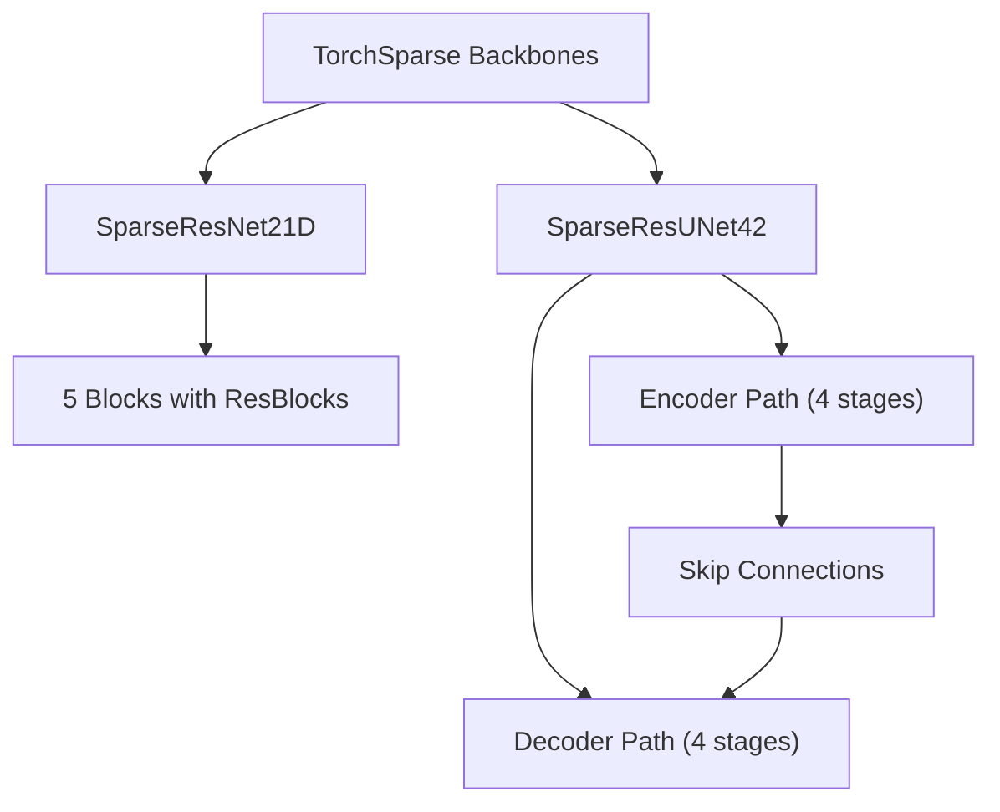
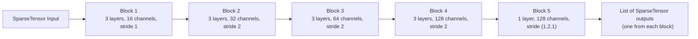
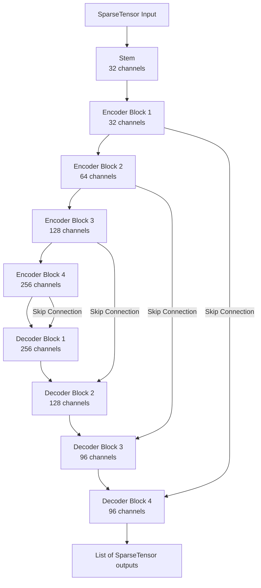
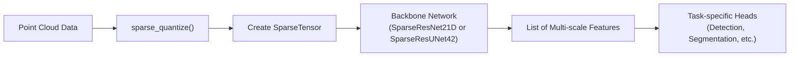

<!-- source: DeepWiki mcp.deepwiki.com · repo mit-han-lab/torchsparse · page 5 Backbone Networks · fetched 2026-10-30 -->

# Backbone Networks

<details>
<summary>Relevant source files</summary>

The following files were used as context for generating this wiki page:

- [examples/backbones.py](examples/backbones.py)
- [torchsparse/backbones/__init__.py](torchsparse/backbones/__init__.py)
- [torchsparse/backbones/modules/__init__.py](torchsparse/backbones/modules/__init__.py)
- [torchsparse/backbones/modules/blocks.py](torchsparse/backbones/modules/blocks.py)
- [torchsparse/backbones/resnet.py](torchsparse/backbones/resnet.py)
- [torchsparse/backbones/unet.py](torchsparse/backbones/unet.py)

</details>


## Purpose and Scope

This document covers the pre-built backbone network architectures provided by TorchSparse for point cloud processing. These backbones are designed to work efficiently with sparse 3D data using the SparseTensor data structure, enabling users to quickly implement common deep learning architectures for point cloud tasks without building networks from scratch.

For information about the underlying SparseTensor data structure, see [SparseTensor Data Structure](#2.1).
For details on neural network modules used within backbones, see [Neural Network Modules](#3).

Sources: [torchsparse/backbones/__init__.py](), [examples/backbones.py]()

## Available Backbone Architectures

TorchSparse provides two primary backbone architectures:

1. **SparseResNet21D** - A sparse ResNet variant optimized for 3D point cloud processing
2. **SparseResUNet42** - A sparse U-Net variant with residual blocks for encoder-decoder style tasks



Sources: [torchsparse/backbones/__init__.py](), [torchsparse/backbones/resnet.py:59-70](), [torchsparse/backbones/unet.py:115-122]()

## Building Blocks

Both backbone architectures are constructed using three fundamental building blocks:

| Block Type | Description | Primary Use |
|------------|-------------|-------------|
| `SparseConvBlock` | Sequential block of Conv3d + BatchNorm + ReLU | Basic feature extraction |
| `SparseConvTransposeBlock` | Sequential block of transposed Conv3d + BatchNorm + ReLU | Upsampling in decoder paths |
| `SparseResBlock` | Residual block with two convolution paths and skip connection | Feature refinement with identity mapping |

```mermaid
classDiagram
    class SparseConvBlock {
        +Conv3d
        +BatchNorm
        +ReLU
        +forward(SparseTensor)
    }
    
    class SparseConvTransposeBlock {
        +Conv3d(transposed=True)
        +BatchNorm
        +ReLU
        +forward(SparseTensor)
    }
    
    class SparseResBlock {
        +main(Sequential)
        +shortcut(Sequential/Identity)
        +ReLU
        +forward(SparseTensor)
    }
    
    SparseConvBlock --> "nn.Sequential"
    SparseConvTransposeBlock --> "nn.Sequential"
    SparseResBlock --> "nn.Module"
```

Sources: [torchsparse/backbones/modules/blocks.py:12-27](), [torchsparse/backbones/modules/blocks.py:30-50](), [torchsparse/backbones/modules/blocks.py:53-85]()

## SparseResNet Architecture

The `SparseResNet` is a base class for creating ResNet-like architectures for sparse 3D data. The specific implementation provided is `SparseResNet21D`.

### SparseResNet21D

`SparseResNet21D` follows a standard ResNet architecture adapted for sparse 3D inputs:



The network consists of 5 blocks, with each block containing multiple layers. The first layer of each block uses a `SparseConvBlock` to adjust channel dimensions and stride, while subsequent layers use `SparseResBlock` for feature refinement.

Sources: [torchsparse/backbones/resnet.py:12-56](), [torchsparse/backbones/resnet.py:59-70]()

### Implementation Details

The `SparseResNet` class is implemented as a `nn.ModuleList` where each element is a block of layers. The configuration for `SparseResNet21D` is:

```
blocks=[
    (3, 16, 3, 1),    # (num_blocks, out_channels, kernel_size, stride)
    (3, 32, 3, 2),
    (3, 64, 3, 2),
    (3, 128, 3, 2),
    (1, 128, (1, 3, 1), (1, 2, 1)),
]
```

Each tuple in the `blocks` list represents:
- Number of layers in the block
- Output channel count
- Kernel size
- Stride

The `width_multiplier` parameter allows scaling the network width (channel counts) for different capacity requirements.

Sources: [torchsparse/backbones/resnet.py:12-56](), [torchsparse/backbones/resnet.py:59-70]()

## SparseResUNet Architecture

`SparseResUNet` implements a U-Net architecture with residual blocks, specifically designed for tasks that benefit from multi-scale feature extraction and upsampling, such as semantic segmentation of point clouds.

### SparseResUNet42

The `SparseResUNet42` is configured with:
- Initial stem with 32 channels
- Encoder path with channels [32, 64, 128, 256]
- Decoder path with channels [256, 128, 96, 96]



The architecture follows the encoder-decoder pattern with skip connections between corresponding encoder and decoder blocks, allowing the network to preserve spatial information during upsampling.

Sources: [torchsparse/backbones/unet.py:14-112](), [torchsparse/backbones/unet.py:115-122]()

### Implementation Details

Key components of the `SparseResUNet` implementation:

1. **Stem**: Two convolution layers that process the input `SparseTensor`
2. **Encoders**: Four sequential blocks that downsample the input while increasing channel dimensions
3. **Decoders**: Four blocks that upsample features and fuse them with corresponding encoder features

Each encoder block consists of:
- A downsampling `SparseConvBlock` with stride 2
- Two `SparseResBlock` units for feature refinement

Each decoder block includes:
- An upsampling `SparseConvTransposeBlock` with stride 2
- A fusion module that combines upsampled features with corresponding encoder features via skip connections

The decoder implementation uses recursive processing to handle the skip connections elegantly.

Sources: [torchsparse/backbones/unet.py:14-112](), [torchsparse/backbones/unet.py:89-109]()

## Usage Example

The backbones can be easily incorporated into point cloud processing pipelines. Here's a simplified usage pattern:



The `examples/backbones.py` file demonstrates how to initialize and use these backbones:

1. Initialize the backbone with desired parameters:
   ```python
   model = SparseResNet21D(in_channels=4, width_multiplier=1.0)
   # OR
   model = SparseResUNet42(in_channels=4, width_multiplier=1.0)
   ```

2. Process point cloud data and create a `SparseTensor`
3. Pass the `SparseTensor` through the backbone to get multi-scale features
4. Use the output features for downstream tasks

Both backbone architectures return a list of `SparseTensor` objects, representing features at different scales in the network.

Sources: [examples/backbones.py:10-41]()

## Customization Options

The backbone implementations provide several customization options:

| Parameter | Description | Default |
|-----------|-------------|---------|
| `in_channels` | Number of input feature channels | 4 |
| `width_multiplier` | Scaling factor for network width | 1.0 |

For `SparseResNet`, you can also customize:
- Block configurations (number of layers, channels, kernel size, stride)

For `SparseResUNet`, you can customize:
- Stem channel count
- Encoder channel dimensions
- Decoder channel dimensions

These options allow you to adapt the backbones to different point cloud processing tasks with varying complexity requirements.

Sources: [torchsparse/backbones/resnet.py:12-26](), [torchsparse/backbones/unet.py:14-29]()

---

