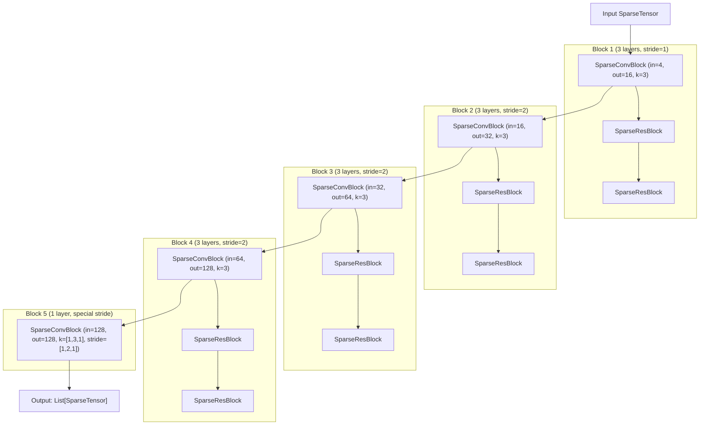
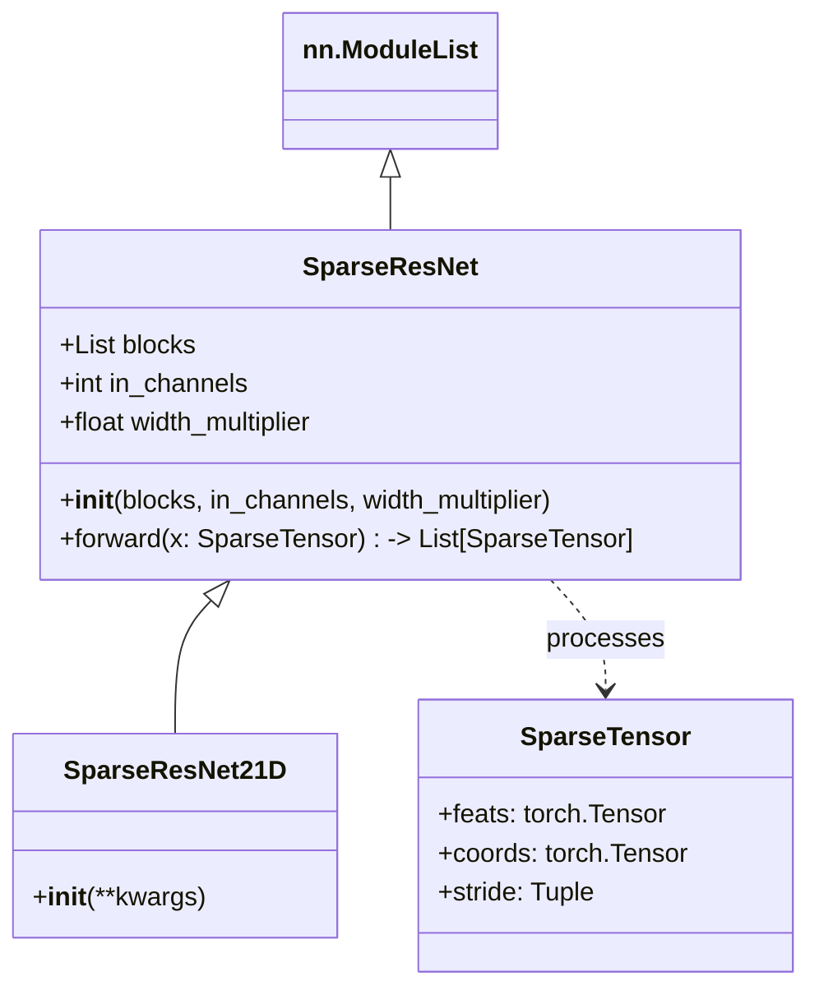
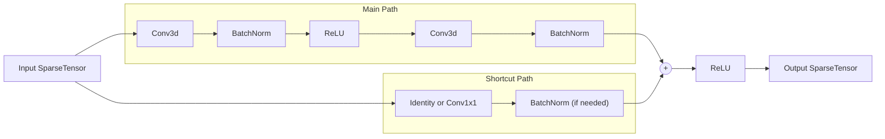
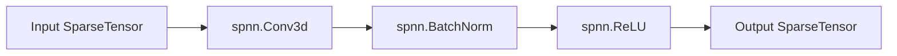

<!-- source: DeepWiki mcp.deepwiki.com · repo mit-han-lab/torchsparse · page 5.1 ResNet Architecture · fetched 2026-10-30 -->

# ResNet Architecture

<details>
<summary>Relevant source files</summary>

The following files were used as context for generating this wiki page:

- [examples/backbones.py](examples/backbones.py)
- [torchsparse/backbones/__init__.py](torchsparse/backbones/__init__.py)
- [torchsparse/backbones/modules/__init__.py](torchsparse/backbones/modules/__init__.py)
- [torchsparse/backbones/modules/blocks.py](torchsparse/backbones/modules/blocks.py)
- [torchsparse/backbones/resnet.py](torchsparse/backbones/resnet.py)
- [torchsparse/backbones/unet.py](torchsparse/backbones/unet.py)

</details>


This document details the ResNet architecture implementation in TorchSparse, focusing on the `SparseResNet` base class and its primary variant, `SparseResNet21D`. This architecture provides an efficient backbone for sparse point cloud processing tasks. For information about the UNet architecture in TorchSparse, see [UNet Architecture](#5.2).

## Purpose and Overview

The SparseResNet implementation in TorchSparse serves as a feature extraction backbone for processing sparse 3D data. It adapts the traditional ResNet architecture to work with the `SparseTensor` data structure, allowing efficient computation on point cloud data through residual connections and progressive downsampling.

Sources: [torchsparse/backbones/resnet.py:12-56](), [examples/backbones.py:15-22]()

## Architecture Overview

The SparseResNet architecture in TorchSparse consists of a sequence of blocks, each containing convolutional and residual layers. The network progressively processes sparse tensors through these blocks, reducing spatial resolution while increasing the feature dimension.



Sources: [torchsparse/backbones/resnet.py:59-70](), [torchsparse/backbones/modules/blocks.py:12-85]()

## Core Components

### SparseResNet Base Class

The `SparseResNet` class serves as the foundation for all sparse residual networks in TorchSparse.



Key features of the base class:
- Inherits from `nn.ModuleList` for managing sequential blocks
- Takes a list of block specifications, each defining number of blocks, output channels, kernel size, and stride
- Implements the `forward` method to process input through each block and collect outputs
- Supports width multiplier to scale network capacity

Sources: [torchsparse/backbones/resnet.py:12-56]()

### Building Blocks

#### SparseResBlock

The `SparseResBlock` is the fundamental building block of the SparseResNet architecture, implementing the residual connection pattern.



Key aspects:
- Main path: Two `Conv3d` operations with batch normalization and ReLU activation
- Shortcut path: Identity function if dimensions match, otherwise a 1×1 convolution with batch normalization
- Element-wise addition of both paths followed by ReLU activation

Sources: [torchsparse/backbones/modules/blocks.py:53-85]()

#### SparseConvBlock

The `SparseConvBlock` provides a standard convolutional block for processing sparse tensors.



This simple block combines a sparse convolution with batch normalization and ReLU activation.

Sources: [torchsparse/backbones/modules/blocks.py:12-27]()

## SparseResNet21D Implementation

The `SparseResNet21D` is a specific implementation of the `SparseResNet` architecture with a predefined configuration:

| Block # | # of Layers | Output Channels | Kernel Size | Stride     |
|---------|-------------|-----------------|-------------|------------|
| 1       | 3           | 16              | 3           | 1          |
| 2       | 3           | 32              | 3           | 2          |
| 3       | 3           | 64              | 3           | 2          |
| 4       | 3           | 128             | 3           | 2          |
| 5       | 1           | 128             | (1, 3, 1)   | (1, 2, 1)  |

The name "ResNet21D" indicates:
- 21 layers: Each of the first four blocks has 3 layers (1 SparseConvBlock + 2 SparseResBlocks), and the final block has 1 layer, totaling 13 layers. Including the 2 convolutions within each SparseResBlock (8 more layers), this gives 21 total layers.
- D: Denotes the use of an asymmetric kernel (1,3,1) in the final layer for specialized processing.

Sources: [torchsparse/backbones/resnet.py:59-70]()

## Forward Pass Operation

During the forward pass, the SparseResNet processes an input `SparseTensor` through each block sequentially:

1. Each block transforms the input sparse tensor
2. The transformed tensors from each block are collected into a list
3. The final output is a list of sparse tensors, one from each block

This allows users to access features at different resolutions, which is particularly useful for tasks requiring multi-scale features.

```python
# Forward pass implementation
def forward(self, x: SparseTensor) -> List[SparseTensor]:
    outputs = []
    for module in self:
        x = module(x)
        outputs.append(x)
    return outputs
```

Sources: [torchsparse/backbones/resnet.py:51-56]()

## Usage Example

Here's how to use the SparseResNet21D backbone in practice:

```python
# Import the backbone
from torchsparse.backbones import SparseResNet21D

# Create the model (4 input channels, e.g., xyz + intensity)
model = SparseResNet21D(in_channels=4, width_multiplier=1.0)

# Prepare input sparse tensor
# (after voxelization and quantization of point cloud)
input_tensor = SparseTensor(coords=coords, feats=feats).to(device)

# Forward pass
outputs = model(input_tensor)

# Process the outputs (one SparseTensor from each block)
for i, output in enumerate(outputs):
    print(f"Block {i+1} output shape: {output.feats.shape}")
```

The `width_multiplier` parameter allows scaling the network capacity by multiplying the number of channels in each layer, enabling a trade-off between model capacity and computational efficiency.

Sources: [examples/backbones.py:15-41]()

## Comparison with UNet Architecture

Unlike the SparseResUNet ([UNet Architecture](#5.2)), the SparseResNet:

1. Is a pure encoder network with progressively decreasing spatial resolution
2. Uses residual connections within each block rather than long-range skip connections
3. Returns intermediate outputs from each stage as a list, without reconstruction to original resolution
4. Is primarily designed as a feature extractor backbone for tasks like classification and detection

The following table summarizes key differences:

| Feature | SparseResNet | SparseResUNet |
|---------|--------------|---------------|
| Architecture Type | Encoder only | Encoder-decoder |
| Skip Connections | Local residual connections | Long-range skip connections between encoder-decoder |
| Output | List of features at different resolutions | List of features including reconstructed high-resolution features |
| Typical Use Cases | Feature extraction, classification | Segmentation, dense prediction tasks |

Sources: [torchsparse/backbones/resnet.py:12-70](), [torchsparse/backbones/unet.py:14-122]()

---

