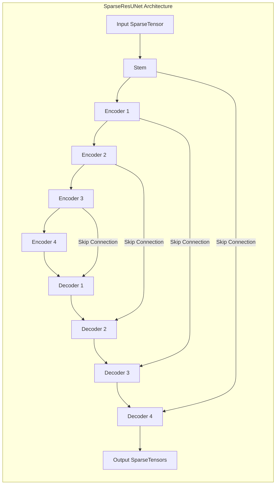
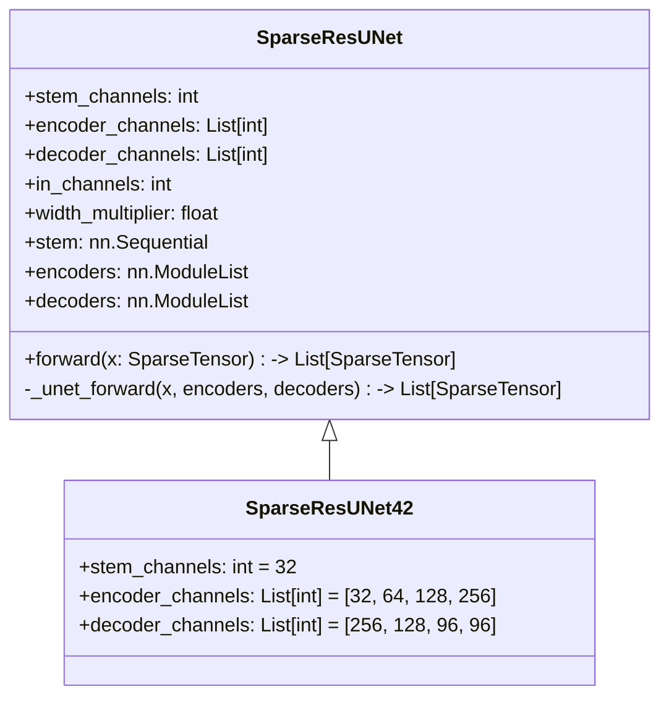
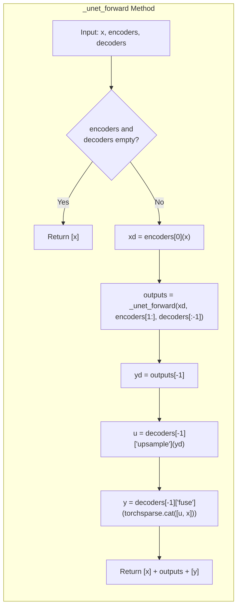
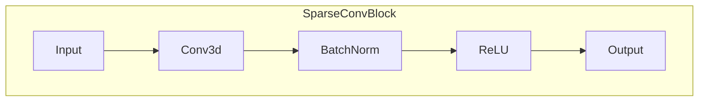
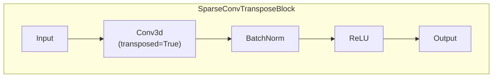
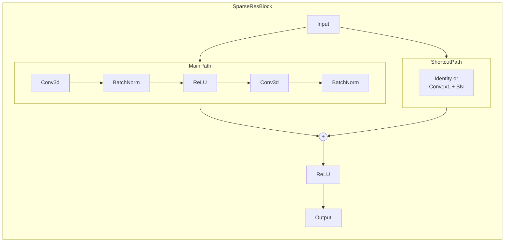
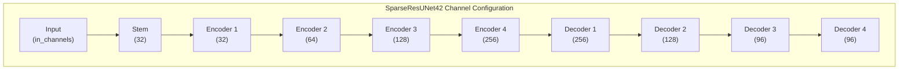
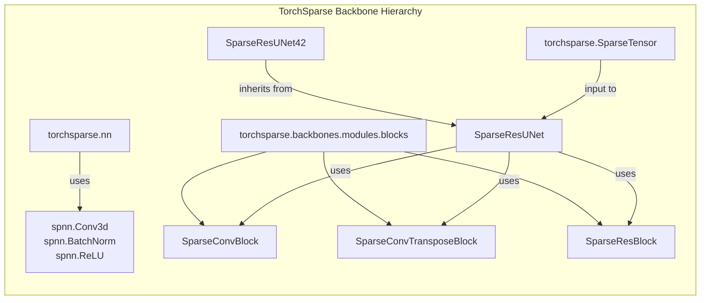

<!-- source: DeepWiki mcp.deepwiki.com · repo mit-han-lab/torchsparse · page 5.2 UNet Architecture · fetched 2026-10-30 -->

# UNet Architecture

<details>
<summary>Relevant source files</summary>

The following files were used as context for generating this wiki page:

- [examples/backbones.py](examples/backbones.py)
- [torchsparse/backbones/__init__.py](torchsparse/backbones/__init__.py)
- [torchsparse/backbones/modules/__init__.py](torchsparse/backbones/modules/__init__.py)
- [torchsparse/backbones/modules/blocks.py](torchsparse/backbones/modules/blocks.py)
- [torchsparse/backbones/resnet.py](torchsparse/backbones/resnet.py)
- [torchsparse/backbones/unet.py](torchsparse/backbones/unet.py)

</details>


This page documents the UNet-based neural network architecture implemented in the TorchSparse library for sparse point cloud processing. The UNet architecture provides a powerful backbone for tasks requiring multi-scale feature extraction and upsampling, commonly used in segmentation tasks for 3D point cloud data.

For information about other backbone architectures in TorchSparse, see [ResNet Architecture](#5.1).

## Architecture Overview

The SparseResUNet in TorchSparse is an adaptation of the traditional UNet architecture for sparse tensor operations. It features an encoder-decoder structure with skip connections and utilizes residual blocks for improved gradient flow.



Sources: [torchsparse/backbones/unet.py:14-113]()

## Implementation Details

The SparseResUNet is implemented as a modular architecture consisting of:

1. **Stem**: Initial feature extraction from input points
2. **Encoders**: Sequence of downsampling operations and feature extraction
3. **Decoders**: Sequence of upsampling operations with skip connections from corresponding encoder levels

### Class Structure



Sources: [torchsparse/backbones/unet.py:14-113](), [torchsparse/backbones/unet.py:115-123]()

### Key Components

#### Stem
The stem consists of two consecutive 3D convolution layers with batch normalization and ReLU activations. It processes the input sparse tensor and prepares it for the encoder stages.

#### Encoders
Each encoder unit consists of:
1. A downsampling convolution layer (stride=2)
2. Two residual blocks for feature extraction

#### Decoders
Each decoder unit consists of:
1. An upsampling transpose convolution layer (stride=2)
2. A fusion module that concatenates the upsampled features with corresponding encoder features
3. Two residual blocks for feature processing

Sources: [torchsparse/backbones/unet.py:34-87]()

### Recursive Forward Mechanism

The SparseResUNet implements a recursive forward pass that elegantly handles the U-shaped network structure:



This recursive approach allows the network to:
1. First travel down the entire encoder path
2. Then gradually come back up through the decoder path
3. At each decoder level, fuse the upsampled features with the corresponding encoder features

Sources: [torchsparse/backbones/unet.py:89-109]()

## Building Blocks

The SparseResUNet architecture uses three key building blocks:

### SparseConvBlock

Used for standard convolution operations, particularly in the stem and encoder paths.



### SparseConvTransposeBlock

Used for upsampling operations in the decoder path.



### SparseResBlock

Used throughout the network to improve gradient flow. It implements a residual connection pattern.



Sources: [torchsparse/backbones/modules/blocks.py:12-85]()

## SparseResUNet42

The primary UNet implementation in TorchSparse is the `SparseResUNet42`, which has a specific configuration of channel dimensions:

- Stem channels: 32
- Encoder channels: [32, 64, 128, 256]
- Decoder channels: [256, 128, 96, 96]

This configuration results in a network with 42 convolution layers in total (hence the name "UNet42"), providing a good balance between computational cost and model capacity.



Sources: [torchsparse/backbones/unet.py:115-123]()

## Usage Example

The SparseResUNet42 backbone can be easily instantiated and used as follows:

1. Import the necessary modules:
```python
from torchsparse import SparseTensor
from torchsparse.backbones import SparseResUNet42
```

2. Create and initialize the model:
```python
model = SparseResUNet42(in_channels=4, width_multiplier=1.0)
model = model.to(device).eval()
```

3. Forward pass with a SparseTensor input:
```python
outputs = model(input_tensor)  # Returns a list of SparseTensors
```

The model returns a list of SparseTensor objects, where:
- The first element is the stem output
- The middle elements are outputs from each encoder stage
- The final elements are outputs from each decoder stage

Sources: [examples/backbones.py:16-40]()

### Input and Output Format

- **Input**: A single SparseTensor with shape `[N, in_channels]` where N is the number of points.
- **Output**: A list of SparseTensors from different stages of the network, with the last one typically being used for downstream tasks.

## Implementation Architecture

The following diagram shows how the UNet classes relate to the other building blocks in the TorchSparse backbone system:



Sources: [torchsparse/backbones/unet.py:14-123](), [torchsparse/backbones/modules/blocks.py:12-85]()

## Performance Considerations

When using the SparseResUNet42 backbone, consider the following:

1. **Memory Efficiency**: The UNet architecture is memory-intensive due to the need to store feature maps from each encoder level for the skip connections. However, the sparse tensor representation significantly reduces memory requirements compared to dense implementations.

2. **Width Multiplier**: The `width_multiplier` parameter can be used to scale the network capacity. Larger values increase the number of channels at each level, potentially improving performance at the cost of increased computation.

3. **Input Sparsity**: The performance of the network is highly dependent on the sparsity of the input point cloud. Highly sparse inputs will process more efficiently than dense ones.

4. **Multi-scale Features**: The network produces features at multiple spatial resolutions, which can be leveraged for tasks requiring both fine details and global context.

Sources: [torchsparse/backbones/unet.py:14-123](), [examples/backbones.py:16-40]()

---

