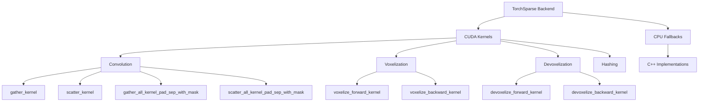
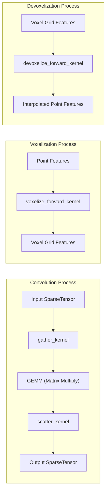
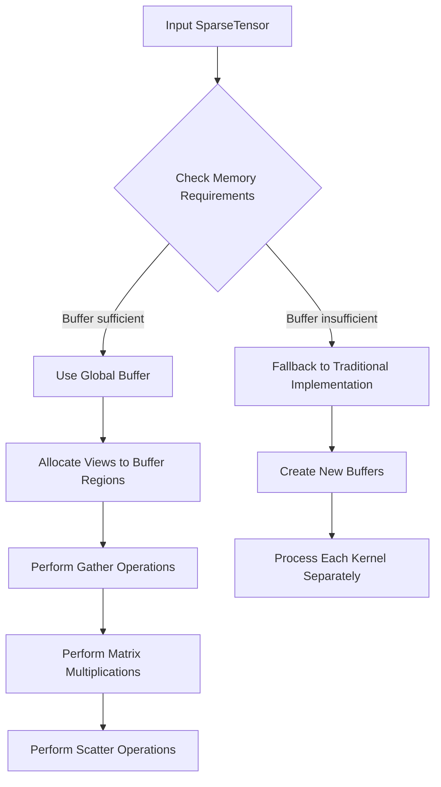
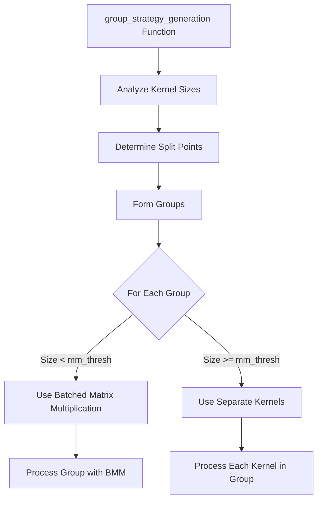
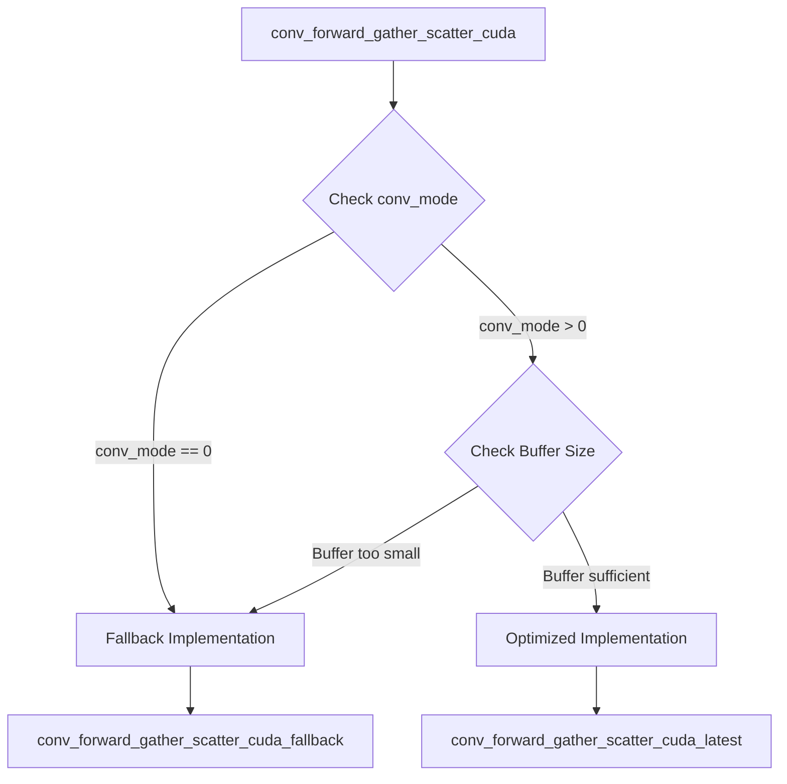
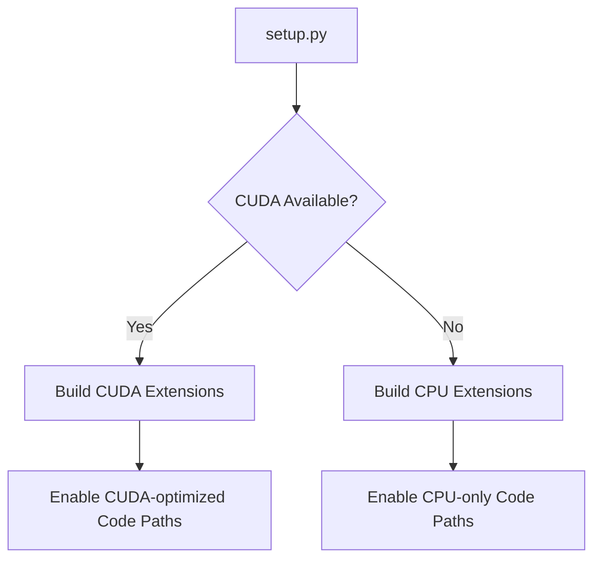
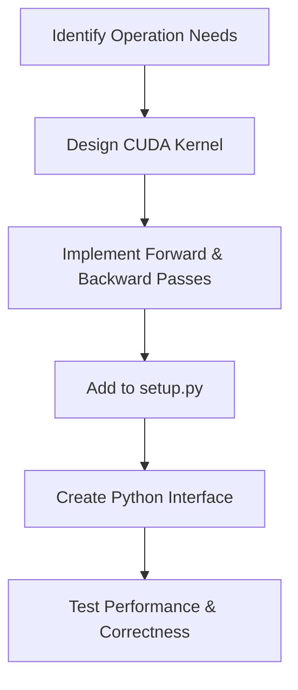
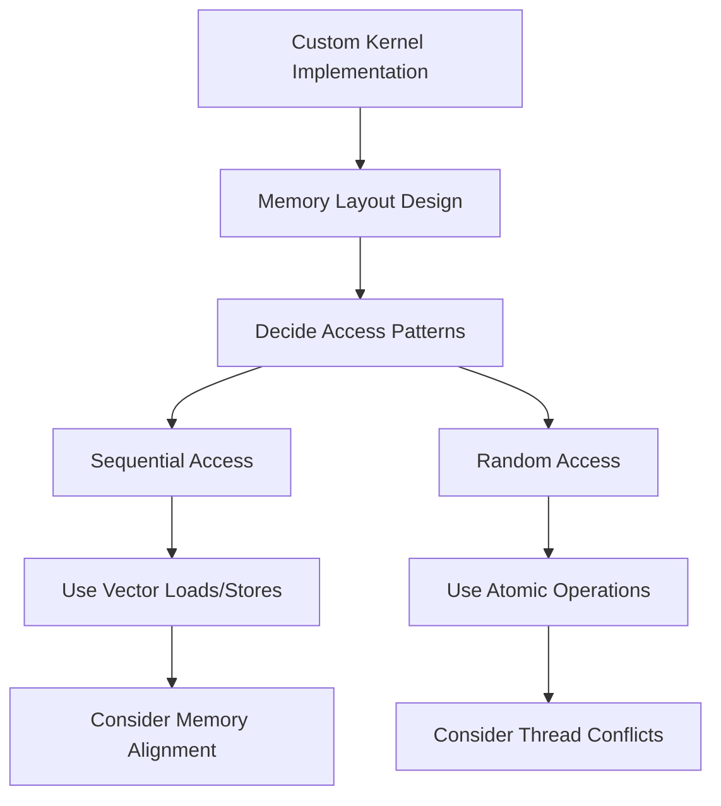
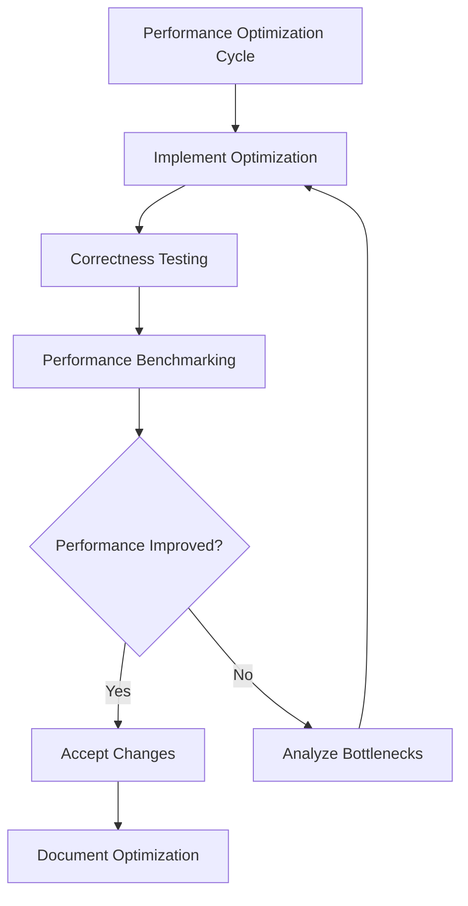

<!-- source: DeepWiki mcp.deepwiki.com · repo mit-han-lab/torchsparse · page 6 Advanced Topics · fetched 2026-10-30 -->

# Advanced Topics

Relevant source files

The following files were used as context for generating this wiki page:

- [setup.py](setup.py)
- [torchsparse/backend/convolution/convolution_gather_scatter_cuda.cu](torchsparse/backend/convolution/convolution_gather_scatter_cuda.cu)
- [torchsparse/backend/devoxelize/devoxelize_cuda.cu](torchsparse/backend/devoxelize/devoxelize_cuda.cu)
- [torchsparse/backend/voxelize/voxelize_cuda.cu](torchsparse/backend/voxelize/voxelize_cuda.cu)

This page covers advanced aspects of TorchSparse for users who want to understand the internal workings, extend the library with custom operations, or optimize performance. For basic usage and core concepts, see [Overview](#1) and [Core Concepts](#2).

## CUDA Kernel Implementation

TorchSparse achieves its high performance through carefully optimized CUDA kernels. These kernels implement the core operations needed for sparse point cloud processing, with specific optimizations for sparse tensor operations.

### Backend Architecture

Sources: [setup.py:20-40](), [torchsparse/backend/convolution/convolution_gather_scatter_cuda.cu:10-250]()

### Key CUDA Kernels

TorchSparse implements several key CUDA kernels that are critical for performance:

1. **Convolution Kernels**:
   - `gather_kernel`: Gathers features from sparse locations into dense buffers
   - `scatter_kernel`: Scatters features from dense buffers to sparse locations
   - `gather_all_kernel_pad_sep_with_mask`: Optimized gather for multiple kernel positions
   - `scatter_all_kernel_pad_sep_with_mask`: Optimized scatter for multiple kernel positions

2. **Voxelization Kernels**:
   - `voxelize_forward_kernel`: Converts point features to voxel grid features
   - `voxelize_backward_kernel`: Backpropagates gradients from voxel grid to points

3. **Devoxelization Kernels**:
   - `devoxelize_forward_kernel`: Converts voxel features back to point features
   - `devoxelize_backward_kernel`: Backpropagates gradients from points to voxel grid

Sources: [torchsparse/backend/convolution/convolution_gather_scatter_cuda.cu:18-96](), [torchsparse/backend/voxelize/voxelize_cuda.cu:40-75](), [torchsparse/backend/devoxelize/devoxelize_cuda.cu:11-57]()

## Performance Optimization

TorchSparse employs multiple techniques to optimize performance for sparse 3D data processing.

### Memory Optimization Techniques

1. **Memory Padding and Alignment**:
   - Input and output tensors are padded to ensure memory alignment
   - For half precision (FP16), tensors are padded to multiples of 8
   - For single precision (FP32), tensors are padded to multiples of 4

2. **Buffer Reuse**:
   - Global buffers are reused across operations to minimize memory allocation overhead
   - Selective fallback to CPU when memory requirements exceed available buffer size

Sources: [torchsparse/backend/convolution/convolution_gather_scatter_cuda.cu:432-482](), [torchsparse/backend/convolution/convolution_gather_scatter_cuda.cu:290-310]()

### Compute Optimization Strategies

1. **Operation Fusion**:
   - Fused gather-scatter operations to minimize memory transfers
   - Batch matrix multiplications for similar workloads

2. **Kernel Reordering and Grouping**:
   - Similar-sized workloads are grouped together
   - Adaptive strategy based on workload characteristics
   - Dedicated group_strategy_generation function for workload analysis

3. **Precision Optimization**:
   - Half-precision (FP16) support for better memory efficiency and throughput
   - Different kernels optimized for float and half types

4. **Precomputation**:
   - Precomputation of intermediate results when possible (e.g., for central kernel in convolution)

Sources: [torchsparse/backend/convolution/convolution_gather_scatter_cuda.cu:313-408](), [torchsparse/backend/convolution/convolution_gather_scatter_cuda.cu:493-678]()

### Tuning Parameters

TorchSparse exposes several parameters that can be tuned for optimal performance:

| Parameter | Description | Impact |
|-----------|-------------|--------|
| `epsilon` | Tolerance for redundant computation in adaptive grouping | Higher values lead to fewer groups but more redundant computation |
| `mm_thresh` | Threshold for matrix multiplication workload size | Controls when to use batched vs. separate operations |
| `conv_mode` | Convolution backend selection | Different modes for different optimization levels |

Sources: [torchsparse/backend/convolution/convolution_gather_scatter_cuda.cu:252-278](), [torchsparse/backend/convolution/convolution_gather_scatter_cuda.cu:313-408]()

## Debugging and Profiling

Understanding the performance characteristics of sparse operations is critical for optimization. TorchSparse includes features to help with debugging and profiling.

### Fallback Mechanisms

TorchSparse includes fallback mechanisms that allow operations to be executed in a simpler but potentially slower way when needed:

Sources: [torchsparse/backend/convolution/convolution_gather_scatter_cuda.cu:279-311]()

### Conditional Compilation

TorchSparse uses conditional compilation to adapt to the available hardware:

Sources: [setup.py:20-36]()

## Extending TorchSparse

Developers who want to extend TorchSparse with new operations need to understand how to integrate with the existing architecture.

### Custom CUDA Kernel Implementation

To implement a custom CUDA kernel for TorchSparse:

1. Create a C++ header file that declares your forward and backward functions
2. Implement CUDA kernels in a .cu file
3. Add your kernel to the build system in setup.py
4. Create Python bindings in the appropriate backend file

A typical workflow for adding a new CUDA kernel:

Sources: [setup.py:29-34]()

### Memory Considerations

When extending TorchSparse with custom operations, consider these memory best practices:

1. **Buffer Reuse**: Follow the pattern of global buffer reuse to minimize allocations
2. **Padding**: Align memory for optimal access patterns, especially for vectorized operations
3. **Hybrid Precision**: Consider implementing both FP32 and FP16 variants for flexibility
4. **Atomic Operations**: Use atomic operations for parallel updates to the same memory location

Sources: [torchsparse/backend/convolution/convolution_gather_scatter_cuda.cu:432-482](), [torchsparse/backend/convolution/convolution_gather_scatter_cuda.cu:53-66]()

## Performance Testing and Validation

Validating the correctness and performance of sparse operations is challenging due to their irregular nature. Here are approaches used in TorchSparse:

### Correctness Testing

1. **Compare with Reference Implementation**: Implement a simpler, guaranteed-correct CPU version to compare results
2. **Gradient Checking**: Verify that backward passes correctly compute gradients
3. **Edge Cases**: Test with empty inputs, single-element inputs, and extremely sparse inputs

### Performance Benchmarking

1. **Profiling Workflow**: Use CUDA profiling tools to analyze kernel performance
2. **Comparative Analysis**: Compare against previous implementations and other libraries
3. **Scale Testing**: Test with progressively larger inputs to identify scaling bottlenecks

### Memory Usage Analysis

Understanding memory usage patterns is crucial for optimizing sparse operations:

| Operation Type | Memory Growth Pattern | Optimization Strategy |
|----------------|------------------------|------------------------|
| Convolution | Growth proportional to active sites | Buffer reuse, kernel grouping |
| Voxelization | Growth proportional to output voxels | In-place operations where possible |
| Devoxelization | Growth proportional to interpolation points | Minimize intermediate storage |

Sources: [torchsparse/backend/convolution/convolution_gather_scatter_cuda.cu:313-408](), [torchsparse/backend/voxelize/voxelize_cuda.cu:78-95](), [torchsparse/backend/devoxelize/devoxelize_cuda.cu:60-78]()

## Conclusion

Understanding the advanced topics in TorchSparse enables users to fully leverage the library's capabilities, extend it with custom operations, and optimize performance for specific applications. The combination of efficient CUDA kernels, memory optimization techniques, and flexible architecture makes TorchSparse a powerful tool for sparse point cloud processing.

For specific implementation details related to neural network modules, see [Neural Network Modules](#3). For details on the functional API, see [Functional API](#4).

---

