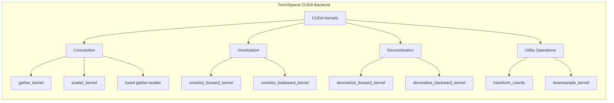
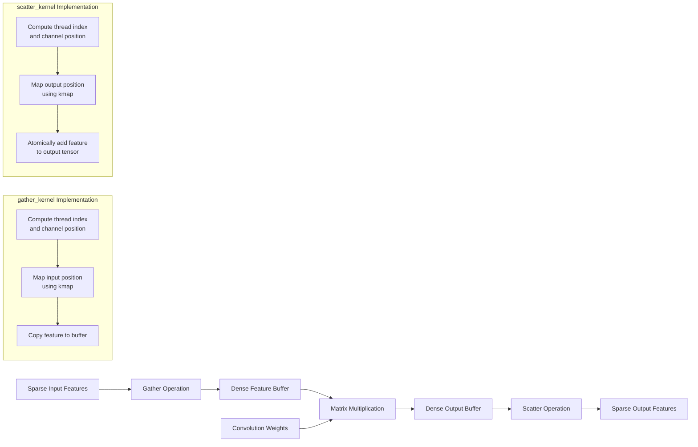
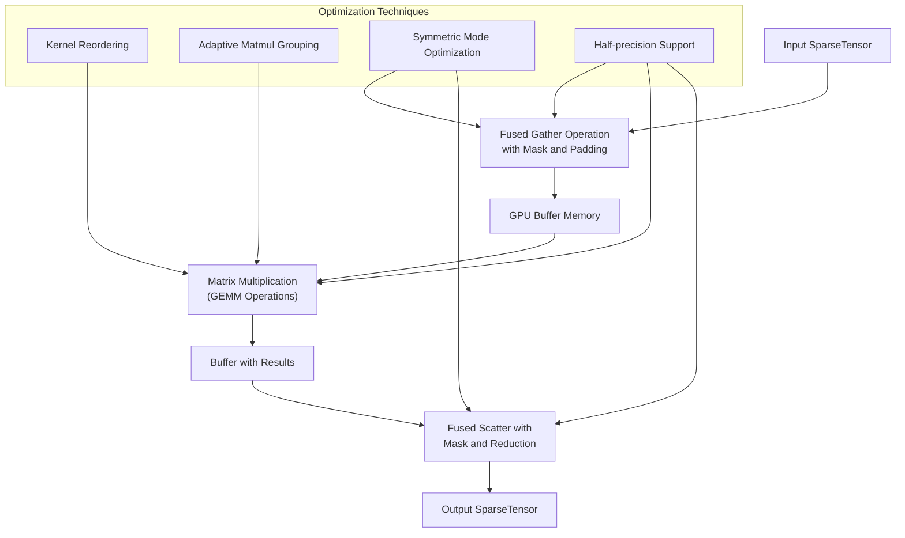
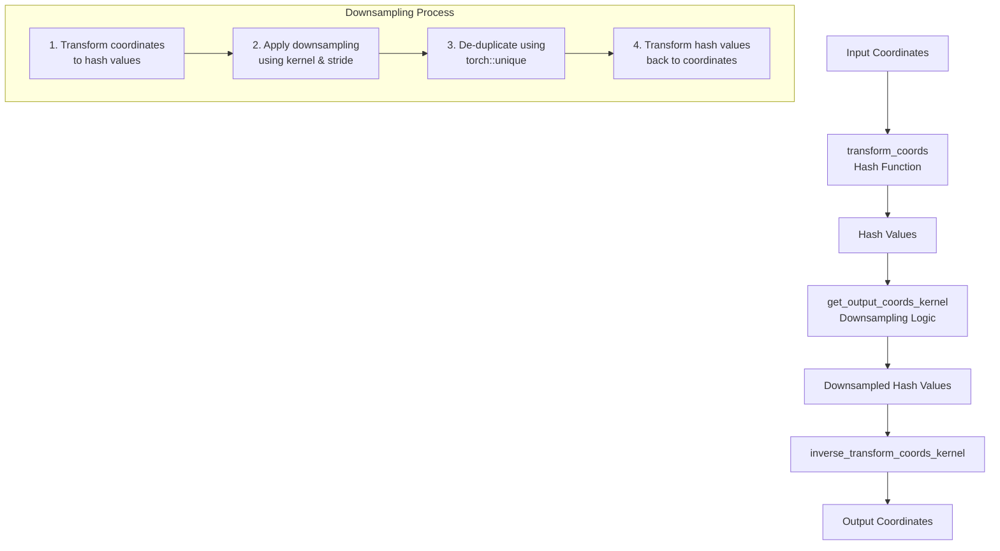
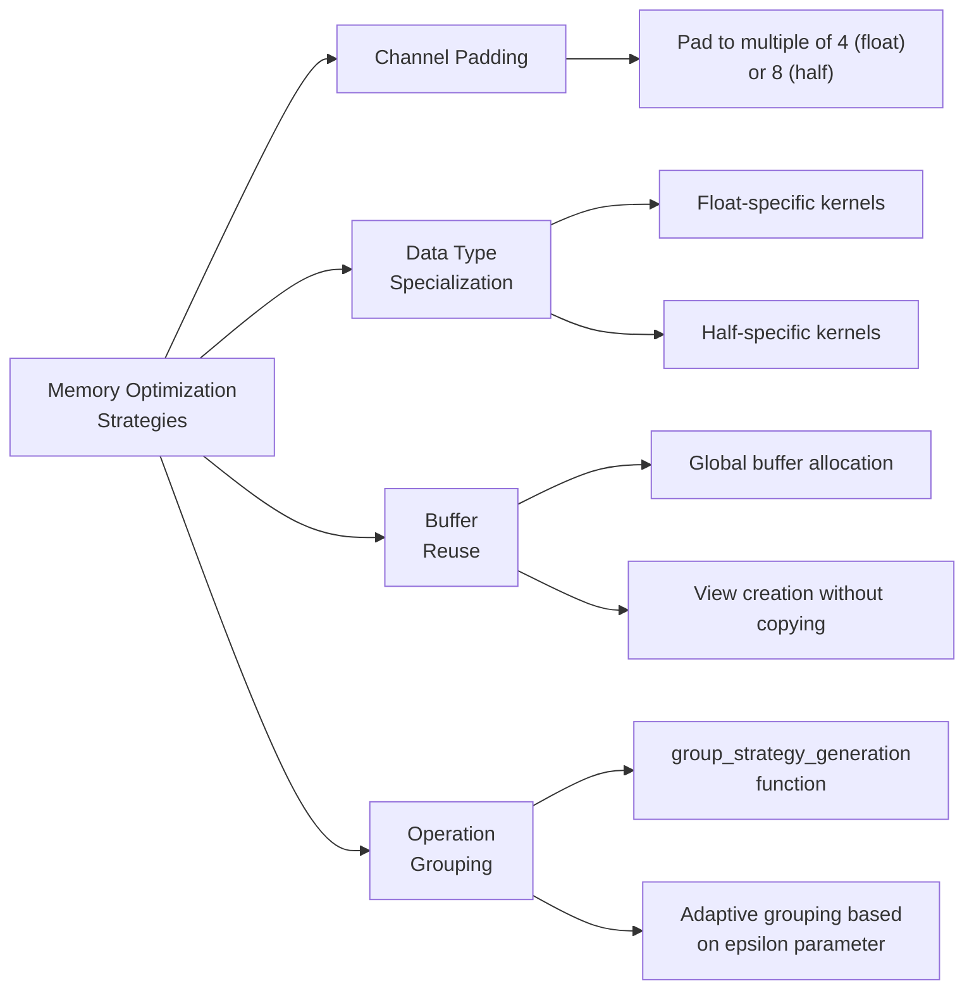
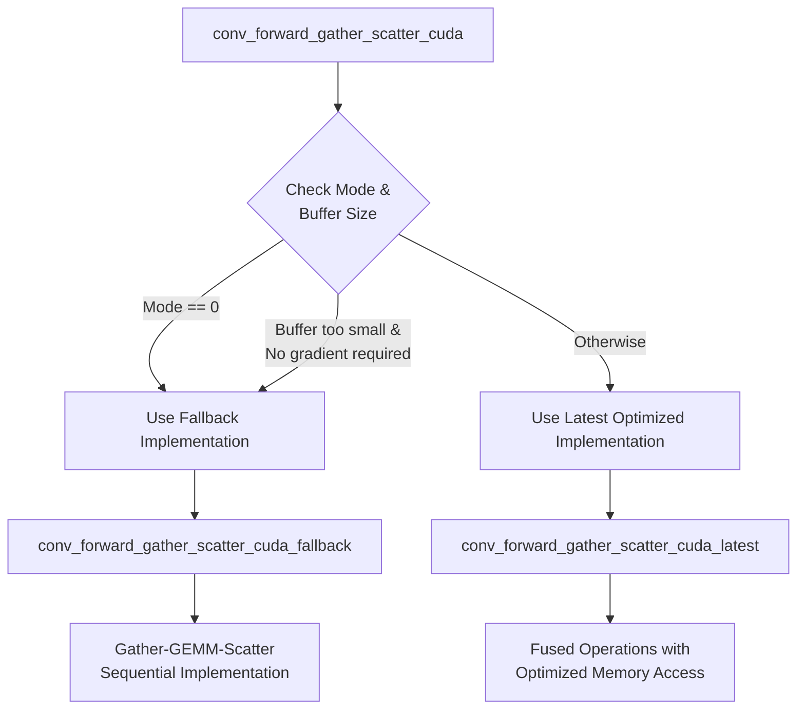

<!-- source: DeepWiki mcp.deepwiki.com · repo mit-han-lab/torchsparse · page 6.1 CUDA Kernel Implementation · fetched 2026-10-30 -->

# CUDA Kernel Implementation

<details>
<summary>Relevant source files</summary>

The following files were used as context for generating this wiki page:

- [torchsparse/backend/convolution/convolution_gather_scatter_cuda.cu](torchsparse/backend/convolution/convolution_gather_scatter_cuda.cu)
- [torchsparse/backend/devoxelize/devoxelize_cuda.cu](torchsparse/backend/devoxelize/devoxelize_cuda.cu)
- [torchsparse/backend/others/downsample_cuda.cu](torchsparse/backend/others/downsample_cuda.cu)
- [torchsparse/backend/voxelize/voxelize_cuda.cu](torchsparse/backend/voxelize/voxelize_cuda.cu)

</details>


This document provides a detailed explanation of the CUDA kernel implementations in TorchSparse, which are critical to achieving high-performance sparse tensor operations for point cloud processing. It focuses on the low-level CUDA kernels that power operations like sparse convolution, voxelization, and devoxelization. For information about the overall backend system architecture, see [Backend System](#2.2).

## Introduction to CUDA Kernels in TorchSparse

TorchSparse's performance advantage comes from highly optimized CUDA kernels that efficiently handle sparse data. These kernels directly run on NVIDIA GPUs and implement core operations like gather, scatter, voxelize, and devoxelize while managing sparse tensor data structures.



The CUDA kernels in TorchSparse are organized by functionality, with each kernel specializing in a specific operation related to sparse tensor processing. The implementation leverages CUDA's parallel processing capabilities to efficiently handle the irregular computation patterns inherent in sparse data.

Sources: [torchsparse/backend/convolution/convolution_gather_scatter_cuda.cu:17-40](), [torchsparse/backend/voxelize/voxelize_cuda.cu:40-56](), [torchsparse/backend/devoxelize/devoxelize_cuda.cu:11-33]()

## Kernel Organization and Memory Access Patterns

TorchSparse's CUDA kernels are designed with careful consideration of memory access patterns to maximize performance on GPU hardware.

```mermaid
classDiagram
    class "CUDA Kernel Base" {
        +blockIdx: CUDA block index
        +threadIdx: Thread index in block
        +index calculation
        +memory access patterns
    }
    
    class "Gather Kernel" {
        +template<typename scalar_t>
        +__global__ void gather_kernel()
        +Maps sparse input to dense buffer
    }
    
    class "Scatter Kernel" {
        +template<typename scalar_t>
        +__global__ void scatter_kernel()
        +Maps dense buffer to sparse output
    }
    
    class "Voxelize Kernel" {
        +template<typename scalar_t>
        +__global__ void voxelize_forward_kernel()
        +Points to voxels with averaging
    }
    
    class "Devoxelize Kernel" {
        +template<typename scalar_t>
        +__global__ void devoxelize_forward_kernel()
        +Voxels to points with interpolation
    }
    
    "CUDA Kernel Base" <|-- "Gather Kernel"
    "CUDA Kernel Base" <|-- "Scatter Kernel"
    "CUDA Kernel Base" <|-- "Voxelize Kernel"
    "CUDA Kernel Base" <|-- "Devoxelize Kernel"
```

All kernels follow a common pattern for determining the thread index and dividing work:

```c++
int index = blockIdx.x * blockDim.x + threadIdx.x;
int i = index / c;  // Point/voxel index
int j = index % c;  // Channel index
```

This pattern allows each CUDA thread to process one element of a feature vector, enabling efficient parallel processing across both spatial dimensions and feature channels.

Sources: [torchsparse/backend/convolution/convolution_gather_scatter_cuda.cu:21-22](), [torchsparse/backend/voxelize/voxelize_cuda.cu:47-48](), [torchsparse/backend/devoxelize/devoxelize_cuda.cu:16-18]()

## Sparse Convolution Implementation

The sparse convolution in TorchSparse is implemented using a gather-scatter pattern, which is critical for efficiently processing sparse data. This approach consists of three main steps:

1. **Gather**: Collect input features based on the kernel's receptive field
2. **Matrix Multiplication**: Apply convolution weights to gathered features
3. **Scatter**: Distribute results to appropriate output locations



### Gather Kernel

The gather kernel collects input features from sparse locations to create a dense buffer for efficient matrix multiplication:

```cpp
template <typename scalar_t>
__global__ void gather_kernel(const int n_k, const int n_in, const int c,
                            scalar_t *in_feat, scalar_t *out_feat,
                            const int *kmap, const bool transpose) {
  int index = blockIdx.x * blockDim.x + threadIdx.x;
  // Determine point and channel indices
  int i = index / c;  // kernel map index
  int j = index % c;  // channel index
  if (i >= n_k) return;
  
  // Get input position from kernel map
  int in_pos = kmap[2 * i + transpose];
  if (in_pos < 0) return;
  
  // Copy feature from input to output buffer
  out_feat[i * c + j] = in_feat[in_pos * c + j];
}
```

This kernel maps input features to a dense buffer based on the kernel map (`kmap`), which defines the spatial relationship between input and output features.

Sources: [torchsparse/backend/convolution/convolution_gather_scatter_cuda.cu:17-40]()

### Scatter Kernel

The scatter kernel distributes computed features from the dense buffer back to the sparse output tensor:

```cpp
template <typename scalar_t>
__global__ void scatter_kernel(const int n_in, const int n_out, const int c,
                             scalar_t *in_feat, scalar_t *out_feat,
                             const int *kmap, const bool transpose) {
  int index = blockIdx.x * blockDim.x + threadIdx.x;
  int i = index / c;  // kernel map index
  int j = index % c;  // channel index
  if (i >= n_in) return;
  
  // Get output position from kernel map
  int out_pos = kmap[2 * i + 1 - transpose];
  if (out_pos < 0 || out_pos >= n_out) return;
  
  // Atomically add feature to output tensor
  atomicAdd(&out_feat[out_pos * c + j], in_feat[i * c + j]);
}
```

The atomic addition is necessary because multiple input elements might contribute to the same output location in sparse convolution.

Sources: [torchsparse/backend/convolution/convolution_gather_scatter_cuda.cu:42-67]()

### Fused Gather-Scatter Operations

For improved performance, TorchSparse implements fused gather-scatter operations that combine multiple steps:



These fused operations include specialized versions for different data types (float and half-precision) and employ masked operations to avoid processing invalid elements.

Sources: [torchsparse/backend/convolution/convolution_gather_scatter_cuda.cu:71-112](), [torchsparse/backend/convolution/convolution_gather_scatter_cuda.cu:150-197](), [torchsparse/backend/convolution/convolution_gather_scatter_cuda.cu:199-250]()

## Voxelization and Devoxelization Kernels

### Voxelization

Voxelization converts point cloud features to a voxel grid representation. The core kernel averages features from points that fall into the same voxel:

```cpp
template <typename scalar_t>
__global__ void voxelize_forward_kernel(int N, int c, int s,
                                      const scalar_t *__restrict__ data,
                                      const int *__restrict__ idx,
                                      const int *__restrict__ counts,
                                      scalar_t *__restrict__ out) {
  int index = blockDim.x * blockIdx.x + threadIdx.x;
  int i = index / c;
  int j = index % c;
  if (i < N) {
    int pos = idx[i];
    if (pos < 0 || pos >= s || counts[pos] == 0)
      return;
    atomicAdd(&out[pos * c + j], data[i * c + j] / float(counts[pos]));
  }
}
```

The kernel uses atomic operations to handle multiple points contributing to the same voxel, ensuring correct feature averaging.

Sources: [torchsparse/backend/voxelize/voxelize_cuda.cu:40-56]()

### Devoxelization

Devoxelization converts voxel features back to point features, often with interpolation from neighboring voxels:

```cpp
template <typename scalar_t>
__global__ void devoxelize_forward_kernel(int N, int c,
                                        const int *__restrict__ indices,
                                        const scalar_t *__restrict__ weight,
                                        const scalar_t *__restrict__ feat,
                                        scalar_t *__restrict__ out) {
  int index = blockIdx.x * blockDim.x + threadIdx.x;
  int i = index / c;
  int j = index % c;

  if (i < N) {
    const int *indices_ = indices + 8 * i;
    const scalar_t *weight_ = weight + 8 * i;
    
    for (int k = 0; k < 8; k++) {
      scalar_t cur_feat = 0;
      if (indices_[k] >= 0) cur_feat = feat[indices_[k] * c + j];
      out[i * c + j] += weight_[k] * cur_feat;
    }
  }
}
```

This kernel retrieves features from up to 8 neighboring voxels (for 3D space) and computes a weighted sum based on interpolation weights.

Sources: [torchsparse/backend/devoxelize/devoxelize_cuda.cu:11-33]()

## Downsampling and Coordinate Processing

TorchSparse includes specialized kernels for coordinate processing and downsampling operations:



The downsampling process relies on efficient coordinate transformation using a hashing scheme and careful management of kernel sizes, strides, and padding.

Sources: [torchsparse/backend/others/downsample_cuda.cu:22-57](), [torchsparse/backend/others/downsample_cuda.cu:111-141]()

## Memory Optimization Techniques

TorchSparse employs several memory optimization techniques to improve efficiency:

1. **Data Type Specialization**: Separate kernel implementations for `float` and `half` data types
2. **Channel Padding**: Padding channels to optimize memory alignment (e.g., to multiples of 4 for float, 8 for half)
3. **Buffer Reuse**: Reusing pre-allocated buffers for temporary data to avoid frequent memory allocations
4. **Grouped Processing**: Processing similar kernel regions together to maximize compute efficiency



The optimization strategies are implemented throughout the CUDA kernels, with specialized handling for different data types and memory access patterns.

Sources: [torchsparse/backend/convolution/convolution_gather_scatter_cuda.cu:437-482](), [torchsparse/backend/convolution/convolution_gather_scatter_cuda.cu:313-408]()

## Fallback Mechanisms and Compatibility

TorchSparse includes fallback mechanisms to ensure compatibility across different hardware and conditions:



The system checks parameters like the convolution mode, buffer size, and gradient requirements to decide which implementation to use, balancing performance and compatibility.

Sources: [torchsparse/backend/convolution/convolution_gather_scatter_cuda.cu:279-311](), [torchsparse/backend/convolution/convolution_gather_scatter_cuda.cu:410-679](), [torchsparse/backend/convolution/convolution_gather_scatter_cuda.cu:681-814]()

## Thread Block and Grid Configuration

CUDA kernel launches in TorchSparse use carefully chosen thread block and grid configurations to maximize performance:

| Operation | Grid Size | Block Size | Work Distribution |
|-----------|-----------|------------|-------------------|
| Gather | `ceil(n_k * c / 256)` | 256 | One thread per feature element |
| Scatter | `ceil(n_in * c / 256)` | 256 | One thread per feature element |
| Voxelize | `N` (point count) | `c` (channels) | One thread per channel per point |
| Devoxelize | `N` (point count) | `c` (channels) | One thread per channel per point |
| Downsample | `ceil(N / 256)` | 256 | One thread per coordinate |

The configurations are adjusted based on data type and dimensionality to ensure efficient GPU utilization.

Sources: [torchsparse/backend/convolution/convolution_gather_scatter_cuda.cu:783-789](), [torchsparse/backend/voxelize/voxelize_cuda.cu:90-92](), [torchsparse/backend/devoxelize/devoxelize_cuda.cu:72-74](), [torchsparse/backend/others/downsample_cuda.cu:169-172]()

## Conclusion

TorchSparse's CUDA kernel implementation provides high-performance sparse tensor operations by leveraging GPU parallel processing capabilities. The implementation includes:

1. Efficient gather-scatter operations for sparse convolution
2. Specialized voxelization and devoxelization kernels
3. Memory optimization techniques including data type specialization and buffer reuse
4. Adaptive computation grouping for improved performance
5. Fallback mechanisms for compatibility across different hardware configurations

These optimized CUDA kernels form the foundation of TorchSparse's performance advantages for sparse point cloud processing.

---

