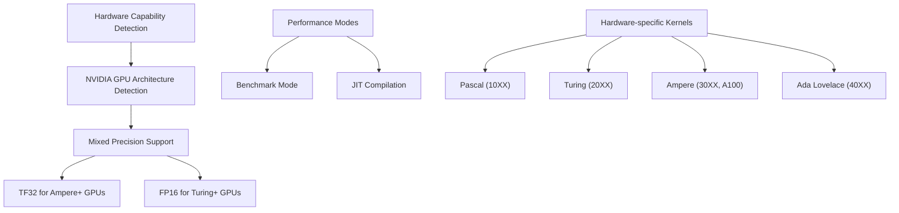
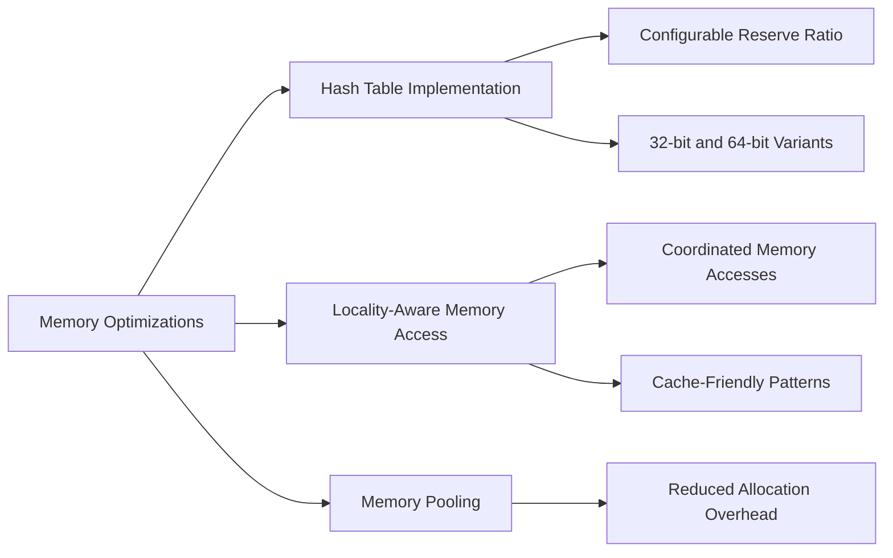
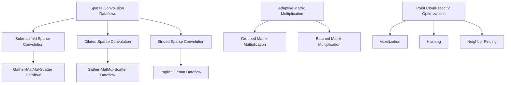
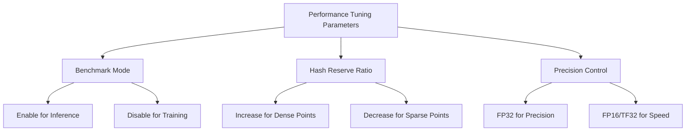
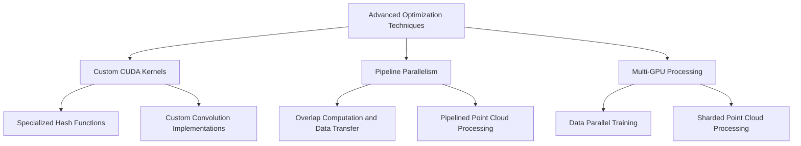

<!-- source: DeepWiki mcp.deepwiki.com · repo mit-han-lab/torchsparse · page 6.2 Performance Optimization · fetched 2026-10-30 -->

# Performance Optimization

<details>
<summary>Relevant source files</summary>

The following files were used as context for generating this wiki page:

- [.github/workflows/pre-commit.yaml](.github/workflows/pre-commit.yaml)
- [.pre-commit-config.yaml](.pre-commit-config.yaml)
- [README.md](README.md)
- [docs/figs/eval_benchmark.png](docs/figs/eval_benchmark.png)
- [docs/figs/train_benchmark.png](docs/figs/train_benchmark.png)
- [install.py](install.py)
- [torchsparse/backend/others/sparsemapping_cuda.h](torchsparse/backend/others/sparsemapping_cuda.h)
- [torchsparse/backends.py](torchsparse/backends.py)

</details>


This page describes the performance optimization techniques implemented in TorchSparse and provides guidance on how to tune the library for maximum efficiency. TorchSparse is specifically designed to address the challenges of sparse and irregular computation patterns in point cloud processing, with optimizations at hardware, algorithm, and memory levels.

For information about the CUDA kernel implementation details, see [CUDA Kernel Implementation](#6.1).

## Hardware-Aware Optimizations

TorchSparse implements several hardware-aware optimizations to take advantage of capabilities in modern GPUs.



### GPU Architecture Detection

TorchSparse automatically detects the GPU architecture capability and enables optimizations appropriate for that hardware:

```python
# Device capability is detected at initialization
device_capability = torch.cuda.get_device_capability()
device_capability = device_capability[0] * 100 + device_capability[1] * 10
allow_tf32 = device_capability >= 800  # Enabled for Ampere and newer
allow_fp16 = device_capability >= 750  # Enabled for Turing and newer
```

This automatic detection ensures that TorchSparse can leverage architecture-specific features like Tensor Cores without requiring manual configuration.

### Mixed Precision Support

TorchSparse supports different precision modes to balance performance and accuracy:

1. **FP32 (Full Precision)**: Available on all supported hardware
2. **TF32 (Tensor Float 32)**: Automatically enabled on Ampere (A100, 30XX series) and newer GPUs
3. **FP16 (Half Precision)**: Available on Turing (20XX series) and newer GPUs

Mixed precision training and inference can significantly accelerate performance, especially for GPUs with Tensor Core support.

Sources: [torchsparse/backends.py:4-11]()

## Memory Optimizations

Memory access patterns are a critical factor in TorchSparse's performance. The library implements several optimizations to efficiently manage memory for sparse tensors.



### Hash Table Optimization

TorchSparse uses hash tables for sparse tensor storage and operations. The hash table implementation includes:

1. **Configurable reserve ratio**: Controls the amount of memory allocated for hash tables
   ```python
   hash_rsv_ratio = 2  # default value, reserves 2x space for downsampling
   ```

2. **Specialized 32-bit and 64-bit implementations**: For different memory requirements
   ```cpp
   // 32-bit hash table implementation for lower memory footprint
   std::vector<at::Tensor> build_kernel_map_subm_hashmap_int32(
       hashtable32& table,
       at::Tensor _in_coords, at::Tensor _coords_min, at::Tensor _coords_max,
       at::Tensor _kernel_sizes, at::Tensor _stride,
       at::Tensor padding, bool to_insert);
   
   // 64-bit hash table implementation for larger coordinate ranges
   std::vector<at::Tensor> build_kernel_map_subm_hashmap(
       hashtable& table,
       at::Tensor _in_coords, at::Tensor _coords_min, at::Tensor _coords_max,
       at::Tensor _kernel_sizes, at::Tensor _stride,
       at::Tensor padding, bool to_insert);
   ```

### Locality-Aware Memory Access

TorchSparse implements locality-aware memory access patterns to maximize cache efficiency. This is especially important for sparse operations where memory access can be irregular.

Sources: [torchsparse/backends.py:4-11](), [torchsparse/backend/others/sparsemapping_cuda.h:1-33]()

## Dataflow Optimizations

TorchSparse introduces adaptive dataflow selection to optimize for different sparse convolution patterns.



### Adaptive Dataflow Selection

TorchSparse automatically selects the most efficient dataflow for sparse convolution operations:

1. **Gather-MatMul-Scatter**: Efficient for submanifold and dilated convolutions
2. **Implicit Gemm**: Better for strided convolutions

The selection is done based on the convolution parameters and the sparsity pattern of the input.

### Grouped Matrix Multiplication

TorchSparse implements adaptive matrix multiplication grouping to optimize compute utilization. This technique:

1. Analyzes the size and sparsity of kernels
2. Determines optimal grouping strategies for matrix multiplication
3. Dynamically adapts to different input patterns

## Performance Tuning Parameters

TorchSparse provides several parameters that can be tuned to optimize performance for specific workloads:



### Benchmark Mode

The benchmark flag can be set to optimize CUDA kernels for inference:

```python
import torchsparse.backends

# Enable benchmark mode for inference
torchsparse.backends.benchmark = True
```

Enabling benchmark mode optimizes CUDA kernels for inference but may increase memory usage. It's recommended to:
- Enable for inference
- Disable for training (especially with varying input sizes)

### Hash Reserve Ratio

The hash reserve ratio controls the amount of memory allocated for hash tables:

```python
import torchsparse.backends

# Increase hash reserve ratio for denser point clouds
torchsparse.backends.hash_rsv_ratio = 3  # Default is 2
```

A higher ratio reduces hash collisions but increases memory usage. Optimal settings depend on:
- Point cloud density
- Operation type (especially for downsampling operations)

### Precision Control

Precision can be controlled to balance accuracy and performance:

```python
import torchsparse.backends

# Enable/disable TF32 (for Ampere and newer GPUs)
torchsparse.backends.allow_tf32 = True  # Default is based on GPU

# Enable/disable FP16 (for Turing and newer GPUs)
torchsparse.backends.allow_fp16 = True  # Default is based on GPU
```

Sources: [torchsparse/backends.py:4-11]()

## Benchmarks and Performance Comparison

TorchSparse demonstrates significant performance improvements compared to other sparse convolution libraries across different GPU architectures.

### Inference Performance

TorchSparse significantly outperforms existing point cloud inference engines:

| Library | Pascal | Turing | Ampere | Relative Performance |
|---------|--------|--------|--------|---------------------|
| MinkowskiEngine | 1.0x | 1.0x | 1.0x | Baseline |
| SpConv 1.2 | 1.1x | 1.2x | 1.3x | Faster than baseline |
| TorchSparse (MLSys) | 1.4x | 1.7x | 1.9x | Much faster than baseline |
| SpConv v2 | 1.6x | 1.9x | 2.5x | Nearly state-of-the-art |
| TorchSparse++ | 1.7x | 2.2x | 2.9x | State-of-the-art |

TorchSparse++ achieves up to 2.9x speedup on NVIDIA A100 GPU over MinkowskiEngine.

### Training Performance

TorchSparse also demonstrates superior training performance with mixed precision:

| Library | RTX 2080 Ti | Tesla A100 |
|---------|-------------|------------|
| MinkowskiEngine | 1.0x | 1.0x |
| SpConv 2.3.5 | 3.6x | 4.1x |
| TorchSparse++ | 4.6x | 4.8x |

TorchSparse++ is approximately 1.2-1.3x faster than SpConv 2.3.5 and 4.6-4.8x faster than MinkowskiEngine for mixed-precision training.

Sources: [README.md:81-95]()

## Optimization Guidelines for Users

This section provides guidelines for optimizing your TorchSparse applications.

### Performance Best Practices

1. **Use the right precision for your hardware**:
   - FP16 for Turing+ GPUs when accuracy allows
   - TF32 for Ampere+ GPUs for a good balance of precision and speed
   - FP32 for higher precision requirements

2. **Optimize hash table parameters**:
   - Adjust `hash_rsv_ratio` based on your point cloud density
   - Use a higher ratio for denser point clouds
   - Use a lower ratio for sparser point clouds to save memory

3. **Enable benchmark mode for inference**:
   ```python
   import torchsparse.backends
   torchsparse.backends.benchmark = True
   ```

4. **Choose appropriate batch sizes**:
   - Larger batch sizes generally offer better performance
   - Balance with memory constraints

5. **Data preprocessing optimization**:
   - Optimize voxelization parameters for your specific point cloud density
   - Consider downsampling extremely dense point clouds

### Common Performance Pitfalls

1. **Excessive voxel resolution**: Using too high a voxel resolution can lead to excessive memory usage and slower processing

2. **Inappropriate hash reserve ratio**: Too small can cause excessive hash collisions, too large wastes memory

3. **Ignoring hardware capabilities**: Not enabling TF32 or FP16 when the hardware supports it

4. **Misusing benchmark mode**: Enabling it during training with varying input sizes can lead to suboptimal performance

5. **Ignoring memory fragmentation**: Multiple small operations can lead to memory fragmentation; batch operations when possible

## Performance Debugging

When facing performance issues, consider the following steps:

1. **Profile with PyTorch Profiler**:
   ```python
   with torch.profiler.profile(
       activities=[torch.profiler.ProfilerActivity.CPU, torch.profiler.ProfilerActivity.CUDA],
       record_shapes=True,
       profile_memory=True
   ) as prof:
       # Your TorchSparse operations here
       
   print(prof.key_averages().table(sort_by="cuda_time_total"))
   ```

2. **Check memory usage**:
   - Monitor GPU memory usage with `nvidia-smi`
   - Use PyTorch's memory profiling tools

3. **Verify hardware utilization**:
   - Check GPU utilization to ensure compute resources are fully used
   - Look for memory bottlenecks

4. **Experiment with different configurations**:
   - Try different precision modes
   - Adjust hash reserve ratio
   - Toggle benchmark mode

Remember that optimal configuration depends on your specific hardware, point cloud characteristics, and network architecture.

Sources: [torchsparse/backends.py:4-11](), [README.md:81-95]()

## Advanced Optimization Techniques

For advanced users, TorchSparse provides additional optimization opportunities.



### Custom CUDA Kernels

TorchSparse allows for extending the library with custom CUDA kernels for specialized operations. This requires understanding of the [backend system](#2.2) and CUDA programming.

### Pipeline Optimization

For complex networks, consider implementing pipeline parallelism by overlapping:
- Data preprocessing (voxelization, quantization)
- Feature extraction (sparse convolution)
- Post-processing (BEV conversion, etc.)

### Multi-GPU Processing

For large point clouds or datasets, leverage multiple GPUs through:
- Data parallelism for training
- Spatial partitioning for extremely large point clouds

## Conclusion

TorchSparse provides extensive performance optimizations for sparse point cloud processing. By understanding and properly configuring these optimizations, users can achieve state-of-the-art performance for both training and inference.

The library's hardware-aware design, optimized memory management, and adaptive algorithms make it particularly well-suited for real-time applications like autonomous driving perception systems, where processing efficiency is crucial.

For further details on the implementation of these optimizations, refer to the [CUDA Kernel Implementation](#6.1) page.

Sources: [README.md:15-17](), [torchsparse/backends.py:4-11]()

---

