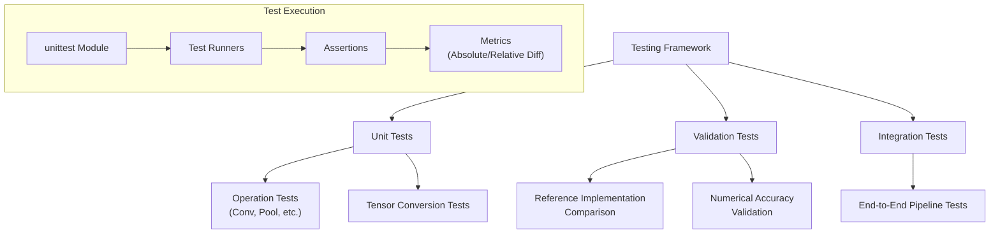
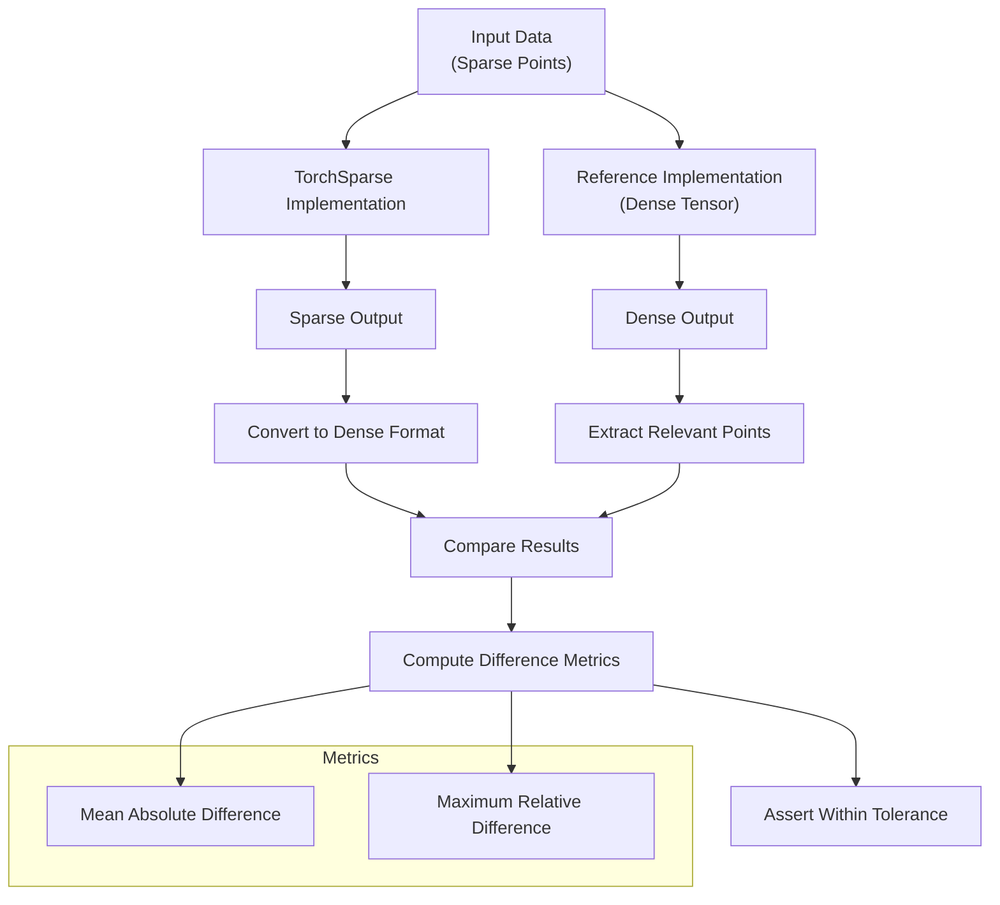
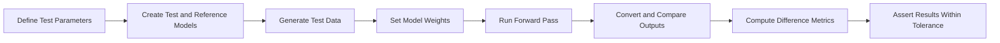

<!-- source: DeepWiki mcp.deepwiki.com · repo mit-han-lab/torchsparse · page 6.3 Testing and Validation · fetched 2026-10-30 -->

# Testing and Validation

<details>
<summary>Relevant source files</summary>

The following files were used as context for generating this wiki page:

- [.github/ISSUE_TEMPLATE/bug_report.yaml](.github/ISSUE_TEMPLATE/bug_report.yaml)
- [.github/ISSUE_TEMPLATE/installation.yaml](.github/ISSUE_TEMPLATE/installation.yaml)
- [docs/FAQ.md](docs/FAQ.md)
- [tests/python/test_single_layer_conv.py](tests/python/test_single_layer_conv.py)
- [tests/test.py](tests/test.py)

</details>


This document provides an overview of the testing and validation framework used in TorchSparse, explaining how tests are structured, how to run them, and how to write new tests for validating custom implementations. For information about performance optimization and benchmarking, see [Performance Optimization](#6.2).

## Overview of TorchSparse Testing Framework

TorchSparse employs a comprehensive testing strategy to ensure correctness and performance of its sparse tensor operations. The testing framework primarily uses Python's `unittest` module for organizing and running tests, with a focus on comparing TorchSparse's implementation results against reference implementations using dense tensors.



Sources: [tests/test.py](), [tests/python/test_single_layer_conv.py]()

## Test Structure and Organization

The TorchSparse testing framework is organized into multiple test files, each focused on specific components of the library. Tests are structured using Python's unittest framework with test cases for different operations and configurations.

### Main Test Components

```mermaid
classDiagram
    class "SparseConvTestCase" {
        +test_single_layer()
    }
    
    class "ToDenseTestCase" {
        +test_to_dense()
    }
    
    class "TestSparseConv" {
        +__init__(num_layers, shape, in_channels, out_channels, kernel_size, stride, padding, dilation, device)
        +forward(feats, coords)
    }
    
    class "TestTorchConv" {
        +__init__(num_layers, shape, in_channels, out_channels, kernel_size, stride, padding, dilation, device)
        +forward(x)
    }
    
    "SparseConvTestCase" --> "test_single_layer_convolution_forward" : uses
    "ToDenseTestCase" --> "test_to_dense_forward" : uses
    "test_single_layer_convolution_forward" --> "TestSparseConv" : creates
    "test_single_layer_convolution_forward" --> "TestTorchConv" : creates as reference
```

The main test entry point is [tests/test.py](), which defines test cases using the unittest framework. Individual test functions are imported from Python modules in the `tests/python/` directory.

Sources: [tests/test.py:1-51](), [tests/python/test_single_layer_conv.py:17-109]()

## Validation Methodology

TorchSparse uses a reference-based validation approach, where the sparse operations are compared against equivalent dense tensor operations to ensure correctness. This methodology verifies that the sparse implementations produce the same results as their dense counterparts, within acceptable numerical precision.

### Comparison with Reference Implementations

For operations like sparse convolution, TorchSparse implements both:
1. A sparse version using TorchSparse's specialized operations
2. A reference version using PyTorch's standard dense operations

The test then compares the outputs to validate correctness:



Sources: [tests/python/test_single_layer_conv.py:111-220](), [tests/test.py:9-41]()

## Running Tests

Tests in TorchSparse can be run using Python's unittest framework. The main test script [tests/test.py]() defines the test cases and runs them when executed.

### Basic Test Execution

To run all tests:

```bash
python tests/test.py
```

To run specific test cases:

```bash
python -m unittest tests.test.SparseConvTestCase
```

### Test Parameters and Configurations

Tests are run with various configurations to ensure comprehensive validation:

| Parameter | Description | Values Tested |
|-----------|-------------|---------------|
| kernel_size | Size of convolution kernel | 2, 3, 5 |
| stride | Convolution stride | 1, 2, 3 |
| kmap_mode | Kernel map mode | "hashmap", "hashmap_on_the_fly" |
| dataflow | Computation pattern | ImplicitGEMM |

The test framework also supports different precision modes (float16/float32) to validate half-precision operations.

Sources: [tests/test.py:11-38](), [tests/python/test_single_layer_conv.py:227-247]()

## Test Case Implementation

TorchSparse's test cases follow a specific pattern to validate sparse operations against dense tensor operations. Here's how a typical test implementation works:

1. Define both sparse and dense model implementations
2. Generate test data with specific characteristics
3. Run both implementations on the same data
4. Convert outputs to comparable formats
5. Calculate difference metrics
6. Assert that differences are within acceptable thresholds

### Example: Convolution Test

The single layer convolution test ([tests/python/test_single_layer_conv.py]()) validates sparse convolution against regular PyTorch convolution by:

1. Creating both sparse and dense convolution models
2. Generating point cloud data and converting to appropriate formats
3. Applying the same convolution weights to both models
4. Running forward passes and collecting outputs
5. Converting sparse outputs to dense format for comparison
6. Computing mean absolute difference and maximum relative difference
7. Validating that these differences are within acceptable thresholds

Sources: [tests/python/test_single_layer_conv.py:111-220]()

## Writing Custom Tests

When extending TorchSparse or implementing custom operations, it's important to validate them properly. Here's a guide for writing effective test cases:

### Test Case Structure



### Key Considerations for Custom Tests

1. **Test both sparse and dense implementations**: Always implement both a sparse version and a dense reference version.

2. **Test with various configurations**: Test with different kernel sizes, strides, and other relevant parameters.

3. **Control random seed**: Set fixed random seeds for reproducibility:
   ```python
   np.random.seed(0)
   torch.manual_seed(0)
   ```

4. **Validate with appropriate metrics**: Use both absolute and relative differences to account for numerical variations.

5. **Test with different precisions**: Validate with both float32 and float16 when applicable.

Sources: [tests/python/test_single_layer_conv.py:111-220](), [tests/test.py:9-41]()

## Validation Metrics

TorchSparse uses two primary metrics to validate test results:

1. **Mean Absolute Difference (mean_adiff)**: Measures the average absolute difference between the sparse and dense implementations.
   ```
   mean_adiff = np.sum(np.abs(sparse_output - dense_output)) / num_points
   ```

2. **Maximum Relative Difference (max_rdiff)**: Measures the maximum relative difference, which helps identify significant relative errors.
   ```
   max_rdiff = max_adiff / np.mean(np.abs(sparse_output))
   ```

Typical acceptance thresholds are:
- Mean absolute difference: ≤ 1e-4
- Maximum relative difference: ≤ 1e-2

Sources: [tests/python/test_single_layer_conv.py:217-219](), [tests/test.py:40-41]()

## Troubleshooting Test Failures

When tests fail, it's important to systematically diagnose the issue. Here are common causes and solutions:

### Common Test Failure Causes

1. **Environment Issues**: Mismatches between CUDA, PyTorch, and compiler versions.
   - Solution: Verify CUDA and PyTorch versions match using commands from [.github/ISSUE_TEMPLATE/bug_report.yaml:30-34]()

2. **Numerical Precision**: Small differences might accumulate in complex operations.
   - Solution: Adjust tolerance thresholds if the differences are minimal

3. **Memory Issues**: Out-of-memory errors during testing.
   - Solution: Reduce batch sizes or test with fewer points

4. **Implementation Differences**: Fundamental differences between sparse and dense implementations.
   - Solution: Review algorithm implementation and ensure equivalence

## Continuous Integration

TorchSparse uses GitHub Actions for continuous integration testing. When contributing new code, all tests will be automatically run to ensure your changes don't break existing functionality.

### Pre-commit Hooks

TorchSparse also uses pre-commit hooks to validate code quality before submission:

1. Code formatting checks
2. Syntax validation
3. Type checking

Ensuring these checks pass locally before submitting PRs will streamline the contribution process.

Sources: [.github/ISSUE_TEMPLATE/bug_report.yaml](), [.github/ISSUE_TEMPLATE/installation.yaml]()

## Summary

Testing and validation are critical components of the TorchSparse development process, ensuring that sparse tensor operations produce correct results efficiently. The framework follows a systematic approach of comparing sparse implementations against dense reference implementations, with clear metrics for validation.

When extending or customizing TorchSparse, following these testing patterns will help ensure your implementations are correct and robust.

---

