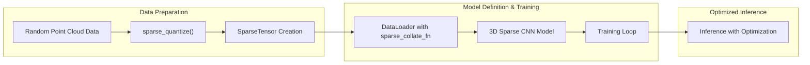
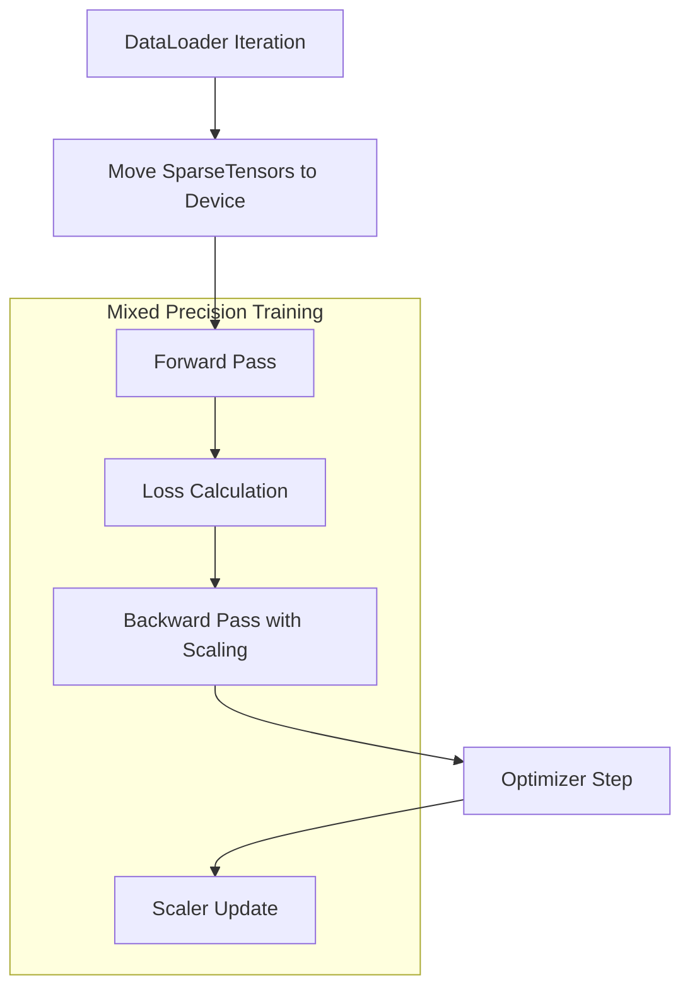
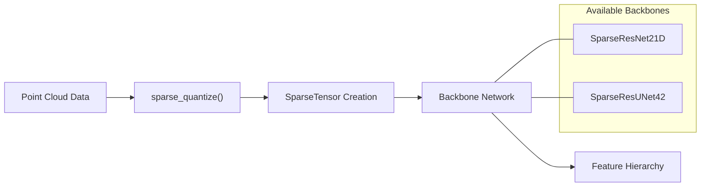
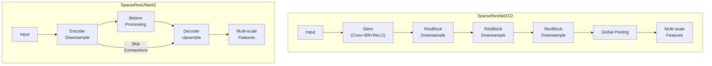

<!-- source: DeepWiki mcp.deepwiki.com · repo mit-han-lab/torchsparse · page 7 Examples and Tutorials · fetched 2026-10-30 -->

# Examples and Tutorials

<details>
<summary>Relevant source files</summary>

The following files were used as context for generating this wiki page:

- [examples/backbones.py](examples/backbones.py)
- [examples/example.py](examples/example.py)
- [torchsparse/backbones/__init__.py](torchsparse/backbones/__init__.py)
- [torchsparse/backbones/modules/__init__.py](torchsparse/backbones/modules/__init__.py)

</details>


This page provides practical examples and tutorials for using TorchSparse in real-world point cloud processing applications. The examples demonstrate how to implement common workflows, from data preparation and model definition to training and inference with optimization features.

For a conceptual introduction to TorchSparse, please see [Overview](#1). For information about specific neural network modules, refer to [Neural Network Modules](#3).

## Basic Usage Example

The basic example demonstrates a complete TorchSparse workflow, including data preparation, model construction, training, and optimized inference.



### Data Preparation

The example starts by creating a custom dataset that generates random point cloud data and applies sparse quantization:

```mermaid
classDiagram
    class "RandomDataset" {
        +input_size: int
        +voxel_size: float
        +__getitem__(idx): Dict
        +__len__(): int
    }
    
    class "sparse_quantize()" {
        +coords: np.ndarray
        +voxel_size: float
        +return_index: bool
        +return: Tuple
    }
    
    class "SparseTensor" {
        +coords: torch.Tensor
        +feats: torch.Tensor
    }
    
    "RandomDataset" --> "sparse_quantize()"
    "sparse_quantize()" --> "SparseTensor"
```

The `RandomDataset` class:
1. Generates random point cloud data
2. Applies sparse quantization to convert continuous coordinates to discrete voxel indices
3. Creates a `SparseTensor` with coordinates and features

Key operations include:
- Generating random point coordinates and features [examples/example.py:25-26]()
- Applying sparse quantization to obtain voxel coordinates [examples/example.py:30]()
- Creating SparseTensor objects for input and label [examples/example.py:36-37]()

To handle batching of sparse tensors, the example uses `sparse_collate_fn`:

```python
dataflow = torch.utils.data.DataLoader(
    dataset,
    batch_size=2,
    collate_fn=sparse_collate_fn,
)
```

Sources: [examples/example.py:19-41](), [examples/example.py:58-63]()

### Model Definition

The example creates a sequential model using TorchSparse's sparse convolutional layers:

```mermaid
flowchart LR
    A["Input SparseTensor\n(4 channels)"] --> B["Conv3d(4→32, k=3)"]
    B --> C["BatchNorm + ReLU"]
    C --> D["Conv3d(32→64, k=2, s=2)"]
    D --> E["BatchNorm + ReLU"]
    E --> F["Conv3d-Transpose(64→64, k=2, s=2)"]
    F --> G["BatchNorm + ReLU"]
    G --> H["Conv3d(64→32, k=3)"]
    H --> I["BatchNorm + ReLU"]
    I --> J["Conv3d(32→10, k=1)"]
    J --> K["Output SparseTensor\n(10 channels)"]
```



The model architecture:
- Starts with a 3D convolution to expand features from 4 to 32 channels
- Applies downsampling with strided convolution (stride=2)
- Uses transposed convolution for upsampling
- Ends with a 1×1 convolution to produce class scores

Example model definition:

```python
model = nn.Sequential(
    spnn.Conv3d(4, 32, 3),
    spnn.BatchNorm(32),
    spnn.ReLU(True),
    spnn.Conv3d(32, 64, 2, stride=2),
    spnn.BatchNorm(64),
    spnn.ReLU(True),
    spnn.Conv3d(64, 64, 2, stride=2, transposed=True),
    spnn.BatchNorm(64),
    spnn.ReLU(True),
    spnn.Conv3d(64, 32, 3),
    spnn.BatchNorm(32),
    spnn.ReLU(True),
    spnn.Conv3d(32, 10, 1),
)
```

Sources: [examples/example.py:65-79]()

### Training Loop

The training loop demonstrates how to:
1. Move sparse tensors to the target device
2. Apply mixed-precision training with PyTorch's AMP
3. Access and use features from sparse tensors



Key training components:
- Loss function: `nn.CrossEntropyLoss()`
- Optimizer: `torch.optim.Adam`
- Gradient scaling for mixed precision: `amp.GradScaler`

Sources: [examples/example.py:81-98]()

### Optimized Inference

The example also demonstrates how to optimize TorchSparse for inference:

```python
# enable torchsparse 2.0 inference
model.eval()
# enable fused and locality-aware memory access optimization
torchsparse.backends.benchmark = True
```

The optimized inference section shows:
- Setting the model to evaluation mode
- Enabling backend optimizations for improved performance
- Using half-precision (FP16) for faster inference
- Using AMP autocast for mixed precision inference

Sources: [examples/example.py:100-114]()

## Backbone Implementation Example

TorchSparse provides pre-built backbone architectures for common 3D tasks. The backbones example demonstrates how to use these architectures with random point cloud data.



### Using Pre-built Backbones

The example demonstrates how to:
1. Initialize backbone networks with customizable parameters
2. Process point cloud data through the backbones
3. Access multi-scale feature outputs

```python
# Initialize a backbone
model = SparseResNet21D(in_channels=4, width_multiplier=1.0)

# Process data through the backbone
outputs = model(input)

# Access multi-scale features
for k, output in enumerate(outputs):
    print(f"output[{k}].F.shape = {output.feats.shape}")
```

The backbones return a list of `SparseTensor` objects representing features at different scales, which can be used for downstream tasks like detection or segmentation.

Sources: [examples/backbones.py:10-41]()

### Backbone Architecture Comparison

The example demonstrates two main backbone architectures:

1. **SparseResNet21D**: A ResNet-style architecture for 3D point clouds
   - Based on residual blocks with skip connections
   - Suitable for classification and feature extraction tasks

2. **SparseResUNet42**: A U-Net-style architecture with skip connections
   - Encoder-decoder structure with skip connections
   - Suitable for dense prediction tasks like semantic segmentation



Sources: [examples/backbones.py:17-41](), [torchsparse/backbones/__init__.py:1-2]()

## Common Patterns and Best Practices

Based on the examples, several common patterns and best practices emerge when using TorchSparse:

### Data Preparation

1. **Sparse Quantization**: Always apply `sparse_quantize()` to convert continuous point coordinates to discrete voxel indices:

```python
coords, indices = sparse_quantize(point_cloud, voxel_size, return_index=True)
```

2. **SparseTensor Creation**: Construct a `SparseTensor` with coordinate and feature tensors:

```python
input = SparseTensor(coords=coords, feats=feats)
```

3. **Batch Processing**: Use `sparse_collate_fn` with DataLoader to properly batch sparse tensors:

```python
dataloader = torch.utils.data.DataLoader(
    dataset,
    batch_size=batch_size,
    collate_fn=sparse_collate_fn
)
```

### Model Configuration

1. **Convolution Configuration**: Set global convolution configuration before model creation:

```python
from torchsparse.nn import functional as F
conv_config = F.get_default_conv_config()
F.set_global_conv_config(conv_config)
```

2. **Kernel Map Mode**: Choose the kernel map implementation for best performance:

```python
F.set_kmap_mode("hashmap")  # Options: "hashmap" or "subm"
```

### Performance Optimization

1. **Mixed Precision Training**: Use PyTorch's AMP for better performance:

```python
scaler = amp.GradScaler(enabled=True)
with amp.autocast(enabled=True):
    outputs = model(inputs)
    loss = criterion(outputs.feats, labels.feats)

scaler.scale(loss).backward()
scaler.step(optimizer)
scaler.update()
```

2. **Inference Optimization**: Enable TorchSparse optimizations for inference:

```python
model.eval()
torchsparse.backends.benchmark = True  # Enable fused operations
```

3. **Half-precision Inference**: Use FP16 for faster inference:

```python
inputs = inputs.half()  # Convert to half precision
with amp.autocast(enabled=True):
    outputs = model(inputs)
```

Sources: [examples/example.py:44-47](), [examples/example.py:100-111](), [examples/backbones.py:15]()

## What's Next

After mastering these examples, you can:

1. Explore specific neural network modules in the [Neural Network Modules](#3) section
2. Learn about advanced operations in the [Functional API](#4) section
3. Find out about performance optimization in the [Performance Optimization](#6.2) section

For detailed examples of specific operations like voxelization and BEV conversion, refer to [Basic Usage Example](#7.1) and [Backbone Implementation Example](#7.2).

---

