<!-- source: DeepWiki mcp.deepwiki.com · repo mit-han-lab/torchsparse · page 7.1 Basic Usage Example · fetched 2026-10-30 -->

# Basic Usage Example

Relevant source files

The following files were used as context for generating this wiki page:

- [examples/example.py](examples/example.py)

This page demonstrates a complete workflow for using TorchSparse to process point cloud data through a neural network model. It covers data preparation, model creation, training, and optimized inference. For information about using pre-built backbone networks, see [Backbone Implementation Example](#7.2).

## Overview of the Basic Workflow

The typical TorchSparse usage pipeline includes:

1. Preparing point cloud data and converting it to `SparseTensor` format
2. Building a neural network model with sparse operations
3. Training the model with standard PyTorch techniques
4. Running optimized inference with TorchSparse-specific enhancements

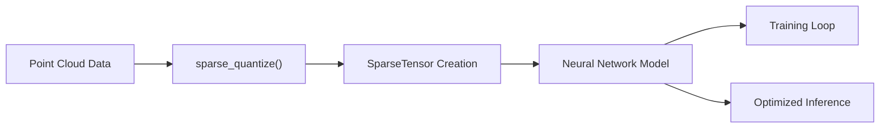

Sources: [examples/example.py:1-115]()

## Data Preparation

### Creating a Dataset

When working with point cloud data, you need to prepare it for sparse tensor operations. The example uses a custom dataset class that generates random point cloud data:

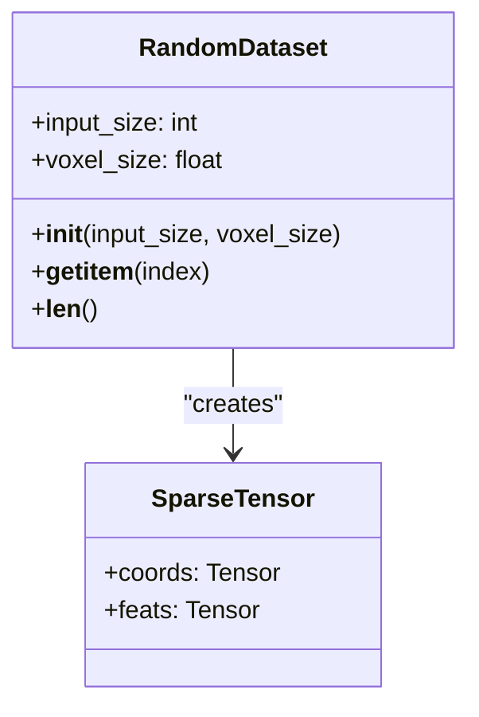

Sources: [examples/example.py:19-41]()

The dataset performs these key operations:

1. Generates random 3D points with features
2. Quantizes the points to voxels using `sparse_quantize`
3. Creates and returns `SparseTensor` objects for both input data and labels

### Point Cloud Quantization

Quantization is a crucial step that converts continuous point coordinates to discrete voxel coordinates:

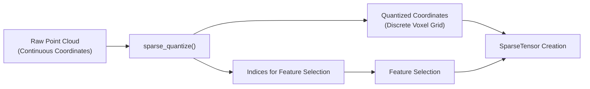

Sources: [examples/example.py:30-36]()

The quantization process:

1. Normalizes point coordinates by subtracting minimum values
2. Applies `sparse_quantize` with a specified voxel size
3. Returns quantized coordinates and indices for feature selection

### Creating SparseTensor Objects

The `SparseTensor` is the core data structure in TorchSparse:

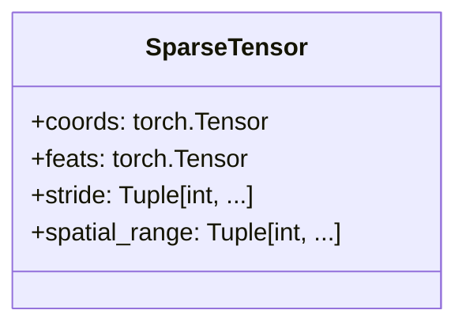

Sources: [examples/example.py:36-37]()

Key components:
- `coords`: Integer tensor representing voxel coordinates (shape: [N, 3] or [N, 4] with batch index)
- `feats`: Floating-point tensor containing features for each voxel (shape: [N, C] where C is the feature dimension)

## Model Creation

### Setting up a Neural Network

The example creates a sequential model using TorchSparse's neural network modules:

```mermaid
flowchart TB
    subgraph "Sequential Model"
        A["spnn.Conv3d(4, 32, 3)"] --> B["spnn.BatchNorm(32)"]
        B --> C["spnn.ReLU(True)"]
        C --> D["spnn.Conv3d(32, 64, 2, stride=2)"]
        D --> E["spnn.BatchNorm(64)"]
        E --> F["spnn.ReLU(True)"]
        F --> G["spnn.Conv3d(64, 64, 2, stride=2, transposed=True)"]
        G --> H["spnn.BatchNorm(64)"]
        H --> I["spnn.ReLU(True)"]
        I --> J["spnn.Conv3d(64, 32, 3)"]
        J --> K["spnn.BatchNorm(32)"]
        K --> L["spnn.ReLU(True)"]
        L --> M["spnn.Conv3d(32, 10, 1)"]
    end
    
    classDef default font-size:14px;
```

Sources: [examples/example.py:65-79]()

This model implements:
- Sparse 3D convolutions (`spnn.Conv3d`)
- Batch normalization for sparse tensors (`spnn.BatchNorm`)
- ReLU activation functions (`spnn.ReLU`)
- Transposed convolutions for upsampling (`spnn.Conv3d` with `transposed=True`)

### Network Architecture

The example network architecture follows a typical encoder-decoder pattern:

| Layer | Operation | Input Channels | Output Channels | Kernel Size | Stride | Notes |
|-------|-----------|----------------|-----------------|-------------|--------|-------|
| 1-3 | Conv3D + BN + ReLU | 4 | 32 | 3 | 1 | Initial feature extraction |
| 4-6 | Conv3D + BN + ReLU | 32 | 64 | 2 | 2 | Downsampling |
| 7-9 | TransposedConv3D + BN + ReLU | 64 | 64 | 2 | 2 | Upsampling |
| 10-12 | Conv3D + BN + ReLU | 64 | 32 | 3 | 1 | Feature processing |
| 13 | Conv3D | 32 | 10 | 1 | 1 | Output layer |

Sources: [examples/example.py:65-79]()

## Dataflow Configuration

Before training, the example sets up a global convolution configuration:

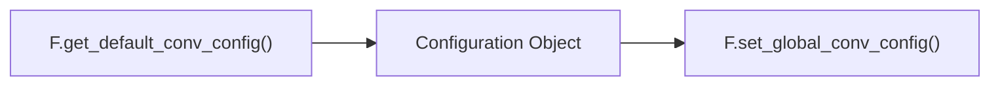

Sources: [examples/example.py:45-47]()

The default configuration is used, but there's a commented option to use the `GatherScatter` dataflow, which is an alternative algorithm for sparse convolution.

## Training Loop

The training process follows standard PyTorch patterns with some TorchSparse-specific handling:

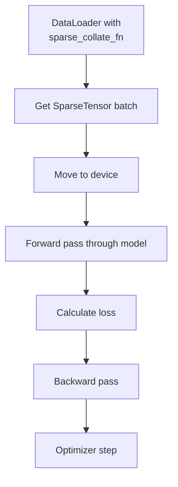

Sources: [examples/example.py:85-98]()

Key components:
1. DataLoader with custom `sparse_collate_fn` for batching sparse tensors
2. Standard forward and backward passes
3. CrossEntropyLoss for classification
4. Adam optimizer for parameter updates
5. Optional AMP (Automatic Mixed Precision) for faster training

### Data Batching

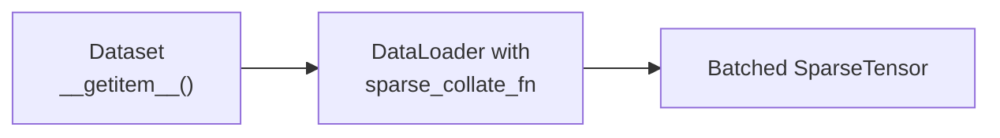

Sources: [examples/example.py:58-63]()

The `sparse_collate_fn` is crucial for batching sparse tensors correctly, handling:
- Concatenation of feature tensors
- Adding batch indices to coordinate tensors
- Preserving sparse tensor properties across the batch

## Inference Optimization

For optimized inference, the example demonstrates two important TorchSparse features:

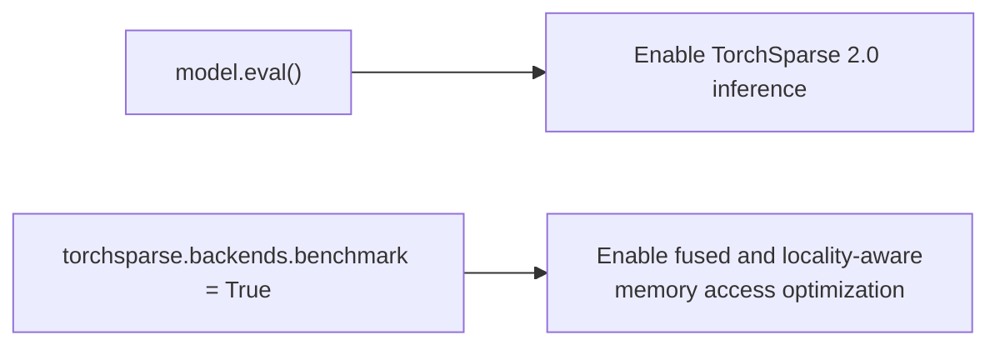

Sources: [examples/example.py:100-103]()

Optimization techniques:
1. Setting the model to evaluation mode (`model.eval()`)
2. Enabling TorchSparse 2.0 inference mode
3. Setting `torchsparse.backends.benchmark = True` for memory access optimization
4. Using half-precision (FP16) computation with `inputs.half()`

### Inference Process

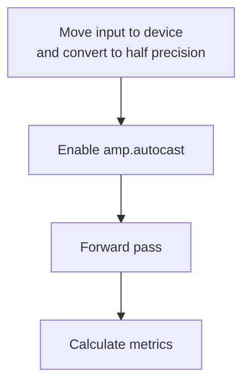

Sources: [examples/example.py:105-114]()

The optimized inference process:
1. Converts inputs to half-precision (FP16)
2. Uses PyTorch's AMP for mixed-precision computation
3. Runs the same model with optimizations enabled

## Complete Example Workflow

The entire workflow from data preparation to inference can be summarized as:

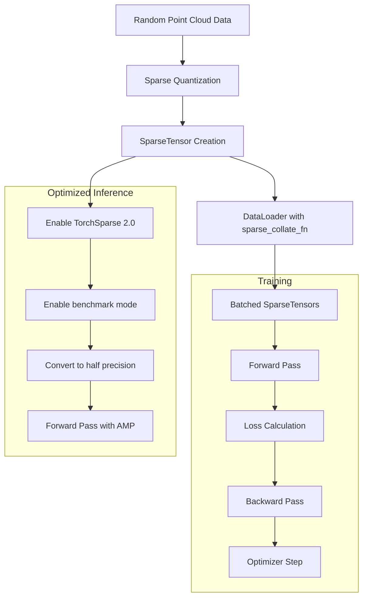

Sources: [examples/example.py:1-115]()

## Key Points to Remember

1. Point cloud data must be quantized using `sparse_quantize` before creating `SparseTensor` objects
2. Use `sparse_collate_fn` with DataLoader for proper batching of sparse tensors
3. TorchSparse's neural network modules (`spnn`) mirror PyTorch's modules with sparse operations
4. Enable benchmark mode (`torchsparse.backends.benchmark = True`) for optimized inference
5. Half-precision (FP16) computation can provide significant performance benefits during inference

This basic example demonstrates the fundamental workflow for using TorchSparse. For more advanced usage, such as working with pre-built backbone networks, see [Backbone Implementation Example](#7.2).

---

