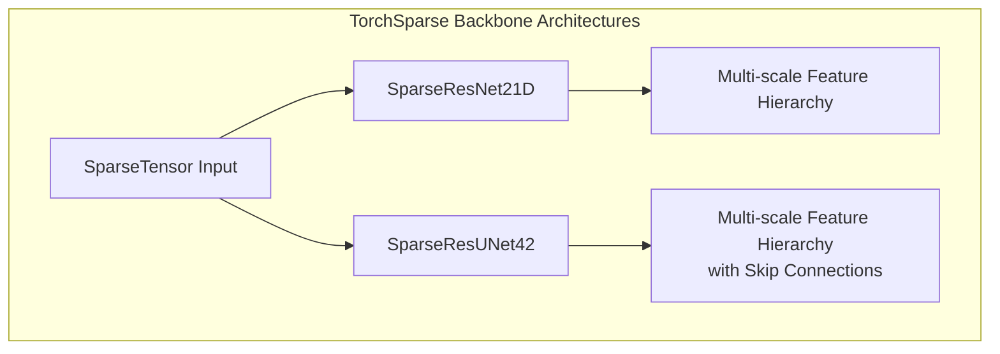
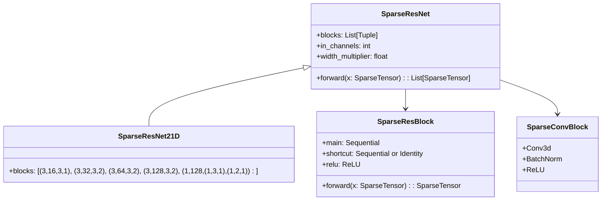
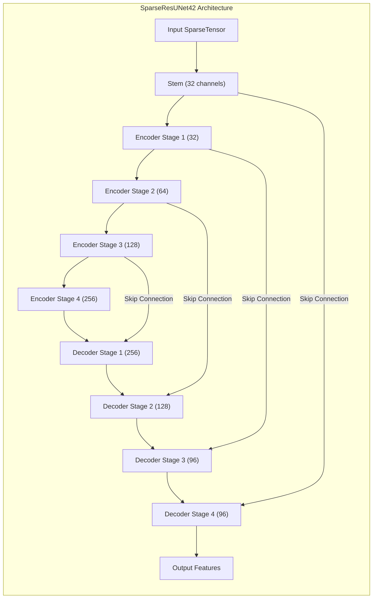
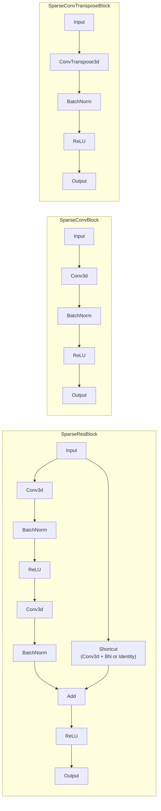
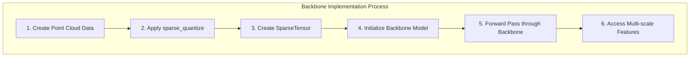
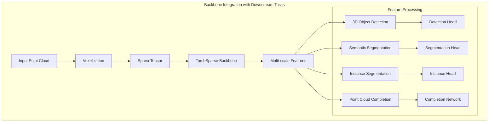

<!-- source: DeepWiki mcp.deepwiki.com · repo mit-han-lab/torchsparse · page 7.2 Backbone Implementation Example · fetched 2026-10-30 -->

# Backbone Implementation Example

<details>
<summary>Relevant source files</summary>

The following files were used as context for generating this wiki page:

- [examples/backbones.py](examples/backbones.py)
- [torchsparse/backbones/__init__.py](torchsparse/backbones/__init__.py)
- [torchsparse/backbones/modules/__init__.py](torchsparse/backbones/modules/__init__.py)
- [torchsparse/backbones/modules/blocks.py](torchsparse/backbones/modules/blocks.py)
- [torchsparse/backbones/resnet.py](torchsparse/backbones/resnet.py)
- [torchsparse/backbones/unet.py](torchsparse/backbones/unet.py)

</details>


This page demonstrates how to use TorchSparse's pre-built backbone networks in custom point cloud processing applications. It provides practical examples of implementing SparseResNet and SparseResUNet architectures, which are specialized for sparse point cloud data processing.

For details about the specific backbone architectures, see [Backbone Networks](#5).

## Overview of TorchSparse Backbones

TorchSparse provides two primary backbone architectures: SparseResNet and SparseResUNet. These backbones are designed to efficiently process sparse 3D point cloud data while maintaining spatial relationships between points.



Sources: [torchsparse/backbones/__init__.py:1-3](), [torchsparse/backbones/resnet.py:11-71](), [torchsparse/backbones/unet.py:11-123]()

## Backbone Architecture Details

### SparseResNet21D Architecture

The SparseResNet21D is a sparse version of the ResNet architecture, designed specifically for 3D point cloud data. It consists of a series of residual blocks organized in stages, with increasing channel dimensions and decreasing spatial resolution.



The SparseResNet21D configuration uses:
- 5 stages with different channel dimensions (16, 32, 64, 128, 128)
- Multiple residual blocks per stage
- Varying stride patterns for spatial downsampling

Sources: [torchsparse/backbones/resnet.py:12-71](), [torchsparse/backbones/modules/blocks.py:12-85]()

### SparseResUNet42 Architecture

The SparseResUNet42 follows a U-Net style architecture with encoder and decoder paths, enhanced with residual blocks. It's particularly useful for tasks requiring fine-grained output such as semantic segmentation.



The SparseResUNet42 configuration includes:
- A stem of two convolutional layers
- 4 encoder stages with increasing channels (32, 64, 128, 256)
- 4 decoder stages with decreasing channels (256, 128, 96, 96)
- Skip connections between corresponding encoder and decoder stages

Sources: [torchsparse/backbones/unet.py:14-123](), [torchsparse/backbones/modules/blocks.py:12-85]()

## Building Blocks

Both backbone architectures use common building blocks for their construction:

| Block Type | Components | Purpose |
|------------|------------|---------|
| SparseConvBlock | Conv3d + BatchNorm + ReLU | Basic convolution unit |
| SparseConvTransposeBlock | ConvTranspose3d + BatchNorm + ReLU | Upsampling unit |
| SparseResBlock | Two Conv3d layers with residual connection | Feature extraction with identity shortcut |



Sources: [torchsparse/backbones/modules/blocks.py:12-85]()

## Implementation Example

The following example demonstrates how to use the backbone networks:



### Step-by-Step Implementation

1. **Import Dependencies:**
   First, import the required modules including the backbone models.

2. **Initialize the Backbone Model:**
   Choose the appropriate backbone (SparseResNet21D or SparseResUNet42) and initialize it with desired parameters.
   
   ```python
   model = SparseResNet21D(in_channels=4, width_multiplier=1.0)
   # or
   model = SparseResUNet42(in_channels=4, width_multiplier=1.0)
   ```

3. **Prepare Point Cloud Data:**
   Process your point cloud data by applying voxelization through `sparse_quantize`, which converts raw points to discrete voxel coordinates.

4. **Create SparseTensor:**
   Construct a SparseTensor from the voxelized coordinates and features.

5. **Forward Pass:**
   Run the model on the input data to get a list of output SparseTensors at different scales.

6. **Process Outputs:**
   The backbones return a list of SparseTensors representing features at different levels of the network.

Sources: [examples/backbones.py:10-44]()

### Complete Example Code Walkthrough

The example in [examples/backbones.py:10-44]() demonstrates:

1. **Setting up the model:**
   - Imports `SparseResNet21D` and `SparseResUNet42` 
   - Sets the device (CUDA if available)
   - Configures the hash map mode for efficient processing

2. **Generating sample data:**
   - Creates random point cloud data
   - Applies voxelization using `sparse_quantize`
   - Prepares coordinates and features tensors
   - Constructs a SparseTensor

3. **Model inference:**
   - Runs the forward pass for each backbone type
   - Outputs the feature shapes at each level

The output shows feature tensors with progressively changing shapes through the network, reflecting the downsampling/upsampling operations.

Sources: [examples/backbones.py:10-44]()

## Customization Options

TorchSparse backbones provide several customization options:

| Parameter | Description | Usage |
|-----------|-------------|-------|
| `in_channels` | Number of input feature channels | Matches the dimensionality of your point features |
| `width_multiplier` | Scales the channel dimensions | Adjust model capacity (smaller = faster but less accurate) |

### Common Customization Patterns

1. **Adjusting Model Capacity:**
   Use `width_multiplier` to scale the model up or down based on your computational constraints and accuracy requirements.

2. **Changing Input Dimensions:**
   Modify `in_channels` based on your point cloud features (e.g., 3 for XYZ only, 4 for XYZC, etc.).

3. **Using Specific Layers:**
   Access intermediate features from the returned list for multi-scale tasks.

Sources: [torchsparse/backbones/resnet.py:13-26](), [torchsparse/backbones/unet.py:15-29]()

## Integration with Downstream Tasks

The backbone networks can be integrated into various downstream tasks:



For most applications, you'll want to:

1. Choose the appropriate backbone based on your task requirements:
   - SparseResNet21D for classification or detection tasks
   - SparseResUNet42 for dense prediction tasks like segmentation

2. Extract the appropriate feature levels:
   - Earlier layers for fine-grained spatial details
   - Later layers for semantic information
   - Multiple layers for multi-scale fusion

3. Add task-specific heads on top of the backbone outputs

Sources: [examples/backbones.py:10-44](), [torchsparse/backbones/resnet.py:51-56](), [torchsparse/backbones/unet.py:89-112]()

## Performance Considerations

When implementing backbones in your applications, consider these performance factors:

1. **Model Size vs. Speed:**
   - Larger models (higher `width_multiplier`) provide better accuracy but require more computation
   - Consider using smaller backbones for real-time applications

2. **Voxel Size Impact:**
   - Smaller voxel sizes create more precise representations but increase computational load
   - Larger voxel sizes improve speed at the cost of detail loss

3. **Memory Efficiency:**
   - The sparse representation is memory-efficient, but very large point clouds may still require optimization
   - Consider downsampling extremely dense point clouds

Sources: [examples/backbones.py:10-44]()

## Conclusion

TorchSparse's backbone architectures provide efficient frameworks for processing point cloud data in various 3D perception tasks. By understanding the architecture details and implementation patterns described in this guide, you can effectively leverage these backbones in your applications.

For more details on the underlying operations that power these backbones, see [Convolution Operations](#3.1).