# Page: Overview

# Overview

<details>
<summary>Relevant source files</summary>

The following files were used as context for generating this wiki page:

- [.github/workflows/pre-commit.yaml](.github/workflows/pre-commit.yaml)
- [.pre-commit-config.yaml](.pre-commit-config.yaml)
- [README.md](README.md)
- [install.py](install.py)
- [torchsparse/__init__.py](torchsparse/__init__.py)

</details>


## Purpose and Scope

TorchSparse is a high-performance neural network library specifically designed for point cloud processing. It addresses the unique computational challenges of processing sparse 3D point cloud data through efficient sparse tensor operations and specialized CUDA kernels. This overview provides a high-level introduction to TorchSparse's architecture, key components, and processing pipeline.

For detailed installation instructions, see [Installation Guide](#1.1). For information about specific neural network modules, see [Neural Network Modules](#3).

Sources: [README.md:10-17]()

## System Architecture

TorchSparse is built around a core `SparseTensor` data structure and provides various components for efficient sparse computation. The main components include neural network modules, functional operations, backbone architectures, and backend operations implemented in CUDA and C++.

### Core Architecture Diagram

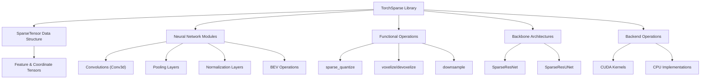

Sources: [README.md:10-17](), [torchsparse/__init__.py:1-8]()

### Module Organization

TorchSparse is organized into several key modules that each handle different aspects of sparse point cloud processing:

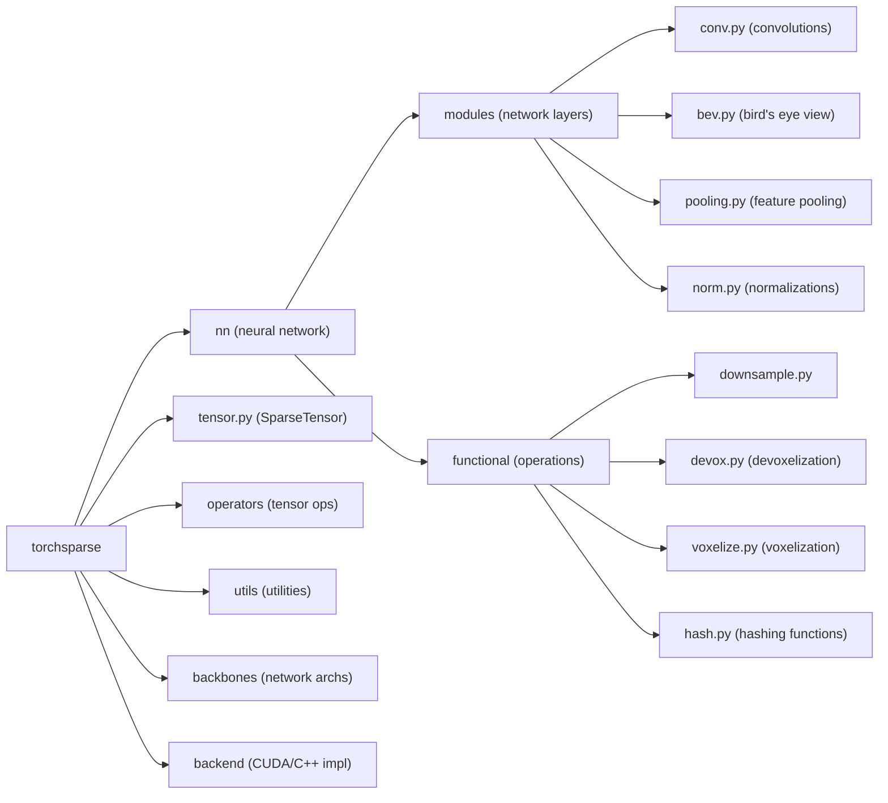

Sources: [torchsparse/__init__.py:1-8]()

## Core Data Structure: SparseTensor

At the heart of TorchSparse is the `SparseTensor` data structure, which efficiently represents sparse 3D data. Unlike dense tensors, `SparseTensor` only stores non-zero elements along with their spatial coordinates, significantly reducing memory usage and computational requirements for sparse data like point clouds.

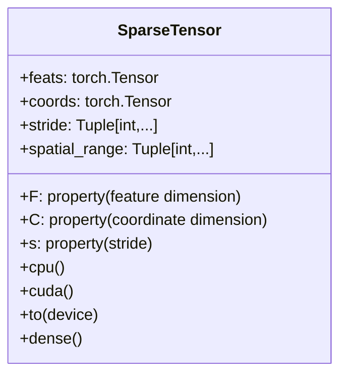

A `SparseTensor` contains:
- `feats`: Dense tensor storing features for each point
- `coords`: Integer tensor storing coordinates for each point
- `stride`: Voxel sizes in each dimension
- `spatial_range`: Valid range of coordinates

Sources: [README.md:10-17]()

## Processing Pipeline

TorchSparse implements an efficient pipeline for processing point cloud data, from initial voxelization to final feature extraction or BEV (Bird's Eye View) conversion.

### Data Flow Diagram

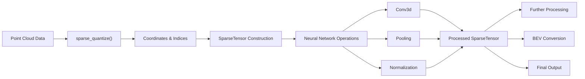

The pipeline typically involves:
1. **Quantization**: Converting continuous point cloud coordinates to discrete voxel coordinates
2. **SparseTensor Construction**: Creating a sparse tensor from features and coordinates
3. **Network Operations**: Applying sparse convolutions and other operations
4. **Post-processing**: Converting to BEV or extracting final features

Sources: [README.md:16-17]()

## Key Features and Optimizations

TorchSparse introduces several optimizations that make it significantly faster than other point cloud processing libraries:

1. **Efficient Sparse Operations**: Specialized implementations of sparse convolution, pooling, and other operations
2. **Adaptive Matrix Multiplication Grouping**: Optimizes computation for varying sparsity patterns
3. **Locality-aware Memory Access**: Improves cache efficiency for sparse data patterns
4. **High-performance CUDA Kernels**: Custom CUDA implementations for critical operations

The library achieves significant speedups compared to other libraries:
- Up to 2.9× faster than MinkowskiEngine
- Up to 3.3× faster than SpConv 1.2
- Up to 2.2× faster than TorchSparse (MLSys)
- Up to 1.7× faster than SpConv v2

| Library | Inference Speedup | Training Speedup |
|---------|-------------------|------------------|
| MinkowskiEngine | 2.9× | 4.6-4.8× |
| SpConv 1.2 | 3.3× | - |
| TorchSparse (MLSys) | 2.2× | - |
| SpConv v2 | 1.7× | 1.16-1.27× |

Sources: [README.md:17-31](), [README.md:80-93]()

## Supported Components

TorchSparse provides a comprehensive set of components for building sparse 3D neural networks:

### Neural Network Modules
- Sparse 3D convolution (Conv3d)
- Sparse pooling operations
- Normalization layers (BatchNorm, InstanceNorm)
- BEV (Bird's Eye View) operations

### Functional Operations
- Voxelization and devoxelization
- Hashing and quantization
- Downsampling and cropping

### Backbone Architectures
- SparseResNet
- SparseResUNet

For more details on neural network modules, see [Neural Network Modules](#3). For information about functional operations, see [Functional API](#4).

Sources: [README.md:10-17]()

## Installation Methods

TorchSparse offers multiple installation methods:

1. **Automatic Installation Script**: Detects PyTorch and CUDA versions and installs the appropriate wheel
   ```bash
   python -c "$(curl -fsSL https://raw.githubusercontent.com/mit-han-lab/torchsparse/master/install.py)"
   ```

2. **Manual Wheel Installation**: Wheels available from custom PyPI server

3. **Installation from Source**:
   ```bash
   python setup.py install
   ```

For detailed installation instructions and requirements, see [Installation Guide](#1.1).

Sources: [README.md:40-78](), [install.py:1-50]()

## Development and Code Quality

TorchSparse maintains high code quality through automated checks and testing:

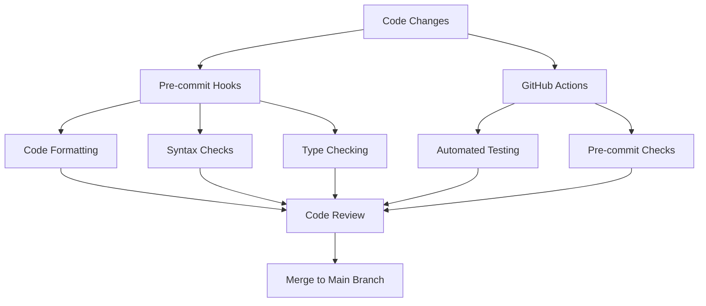

The library uses pre-commit hooks for:
- Code formatting (Python, C++, CUDA)
- Syntax checking
- Type checking
- Markdown formatting

These quality control mechanisms ensure consistent code style and reduce bugs.

Sources: [.pre-commit-config.yaml:1-77](), [.github/workflows/pre-commit.yaml:1-15]()

## Version History

TorchSparse has evolved through several major versions, each with significant improvements:

- **Initial Version** (ECCV 2020): Part of the SPVNAS paper
- **TorchSparse v1.4** (June 2021): Early stable release
- **TorchSparse** (MLSys 2022): Featured adaptive matrix multiplication grouping and locality-aware memory access
- **TorchSparse++/v2.1** (MICRO 2023): Current version with significant inference and training speedups

The library has been adopted by several notable projects in 3D vision, including Argoverse 2, SparseNeuS, One-2-3-45, and One-2-3-45++.

Sources: [README.md:19-38]()

---

# Page: Installation Guide

# Installation Guide

<details>
<summary>Relevant source files</summary>

The following files were used as context for generating this wiki page:

- [.github/workflows/pre-commit.yaml](.github/workflows/pre-commit.yaml)
- [.pre-commit-config.yaml](.pre-commit-config.yaml)
- [README.md](README.md)
- [install.py](install.py)
- [setup.py](setup.py)

</details>


This guide provides detailed instructions for installing TorchSparse, a high-performance neural network library for point cloud processing. It covers different installation methods, system requirements, and troubleshooting tips. For performance benchmarks after installation, please see [Performance Benchmarks](#1.3).

## System Requirements

Before installing TorchSparse, ensure your system meets the following requirements:

- Python 3.6 or higher
- PyTorch 1.9.0 or higher
- CUDA Toolkit (for GPU support)
- C++ compiler compatible with your PyTorch version

TorchSparse has the following dependencies, which will be automatically installed:

```
numpy
backports.cached_property
tqdm
typing-extensions
wheel
rootpath
torch
torchvision
```

Sources: [setup.py:52-61]()

## Installation Methods Overview

TorchSparse offers three installation methods to accommodate different user needs:

### Installation Method Decision Flow

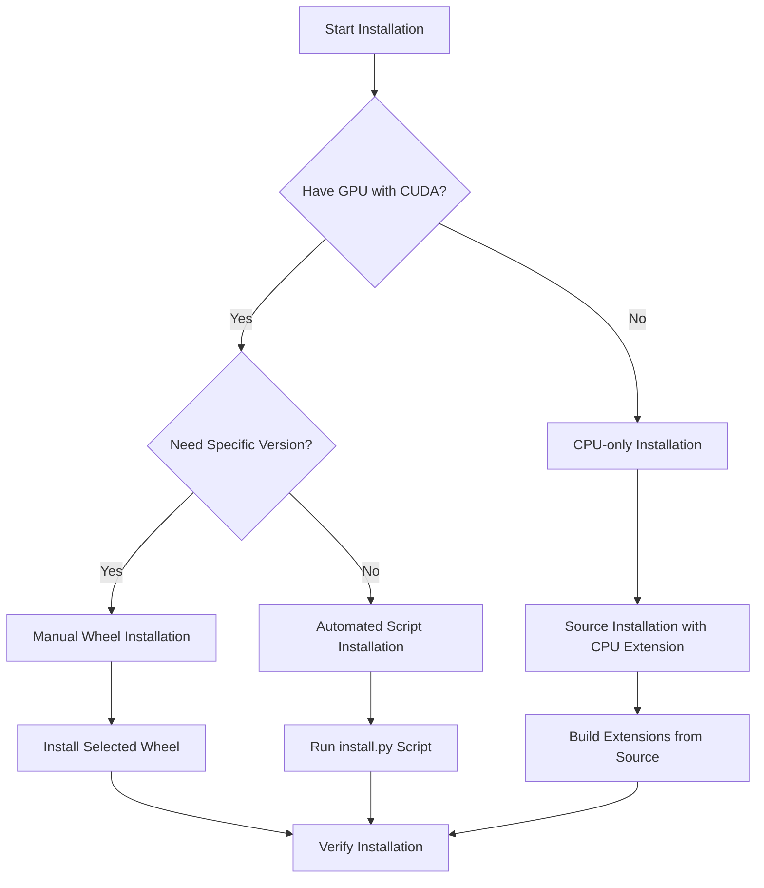

Sources: [README.md:40-78](), [setup.py:20-36]()

## Automated Installation with install.py

The recommended installation method is using the provided installation script, which automatically detects your PyTorch and CUDA versions and installs the appropriate pre-built package.

### Requirements Verification

First, ensure you have PyTorch installed with CUDA support (if using GPU):

```bash
# Check PyTorch version
python -c "import torch; print(torch.__version__)"
# Should be 1.9.0 or higher

# Check CUDA availability and version
python -c "import torch; print(torch.version.cuda)"
# Should display your CUDA version, e.g., 11.3
```

### Running the Installation Script

Execute the installation script with:

```bash
python -c "$(curl -fsSL https://raw.githubusercontent.com/mit-han-lab/torchsparse/master/install.py)"
```

This script automatically:
1. Detects your PyTorch version
2. Identifies available CUDA version
3. Selects the compatible TorchSparse package
4. Installs it via pip

Sources: [README.md:42-62](), [install.py:1-50]()

### PyTorch-CUDA Version Compatibility

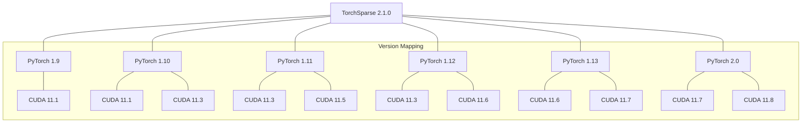

Sources: [install.py:24-33]()

## Manual Wheel Installation

If the automated script doesn't work for your configuration, you can manually download and install the appropriate wheel package.

### Finding the Correct Wheel

1. Visit the PyPI server at http://pypi.hanlab.ai/simple/torchsparse
2. Determine the version tag using this pattern:
   - `torchsparse-2.1.0+torch{PyTorch version}cu{CUDA version}`
   - For example: `torchsparse-2.1.0+torch111cu115` for PyTorch 1.11.0 and CUDA 11.5
3. Select the wheel matching your Python version

### Installing the Wheel

```bash
pip install http://pypi.hanlab.ai/simple/torchsparse/torchsparse-2.1.0+torch111cu115-cp38-cp38-linux_x86_64.whl
```

Replace the URL with the correct wheel URL for your configuration.

Sources: [README.md:64-66]()

## Installation from Source

Installing from source offers the most flexibility and is recommended when pre-built packages are not available for your system configuration.

### Build Process Overview

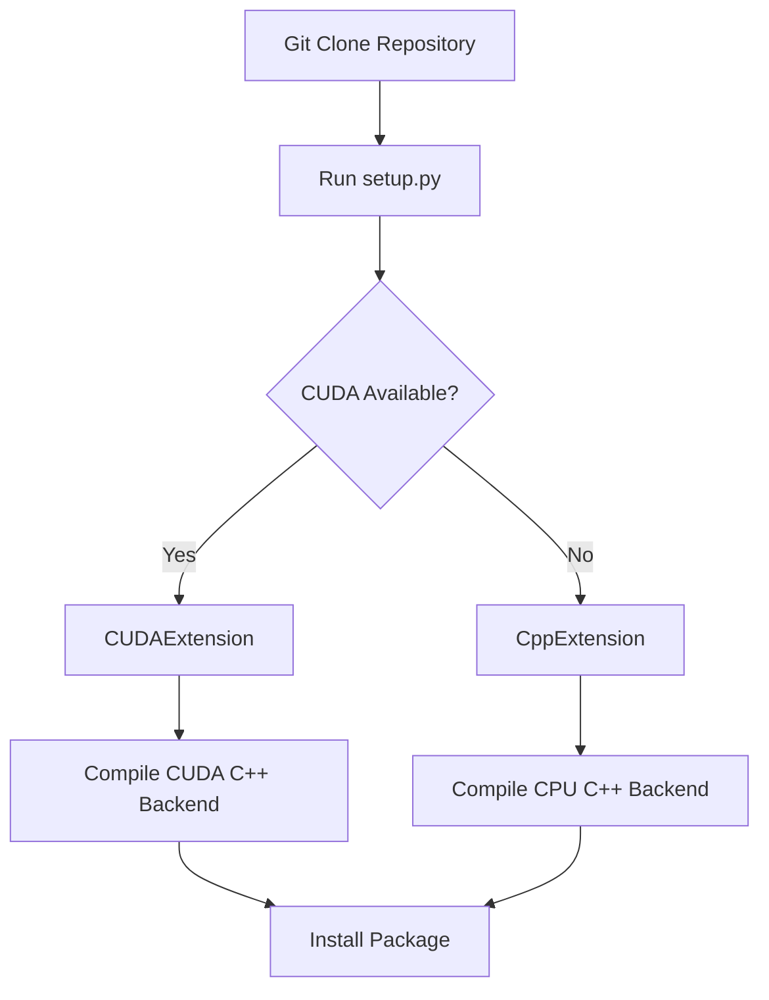

Sources: [setup.py:20-36](), [README.md:67-78]()

### Method 1: Installation from Cloned Repository

```bash
# Clone the repository
git clone https://github.com/mit-han-lab/torchsparse.git
cd torchsparse

# Install the package
python setup.py install
```

### Method 2: Direct Installation via pip

```bash
pip install git+https://github.com/mit-han-lab/torchsparse.git
```

The `setup.py` script automatically detects whether CUDA is available and selects the appropriate extension type. If CUDA is available, it will build with CUDA support; otherwise, it will build with CPU-only support.

Sources: [README.md:67-78](), [setup.py:20-67]()

## Verifying Installation

After installation, verify that TorchSparse is correctly installed and functional:

```bash
python -c "import torchsparse; print(torchsparse.__version__)"
```

This should print the installed TorchSparse version (e.g., 2.1.0).

For CUDA support verification, you can run:

```bash
python -c "import torchsparse; print('CUDA available:', torchsparse.backends.cuda_available())"
```

## Troubleshooting

### Common Issues

| Issue | Possible Cause | Solution |
|-------|---------------|----------|
| `ImportError: No module named torchsparse` | Installation failed | Retry installation or install from source |
| CUDA-related errors | PyTorch and TorchSparse CUDA versions mismatch | Ensure PyTorch is installed with the correct CUDA version |
| Build errors during source installation | Missing development tools or incompatible compiler | Install required development tools and ensure compiler compatibility |
| `OSError: *.so: cannot open shared object file` | Library path issues | Add the library directory to `LD_LIBRARY_PATH` |

### PyTorch CUDA Version Mismatch

If you encounter errors related to CUDA version mismatch, ensure your PyTorch installation supports the CUDA version you're using. You may need to reinstall PyTorch with the compatible CUDA version.

Sources: [README.md:50-56](), [install.py:8-21]()

### Fixing Library Path Issues

If you encounter shared library errors, add the TorchSparse library path to your environment:

```bash
export LD_LIBRARY_PATH=$LD_LIBRARY_PATH:$(python -c "import site; print(site.getsitepackages()[0])")/torchsparse/backend
```

## Additional Resources

TorchSparse provides comprehensive documentation and support channels:

- GitHub Repository: https://github.com/mit-han-lab/torchsparse
- Documentation: http://torchsparse-docs.github.io/
- PyPI Server: http://pypi.hanlab.ai/simple/torchsparse

For specific issues not covered in this guide, please check the [Frequently Asked Questions](#1.2) section.

Sources: [README.md:12-13]()

---

# Page: Frequently Asked Questions

# Frequently Asked Questions

<details>
<summary>Relevant source files</summary>

The following files were used as context for generating this wiki page:

- [.github/ISSUE_TEMPLATE/bug_report.yaml](.github/ISSUE_TEMPLATE/bug_report.yaml)
- [.github/ISSUE_TEMPLATE/installation.yaml](.github/ISSUE_TEMPLATE/installation.yaml)
- [docs/FAQ.md](docs/FAQ.md)

</details>


This page addresses common questions, troubleshooting steps, and configuration challenges encountered when working with TorchSparse. For installation-specific details, see [Installation Guide](#1.1). For performance-related questions, see [Performance Benchmarks](#1.3).

## Installation Troubleshooting

### Common Installation Issues

Before reporting installation issues, follow these troubleshooting steps:

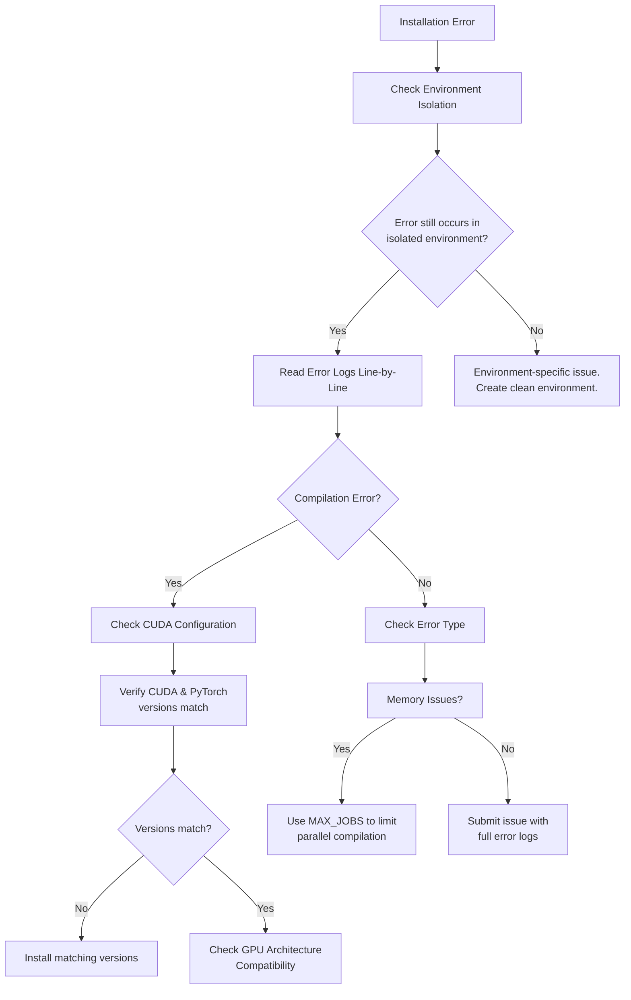

#### Environment Validation

First, verify your environment is correctly configured:

1. Check if the issue is TorchSparse-specific by testing in an isolated environment
2. Ensure downstream projects are compatible with your TorchSparse version
3. Read error logs carefully - compilation errors often indicate environment issues

#### CUDA Configuration Issues

Ensure your CUDA installation is correct:

```bash
# Check for multiple CUDA installations
ls /usr/local/cuda* -d

# Verify CUDA versions match
nvcc --version
python -c "import torch; print(torch.version.cuda);"
```

If versions don't match, you may need to reinstall CUDA or PyTorch.

Sources: [docs/FAQ.md:9-22]()

#### Cross-Compilation

When building for a different GPU than the one in your system:

```bash
# Example for Turing architecture GPUs
TORCH_CUDA_ARCH_LIST="7.0;7.5" pip install --upgrade git+https://github.com/mit-han-lab/torchsparse.git
```

Sources: [docs/FAQ.md:24-28]()

#### Memory Issues During Installation

If compilation fails with a `Killed` message:

```bash
# Limit parallel compilation to reduce memory usage
MAX_JOBS=2 pip install --upgrade git+https://github.com/mit-han-lab/torchsparse.git
```

Sources: [docs/FAQ.md:30-34]()

## Runtime Issues

### SparseTensor Operations

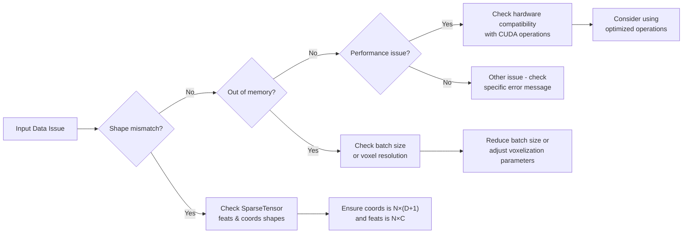

#### Common Shape Errors

When encountering shape mismatch errors:

- Ensure the coordinate tensor has shape `[N, D+1]` where `D` is the spatial dimension
- Verify feature tensor has shape `[N, C]` where `C` is the feature dimension
- Check the stride parameter when constructing `SparseTensor` objects

#### Memory Management

If encountering CUDA out-of-memory errors:

- Reduce the batch size
- Use coarser voxelization (larger voxel sizes)
- Consider using `SparseTensor.dense()` only when necessary as it creates dense tensors

## CUDA and Performance Questions

### Version Compatibility

TorchSparse requires:

| Component | Requirement |
|-----------|-------------|
| CUDA      | 10.2 or later |
| PyTorch   | 1.7 or later |
| Python    | 3.7 or later |
| GCC/G++   | 5.0 or later |

### Performance Optimization

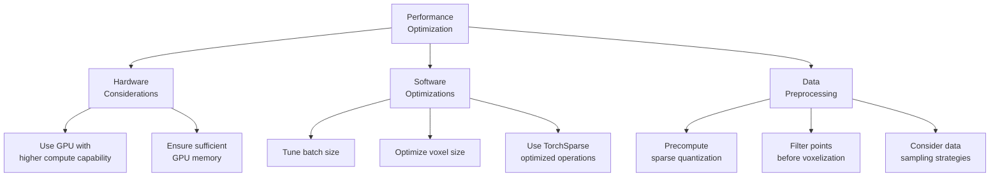

#### Hardware Requirements

TorchSparse performance depends significantly on:

- GPU compute capability (higher is better)
- Available GPU memory
- CUDA version compatibility

#### Operation Optimization

To maximize performance:

- Use appropriate voxel sizes for your application
- Batch process data when possible
- Consider using the pre-built backbone architectures for common tasks

## Debugging Workflow

When encountering issues that aren't covered in this FAQ:

1. Isolate the issue to determine if it's TorchSparse-specific
2. Check the [GitHub issues](https://github.com/mit-han-lab/torchsparse/issues) for similar problems
3. Collect environment information:
   ```bash
   gcc --version
   nvcc --version
   python -c "import torch; print(torch.__version__)"
   python -c "import torch; print(torch.version.cuda)"
   python -c "import torchsparse; print(torchsparse.__version__)"
   ```
4. When reporting issues, include:
   - Full error message
   - Environment information
   - Minimal reproducible example

Sources: [.github/ISSUE_TEMPLATE/bug_report.yaml:27-44]()

## API Usage Questions

### SparseTensor vs. Traditional Tensors

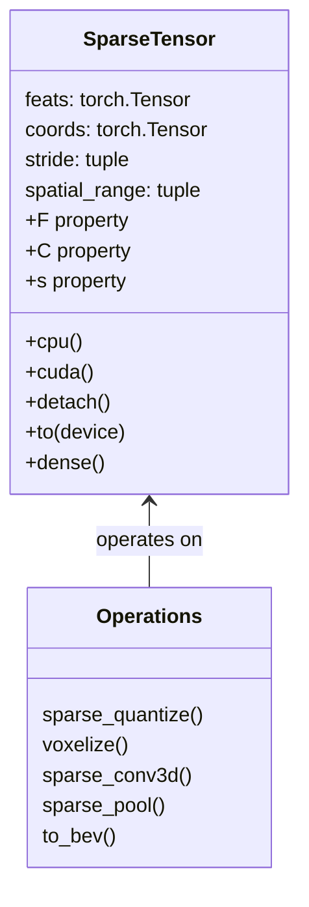

The `SparseTensor` class is fundamentally different from dense PyTorch tensors:

- Stores coordinates and features separately
- Optimized for sparse computation
- Requires specialized operations for processing

### Voxelization Parameters

When using voxelization functions:

- `voxel_size`: Controls the resolution of voxelization (smaller values = higher resolution, more voxels)
- `point_cloud_range`: Defines the spatial extent for voxelization
- `mode`: Determines aggregation strategy for points falling in the same voxel

### Converting Between Representations

TorchSparse provides functions to convert between different representations:

- `sparse_quantize`: Converts continuous coordinates to discrete voxel coordinates
- `voxelize`: Converts point cloud to voxelized features
- `SparseTensor.dense()`: Converts sparse representation to dense tensor
- `sparse_collate`: Combines multiple sparse inputs into a batched sparse tensor

## Environment Setup Best Practices

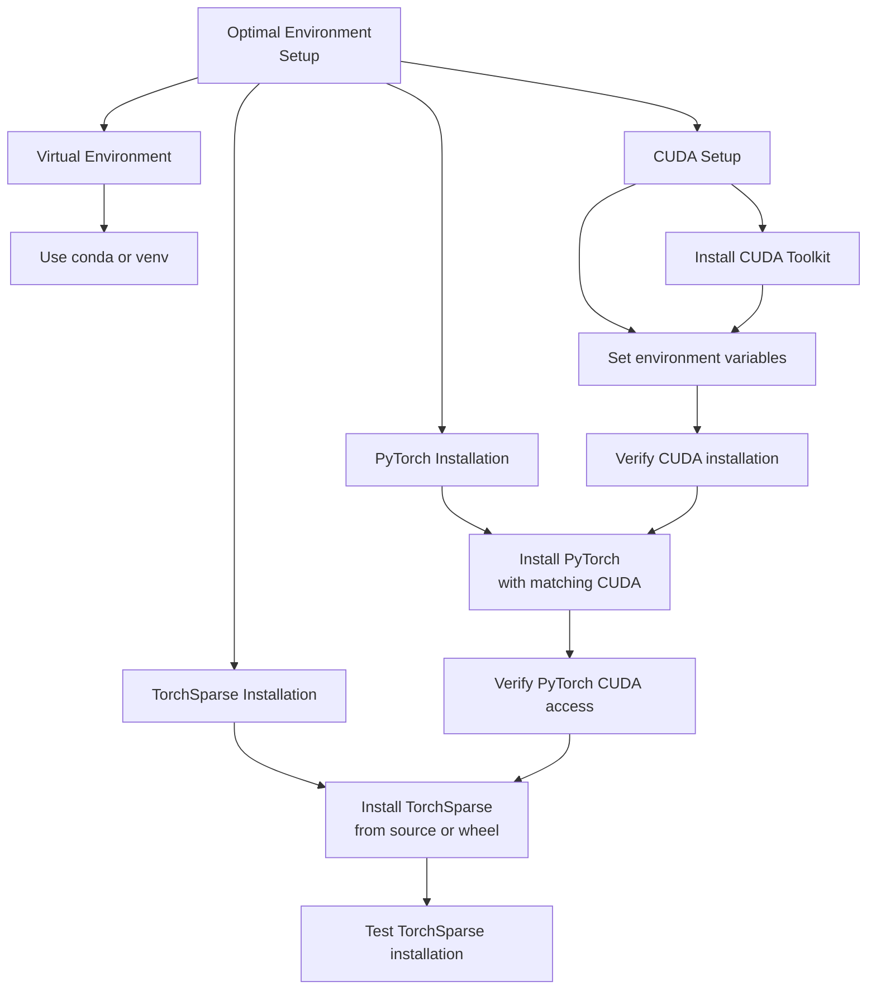

### Recommended Setup Process

1. Create a clean virtual environment
2. Install CUDA toolkit and set environment variables
3. Install PyTorch with matching CUDA version
4. Install TorchSparse from source or pre-built wheel
5. Validate installation with a simple test script

Sources: [docs/FAQ.md:3-15]()

## Common Error Messages and Solutions

Below are frequently encountered error messages and their solutions:

| Error Message | Likely Cause | Solution |
|---------------|--------------|----------|
| `fatal error: cuda_runtime_api.h: No such file or directory` | CUDA not found in path | Set CUDA_HOME environment variable correctly |
| `undefined symbol: _ZN2at4_ops...` | PyTorch version mismatch | Ensure PyTorch and TorchSparse versions are compatible |
| `Segmentation fault (core dumped)` | Memory access issue | Check input data validity and memory allocation |
| `CUDA error: device-side assert triggered` | Invalid operation on GPU | Check shapes and operation validity, run with CUDA_LAUNCH_BLOCKING=1 |
| `Killed` during installation | Out of memory during compilation | Use MAX_JOBS=2 to limit parallel compilation |

Sources: [.github/ISSUE_TEMPLATE/installation.yaml:26-33](), [docs/FAQ.md:30-34]()

This FAQ covers the most common issues encountered when working with TorchSparse. If your issue isn't addressed here, please check the GitHub repository issues or submit a new issue with comprehensive details about your environment and the error encountered.

---

# Page: Performance Benchmarks

# Performance Benchmarks

<details>
<summary>Relevant source files</summary>

The following files were used as context for generating this wiki page:

- [.github/workflows/pre-commit.yaml](.github/workflows/pre-commit.yaml)
- [.pre-commit-config.yaml](.pre-commit-config.yaml)
- [README.md](README.md)
- [docs/figs/eval_benchmark.png](docs/figs/eval_benchmark.png)
- [docs/figs/train_benchmark.png](docs/figs/train_benchmark.png)
- [install.py](install.py)

</details>


## Purpose and Scope

This document provides detailed performance benchmarks comparing TorchSparse with other point cloud processing libraries. It covers both inference and training performance across various GPU architectures and precision formats. For information about performance optimization techniques, see [Performance Optimization](#6.2).

## Overview

TorchSparse delivers significant performance improvements over existing point cloud processing libraries through its optimized sparse tensor operations. These benchmarks quantify those improvements across different workloads, hardware platforms, and precision formats.

Sources: [README.md:15-17](), [README.md:80-82]()

## Benchmark Methodology

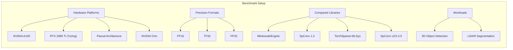

The benchmarks compare TorchSparse against leading sparse convolution libraries across:

- **Hardware platforms**: NVIDIA A100, RTX 2080 Ti (Turing), Pascal architecture GPUs, and NVIDIA Orin
- **Precision formats**: FP16, TF32, and FP32
- **Workloads**: 3D object detection and LiDAR segmentation

All benchmarks use standardized datasets and model architectures to ensure fair comparison.

Sources: [README.md:82-87]()

## Inference Performance

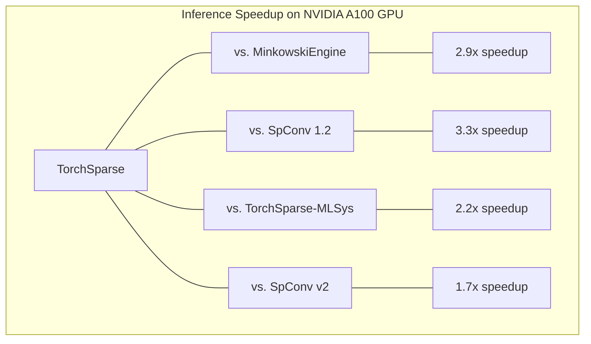

TorchSparse demonstrates substantial inference performance improvements:

| GPU Platform | Comparison | Speedup Factor |
|--------------|------------|----------------|
| NVIDIA A100  | vs. MinkowskiEngine | 2.9x |
| NVIDIA A100  | vs. SpConv 1.2 | 3.3x |
| NVIDIA A100  | vs. TorchSparse-MLSys | 2.2x |
| NVIDIA A100  | vs. SpConv v2 | 1.7x |
| NVIDIA Orin  | vs. SpConv 2.3.5 | 1.25x |

These performance improvements are consistent across all tested precision formats (FP16, TF32, FP32) and GPU architectures (Pascal, Turing, Ampere).

Sources: [README.md:17](), [README.md:82-87]()

## Performance Across GPU Architectures

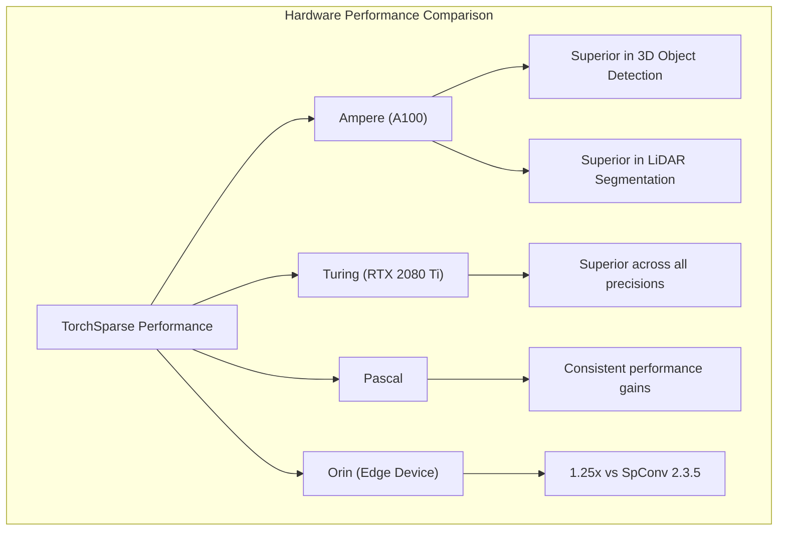

TorchSparse maintains its performance advantage across multiple GPU architectures:

1. **Ampere Architecture (A100)**: Highest absolute performance, with up to 2.9x speedup over competitors
2. **Turing Architecture (RTX 2080 Ti)**: Consistent performance gains across all precision formats
3. **Pascal Architecture**: Significant speedups compared to other libraries
4. **NVIDIA Orin (Edge Device)**: 1.25x improvement over SpConv 2.3.5, demonstrating TorchSparse's efficiency on embedded platforms

Sources: [README.md:82-87]()

## Training Performance

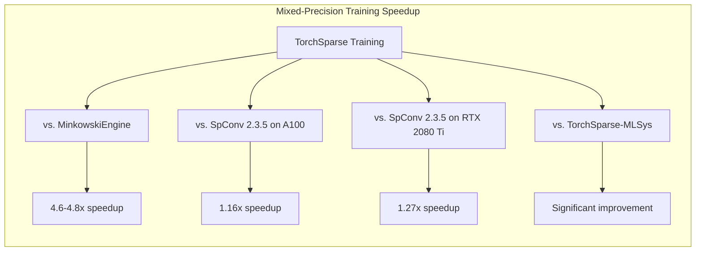

TorchSparse delivers superior training performance:

| GPU Platform | Comparison | Speedup Factor |
|--------------|------------|----------------|
| NVIDIA A100 | vs. MinkowskiEngine | 4.6-4.8x |
| NVIDIA A100 | vs. SpConv 2.3.5 | 1.16x |
| RTX 2080 Ti | vs. SpConv 2.3.5 | 1.27x |
| Multiple platforms | vs. TorchSparse-MLSys | Significant improvement |

All training benchmarks were measured with batch size = 2 using mixed-precision training.

Sources: [README.md:89-95]()

## Performance Factors and Implementation Details

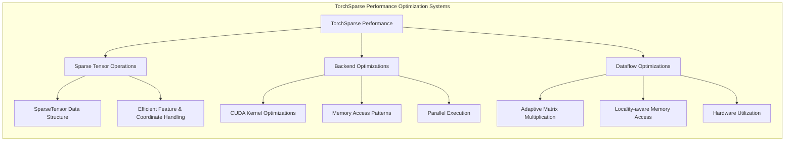

TorchSparse's performance advantages come from several key technical innovations:

1. **Optimized Sparse Tensor Operations**: Efficient implementation of the `SparseTensor` data structure and operations
2. **Backend Optimizations**:
   - CUDA kernel optimizations for sparse operations
   - Efficient memory access patterns
   - Parallel execution strategies
3. **Dataflow Optimizations**:
   - Adaptive matrix multiplication grouping
   - Locality-aware memory access
   - Improved hardware utilization

These optimizations enable TorchSparse to efficiently handle the sparse and irregular computation patterns inherent in point cloud processing.

Sources: [README.md:15-17](), [README.md:36-38]()

## Applications and Use Cases

The performance improvements provided by TorchSparse have been leveraged in several real-world applications:

1. **Autonomous Driving**: Adopted by [Argoverse 2](https://arxiv.org/abs/2301.00493) for their baseline detector
2. **3D Object Generation**: Used in [One-2-3-45++](https://arxiv.org/abs/2311.07885) from UCSD
3. **3D Mesh Reconstruction**: Employed by [One-2-3-45](https://arxiv.org/abs/2306.16928) and [SparseNeuS](https://arxiv.org/pdf/2206.05737)

These applications demonstrate TorchSparse's effectiveness in various point cloud processing tasks.

Sources: [README.md:20-36]()

## Accessing Benchmark Data

The complete benchmark data, including raw results and evaluation scripts, is available at [https://zenodo.org/records/8311889](). For preprocessed datasets, contact the authors, as raw data from SemanticKITTI, nuScenes, and Waymo cannot be publicly released due to license requirements.

Sources: [README.md:95-96]()

## Conclusion

TorchSparse demonstrates substantial performance improvements over existing point cloud processing libraries across various hardware platforms, precision formats, and workloads. Its optimized sparse tensor operations and backend implementations make it well-suited for both research and production applications in point cloud processing.

The benchmarks confirm TorchSparse's position as a high-performance solution for point cloud processing, with significant advantages in both inference and training scenarios.

Sources: [README.md:15-17](), [README.md:80-95]()

---

# Page: Core Concepts

# Core Concepts

<details>
<summary>Relevant source files</summary>

The following files were used as context for generating this wiki page:

- [.github/workflows/pre-commit.yaml](.github/workflows/pre-commit.yaml)
- [.pre-commit-config.yaml](.pre-commit-config.yaml)
- [README.md](README.md)
- [install.py](install.py)
- [torchsparse/__init__.py](torchsparse/__init__.py)
- [torchsparse/tensor.py](torchsparse/tensor.py)

</details>


This page explains the fundamental concepts and data structures that form the foundation of TorchSparse. Understanding these core concepts is essential for effectively using the library for point cloud processing. For specific details about the SparseTensor data structure, see [SparseTensor Data Structure](#2.1). For information about the backend system, see [Backend System](#2.2).

## Point Cloud Processing Challenges

Point cloud data presents unique computational challenges compared to regular grid-based data like images:

1. **Sparsity**: Point clouds contain valid data points (non-zero values) scattered in 3D space with many empty regions.
2. **Irregularity**: Points are unevenly distributed in 3D space with no inherent structure.
3. **Variable density**: Some regions contain many points while others contain few or none.

TorchSparse addresses these challenges through specialized data structures and algorithms designed for efficient sparse computation.

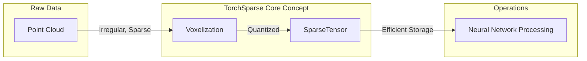

Sources: [README.md:10-17]()

## SparseTensor: The Fundamental Data Structure

The `SparseTensor` class is the central data structure in TorchSparse. Unlike dense tensors that store all values in a grid (including zeros), `SparseTensor` only stores non-zero values and their corresponding coordinates in 3D space. This approach drastically reduces memory usage and computational requirements.

A `SparseTensor` consists of:

1. **Coordinates (`coords`)**: Tensor specifying the spatial location of each point
2. **Features (`feats`)**: Tensor containing feature values at each point
3. **Stride (`stride`)**: Voxel size in each dimension
4. **Spatial Range (`spatial_range`)**: Optional tensor defining the bounds of the space

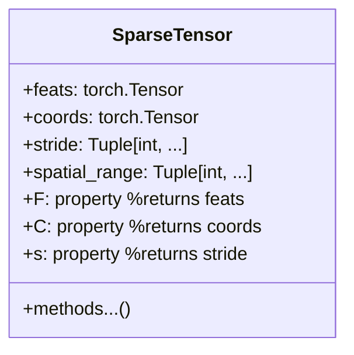

Sources: [torchsparse/tensor.py:29-115]()

## Coordinate System and Tensor Structure

TorchSparse operates on voxelized point clouds with a specific coordinate system:

```mermaid
flowchart TD
    subgraph "SparseTensor Structure"
        direction LR
        A1["coords: torch.Tensor"] -->|"shape=[N, 4]"| B1["batch_idx, x, y, z"]
        A2["feats: torch.Tensor"] -->|"shape=[N, C]"| B2["N points, C features"]
    end
    
    subgraph "Example Point"
        C1["coords[i] = [0, 23, 45, 12]"]
        C2["feats[i] = [0.5, 0.3, 0.7, ...]"]
        C1 --- C2
    end
    
    A1 -.- C1
    A2 -.- C2
```

- **Coordinates (`coords`)**: A tensor of shape `[N, 4]` where N is the number of points. Each point has 4 coordinates: batch index, x, y, and z.
- **Features (`feats`)**: A tensor of shape `[N, C]` where C is the number of feature channels.
- **Stride**: Determines the resolution/scale of the voxel grid. Larger strides result in coarser representations.

By default, coordinates are non-negative integers obtained through voxelization, though negative coordinates can be enabled using `set_allow_negative_coordinates()`.

Sources: [torchsparse/tensor.py:29-76]()

## Data Flow and Processing Pipeline

TorchSparse implements an efficient data processing pipeline for point cloud data:

```mermaid
graph TD
    A["Point Cloud Input"] --> B["sparse_quantize/voxelize"]
    B --> C["SparseTensor Construction"]
    C --> D["Sparse Neural Network"]
    
    D --> E1["Sparse Convolution"]
    D --> E2["Sparse Pooling"]
    D --> E3["Normalization"]
    
    E1 --> F["Processed SparseTensor"]
    E2 --> F
    E3 --> F
    
    F --> G1["Output Features"]
    F --> G2["BEV Conversion"]
    F --> G3["Downsampling"]
```

The pipeline includes:

1. **Quantization/Voxelization**: Converting raw point clouds to voxel representations
2. **SparseTensor Creation**: Constructing sparse tensors from voxelized data
3. **Neural Network Processing**: Applying sparse operations like convolution and pooling
4. **Output Processing**: Converting back to desired formats (e.g., BEV) or further processing

Sources: [README.md:84-96]()

## Memory Management

TorchSparse implements an efficient memory management system using tensor caching to avoid redundant allocations and computations:

```mermaid
classDiagram
    class TensorCache {
        +cache: Dict
        +add()
        +get()
        +clear()
    }
    
    class SparseTensor {
        +feats: torch.Tensor
        +coords: torch.Tensor
        +_caches: TensorCache
    }
    
    SparseTensor --> TensorCache : uses
```

The library uses two tensor cache modes:
1. **Global Tensor Cache**: Shared across multiple sparse tensors
2. **Local Tensor Cache**: Specific to individual sparse tensors

This memory management system improves performance by reusing intermediate tensors in operations like sparse convolution.

Sources: [torchsparse/tensor.py:45-52]()

## Point-Voxel Duality

TorchSparse supports both point-based and voxel-based representations through its dual data structures:

```mermaid
flowchart LR
    A["PointTensor"] -->|"Voxelization"| B["SparseTensor"]
    B -->|"Devoxelization"| A
    
    subgraph "Point-based"
        A
    end
    
    subgraph "Voxel-based"
        B
    end
```

- **SparseTensor**: Voxel-based representation for efficient sparse convolution
- **PointTensor**: Point-based representation for operations directly on points

This duality allows the system to leverage the strengths of both representations:
- Point-based operations for precise spatial information
- Voxel-based operations for efficient computation

Sources: [torchsparse/tensor.py:116-146]()

## Device Support and Tensor Operations

SparseTensor supports various tensor operations similar to PyTorch's native tensors:

| Operation | Description | Method |
|-----------|-------------|--------|
| Device Transfer | Move to CPU/CUDA | `cpu()`, `cuda()`, `to(device)` |
| Precision Control | Change numerical precision | `half()` |
| Detach | Detach from computation graph | `detach()` |
| Convert to Dense | Create dense tensor | `dense()` |
| Addition | Add two sparse tensors | `__add__()` |

These operations make it easy to integrate SparseTensor into existing PyTorch workflows.

Sources: [torchsparse/tensor.py:78-114]()

## System Architecture

TorchSparse is organized into several major components that work together to provide efficient point cloud processing:

```mermaid
graph TD
    A["TorchSparse Library"] --> B["SparseTensor"]
    A --> C["Neural Network Modules"]
    A --> D["Functional Operations"]
    A --> E["Backend Implementations"]
    
    B -->|"Primary Data Structure"| C
    B -->|"Primary Data Structure"| D
    
    C -->|"Uses"| E
    D -->|"Uses"| E
    
    C --> C1["Conv3d"]
    C --> C2["BEV Operations"]
    C --> C3["Pooling"]
    C --> C4["Normalization"]
    
    D --> D1["Voxelization"]
    D --> D2["Hashing"]
    D --> D3["Quantization"]
    D --> D4["Downsampling"]
    
    E --> E1["CUDA Kernels"]
    E --> E2["CPU Fallbacks"]
```

The architecture consists of:
1. **Core Data Structures**: `SparseTensor` and `PointTensor`
2. **Neural Network Modules**: Convolution, pooling, normalization, etc.
3. **Functional Operations**: Voxelization, hashing, quantization, etc.
4. **Backend Implementations**: CUDA kernels and CPU fallbacks

This modular design allows for efficient sparse computation while providing a user-friendly API.

Sources: [torchsparse/__init__.py:1-8](), [README.md:15-18]()

## Performance Considerations

TorchSparse achieves high performance through several key optimizations:

1. **Sparse data representation**: Only storing non-zero values and their coordinates
2. **Efficient hashing**: Fast neighbor finding for sparse convolution
3. **CUDA acceleration**: Specialized kernels for sparse operations
4. **Memory optimization**: Tensor caching to reduce allocations
5. **Adaptive dataflow**: Choosing optimal algorithms based on data characteristics

Understanding these core optimizations helps users get the best performance from TorchSparse.

Sources: [README.md:84-96]()

## Key Differences from Dense Tensor Libraries

TorchSparse differs from dense tensor libraries in several important ways:

| Aspect | Dense Tensor Libraries | TorchSparse |
|--------|------------------------|-------------|
| Data Storage | All values (including zeros) | Only non-zero values + coordinates |
| Memory Usage | Proportional to volume | Proportional to number of points |
| Computation | Regular, predictable patterns | Irregular, sparse patterns |
| Optimization Focus | Matrix multiplication efficiency | Neighbor finding, gather-scatter efficiency |
| Primary Use Case | Regular grid data (images) | Sparse 3D data (point clouds) |

These differences highlight why specialized libraries like TorchSparse are necessary for efficient point cloud processing.

Sources: [README.md:10-17]()

## Relationship to Other Subsystems

TorchSparse's core concepts form the foundation for higher-level systems in the library:

```mermaid
flowchart TD
    A["Core Concepts"]
    A -->|"Foundation for"| B["Neural Network Modules"]
    A -->|"Foundation for"| C["Functional API"]
    A -->|"Foundation for"| D["Backbone Networks"]
    
    B -->|"Uses"| E["SparseTensor"]
    C -->|"Uses"| E
    D -->|"Uses"| B
    
    A -->|"Includes"| E
    A -->|"Includes"| F["Backend System"]
    
    subgraph "Higher-level Features"
        B
        C
        D
    end
    
    subgraph "Core Concepts"
        E
        F
    end
```

Understanding these core concepts is essential for effectively using the higher-level features covered in other sections of the documentation:
- [Neural Network Modules](#3) build upon SparseTensor to implement sparse convolution
- [Functional API](#4) provides operations for manipulating sparse tensors
- [Backbone Networks](#5) combine neural network modules into complete architectures

Sources: [README.md:10-17]()

---

# Page: SparseTensor Data Structure

# SparseTensor Data Structure

<details>
<summary>Relevant source files</summary>

The following files were used as context for generating this wiki page:

- [examples/example.py](examples/example.py)
- [torchsparse/tensor.py](torchsparse/tensor.py)

</details>


## Purpose and Scope

This document details the `SparseTensor` data structure, which is the foundational representation in TorchSparse for efficiently handling sparse point cloud data. It covers the internal structure, initialization, properties, and methods of this class. For information about backend implementations that operate on this data structure, see [Backend System](#2.2). For neural network operations that use this data structure, see [Neural Network Modules](#3).

## Core Concept

The `SparseTensor` is designed to represent sparse 3D data (such as point clouds) in a memory-efficient format. Unlike dense tensors that allocate memory for all possible positions in a volume, the `SparseTensor` only stores information for occupied voxels, making it ideal for processing sparse 3D data.

```mermaid
classDiagram
    class SparseTensor {
        +feats: torch.Tensor
        +coords: torch.Tensor
        +stride: Tuple[int, ...]
        +spatial_range: Tuple[int, ...]
        +_caches: TensorCache
        +F: property(feats)
        +C: property(coords)
        +s: property(stride)
        +cpu()
        +cuda()
        +half()
        +detach()
        +to(device)
        +dense()
        +__add__(other)
    }
```

Sources: [torchsparse/tensor.py:29-114](). This represents the main `SparseTensor` class defined in the codebase.

## Data Structure Components

The `SparseTensor` consists of four main components:

1. **Features Tensor (`feats`)**: Contains the feature values for each point/voxel
2. **Coordinates Tensor (`coords`)**: Stores the spatial coordinates of each point/voxel
3. **Stride (`stride`)**: Determines the spacing between voxels
4. **Spatial Range (`spatial_range`)**: Defines the boundaries of the spatial domain

```mermaid
graph TD
    subgraph "SparseTensor"
        A["feats (torch.Tensor)"] --> |"Contains feature values"| B["N × F matrix"]
        C["coords (torch.Tensor)"] --> |"Contains coordinates"| D["N × 4 matrix (batch, x, y, z)"]
        E["stride (tuple)"] --> |"Voxel spacing"| F["3D stride (sx, sy, sz)"]
        G["spatial_range (tuple)"] --> |"Optional boundary"| H["Spatial limits"]
    end
```

Sources: [torchsparse/tensor.py:30-43]()

### Features Tensor

The `feats` attribute stores the actual data values (features) at each point in the sparse tensor. It's a regular PyTorch tensor with shape `(N, C)`, where:
- `N` is the number of points/voxels
- `C` is the number of feature channels

### Coordinates Tensor

The `coords` attribute stores the coordinates of each point/voxel. It's a regular PyTorch tensor with shape `(N, D+1)`, where:
- `N` is the number of points/voxels
- `D+1` includes batch dimension plus spatial dimensions (typically 4 for 3D data: batch, x, y, z)

### Stride and Spatial Range

- **stride**: A 3-tuple specifying the spacing between voxels in each dimension.
- **spatial_range**: An optional tuple defining the spatial boundaries of the tensor.

## Initialization

```python
SparseTensor(
    feats: torch.Tensor,
    coords: torch.Tensor,
    stride: Union[int, Tuple[int, ...]] = 1,
    spatial_range: Union[int, Tuple[int, ...]] = None
)
```

Creating a `SparseTensor` requires features and coordinates at minimum:

```mermaid
flowchart LR
    A["Point Cloud Data"] --> B["Quantization\n(sparse_quantize)"]
    B --> C["coords, indices"]
    F["Feature Data"] --> G["feats[indices]"]
    C --> D["SparseTensor Constructor"]
    G --> D
    D --> E["SparseTensor Object"]
```

Sources: [examples/example.py:28-37](), [torchsparse/tensor.py:30-43]()

## Properties and Aliases

The `SparseTensor` class provides convenient property accessors:

| Property | Access to | Description |
|----------|-----------|-------------|
| `F` | `feats` | Feature tensor containing data values |
| `C` | `coords` | Coordinate tensor containing spatial positions |
| `s` | `stride` | Tensor stride (voxel spacing) |

Sources: [torchsparse/tensor.py:54-76]()

## Tensor Cache Integration

Each `SparseTensor` maintains a `TensorCache` that stores intermediate tensors computed during operations to avoid redundant calculations:

```mermaid
flowchart LR
    subgraph "SparseTensor"
        A["_caches: TensorCache"]
    end
    
    A --> B["Global Cache"] 
    A --> C["Local Cache"]
    
    B <--> D["TensorCacheMode.GLOBAL_TENSOR_CACHE"]
    C <--> E["TensorCacheMode.LOCAL_TENSOR_CACHE"]
```

Sources: [torchsparse/tensor.py:45-52]()

## Methods

The `SparseTensor` provides several methods for common operations:

### Device Movement

```python
tensor = SparseTensor(...)
tensor = tensor.cuda()  # Move to GPU
tensor = tensor.cpu()   # Move to CPU
tensor = tensor.to(device)  # Move to specific device
```

Sources: [torchsparse/tensor.py:78-100]()

### Data Type and State

```python
tensor = SparseTensor(...)
tensor = tensor.half()    # Convert features to half precision
tensor = tensor.detach()  # Detach from computation graph
```

Sources: [torchsparse/tensor.py:88-95]()

### Conversion

```python
tensor = SparseTensor(...)
dense_tensor = tensor.dense()  # Convert to dense tensor
```

The `dense()` method requires that `spatial_range` is set, as it defines the dimensions of the output dense tensor.

Sources: [torchsparse/tensor.py:102-104]()

### Operations

```python
tensor1 = SparseTensor(...)
tensor2 = SparseTensor(...)
tensor3 = tensor1 + tensor2  # Element-wise addition
```

Currently, the `SparseTensor` class directly supports element-wise addition through the `__add__` method. Other operations are handled through the functional API.

Sources: [torchsparse/tensor.py:106-114]()

## Integration with Neural Network Operations

The `SparseTensor` is designed to work seamlessly with TorchSparse's neural network operations. Here's how it connects to the broader system:

```mermaid
flowchart TD
    A["Point Cloud Data"] --> B["Voxelization/Quantization"]
    B --> C["SparseTensor"]
    
    C --> D["Neural Network Operations"]
    D --> E["Sparse Convolution"]
    D --> F["Pooling"]
    D --> G["Normalization"]
    D --> H["Activation"]
    
    E --> I["Result SparseTensor"]
    F --> I
    G --> I
    H --> I
    
    I --> J["Further Processing"]
    I --> K["Output"]
```

Sources: [examples/example.py:65-79](), [examples/example.py:85-91]()

## Usage Example

A typical workflow for creating and using a `SparseTensor`:

1. Start with point cloud data (coordinates and features)
2. Quantize the coordinates to voxels
3. Create a `SparseTensor`
4. Process through neural network operations

```mermaid
sequenceDiagram
    participant PC as Point Cloud
    participant QT as Quantization
    participant ST as SparseTensor
    participant NN as Neural Network
    
    PC->>QT: coords, feats
    QT->>QT: sparse_quantize(coords)
    QT->>ST: coords, indices
    PC->>ST: feats[indices]
    ST->>ST: Create SparseTensor
    ST->>NN: Forward Pass
    NN->>ST: Output SparseTensor
```

Sources: [examples/example.py:25-38](), [examples/example.py:85-91]()

## Relation to PointTensor

TorchSparse also provides a `PointTensor` class for working with unquantized point clouds directly:

```mermaid
classDiagram
    class SparseTensor {
        +feats: torch.Tensor
        +coords: torch.Tensor
        +stride: Tuple[int, ...]
        +spatial_range: Tuple[int, ...]
    }
    
    class PointTensor {
        +F: torch.Tensor
        +C: torch.Tensor
        +idx_query: Dict
        +weights: Dict
        +additional_features: Dict
    }
    
    SparseTensor --> PointTensor: Can be transformed to
    PointTensor --> SparseTensor: Can be voxelized to
```

While `SparseTensor` represents voxelized data, `PointTensor` represents raw points with additional lookup information.

Sources: [torchsparse/tensor.py:116-145]()

## Difference from PyTorch's Sparse Tensors

TorchSparse's `SparseTensor` differs from PyTorch's native sparse tensors:

| Feature | TorchSparse `SparseTensor` | PyTorch Native Sparse Tensor |
|---------|--------------------------|---------------------------|
| Design Target | 3D point clouds | General sparse data |
| Efficiency | Optimized for 3D convolutions | General sparse operations |
| Coordinate Format | Explicit coordinates tensor | COO or CSR format |
| Operations | Specialized 3D operations | Limited to basic operations |
| Backend | Custom CUDA kernels | PyTorch back-end |

Sources: [torchsparse/tensor.py:29-114]()

## Summary

The `SparseTensor` is the fundamental data structure in TorchSparse, designed specifically for efficient representation and processing of sparse 3D data. It combines feature and coordinate information with spatial metadata, enabling memory-efficient operations on point cloud data. The class provides intuitive interfaces for tensor manipulation and integrates seamlessly with TorchSparse's neural network operations.

---

# Page: Backend System

# Backend System

<details>
<summary>Relevant source files</summary>

The following files were used as context for generating this wiki page:

- [setup.py](setup.py)
- [torchsparse/__init__.py](torchsparse/__init__.py)
- [torchsparse/backend/others/sparsemapping_cuda.h](torchsparse/backend/others/sparsemapping_cuda.h)
- [torchsparse/backends.py](torchsparse/backends.py)

</details>


The TorchSparse Backend System provides the underlying computational infrastructure that powers efficient sparse tensor operations. This system is responsible for the high-performance implementation of core operations such as sparse convolution, voxelization, and hashing. For information about the SparseTensor data structure that these operations work with, see [SparseTensor Data Structure](#2.1).

## Overview

The backend system in TorchSparse provides optimized implementations for sparse operations on both CUDA-enabled GPUs and CPUs. It forms the computational foundation that makes sparse point cloud processing efficient.

```mermaid
graph TD
    A["TorchSparse Backend System"] --> B["CUDA Implementation"]
    A --> C["CPU Implementation"]
    
    B --> D["Convolution Operations"]
    B --> E["Voxelization Operations"]
    B --> F["Devoxelization Operations"]
    B --> G["Hashing Operations"]
    B --> H["Other Operations"]
    
    C --> I["CPU Fallback Operations"]
    
    D --> J["build_kernel_map_subm_hashmap"]
    D --> K["build_kernel_map_downsample_hashmap"]
    
    G --> L["hashtable/hashmap_cuda"]
```

Sources: [setup.py:20-27](), [torchsparse/backend/others/sparsemapping_cuda.h:1-32]()

## Backend Initialization

The backend system is automatically initialized when TorchSparse is imported. The initialization process configures various parameters based on the available hardware capabilities.

```mermaid
flowchart LR
    A["import torchsparse"] --> B["backends.init()"]
    B --> C{"Check CUDA\nCapability"}
    C -->|"≥ 8.0"| D["Enable TF32"]
    C -->|"≥ 7.5"| E["Enable FP16"]
    C -->|"Any"| F["Set hash_rsv_ratio = 2"]
    B --> G["Set benchmark = false"]
```

Sources: [torchsparse/__init__.py:1-9](), [torchsparse/backends.py:1-12]()

### Backend Configuration Options

The backend initialization sets several important configuration parameters:

| Parameter | Description | Default Value |
|-----------|-------------|---------------|
| benchmark | Performance benchmarking mode | False |
| allow_tf32 | Enable TensorFloat32 format (for Ampere+ GPUs) | True if device capability ≥ 8.0 |
| allow_fp16 | Enable half-precision operations | True if device capability ≥ 7.5 |
| hash_rsv_ratio | Hashmap reserve ratio for downsampling | 2 (reserves 2x original point space) |
| device_capability | GPU compute capability | Automatically detected |

Sources: [torchsparse/backends.py:4-11]()

## Backend Components

The backend system consists of several key components that implement different operations. These components are organized by functionality and hardware target.

### Core Operations

```mermaid
classDiagram
    class BackendSystem {
        +Convolution
        +Voxelization
        +Devoxelization
        +Hashing
        +Others
    }
    
    class Convolution {
        +build_kernel_map_subm_hashmap()
        +build_kernel_map_downsample_hashmap()
    }
    
    class Hashing {
        +hashtable
        +hashtable32
    }
    
    class Voxelization {
        +point_to_voxel_hash()
        +voxel_to_point_hash()
    }
    
    BackendSystem --> Convolution
    BackendSystem --> Voxelization
    BackendSystem --> Devoxelization
    BackendSystem --> Hashing
    BackendSystem --> Others
```

Sources: [torchsparse/backend/others/sparsemapping_cuda.h:10-32]()

### Hardware-Specific Implementations

The backend system provides both CUDA and CPU implementations for its operations, automatically selecting the appropriate implementation based on hardware availability.

```mermaid
flowchart TD
    A["Backend Operation"] --> B{"CUDA Available?"}
    
    B -->|"Yes"| C["CUDA Implementation"]
    B -->|"No"| D["CPU Implementation"]
    
    C --> E["Optimized Kernel Execution"]
    D --> F["Slower but Compatible Execution"]
    
    subgraph "CUDA Operations"
        G["_cuda.cu Files"]
    end
    
    subgraph "CPU Operations"
        H["_cpu.cpp Files"]
    end
```

Sources: [setup.py:19-36]()

## Backend Build System

The TorchSparse backend is built using PyTorch's C++/CUDA extension mechanisms. The build system automatically detects hardware capabilities and compiles the appropriate implementation.

### Build Process

```mermaid
flowchart TD
    A["setup.py"] --> B{"CUDA Available?"}
    
    B -->|"Yes"| C["Select CUDA Extension"]
    B -->|"No"| D["Select CPP Extension"]
    
    C --> E["Collect *_cuda.cu Files"]
    D --> F["Collect *_cpu.cpp Files"]
    
    E --> G["Compile with NVCC"]
    F --> H["Compile with C++ Compiler"]
    
    G --> I["torchsparse.backend Extension"]
    H --> I
```

Sources: [setup.py:19-49]()

### Compilation Options

The backend system uses specific compilation flags to optimize performance:

| Compiler | Flags | Purpose |
|----------|-------|---------|
| C++ | -g -O3 -fopenmp -lgomp | Enable OpenMP parallelization with optimization |
| NVCC | -O3 -std=c++17 | C++17 standard with optimization |

Sources: [setup.py:37-40]()

## Implementation Details

The backend system is structured around key operations that form the foundation of sparse tensor processing.

### Hashmap-Based Operations

A core component of the backend system is the hashmap implementation used for efficient sparse tensor operations. This is particularly important for operations like sparse convolution that need to quickly find neighboring points.

```mermaid
graph TD
    A["Sparse Operation"] --> B["Hashmap Lookup"]
    B --> C["Feature Gathering"]
    C --> D["Computation"]
    D --> E["Feature Scattering"]
    
    subgraph "Hashmap Types"
        F["hashtable (int64)"]
        G["hashtable32 (int32)"]
    end
    
    subgraph "Key Operations"
        H["build_kernel_map_subm_hashmap"]
        I["build_kernel_map_downsample_hashmap"]
    end
```

Sources: [torchsparse/backend/others/sparsemapping_cuda.h:4-32]()

### Kernel Map Building

The backend provides specialized functions to build kernel maps for different types of sparse operations:

1. **Submanifold Operations**: Maintain spatial resolution with `build_kernel_map_subm_hashmap`
2. **Downsampling Operations**: Reduce spatial resolution with `build_kernel_map_downsample_hashmap`

Both operations are available in int32 and int64 variants to accommodate different coordinate system requirements.

Sources: [torchsparse/backend/others/sparsemapping_cuda.h:10-32]()

## Integration with PyTorch

The TorchSparse backend integrates with PyTorch's extension system to provide seamless compatibility while maintaining high performance.

```mermaid
flowchart LR
    A["PyTorch User Code"] --> B["TorchSparse API"]
    B --> C["SparseTensor Operations"]
    C --> D["Backend System"]
    
    D --> E["CUDA/C++ Extensions"]
    E --> F["Low-Level Computation"]
    F --> G["Output Tensors"]
    G --> C
    
    subgraph "Python Layer"
        A
        B
        C
    end
    
    subgraph "C++/CUDA Layer"
        D
        E
        F
        G
    end
```

Sources: [setup.py:42-66](), [torchsparse/__init__.py:1-9]()

## Performance Considerations

The backend system includes several features designed to optimize performance based on hardware capabilities.

### Hardware-Specific Optimizations

TorchSparse's backend automatically detects GPU compute capability and enables advanced features when available:

1. **TensorFloat32 (TF32)**: Enabled on Ampere and newer GPUs (compute capability ≥ 8.0)
2. **Half-Precision (FP16)**: Enabled on devices with compute capability ≥ 7.5

These optimizations can significantly accelerate sparse operations while maintaining acceptable numerical precision.

Sources: [torchsparse/backends.py:7-10]()

### Hashmap Reserves

The backend uses a reserve ratio (`hash_rsv_ratio`) to allocate additional space in hashmaps. This prevents frequent rehashing operations during downsampling, improving performance at the cost of additional memory usage.

Sources: [torchsparse/backends.py:11]()

## Conclusion

The TorchSparse Backend System provides the computational foundation that enables efficient sparse tensor operations. By leveraging both CUDA and CPU implementations, and automatically adapting to hardware capabilities, it delivers high-performance processing of point cloud data. The system's architecture balances performance with flexibility, allowing it to support a wide range of sparse operations while maintaining compatibility with the PyTorch ecosystem.

---

# Page: Neural Network Modules

# Neural Network Modules

<details>
<summary>Relevant source files</summary>

The following files were used as context for generating this wiki page:

- [torchsparse/nn/functional/__init__.py](torchsparse/nn/functional/__init__.py)
- [torchsparse/nn/modules/__init__.py](torchsparse/nn/modules/__init__.py)

</details>


## Purpose and Scope

This document provides an overview of the neural network modules available in TorchSparse for building efficient sparse 3D neural networks. These modules are specifically designed to operate on sparse tensors, enabling efficient processing of point cloud data while maintaining sparsity throughout the network.

For details on the underlying `SparseTensor` data structure that these modules operate on, see [SparseTensor Data Structure](#2.1). For information about functional operations like voxelization and hashing, see [Functional API](#4).

## Module Organization

TorchSparse organizes its neural network functionality into two primary components:

1. **Modules**: Class-based implementations following PyTorch's `nn.Module` pattern
2. **Functional**: Function-based implementations for operations that don't require persistent parameters

```mermaid
graph TD
    A["torchsparse.nn"] --> B["modules"]
    A --> C["functional"]
    
    B --> B1["conv (Convolution Layers)"]
    B --> B2["pooling (Pooling Operations)"]
    B --> B3["norm (Normalization Layers)"]
    B --> B4["bev (Bird's Eye View Operations)"]
    B --> B5["activation (Activation Functions)"]
    B --> B6["crop (Crop Operations)"]
    
    C --> C1["conv (Functional Convolution)"]
    C --> C2["pooling (Functional Pooling)"]
    C --> C3["activation (Functional Activation)"]
    C --> C4["devoxelize (Point Cloud Reconstruction)"]
    C --> C5["voxelize (Point Cloud Discretization)"]
    C --> C6["hash (Spatial Hashing)"]
    C --> C7["count (Point Counter)"]
    C --> C8["query (Spatial Querying)"]
    C --> C9["crop (Functional Crop)"]
```

Sources: [torchsparse/nn/modules/__init__.py](). [torchsparse/nn/functional/__init__.py]()

## Key Neural Network Module Categories

### 1. Convolution Operations

Sparse convolution is the core building block for processing point cloud data. TorchSparse provides efficient sparse convolution implementations optimized for 3D point cloud processing.

Key convolution modules:
- `Conv3d`: Standard 3D sparse convolution
- `SubmanifoldConv3d`: Submanifold sparse convolution (maintains sparsity pattern)
- `TransposeConv3d`: Transposed sparse convolution

For detailed information about convolution operations, see [Convolution Operations](#3.1).

### 2. Pooling Operations

Pooling operations aggregate features across spatial regions, enabling hierarchical feature extraction:

- `GlobalAvgPool`: Global average pooling over the entire sparse tensor
- `GlobalMaxPool`: Global maximum pooling over the entire sparse tensor
- `MaxPool`: Maximum pooling for sparse tensors

For detailed information about pooling operations, see [Pooling Operations](#3.3).

### 3. BEV (Bird's Eye View) Operations

BEV operations convert 3D sparse data to 2D representations, which is particularly useful for autonomous driving applications:

- `ToBEVReduction`: Reduces 3D sparse tensor to BEV by a reduction function (sum, mean, max)
- `ToBEVConvolution`: Combines reduction with convolution
- `ToDenseBEVConvolution`: Converts to dense BEV representation

For detailed information about BEV operations, see [BEV Operations](#3.2).

### 4. Normalization and Activation Layers

TorchSparse provides normalization and activation layers adapted for sparse tensors:

- `BatchNorm`: Batch normalization for sparse tensors
- `ReLU`, `LeakyReLU`: Activation functions for sparse tensors

For detailed information about normalization and activation layers, see [Normalization and Activation Layers](#3.4).

### 5. Other Operations

Additional operations for manipulating sparse tensors:
- `Crop`: Cropping operation for sparse tensors

## Data Flow Through Neural Network Modules

The following diagram illustrates how data typically flows through TorchSparse's neural network modules:

```mermaid
flowchart LR
    A["Point Cloud Data"] --> B["Voxelization"]
    B --> C["SparseTensor"]
    
    subgraph "Neural Network Modules"
        C --> D["Conv3d"]
        D --> E["BatchNorm"]
        E --> F["ReLU"]
        F --> G["MaxPool"]
        G --> H["More Conv Layers..."]
        H --> I["ToBEVConvolution"]
    end
    
    I --> J["Output Features/Predictions"]
    
    subgraph "Backend Processing"
        K["CUDA Operations"]
        D -.-> K
        G -.-> K
        I -.-> K
    end
```

Sources: Based on the overall system architecture and neural network organization.

## Module Architecture and Implementation

TorchSparse's neural network modules follow a consistent architecture pattern:

```mermaid
classDiagram
    class ModuleBase {
        +__init__()
        +reset_parameters()
        +forward(input: SparseTensor)
    }
    
    class Conv3d {
        +in_channels: int
        +out_channels: int
        +kernel_size: tuple
        +stride: tuple
        +bias: bool
        +transposed: bool
        +weight: Parameter
        +__init__()
        +reset_parameters()
        +forward(input: SparseTensor)
    }
    
    class SubmanifoldConv3d {
        +in_channels: int
        +out_channels: int
        +kernel_size: tuple
        +bias: bool
        +weight: Parameter
        +__init__()
        +reset_parameters()
        +forward(input: SparseTensor)
    }
    
    class BatchNorm {
        +num_features: int
        +eps: float
        +momentum: float
        +affine: bool
        +track_running_stats: bool
        +weight: Parameter
        +bias: Parameter
        +running_mean: Tensor
        +running_var: Tensor
        +__init__()
        +reset_parameters()
        +forward(input: SparseTensor)
    }
    
    class ToBEVConvolution {
        +in_channels: int
        +out_channels: int
        +stride: int
        +kernel_size: int
        +__init__()
        +reset_parameters()
        +forward(input: SparseTensor)
    }
    
    ModuleBase <|-- Conv3d
    ModuleBase <|-- SubmanifoldConv3d
    ModuleBase <|-- BatchNorm
    ModuleBase <|-- ToBEVConvolution
```

Sources: Based on module organization and class patterns typical in TorchSparse.

## Usage Patterns

### Basic Usage Example

Neural network modules in TorchSparse operate directly on `SparseTensor` objects. Here's a typical usage pattern:

```
# Input: points (N, 3) coordinates and feats (N, C) features
coordinates = points[:, :3]
features = points[:, 3:]

# 1. Create a SparseTensor (via voxelization)
x = SparseTensor(features, coordinates)

# 2. Apply neural network modules
# Convolution
x = Conv3d(in_channels, out_channels, kernel_size=3, stride=1)(x)
# Batch Normalization
x = BatchNorm(out_channels)(x)
# Activation
x = ReLU()(x)
# Pooling (with downsampling)
x = MaxPool(kernel_size=2, stride=2)(x)

# 3. Convert to BEV for 2D processing if needed
bev_features = ToBEVConvolution(in_channels, out_channels, stride=1)(x)
```

### Module Composition

TorchSparse modules can be composed to create complex network architectures:

```mermaid
graph TD
    A["SparseTensor Input"] --> B["SparseConvBlock"]
    B --> C["SparseResBlock"]
    C --> D["SparseUBlock"]
    
    subgraph "SparseConvBlock"
        B1["Conv3d"] --> B2["BatchNorm"]
        B2 --> B3["ReLU"]
    end
    
    subgraph "SparseResBlock"
        C1["Conv3d Branch"] --> C3["Addition"]
        C2["Identity Branch"] --> C3
    end
    
    subgraph "SparseUBlock"
        D1["Encoder Path"] --> D3["Skip Connections"]
        D3 --> D2["Decoder Path"]
    end
```

Sources: Based on typical neural network architecture patterns in point cloud processing.

## Integration with Backend System

TorchSparse modules rely on optimized CUDA kernels for efficient computation:

```mermaid
flowchart TD
    A["Neural Network Modules"] --> B["Module Forward Methods"]
    B --> C["Functional Operations"]
    C --> D["Backend System"]
    
    subgraph "Backend System"
        D1["CUDA Kernels"]
        D2["Custom C++ Operations"]
        D3["PyTorch Extensions"]
    end
    
    D --> D1
    D --> D2
    D --> D3
    
    D1 --> E["Efficient Sparse Computation"]
    D2 --> E
    D3 --> E
    
    E --> F["Output SparseTensor"]
```

For more information about the backend implementation, see [Backend System](#2.2).

Sources: Based on the TorchSparse system architecture.

## Input/Output Data Structure

All neural network modules in TorchSparse operate on `SparseTensor` objects, maintaining sparsity throughout the computation:

```mermaid
classDiagram
    class SparseTensor {
        +feats: torch.Tensor
        +coords: torch.Tensor
        +stride: tuple
        +spatial_shape: tuple
    }
    
    class NeuralNetworkModule {
        +forward(input: SparseTensor): SparseTensor
    }
    
    SparseTensor --> NeuralNetworkModule : input
    NeuralNetworkModule --> SparseTensor : output
```

Sources: Based on the SparseTensor data structure and module interfaces.

## Conclusion

The neural network modules in TorchSparse provide a comprehensive set of tools for building efficient sparse 3D neural networks for point cloud processing. These modules are designed to work seamlessly with the `SparseTensor` data structure, allowing for end-to-end sparse computation that significantly improves performance compared to dense operations.

For more detailed information about specific types of modules, refer to the dedicated wiki pages:
- [Convolution Operations](#3.1)
- [BEV Operations](#3.2)
- [Pooling Operations](#3.3)
- [Normalization and Activation Layers](#3.4)

---

# Page: Convolution Operations

# Convolution Operations

<details>
<summary>Relevant source files</summary>

The following files were used as context for generating this wiki page:

- [requirements.txt](requirements.txt)
- [tests/python/test_single_layer_conv.py](tests/python/test_single_layer_conv.py)
- [tests/test.py](tests/test.py)
- [torchsparse/backend/convolution/convolution_gather_scatter_cuda.cu](torchsparse/backend/convolution/convolution_gather_scatter_cuda.cu)
- [torchsparse/backend/devoxelize/devoxelize_cuda.cu](torchsparse/backend/devoxelize/devoxelize_cuda.cu)
- [torchsparse/backend/voxelize/voxelize_cuda.cu](torchsparse/backend/voxelize/voxelize_cuda.cu)
- [torchsparse/nn/modules/conv.py](torchsparse/nn/modules/conv.py)

</details>


Convolution operations are core components of TorchSparse that enable efficient processing of sparse 3D point cloud data. This page describes the implementation and functionality of sparse convolutions in TorchSparse, including the Conv3d module, backend operations, and optimization mechanisms.

For information about pooling operations, see [Pooling Operations](#3.3). For BEV-specific operations, see [BEV Operations](#3.2).

## 1. Sparse Convolution Fundamentals

Sparse convolutions differ from dense convolutions by only computing values at active sites where data exists, dramatically reducing computation and memory usage for sparse point cloud data.

```mermaid
flowchart LR
    A["Input SparseTensor"] --> B["Neighbor Finding"]
    B --> C["Gather Features"]
    C --> D["Apply Weights/GEMM"]
    D --> E["Scatter Results"]
    E --> F["Output SparseTensor"]

    style A stroke-width:2px
    style F stroke-width:2px
```

Sources: [torchsparse/nn/modules/conv.py:21-110]()

The key characteristics of sparse convolution in TorchSparse:

1. **Memory Efficiency**: Only processes non-zero elements
2. **Hash-based Implementation**: Uses hash tables to find neighbors quickly
3. **CUDA Acceleration**: Leverages optimized CUDA kernels for performance
4. **Multiple Kernel Size Support**: Works with various kernel sizes and strides

## 2. The Conv3d Module

The primary convolution operation in TorchSparse is the `Conv3d` module, which handles 3D sparse convolutions.

```mermaid
classDiagram
    class Conv3d {
        +in_channels: int
        +out_channels: int
        +kernel_size: tuple
        +stride: tuple
        +padding: tuple
        +dilation: int
        +bias: bool
        +transposed: bool
        +kernel: Parameter
        +reset_parameters()
        +forward(input: SparseTensor)
    }
```

Sources: [torchsparse/nn/modules/conv.py:22-110]()

### 2.1 Initialization Parameters

The `Conv3d` module accepts the following parameters:

| Parameter | Type | Description |
|-----------|------|-------------|
| in_channels | int | Number of input feature channels |
| out_channels | int | Number of output feature channels |
| kernel_size | int or tuple | Size of the convolving kernel |
| stride | int or tuple | Stride of the convolution |
| padding | int or tuple | Zero-padding added to input boundaries |
| dilation | int | Spacing between kernel elements |
| bias | bool | If True, adds a learnable bias to the output |
| transposed | bool | If True, performs transposed convolution |
| generative | bool | If True and transposed, generates new coordinates |

Sources: [torchsparse/nn/modules/conv.py:23-51]()

### 2.2 Implementation Details

The kernel weights are stored as a parameter tensor with shape:
- `[kernel_volume, in_channels, out_channels]` for kernel_volume > 1
- `[in_channels, out_channels]` for 1×1×1 convolution

The module also handles padding calculation automatically for odd-sized kernels with stride=1:

```mermaid
flowchart TD
    A["Input (kernel_size, stride, padding)"] --> B{"For each dimension i"}
    B --> C{"kernel_size[i] % 2 == 1 and<br>stride[i] == 1?"}
    C -->|"Yes"| D["padding[i] = (kernel_size[i] - 1) / 2"]
    C -->|"No"| E["Use provided padding[i]"]
    D --> F["Final padding configuration"]
    E --> F
```

Sources: [torchsparse/nn/modules/conv.py:42-48]()

## 3. Forward Operation

When a SparseTensor is passed through the Conv3d module, the forward operation performs several key steps:

```mermaid
sequenceDiagram
    participant S as "SparseTensor"
    participant C as "Conv3d Module"
    participant F as "Functional API"
    participant B as "CUDA Backend"
    
    S->>C: forward(input)
    C->>F: conv3d(input, weight, bias, ...)
    F->>B: conv_forward_gather_scatter_cuda()
    Note over B: 1. Hash-based neighbor finding
    Note over B: 2. Gather input features
    Note over B: 3. Apply convolution weights
    Note over B: 4. Scatter output features
    B->>F: Return output features
    F->>C: Package as SparseTensor
    C->>S: Return output SparseTensor
```

Sources: [torchsparse/nn/modules/conv.py:96-110](), [torchsparse/backend/convolution/convolution_gather_scatter_cuda.cu:279-814]()

The actual convolution process involves:

1. **Neighbor Finding**: Identifying neighboring points for each output point
2. **Gathering**: Collecting scattered input features into a contiguous buffer
3. **Convolution**: Matrix multiplication of gathered features with kernel weights
4. **Scattering**: Distributing the results back to the sparse output tensor

## 4. Backend Implementation

The backend implementation uses CUDA kernels for efficiency, with two main approaches:

### 4.1 Gather-Scatter Pattern

```mermaid
flowchart LR
    subgraph "Gather Operation"
        A["Input SparseTensor<br>(Scattered Features)"] --> B["gather_kernel"]
        B --> C["Contiguous Feature Buffer"]
    end
    
    subgraph "Matrix Multiplication"
        C --> D["GEMM Operation"]
        E["Kernel Weights"] --> D
        D --> F["Output Buffer"]
    end
    
    subgraph "Scatter Operation"
        F --> G["scatter_kernel"]
        G --> H["Output SparseTensor<br>(Scattered Features)"]
    end
```

Sources: [torchsparse/backend/convolution/convolution_gather_scatter_cuda.cu:17-66](), [torchsparse/backend/convolution/convolution_gather_scatter_cuda.cu:681-814]()

The gather-scatter pattern:
- **Gather**: Collects features from non-contiguous memory locations into a contiguous buffer
- **Matrix Multiplication**: Applies convolution weights to the gathered features
- **Scatter**: Distributes results back to non-contiguous memory locations

### 4.2 Optimization Techniques

TorchSparse implements several optimizations for sparse convolutions:

1. **Fused Gather-Scatter**: Combines gather and scatter operations to reduce memory transfers
2. **Adaptive Matrix Multiplication Grouping**: Groups computations to reduce redundant work
3. **Precomputation for Central Weights**: For identity mapping in kernel center
4. **Memory Padding**: Ensures alignment for efficient GPU operations

```mermaid
flowchart TD
    A["Input"] --> B{"Choose Convolution Mode"}
    B -->|"Mode 0"| C["Fallback (Basic Gather-Scatter)"]
    B -->|"Mode 1"| D["Fused Locality-Aware<br>Gather-Scatter"]
    B -->|"Mode 2"| E["All Optimizations<br>(Including Matrix Grouping)"]
    
    C --> F["Output"]
    D --> F
    E --> F
```

Sources: [torchsparse/backend/convolution/convolution_gather_scatter_cuda.cu:272-310]()

## 5. Performance Configurations

TorchSparse offers configuration options to tune convolution performance:

| Parameter | Description |
|-----------|-------------|
| epsilon | Tolerance for redundant computation in matrix grouping |
| mm_thresh | Threshold for matrix multiplication workload size |
| conv_mode | Backend implementation selection (0, 1, or 2) |
| precompute_mid | Whether to precompute central kernel weights |

These options allow users to balance performance, memory usage, and computational efficiency.

Sources: [torchsparse/backend/convolution/convolution_gather_scatter_cuda.cu:266-278](), [tests/python/test_single_layer_conv.py:227-232]()

## 6. Usage Example

Here is a simple example of how to use Conv3d in a network:

```python
# Create a sparse convolutional layer
conv = spnn.Conv3d(
    in_channels=16,
    out_channels=32,
    kernel_size=3,
    stride=1,
    padding=1
)

# Apply to a SparseTensor
input_tensor = torchsparse.SparseTensor(features, coordinates)
output_tensor = conv(input_tensor)
```

A complete implementation example can be found in the test files, where convolution is tested against dense implementation for validation.

Sources: [tests/python/test_single_layer_conv.py:17-52](), [tests/python/test_single_layer_conv.py:138-202]()

## 7. Backend Data Flow

The data flow through the convolution backend shows how features are processed:

```mermaid
flowchart TD
    A["Input SparseTensor"] --> B["conv_forward_gather_scatter_cuda"]
    
    B --> C{"Buffer Size Check"}
    C -->|"Small or Mode 0"| D["conv_forward_gather_scatter_cuda_fallback"]
    C -->|"Sufficient Buffer"| E["conv_forward_gather_scatter_cuda_latest"]
    
    D --> F["Sequential Gather-GEMM-Scatter<br>for Each Kernel Position"]
    
    E --> G["Group Strategy Generation"]
    G --> H["Parallel Gather<br>for All Groups"]
    H --> I{"Process Each Group"}
    I -->|"Separate Mode"| J["Individual GEMM<br>for Each Position"]
    I -->|"Batch Mode"| K["Batched Matrix Multiply"]
    J --> L["Parallel Scatter<br>for All Groups"]
    K --> L
    
    F --> M["Output SparseTensor"]
    L --> M
```

Sources: [torchsparse/backend/convolution/convolution_gather_scatter_cuda.cu:279-814]()

This implementation allows TorchSparse to handle sparse convolutions efficiently by:
1. Choosing the appropriate backend based on buffer size and configuration
2. Grouping similar operations to reduce redundant computation
3. Utilizing CUDA parallelism for gather and scatter operations
4. Optimizing memory access patterns

---

# Page: BEV (Bird's Eye View) Operations

# BEV (Bird's Eye View) Operations

<details>
<summary>Relevant source files</summary>

The following files were used as context for generating this wiki page:

- [torchsparse/nn/modules/bev.py](torchsparse/nn/modules/bev.py)

</details>


## Introduction

Bird's Eye View (BEV) operations transform 3D point cloud data into 2D top-down representations, which are essential for tasks such as autonomous driving, object detection, and scene understanding. TorchSparse provides specialized modules to efficiently convert sparse 3D tensor data into BEV feature maps, enabling seamless integration of 3D point cloud processing with 2D convolutional networks.

For information about Convolution Operations, see [Convolution Operations](#3.1).

Sources: [torchsparse/nn/modules/bev.py:1-14]()

## Overview of BEV Operations

TorchSparse implements four primary BEV transformation modules:

| Module | Description | Output Type | Memory Usage |
|--------|-------------|-------------|-------------|
| `ToBEVReduction` | Simple reduction along height dimension | SparseTensor | Low |
| `ToBEVConvolution` | Applies learned weights based on height values | SparseTensor | Medium |
| `ToDenseBEVConvolution` | Converts to dense BEV feature map with learned weights | Dense Tensor | High |
| `ToBEVHeightCompression` | Preserves height information in channel dimension | Dense Tensor | Medium |

These modules provide different trade-offs between feature representation power, memory consumption, and computational efficiency.

Sources: [torchsparse/nn/modules/bev.py:9-14]()

## BEV Transformation Process

The following diagram illustrates the general process of converting a 3D sparse point cloud into a 2D BEV representation:

```mermaid
flowchart LR
    A["3D SparseTensor\n(coords, feats)"] --> B["BEV Operation"]
    B --> C1["Sparse BEV\n(ToBEVReduction,\nToBEVConvolution)"]
    B --> C2["Dense BEV\n(ToDenseBEVConvolution,\nToBEVHeightCompression)"]
    
    subgraph "Core Processing"
        D1["Project 3D points\nto 2D plane"]
        D2["Aggregate features\nalong height"]
        D3["Optional: Apply\nlearnable weights"]
    end
    
    B --- D1
    D1 --> D2
    D2 --> D3
```

Sources: [torchsparse/nn/modules/bev.py:17-222]()

## BEV Module Implementations

### ToBEVReduction

`ToBEVReduction` performs a simple average pooling operation along the height dimension to create a bird's eye view representation while maintaining the sparse tensor format.

```mermaid
classDiagram
    class ToBEVReduction {
        +dim: int
        +forward(input: SparseTensor) -> SparseTensor
        +extra_repr()
    }
    
    class SparseTensor {
        +coords: torch.Tensor
        +feats: torch.Tensor
        +stride: tuple
    }
    
    ToBEVReduction ..> SparseTensor : "Input/Output"
```

**Key Operations:**
1. Set all coordinates along the specified dimension (default: dim=1) to zero
2. Concatenate a ones tensor to the features for normalization
3. Create a sparse tensor and convert to dense for aggregation
4. Normalize features by dividing by the count
5. Return a new SparseTensor with BEV coordinates and aggregated features

**Usage Example:**
```python
bev_reduction = ToBEVReduction(dim=1)  # Height dimension (z-axis in KITTI)
bev_features = bev_reduction(sparse_3d_tensor)
```

Sources: [torchsparse/nn/modules/bev.py:17-34]()

### ToBEVConvolution

`ToBEVConvolution` transforms a 3D SparseTensor into a sparse BEV representation while applying learnable weights based on the height values. It maintains the sparse representation in the output.

```mermaid
classDiagram
    class ToBEVConvolution {
        +in_channels: int
        +out_channels: int
        +n_kernels: int
        +stride: int
        +dim: int
        +kernel: nn.Parameter
        +bias: nn.Parameter
        +forward(input: SparseTensor) -> SparseTensor
        +reset_parameters()
        +extra_repr()
    }
    
    class SparseTensor {
        +coords: torch.Tensor
        +feats: torch.Tensor
        +stride: tuple
    }
    
    ToBEVConvolution ..> SparseTensor : "Input/Output"
```

**Key Operations:**
1. Apply different kernels based on the height (z-coordinate) values
2. Set height coordinates to zero to create BEV projection
3. Optionally downsample in the x-y plane if stride > 1
4. Aggregate features within the same BEV grid cell
5. Return a new SparseTensor with BEV coordinates and transformed features

Sources: [torchsparse/nn/modules/bev.py:114-161]()

### ToDenseBEVConvolution

`ToDenseBEVConvolution` converts a 3D SparseTensor into a dense 2D BEV feature map, applying learnable weights based on height values. This is useful for integrating with 2D CNN architectures.

```mermaid
classDiagram
    class ToDenseBEVConvolution {
        +in_channels: int
        +out_channels: int
        +shape: torch.Tensor
        +offset: torch.Tensor
        +dim: int
        +n_kernels: int
        +bev_dims: list
        +bev_shape: torch.Tensor
        +kernel: nn.Parameter
        +bias: nn.Parameter
        +forward(input: SparseTensor) -> torch.Tensor
        +reset_parameters()
        +extra_repr()
    }
    
    class SparseTensor {
        +coords: torch.Tensor
        +feats: torch.Tensor
        +stride: tuple
    }
    
    ToDenseBEVConvolution ..> SparseTensor : "Input"
    ToDenseBEVConvolution ..> "torch.Tensor" : "Output"
```

**Key Operations:**
1. Group points with the same height value and apply corresponding FC kernel
2. Project points to the BEV plane by dividing by stride
3. Create sparse tensor and convert to dense
4. Reshape output to [batch_size, channels, height, width] format

**Note:** This module consumes more memory than `ToBEVHeightCompression` but allows for learned feature transformation.

Sources: [torchsparse/nn/modules/bev.py:37-111]()

### ToBEVHeightCompression

`ToBEVHeightCompression` creates a dense BEV representation that preserves height information by flattening it into the channel dimension. This approach is more memory-efficient than `ToDenseBEVConvolution`.

```mermaid
classDiagram
    class ToBEVHeightCompression {
        +channels: int
        +shape: torch.Tensor
        +offset: torch.Tensor
        +dim: int
        +bev_dims: list
        +bev_shape: torch.Tensor
        +forward(input: SparseTensor) -> torch.Tensor
        +extra_repr()
    }
    
    class SparseTensor {
        +coords: torch.Tensor
        +feats: torch.Tensor
        +stride: tuple
    }
    
    ToBEVHeightCompression ..> SparseTensor : "Input"
    ToBEVHeightCompression ..> "torch.Tensor" : "Output"
```

**Key Operations:**
1. Project 3D coordinates to BEV plane while preserving height index
2. Clamp height values to valid range
3. Compute flattened indices for sparse tensor creation
4. Convert to dense and reshape to [batch_size, channels×height_values, width, length]

**Note:** The output channels equal the input channels multiplied by the number of discretized height values.

Sources: [torchsparse/nn/modules/bev.py:163-222]()

## Architectural Data Flow

The following diagram shows how BEV operations fit into a typical 3D point cloud processing pipeline:

```mermaid
flowchart TD
    A["Point Cloud Input"] --> B["Voxelization"]
    B --> C["3D SparseTensor"]
    C --> D["Sparse 3D Convolutions"]
    D --> E["3D Feature Extraction"]
    
    E --> F1["ToBEVReduction"]
    E --> F2["ToBEVConvolution"]
    E --> F3["ToDenseBEVConvolution"]
    E --> F4["ToBEVHeightCompression"]
    
    F1 --> G1["Sparse BEV Features"]
    F2 --> G1
    F3 --> G2["Dense BEV Features"]
    F4 --> G2
    
    G1 --> H1["Sparse 2D Operations"]
    G2 --> H2["2D CNN Operations"]
    
    H1 --> I["Detection/Segmentation Results"]
    H2 --> I
```

Sources: [torchsparse/nn/modules/bev.py:17-222]()

## Performance Considerations

When choosing a BEV operation module, consider these trade-offs:

| Module | Pros | Cons | Best For |
|--------|------|------|----------|
| `ToBEVReduction` | Memory efficient, Fast | Simple averaging only | Basic feature aggregation |
| `ToBEVConvolution` | Learnable weights, Sparse output | Limited feature transformation | Memory-constrained applications |
| `ToDenseBEVConvolution` | Powerful feature transformation | High memory usage | Rich feature extraction |
| `ToBEVHeightCompression` | Preserves height information | Increases channel dimension | Height-aware detection |

The BEV operation choice can significantly impact both memory usage and downstream task performance. For memory-constrained environments, sparse outputs (`ToBEVReduction`, `ToBEVConvolution`) are preferred, while feature-rich tasks may benefit from dense outputs (`ToDenseBEVConvolution`, `ToBEVHeightCompression`).

Sources: [torchsparse/nn/modules/bev.py:37-44](), [torchsparse/nn/modules/bev.py:163-172]()

## Implementation Details

The BEV operation modules make extensive use of PyTorch's sparse tensor functionality. The height dimension (typically z-axis, represented by `dim=1` in KITTI coordinate system) is the primary axis for feature aggregation or transformation.

```mermaid
classDiagram
    class "nn.Module" {
        +forward()
    }
    
    class "BEV Operations" {
        +forward(input: SparseTensor)
    }
    
    "nn.Module" <|-- "BEV Operations"
    "BEV Operations" <|-- "ToBEVReduction"
    "BEV Operations" <|-- "ToBEVConvolution"
    "BEV Operations" <|-- "ToDenseBEVConvolution"
    "BEV Operations" <|-- "ToBEVHeightCompression"
```

All BEV operations extend `nn.Module` and implement the `forward` method that takes a `SparseTensor` as input. The output format varies depending on the specific operation.

Sources: [torchsparse/nn/modules/bev.py:17-222]()

---

# Page: Pooling Operations

# Pooling Operations

<details>
<summary>Relevant source files</summary>

The following files were used as context for generating this wiki page:

- [torchsparse/nn/modules/__init__.py](torchsparse/nn/modules/__init__.py)
- [torchsparse/nn/modules/pooling.py](torchsparse/nn/modules/pooling.py)

</details>


Pooling operations in TorchSparse provide mechanisms for aggregating features from sparse point cloud data. These operations transform `SparseTensor` objects into dense tensors by applying statistical aggregation functions across all points, collapsing the spatial dimensions while preserving feature channels.

Unlike traditional pooling in dense neural networks, TorchSparse's pooling operations are specifically designed for sparse tensors representing point clouds. They serve as an essential bridge between the sparse convolutional layers and dense layers (like fully connected layers) used in classification or other downstream tasks.

For information about other neural network operations in TorchSparse, see:
- [Convolution Operations](#3.1)
- [BEV Operations](#3.2)
- [Normalization and Activation Layers](#3.4)

## Available Pooling Operations

TorchSparse provides two global pooling operations:

| Operation | Description | Input | Output |
|-----------|-------------|-------|--------|
| `GlobalAvgPool` | Computes the average of features across all points | `SparseTensor[N, C]` | `torch.Tensor[C]` |
| `GlobalMaxPool` | Computes the maximum value for each feature across all points | `SparseTensor[N, C]` | `torch.Tensor[C]` |

Both operations reduce a `SparseTensor` with shape `[N, C]` (where N is the number of points and C is the number of channels) to a dense tensor with shape `[C]`, effectively computing a single value per feature channel.

Sources: [torchsparse/nn/modules/pooling.py:10-17]()

## Implementation Details

The pooling modules in TorchSparse are implemented as lightweight wrappers around functional APIs. Each module's `forward` method simply delegates to the corresponding function from `torchsparse.nn.functional`:

- `GlobalAvgPool.forward(input)` calls `F.global_avg_pool(input)`
- `GlobalMaxPool.forward(input)` calls `F.global_max_pool(input)`

This design follows PyTorch's convention of providing both module-based and functional interfaces for operations, allowing flexibility in how these operations are used.

Sources: [torchsparse/nn/modules/pooling.py:10-17]()

## Pooling in Neural Networks

Global pooling operations are typically used in the later stages of neural networks, after several sparse convolution layers have processed the point cloud data. They serve as a transition from spatial feature maps to global feature vectors.

### TorchSparse Pooling Architecture

```mermaid
graph TD
    A["SparseTensor"] --> B["TorchSparse Neural Network Modules"]
    B --> C1["Convolution Operations"]
    B --> C2["Pooling Operations"]
    B --> C3["Normalization Operations"]
    B --> C4["BEV Operations"]
    
    C2 --> D1["GlobalAvgPool"]
    C2 --> D2["GlobalMaxPool"]
    
    D1 --> E1["global_avg_pool Function"]
    D2 --> E2["global_max_pool Function"]
    
    E1 --> F["Dense Tensor Output"]
    E2 --> F
```

Sources: [torchsparse/nn/modules/__init__.py:1-6](), [torchsparse/nn/modules/pooling.py:7-17]()

## Data Flow Through Pooling Operations

The following diagram illustrates how data flows through the pooling operations, transforming from a sparse representation to a dense feature vector:

```mermaid
graph LR
    A["Input SparseTensor"] --> B["Pooling Operation"]
    B --> C["Output Dense Tensor"]
    
    subgraph "Input SparseTensor Structure"
        A1["Features: [N, C]"]
        A2["Coordinates: [N, 4]"]
    end
    
    subgraph "Pooling Process"
        B1["Aggregate Features"]
        B2["Reduce Spatial Dimensions"]
    end
    
    subgraph "Output Dense Tensor"
        C1["Features: [C]"]
    end
    
    A1 --> B1
    A2 --> B1
    B1 --> B2
    B2 --> C1
```

Sources: [torchsparse/nn/modules/pooling.py:10-17]()

## Code Structure of Pooling Operations

The following class diagram illustrates the relationship between the pooling classes and their dependencies:

```mermaid
classDiagram
    class SparseTensor {
        +feats: torch.Tensor
        +coords: torch.Tensor
        +stride: Tuple[int, ...]
        +spatial_range: Tuple[int, ...]
    }
    
    class GlobalAvgPool {
        +forward(input: SparseTensor): torch.Tensor
    }
    
    class GlobalMaxPool {
        +forward(input: SparseTensor): torch.Tensor
    }
    
    class FunctionalAPI {
        +global_avg_pool(input: SparseTensor): torch.Tensor
        +global_max_pool(input: SparseTensor): torch.Tensor
    }
    
    SparseTensor --> GlobalAvgPool: "input to"
    SparseTensor --> GlobalMaxPool: "input to"
    GlobalAvgPool --> FunctionalAPI: "calls"
    GlobalMaxPool --> FunctionalAPI: "calls"
    FunctionalAPI --> "torch.Tensor": "returns"
```

Sources: [torchsparse/nn/modules/pooling.py:1-17]()

## Usage Example

Here's how pooling operations would typically be used in a point cloud classification network:

```python
class PointCloudClassifier(nn.Module):
    def __init__(self, in_channels, num_classes):
        super().__init__()
        self.conv1 = torchsparse.nn.Conv3d(in_channels, 64, kernel_size=3)
        self.conv2 = torchsparse.nn.Conv3d(64, 128, kernel_size=3)
        self.global_pool = torchsparse.nn.GlobalMaxPool()  # Global pooling layer
        self.fc = nn.Linear(128, num_classes)
        
    def forward(self, x):
        # x is a SparseTensor
        x = self.conv1(x)
        x = self.conv2(x)
        # Apply global pooling to get a feature vector
        features = self.global_pool(x)  # features is a dense tensor with shape [batch_size, 128]
        # Pass through fully connected layer for classification
        return self.fc(features)
```

By using global pooling operations, the network can effectively transition from processing sparse spatial data to making predictions based on global features.

Sources: [torchsparse/nn/modules/pooling.py:1-17]()

---

# Page: Normalization and Activation Layers

# Normalization and Activation Layers

<details>
<summary>Relevant source files</summary>

The following files were used as context for generating this wiki page:

- [torchsparse/nn/functional/count.py](torchsparse/nn/functional/count.py)
- [torchsparse/nn/functional/hash.py](torchsparse/nn/functional/hash.py)
- [torchsparse/nn/functional/query.py](torchsparse/nn/functional/query.py)
- [torchsparse/nn/modules/__init__.py](torchsparse/nn/modules/__init__.py)
- [torchsparse/nn/modules/activation.py](torchsparse/nn/modules/activation.py)

</details>


## Purpose and Scope

This document covers the normalization and activation layers implemented in TorchSparse for processing sparse tensors. These layers adapt standard PyTorch normalization and activation functions to work with the `SparseTensor` data structure. For information about convolutional operations, see [Convolution Operations](#3.1), and for pooling operations, see [Pooling Operations](#3.3).

## Overview

Normalization and activation layers are essential components in neural networks for processing point cloud data. In TorchSparse, these operations are designed to directly work with the sparse representation, allowing efficient computation by only processing non-zero elements.

```mermaid
graph TD
    subgraph "TorchSparse Neural Network Modules"
        A["SparseTensor"] --> B["Normalization Layers"]
        A --> C["Activation Layers"]
        B --> D["Normalized SparseTensor"]
        C --> E["Activated SparseTensor"]
        
        B1["BatchNorm"]
        B2["SyncBatchNorm"]
        B --> B1
        B --> B2
        
        C1["ReLU"]
        C2["LeakyReLU"]
        C3["SiLU"]
        C --> C1
        C --> C2
        C --> C3
    end
```

Sources: [torchsparse/nn/modules/__init__.py:1-6](), [torchsparse/nn/modules/activation.py:1-22]()

## Activation Layers

TorchSparse provides sparse-compatible versions of common PyTorch activation functions, including ReLU, LeakyReLU, and SiLU (also known as Swish).

### Implementation Architecture

Each activation layer in TorchSparse follows a consistent pattern:

1. It inherits from the corresponding PyTorch nn module
2. It overrides the `forward` method to handle `SparseTensor` inputs
3. It applies the underlying PyTorch activation function to the features of the `SparseTensor` using the `fapply` utility

```mermaid
classDiagram
    class SparseTensor {
        +feats: torch.Tensor
        +coords: torch.Tensor
        +stride: Tuple[int, ...]
    }
    
    class nn.ReLU {
        +forward(input: torch.Tensor)
    }
    
    class nn.LeakyReLU {
        +forward(input: torch.Tensor)
    }
    
    class nn.SiLU {
        +forward(input: torch.Tensor)
    }
    
    class TorchSparse.ReLU {
        +forward(input: SparseTensor): SparseTensor
    }
    
    class TorchSparse.LeakyReLU {
        +forward(input: SparseTensor): SparseTensor
    }
    
    class TorchSparse.SiLU {
        +forward(input: SparseTensor): SparseTensor
    }
    
    nn.ReLU <|-- TorchSparse.ReLU
    nn.LeakyReLU <|-- TorchSparse.LeakyReLU
    nn.SiLU <|-- TorchSparse.SiLU
    
    SparseTensor --> TorchSparse.ReLU: input
    SparseTensor --> TorchSparse.LeakyReLU: input
    SparseTensor --> TorchSparse.SiLU: input
```

Sources: [torchsparse/nn/modules/activation.py:1-22]()

### Available Activation Functions

| Class | Description | Implementation |
|-------|-------------|----------------|
| `ReLU` | Rectified Linear Unit activation | Inherits from `nn.ReLU` |
| `LeakyReLU` | Leaky Rectified Linear Unit with a small slope for negative input | Inherits from `nn.LeakyReLU` |
| `SiLU` | Sigmoid Linear Unit (Swish) activation | Inherits from `nn.SiLU` |

Sources: [torchsparse/nn/modules/activation.py:9-21]()

### Working with SparseTensor

The key to understanding these activation layers is how they operate on `SparseTensor` instances. The `fapply` utility function is used to apply standard PyTorch operations to the features of a `SparseTensor` while preserving the sparse structure:

```mermaid
flowchart LR
    A["SparseTensor\n(coords, feats)"] --> B["fapply\nUtility"]
    B --> C["PyTorch\nActivation"]
    C --> D["Activated\nFeatures"]
    D --> E["New SparseTensor\n(same coords,\nactivated feats)"]
```

Sources: [torchsparse/nn/modules/activation.py:9-21]()

## Normalization Layers

TorchSparse includes sparse-compatible normalization layers that adapt standard PyTorch normalization functions for sparse data. The implementation follows a similar pattern to the activation layers.

### Available Normalization Layers

Based on the import in the `__init__.py` file, TorchSparse provides normalization layers for sparse tensors. These likely include:

- `BatchNorm`: Batch normalization for sparse tensors
- `SyncBatchNorm`: Synchronized batch normalization for multi-GPU training

These normalization layers are critical for stabilizing and accelerating training of deep neural networks that process sparse point cloud data.

Sources: [torchsparse/nn/modules/__init__.py:5]()

### Normalization Operation Flow

```mermaid
flowchart LR
    A["Input SparseTensor"] --> B["Extract Features"]
    B --> C["Apply Normalization\n(mean, variance)"]
    C --> D["Scale and Shift\n(gamma, beta)"]
    D --> E["Create New SparseTensor\nwith Normalized Features"]
```

Sources: [torchsparse/nn/modules/__init__.py:5]()

## Usage Examples

### Using Activation Layers

```python
import torch
from torchsparse import SparseTensor
from torchsparse.nn.modules import ReLU, LeakyReLU, SiLU

# Create a sparse tensor
feats = torch.randn(100, 32)  # 100 points with 32 features each
coords = torch.randint(0, 100, (100, 4))  # Batch index + 3D coordinates
input_tensor = SparseTensor(feats=feats, coords=coords)

# Apply activation functions
relu = ReLU()
leaky_relu = LeakyReLU(negative_slope=0.1)
silu = SiLU()

output_relu = relu(input_tensor)  # Apply ReLU to sparse tensor
output_leaky = leaky_relu(input_tensor)  # Apply LeakyReLU to sparse tensor
output_silu = silu(input_tensor)  # Apply SiLU to sparse tensor
```

### Using Normalization Layers

```python
import torch
from torchsparse import SparseTensor
from torchsparse.nn.modules import BatchNorm

# Create a sparse tensor
feats = torch.randn(100, 32)  # 100 points with 32 features each
coords = torch.randint(0, 100, (100, 4))  # Batch index + 3D coordinates
input_tensor = SparseTensor(feats=feats, coords=coords)

# Apply batch normalization
bn = BatchNorm(32)  # 32 is the number of features
normalized_tensor = bn(input_tensor)
```

## Integration with Neural Network Pipelines

Normalization and activation layers are typically used in combination with convolution and pooling operations to build complete neural networks for point cloud processing.

```mermaid
flowchart TD
    A["Input Point Cloud"] --> B["Voxelization"]
    B --> C["SparseTensor"]
    C --> D["SparseConv3d"]
    D --> E["BatchNorm"]
    E --> F["ReLU"]
    F --> G["SparseConv3d"]
    G --> H["BatchNorm"]
    H --> I["ReLU"]
    I --> J["Global Pooling"]
    J --> K["Output Features"]
    
    style A stroke-width:2px
    style K stroke-width:2px
```

Sources: [torchsparse/nn/modules/__init__.py:1-6](), [torchsparse/nn/modules/activation.py:1-22]()

## Performance Considerations

- Normalization and activation operations in TorchSparse are optimized to work efficiently with sparse data
- They only compute values for non-zero elements, which can significantly reduce computation time compared to dense operations
- The implementation leverages the underlying PyTorch operations, ensuring compatibility with PyTorch's automatic differentiation system

## Summary

TorchSparse's normalization and activation layers adapt standard neural network components to work efficiently with sparse point cloud data. By inheriting from PyTorch's implementation and adding sparse tensor compatibility, these layers provide essential functionality for building deep learning models for 3D perception tasks.

Sources: [torchsparse/nn/modules/__init__.py:1-6](), [torchsparse/nn/modules/activation.py:1-22]()

---

# Page: Functional API

# Functional API

<details>
<summary>Relevant source files</summary>

The following files were used as context for generating this wiki page:

- [torchsparse/nn/functional/__init__.py](torchsparse/nn/functional/__init__.py)

</details>


## Purpose and Scope

The Functional API in TorchSparse provides low-level operations for manipulating point cloud data and sparse tensors. These functions serve as the foundational building blocks upon which the higher-level neural network modules are built. The Functional API enables efficient point cloud processing through operations such as voxelization, devoxelization, hashing, and quantization.

For information about neural network modules that use these functional operations, see [Neural Network Modules](#3). For details about the SparseTensor data structure that these functions operate on, see [SparseTensor Data Structure](#2.1).

Sources: [torchsparse/nn/functional/__init__.py:1-10]()

## Functional Operations Overview

The Functional API includes several categories of operations that can be directly applied to point clouds and sparse tensors:

```mermaid
graph TD
    A["Functional API"] --> B["Voxelization/Devoxelization"]
    A --> C["Hashing/Quantization"]
    A --> D["Spatial Operations"]
    A --> E["Feature Computation"]
    
    B --> B1["voxelize"]
    B --> B2["point_to_voxel"]
    B --> B3["devoxelize"]
    
    C --> C1["hash_table"]
    C --> C2["kernel_hash_query"]
    C --> C3["sparse_quantize"]
    
    D --> D1["sparse_crop"]
    D --> D2["downsample"]
    
    E --> E1["sparse_conv"]
    E --> E2["count_neighbors"]
    E --> E3["activation functions"]
    E --> E4["pooling operations"]
    E --> E5["query operations"]
```

These functional operations form the foundation of TorchSparse's processing capabilities, allowing for efficient manipulation of sparse 3D data.

Sources: [torchsparse/nn/functional/__init__.py:1-10]()

## Relation to Processing Pipeline

In the TorchSparse processing pipeline, functional operations are applied at different stages:

```mermaid
flowchart LR
    A["Raw Point Cloud"] --> B["sparse_quantize"]
    B --> C["SparseTensor Creation"]
    C --> D["Neural Network Processing"]
    D --> E["Feature Extraction"]
    
    subgraph "Functional API Operations"
        B
        F["voxelize/point_to_voxel"]
        G["hash_table"]
        H["downsample"]
        I["sparse_crop"]
        J["devoxelize"]
    end
    
    A --> F
    F --> C
    C --> G
    C --> H
    C --> I
    D --> J
    J --> E
```

The diagram shows how functional operations are used throughout the point cloud processing workflow, from initial quantization to final feature extraction.

Sources: [torchsparse/nn/functional/__init__.py:1-10]()

## Core Functional Operations

### Voxelization and Devoxelization

Voxelization converts continuous point cloud data into a discrete voxel grid representation, while devoxelization performs the reverse operation.

```mermaid
graph TD
    A["Point Cloud <br> (x,y,z coordinates)"] --> B["voxelize()"]
    B --> C["Voxel Grid <br> (SparseTensor)"]
    C --> D["Neural Network <br> Processing"]
    D --> E["devoxelize()"]
    E --> F["Point Features"]
    
    subgraph "Voxelization Process"
        G["Input Points"] --> H["Quantize Points"]
        H --> I["Aggregate Features"]
        I --> J["Create SparseTensor"]
    end
    
    subgraph "Devoxelization Process"
        K["Processed Voxels"] --> L["Map Voxels to Points"]
        L --> M["Interpolate Features"]
        M --> N["Point-wise Features"]
    end
```

Voxelization functions include:
- `voxelize`: Converts points to voxels
- `point_to_voxel`: Maps points to voxel indices
- `devoxelize`: Converts voxels back to point features

Sources: [torchsparse/nn/functional/__init__.py:5-9]()

### Hashing and Quantization

Hashing and quantization are fundamental operations for efficient sparse tensor processing. These functions enable fast neighbor finding and coordinate space discretization.

```mermaid
graph TD
    A["Continuous Coordinates"] --> B["sparse_quantize()"]
    B --> C["Discrete Coordinates"]
    C --> D["hash_table()"]
    D --> E["Hash Table"]
    E --> F["kernel_hash_query()"]
    F --> G["Neighbor Indices"]
    
    subgraph "Hash Table Structure"
        H["Coordinate Hash"] --> I["Voxel Index"]
        J["Key-Value Pairs"] --> K["O(1) Lookup"]
    end
```

Key hashing and quantization functions:
- `sparse_quantize`: Discretizes continuous coordinates
- `hash_table`: Creates a hash table for fast coordinate lookup
- `kernel_hash_query`: Queries the hash table for neighbor finding

Sources: [torchsparse/nn/functional/__init__.py:6]()

### Spatial Operations

Spatial operations manipulate the geometry of sparse tensors through operations like cropping and downsampling.

```mermaid
graph TD
    A["Input SparseTensor"] --> B["sparse_crop()"]
    A --> C["downsample()"]
    
    B --> D["Cropped SparseTensor"]
    C --> E["Downsampled SparseTensor"]
    
    subgraph "Cropping Process"
        F["Define Crop Region"] --> G["Filter Coordinates"]
        G --> H["Select Features"]
    end
    
    subgraph "Downsampling Process"
        I["Increase Stride"] --> J["Aggregate Features"]
        J --> K["Reduce Resolution"]
    end
```

Key spatial operations:
- `sparse_crop`: Extracts a spatial region from a sparse tensor
- `downsample`: Reduces the resolution of a sparse tensor by increasing stride

Sources: [torchsparse/nn/functional/__init__.py:4]()

## Feature Computation Operations

Feature computation operations process the features of sparse tensors without changing their spatial structure.

```mermaid
graph TD
    A["Input SparseTensor"] --> B["sparse_conv()"]
    A --> C["count_neighbors()"]
    A --> D["Activation Functions"]
    A --> E["Pooling Operations"]
    
    B --> F["Convolved Features"]
    C --> G["Neighbor Count Tensor"]
    D --> H["Activated Features"]
    E --> I["Pooled Features"]
    
    subgraph "Convolution Process"
        J["Find Neighbors"] --> K["Gather Features"]
        K --> L["Apply Kernel"]
        L --> M["Scatter Results"]
    end
```

Feature computation functions include:
- Sparse convolution operations
- Activation functions (ReLU, LeakyReLU, etc.)
- Pooling operations (max pooling, average pooling)
- Count operations for neighborhood analysis

Sources: [torchsparse/nn/functional/__init__.py:1-3]()

## Code Structure and Organization

The functional API is organized into several Python modules within the TorchSparse codebase:

```mermaid
classDiagram
    class TorchSparse_Functional_API {
        +activation.py
        +conv.py
        +count.py
        +crop.py
        +devoxelize.py
        +hash.py
        +pooling.py
        +query.py
        +voxelize.py
    }
    
    class activation {
        +relu()
        +leaky_relu()
    }
    
    class voxelize {
        +voxelize()
        +point_to_voxel()
    }
    
    class devoxelize {
        +devoxelize()
    }
    
    class hash {
        +hash_table()
        +kernel_hash_query()
        +sparse_quantize()
    }
    
    class crop {
        +sparse_crop()
    }
    
    class conv {
        +sparse_conv()
    }
    
    class count {
        +count_neighbors()
    }
    
    class pooling {
        +sparse_max_pool()
        +sparse_avg_pool()
    }
    
    class query {
        +sparse_query()
    }
    
    TorchSparse_Functional_API --> activation
    TorchSparse_Functional_API --> voxelize
    TorchSparse_Functional_API --> devoxelize
    TorchSparse_Functional_API --> hash
    TorchSparse_Functional_API --> crop
    TorchSparse_Functional_API --> conv
    TorchSparse_Functional_API --> count
    TorchSparse_Functional_API --> pooling
    TorchSparse_Functional_API --> query
```

Each module in the functional API contains related operations and is imported through the `__init__.py` file to provide a unified interface.

Sources: [torchsparse/nn/functional/__init__.py:1-10]()

## Functional API vs. Module API

The TorchSparse library provides both a functional API and a module API. The relationship between them is illustrated below:

```mermaid
graph TD
    A["TorchSparse Library"] --> B["Functional API"]
    A --> C["Module API"]
    
    B --> B1["Low-level operations"]
    B --> B2["Direct tensor manipulation"]
    
    C --> C1["OOP interfaces"]
    C --> C2["Stateful operations"]
    
    B1 --> D["voxelize(), devoxelize()"]
    B1 --> E["hash_table(), sparse_quantize()"]
    B1 --> F["sparse_conv(), sparse_crop()"]
    
    C1 --> G["Conv3d, Pool3d"]
    C1 --> H["ToBEVConvolution"]
    C1 --> I["SparseNorm, BatchNorm"]
    
    J["Backbone Networks"] --> C
    C --> B
```

The functional API provides the core building blocks that are used by the module API to implement higher-level neural network components.

| API Type | Characteristics | Example Operations | Usage Context |
|----------|----------------|-------------------|---------------|
| Functional API | Stateless, Pure functions | `voxelize()`, `sparse_quantize()` | Direct tensor manipulation, Custom operations |
| Module API | Stateful, OOP interfaces | `Conv3d`, `Pool3d` | Neural network building, Training loops |

Sources: [torchsparse/nn/functional/__init__.py:1-10]()

## Summary

The TorchSparse Functional API provides the fundamental operations needed for efficient point cloud processing. These operations include:

1. Voxelization and devoxelization for converting between point clouds and voxel grids
2. Hashing and quantization for efficient neighbor finding and coordinate processing
3. Spatial operations like cropping and downsampling for manipulating tensor geometry
4. Feature computation operations for processing sparse tensor features

These functional operations form the foundation upon which the higher-level neural network modules are built. For more detailed information on specific operations, refer to the dedicated pages:
- [Voxelization and Devoxelization](#4.1)
- [Hashing and Quantization](#4.2)
- [Downsampling and Cropping](#4.3)

Sources: [torchsparse/nn/functional/__init__.py:1-10]()

---

# Page: Voxelization and Devoxelization

# Voxelization and Devoxelization

<details>
<summary>Relevant source files</summary>

The following files were used as context for generating this wiki page:

- [torchsparse/backend/convolution/convolution_gather_scatter_cuda.cu](torchsparse/backend/convolution/convolution_gather_scatter_cuda.cu)
- [torchsparse/backend/devoxelize/devoxelize_cuda.cu](torchsparse/backend/devoxelize/devoxelize_cuda.cu)
- [torchsparse/backend/voxelize/voxelize_cuda.cu](torchsparse/backend/voxelize/voxelize_cuda.cu)
- [torchsparse/nn/functional/voxelize.py](torchsparse/nn/functional/voxelize.py)

</details>


## Introduction

Voxelization and devoxelization are fundamental operations in point cloud processing that convert between continuous point representations and discretized voxel grid representations. In TorchSparse, these operations form the bridge between raw point cloud data and the `SparseTensor` data structure (see [SparseTensor Data Structure](#2.1)), enabling efficient sparse convolution networks.

This document explains the implementation, usage, and technical details of voxelization and devoxelization in TorchSparse.

Sources: [torchsparse/nn/functional/voxelize.py:1-60]()

## Overview of Data Flow

```mermaid
flowchart LR
    A["Point Cloud Data"] --> B["Voxelization"]
    B --> C["SparseTensor"]
    C --> D["Sparse Neural Network"]
    D --> E["Processed SparseTensor"]
    E --> F["Devoxelization (Optional)"]
    F --> G["Point-level Features"]
    
    style B fill:#f5f5f5,stroke:#333
    style F fill:#f5f5f5,stroke:#333
```

Voxelization converts raw point cloud data into a sparse voxel representation, which is then used to create a `SparseTensor`. After processing through sparse neural networks, the resulting `SparseTensor` can optionally be converted back to point-level features through devoxelization.

Sources: [torchsparse/nn/functional/voxelize.py:56-59](), [torchsparse/backend/voxelize/voxelize_cuda.cu:39-113](), [torchsparse/backend/devoxelize/devoxelize_cuda.cu:10-57]()

## Voxelization

Voxelization quantizes continuous point coordinates into discrete voxel grid coordinates and aggregates point features that fall into the same voxel.

### Implementation Details

```mermaid
flowchart TD
    A["Input: Features (N, C), Coords (N, D), Counts (M)"] --> B["VoxelizeFunction.apply()"]
    B --> C{"Device Type?"}
    C -->|"CUDA"| D["voxelize_forward_cuda()"]
    C -->|"CPU"| E["voxelize_forward_cpu()"]
    D --> F["voxelize_forward_kernel<<<N, c>>>"]
    E --> G["CPU implementation"]
    F --> H["Output: Voxelized Features (M, C)"]
    G --> H
    
    subgraph "CUDA Kernel Operation"
        I["For each point i, channel j"] --> J["Get voxel position idx[i]"]
        J --> K{"Valid voxel?"}
        K -->|"Yes"| L["atomicAdd to output[pos*c+j] with normalized feature"]
        K -->|"No"| M["Skip point"]
    end
```

The voxelization process:

1. The `spvoxelize` function in TorchSparse provides a high-level interface
2. It uses `VoxelizeFunction` which is a custom autograd function for differentiable voxelization
3. Based on the device type, it calls the appropriate backend implementation
4. The CUDA implementation atomically aggregates features of points that map to the same voxel

The kernel operation is defined in `voxelize_forward_kernel` and performs the following steps:
- For each input point and channel, it finds the corresponding voxel position
- If the position is valid, it atomically adds the point's feature to the voxel's feature, normalized by the count of points in that voxel

Sources: [torchsparse/nn/functional/voxelize.py:11-32](), [torchsparse/backend/voxelize/voxelize_cuda.cu:39-95]()

### Backward Pass

During the backward pass, gradients flow from the voxelized features back to the original point features:

```mermaid
flowchart TD
    A["Grad Output (M, C)"] --> B["VoxelizeFunction.backward()"]
    B --> C{"Device Type?"}
    C -->|"CUDA"| D["voxelize_backward_cuda()"]
    C -->|"CPU"| E["voxelize_backward_cpu()"]
    D --> F["voxelize_backward_kernel<<<N, c>>>"]
    F --> G["Distribute gradients to original points"]
    G --> H["Grad Input (N, C)"]
    E --> H
```

The backward implementation distributes the gradient of each voxel's feature to all points that contributed to that voxel, with normalization based on the point count.

Sources: [torchsparse/nn/functional/voxelize.py:33-53](), [torchsparse/backend/voxelize/voxelize_cuda.cu:97-114]()

## Devoxelization

Devoxelization is the reverse process that maps voxel-based features back to point-level features, typically through interpolation.

### Implementation Details

```mermaid
flowchart TD
    A["Input: Voxel Features (n, c), Indices (N, 8), Weights (N, 8)"] --> B["devoxelize_forward_cuda()"]
    B --> C["devoxelize_forward_kernel<<<N, c>>>"]
    C --> D["Output: Point Features (N, c)"]
    
    subgraph "CUDA Kernel Operation"
        E["For each point i, channel j"] --> F["Get 8 neighboring voxels (trilinear)"]
        F --> G["For each neighbor k (0-7)"]
        G --> H{"Valid index?"}
        H -->|"Yes"| I["Add weighted feature to output"]
        H -->|"No"| J["Skip this neighbor"]
        I --> K["Next neighbor"]
        J --> K
    end
```

The devoxelization process:

1. For each point, identify up to 8 neighboring voxels (for trilinear interpolation)
2. Compute interpolation weights based on the point's position relative to voxel centers
3. Interpolate the voxel features based on these weights to produce the point's feature

The CUDA kernel implements this by:
- Processing each point and feature channel
- For each of the 8 potential neighboring voxels, checking if it exists
- Adding the voxel's feature to the point's feature, weighted by the interpolation weight

Sources: [torchsparse/backend/devoxelize/devoxelize_cuda.cu:10-57]()

### Backward Pass

```mermaid
flowchart TD
    A["Grad Output (N, c)"] --> B["devoxelize_backward_cuda()"]
    B --> C["devoxelize_backward_kernel<<<N, c>>>"]
    C --> D["For each point, distribute gradient to contributing voxels"]
    D --> E["Atomically add weighted gradients to voxel features"]
    E --> F["Grad Input (n, c)"]
```

During the backward pass, gradients are distributed from points back to voxels based on the interpolation weights. This is implemented using atomic operations to handle the case where multiple points contribute to the same voxel.

Sources: [torchsparse/backend/devoxelize/devoxelize_cuda.cu:36-98]()

## Technical Details and Optimizations

### Voxelization Implementation

The `voxelize_forward_kernel` defined in [torchsparse/backend/voxelize/voxelize_cuda.cu:39-56]() includes several optimizations:

1. **Atomic operations**: Uses `atomicAdd` to safely accumulate features from multiple points to the same voxel
2. **Normalization**: Divides each feature by the count of points in that voxel for averaging
3. **Efficient parallelization**: Each CUDA thread processes one point and channel combination

### Devoxelization Implementation

The `devoxelize_forward_kernel` defined in [torchsparse/backend/devoxelize/devoxelize_cuda.cu:10-33]() implements:

1. **Trilinear interpolation**: Uses up to 8 neighboring voxels (2³ for trilinear in 3D space)
2. **Weighted aggregation**: Applies interpolation weights to voxel features
3. **Null checking**: Handles cases where some neighboring voxels don't exist

## Usage Example

Here's a typical usage pattern for voxelization in TorchSparse:

```python
import torch
import torchsparse.nn.functional as F

# Point cloud features and coordinates
point_features = torch.randn(1000, 64)  # 1000 points with 64-dim features
point_coords = torch.randn(1000, 3)     # 3D coordinates

# Quantize coordinates to voxel indices
voxel_size = 0.1
coords = torch.floor(point_coords / voxel_size).int()

# Get unique voxels and counts
unique_coords, inverse, counts = torch.unique(coords, dim=0, return_inverse=True, return_counts=True)
num_voxels = unique_coords.shape[0]

# Voxelize the features
voxel_features = F.spvoxelize(point_features, inverse, counts)

# The result is a tensor of shape (num_voxels, 64)
```

For devoxelization, you would typically:
1. Determine interpolation indices for each point (which voxels to sample from)
2. Compute interpolation weights
3. Call the devoxelization function

## Performance Considerations

When using voxelization and devoxelization:

1. **Batch processing**: Process points in batches to maximize GPU utilization
2. **Voxel size selection**: Choose voxel size carefully - too small increases memory requirements, too large loses detail
3. **Data preparation**: Pre-compute quantized coordinates and counts when possible
4. **Memory management**: For large point clouds, monitor memory usage as atomicAdd operations can be memory-intensive

## Integration with SparseTensor

Voxelization is a prerequisite for creating a `SparseTensor` in TorchSparse. The typical workflow is:

```mermaid
flowchart LR
    A["Raw Point Cloud"] --> B["Coordinate Quantization"]
    B --> C["Unique Voxel Identification"]
    C --> D["Feature Voxelization"]
    D --> E["SparseTensor Construction"]
    E --> F["Sparse Neural Network"]
```

After processing through sparse neural networks, devoxelization can be used to map features back to the original points if point-level predictions are required.

Sources: [torchsparse/nn/functional/voxelize.py:56-59](), [torchsparse/backend/voxelize/voxelize_cuda.cu:78-95](), [torchsparse/backend/devoxelize/devoxelize_cuda.cu:61-78]()

---

# Page: Hashing and Quantization

# Hashing and Quantization

<details>
<summary>Relevant source files</summary>

The following files were used as context for generating this wiki page:

- [torchsparse/backend/hash/hash_cpu.cpp](torchsparse/backend/hash/hash_cpu.cpp)
- [torchsparse/nn/functional/count.py](torchsparse/nn/functional/count.py)
- [torchsparse/nn/functional/hash.py](torchsparse/nn/functional/hash.py)
- [torchsparse/nn/functional/query.py](torchsparse/nn/functional/query.py)
- [torchsparse/nn/modules/activation.py](torchsparse/nn/modules/activation.py)

</details>


This document provides detailed information about the hashing and quantization mechanisms in TorchSparse. These fundamental operations enable efficient sparse tensor operations by transforming continuous point cloud coordinates into discrete representations and providing fast neighbor lookup capabilities. For information about voxelization operations which use these mechanisms, see [Voxelization and Devoxelization](#4.1).

## 1. Overview

Hashing and quantization are critical components in TorchSparse's sparse tensor processing pipeline. They provide the foundation for efficient sparse operations by:

1. Converting continuous point coordinates to discrete voxel coordinates (quantization)
2. Efficiently indexing and querying these discrete coordinates using hash functions (hashing)

These operations are essential for building efficient sparse convolutional networks for point cloud processing.

```mermaid
flowchart LR
    A["Raw Point Cloud 
    (x, y, z coordinates)"] --> B["Quantization"]
    B --> C["Discrete Coordinates 
    (voxel indices)"]
    C --> D["Hashing"]
    D --> E["Hash Table"]
    E --> F["Neighbor Finding"]
    F --> G["Sparse Convolution"]
    
    style A stroke-width:2px
    style E stroke-width:2px
    style G stroke-width:2px
```

**Sources:** [torchsparse/nn/functional/hash.py:1-40](), [torchsparse/nn/functional/query.py:1-38]()

## 2. Coordinate Quantization

Quantization in TorchSparse refers to the process of converting continuous point cloud coordinates into discrete voxel indices. This is a prerequisite step before applying sparse convolution operations.

### 2.1 Coordinate Quantization Process

```mermaid
flowchart TD
    A["Continuous Point Coordinates
    (x₁, y₁, z₁), (x₂, y₂, z₂), ..."] --> B["sparse_quantize()"]
    B --> C["Discrete Voxel Coordinates
    (i₁, j₁, k₁), (i₂, j₂, k₂), ..."]
    B --> D["Unique Points
    (removing duplicates in same voxel)"]
    
    subgraph "Quantization Process"
        B1["Divide by voxel size"] --> B2["Round to integers"]
        B2 --> B3["Add batch dimension"]
        B3 --> B4["Create 4D coordinates tensor
        [batch_idx, i, j, k]"]
    end
```

The quantization process includes:

1. Scaling continuous coordinates by dividing by the voxel size
2. Rounding to integers to get discrete voxel indices
3. Adding a batch dimension to form the 4D coordinate tensor used in TorchSparse
4. Removing duplicate points that fall into the same voxel

## 3. Hashing Mechanism

After quantization, TorchSparse uses hashing to efficiently index and query discrete coordinates. The hashing mechanism is implemented in both CPU and CUDA backends.

### 3.1 Hashing Functions

TorchSparse provides several key hashing functions:

- `sphash`: Computes hash values for coordinate tensors
- `sphashquery`: Queries coordinates using hash tables
- `spcount`: Counts occurrences of coordinates

```mermaid
classDiagram
    class sphash {
        +Input: coords Tensor[N, 4]
        +Input(optional): offsets Tensor[K, 3]
        +Output: hash values Tensor
        +Routes to CPU/CUDA backend
    }
    
    class sphashquery {
        +Input: queries Tensor
        +Input: references Tensor
        +Output: indices Tensor
        +Uses GPUHashTable for lookup
    }
    
    class Hash_Backend {
        +hash_cpu()
        +hash_cuda()
        +kernel_hash_cpu()
        +kernel_hash_cuda()
    }
    
    sphash --> Hash_Backend: calls
    sphashquery --> Hash_Backend: uses
```

**Sources:** [torchsparse/nn/functional/hash.py:10-39](), [torchsparse/nn/functional/query.py:8-37]()

### 3.2 Hash Algorithm

The hashing algorithm used in TorchSparse is a variant of the FNV-1a hash function, which is particularly suitable for hashing integers. The implementation is shown in the CPU backend:

```
1. Initialize hash = 14695981039346656037UL (FNV offset basis)
2. For each coordinate component (x, y, z, batch):
   a. XOR hash with the component value
   b. Multiply hash by 1099511628211UL (FNV prime)
3. Finalize: hash = (hash >> 60) ^ (hash & 0xFFFFFFFFFFFFFFF)
```

This hash function is designed to minimize collisions while being computationally efficient.

**Sources:** [torchsparse/backend/hash/hash_cpu.cpp:7-18](), [torchsparse/backend/hash/hash_cpu.cpp:20-39]()

### 3.3 Kernel Hashing

TorchSparse also provides kernel hashing functionality, which computes hash values for coordinates with kernel offsets. This is crucial for convolutional operations that need to find neighboring points.

```mermaid
flowchart LR
    A["Input Coordinates
    (batch, x, y, z)"] --> B["Kernel Offsets
    (dx, dy, dz)"]
    
    A --> C["kernel_hash()"]
    B --> C
    
    C --> D["Hash Values for
    Each Coordinate + Offset"]
    
    D --> E["Neighbor Finding
    for Convolution"]
```

**Sources:** [torchsparse/backend/hash/hash_cpu.cpp:20-39](), [torchsparse/nn/functional/hash.py:26-39]()

## 4. Hash Table Implementation

TorchSparse uses a custom GPU hash table implementation for efficient coordinate lookup.

### 4.1 Hash Table Structure

```mermaid
flowchart TD
    A["GPUHashTable"] --> B["hashmap_keys: Tensor[2*N]"]
    A --> C["hashmap_vals: Tensor[2*N]"]
    
    D["insert_vals()"] --> A
    A --> E["lookup_vals()"]
    
    F["sphashquery()"] --> |"uses"| A
```

The hash table implementation:
1. Allocates space for both keys and values (twice the size of the input for collision handling)
2. Provides `insert_vals` method to populate the table
3. Provides `lookup_vals` method to query the table

**Sources:** [torchsparse/nn/functional/query.py:15-23]()

### 4.2 Hash Table Operations

```mermaid
sequenceDiagram
    participant User
    participant sphashquery
    participant HashTable
    participant Backend
    
    User->>sphashquery: queries, references
    sphashquery->>HashTable: Create GPUHashTable
    sphashquery->>HashTable: insert_vals(references)
    sphashquery->>HashTable: lookup_vals(queries)
    HashTable->>Backend: Route to CPU/CUDA implementation
    Backend->>sphashquery: Return indices
    sphashquery->>User: Return matched indices
```

**Sources:** [torchsparse/nn/functional/query.py:8-37]()

## 5. Integration with Sparse Convolution

Hashing and quantization are fundamental to sparse convolution operations in TorchSparse. The process flow is:

1. Raw point cloud coordinates are quantized to discrete voxel coordinates
2. Coordinates are hashed for efficient indexing and lookup
3. During convolution, kernel offsets are applied to find neighboring points
4. Hash-based neighbor finding enables efficient gathering of input features
5. Convolution is performed only on active sites, significantly reducing computation

```mermaid
flowchart TD
    A["Point Cloud"] --> B["sparse_quantize()"]
    B --> C["Discrete Coordinates"]
    C --> D["sphash()"]
    
    D --> E["Hash Table"]
    E --> F["Sparse Convolution"]
    
    G["Kernel Offsets"] --> H["kernel_hash()"]
    H --> I["Neighbor Finding"]
    
    E --> I
    I --> F
```

## 6. Usage Examples

### 6.1 Computing Hash Values for Coordinates

```python
import torch
from torchsparse.nn.functional import sphash

# Create a 4D coordinate tensor (batch_idx, x, y, z)
coords = torch.tensor([
    [0, 1, 2, 3],
    [0, 4, 5, 6],
    [1, 7, 8, 9]
], dtype=torch.int)

# Compute hash values
hash_values = sphash(coords)
```

### 6.2 Querying Coordinates Using Hash Table

```python
import torch
from torchsparse.nn.functional import sphashquery

# Reference coordinates
references = torch.tensor([
    [0, 1, 2, 3],
    [0, 4, 5, 6],
    [1, 7, 8, 9]
], dtype=torch.int)

# Query coordinates
queries = torch.tensor([
    [0, 1, 2, 3],
    [0, 10, 11, 12]
], dtype=torch.int)

# Find matching indices (-1 if not found)
indices = sphashquery(queries, references)
```

## 7. Performance Considerations

- The hashing algorithm is designed to minimize collisions while being computationally efficient
- The hash table is allocated with twice the size of the input to handle collisions
- Both CPU and CUDA implementations are provided for different deployment scenarios
- For large point clouds, the CUDA implementation provides significant performance benefits

**Sources:** [torchsparse/nn/functional/hash.py:10-39](), [torchsparse/backend/hash/hash_cpu.cpp:7-59]()

## 8. Conclusion

Hashing and quantization are core operations in TorchSparse that enable efficient sparse tensor processing. They transform continuous point cloud data into discrete representations and provide fast neighbor lookup capabilities, which are essential for sparse convolution operations. By understanding these mechanisms, users can better leverage TorchSparse for point cloud processing tasks.

---

# Page: Downsampling and Cropping

# Downsampling and Cropping

<details>
<summary>Relevant source files</summary>

The following files were used as context for generating this wiki page:

- [torchsparse/backend/others/downsample_cuda.cu](torchsparse/backend/others/downsample_cuda.cu)

</details>


This document covers the downsampling and cropping operations available in TorchSparse for sparse tensor processing. These operations allow you to reduce the spatial resolution of sparse tensors and extract specific regions of interest, which are essential for building hierarchical neural networks for point cloud processing.

For information about voxelization and devoxelization, see [Voxelization and Devoxelization](#4.1). For hashing and quantization details, see [Hashing and Quantization](#4.2).

## Introduction to Downsampling in Sparse Tensors

Downsampling in the context of sparse tensors refers to the process of reducing spatial resolution while maintaining the sparse structure. Unlike dense tensors where downsampling can be applied uniformly across a regular grid, sparse tensor downsampling must account for the irregular distribution of non-zero elements.

```mermaid
flowchart LR
    A["Input SparseTensor"] --> B["Downsampling Operation"]
    B --> C["Output SparseTensor"]
    
    subgraph "Parameters"
        P1["Kernel Size"]
        P2["Stride"]
        P3["Padding"]
    end
    
    P1 --> B
    P2 --> B
    P3 --> B
    
    style A stroke-width:2px
    style B stroke-width:2px
    style C stroke-width:2px
```

Sources: [torchsparse/backend/others/downsample_cuda.cu:147-190]()

## CUDA Implementation of Downsampling

The downsampling operation in TorchSparse is implemented using optimized CUDA kernels for high performance. The process involves several key steps:

1. Transforming sparse coordinates to 1D hash values
2. Determining valid output coordinates based on kernel size, stride, and padding
3. Applying uniqueness filtering to avoid duplicates
4. Transforming the hash values back to multi-dimensional coordinates

```mermaid
flowchart TD
    A["Input Coordinates"] --> B["get_output_coords_kernel"]
    B --> C["Transformed Coordinates (1D Hash)"]
    C --> D["Uniqueness Filtering"]
    D --> E["inverse_transform_coords_kernel"]
    E --> F["Output Coordinates"]
    
    B1["Kernel Size"] --> B
    B2["Stride"] --> B
    B3["Padding"] --> B
    B4["Coordinate Bounds"] --> B
    
    style A stroke-width:2px
    style F stroke-width:2px
```

Sources: [torchsparse/backend/others/downsample_cuda.cu:111-141](), [torchsparse/backend/others/downsample_cuda.cu:147-190]()

## Coordinate Transformation Process

The downsampling operation relies on efficient coordinate transformation between multi-dimensional spaces and 1D hash values:

```mermaid
flowchart LR
    A["Multi-dimensional\nCoordinates (N x 4)"] --> B["transform_coords"]
    B --> C["1D Hash Values"]
    C --> D["inverse_transform_coords"]
    D --> E["Multi-dimensional\nCoordinates (N x 4)"]
    
    style A stroke-width:2px
    style E stroke-width:2px
```

Sources: [torchsparse/backend/others/downsample_cuda.cu:22-35](), [torchsparse/backend/others/downsample_cuda.cu:44-57]()

### Transform Coordinates Function

The `transform_coords` function converts multi-dimensional coordinates into a 1D hash value, which makes it easier to identify unique coordinates:

```
Hash = (((x - x_min) * size_y + (y - y_min)) * size_z + (z - z_min)) * size_b + (b - b_min)
```

Where:
- `x, y, z, b` are the coordinates (3D spatial + batch)
- `x_min, y_min, z_min, b_min` are the minimum coordinate values
- `size_x, size_y, size_z, size_b` are the coordinate ranges (max - min + 1)

Sources: [torchsparse/backend/others/downsample_cuda.cu:22-35]()

### Inverse Transform Coordinates Function

The `inverse_transform_coords` function converts the 1D hash back to multi-dimensional coordinates, which is necessary after uniqueness filtering:

Sources: [torchsparse/backend/others/downsample_cuda.cu:44-57]()

## Downsampling Parameters

The downsampling operation takes several important parameters that control its behavior:

| Parameter | Description |
|-----------|-------------|
| `in_coords` | Input coordinates tensor (N x 4, where 4 represents batch + 3D spatial coordinates) |
| `coords_max` | Maximum coordinate values along each dimension |
| `coords_min` | Minimum coordinate values along each dimension |
| `kernel_sizes` | Size of the downsampling kernel for each dimension |
| `stride` | Stride value for each dimension |
| `padding` | Padding value for each dimension |

Sources: [torchsparse/backend/others/downsample_cuda.cu:147-159]()

## Output Coordinate Generation

A key aspect of the downsampling operation is determining which output coordinates are valid. This is handled by the `get_output_coords` function:

```mermaid
flowchart TD
    A["Input Coordinates"] --> B["For each kernel position"]
    B --> C{"Is position valid?"}
    C -->|"Yes"| D["Add to output coordinates"]
    C -->|"No"| E["Skip"]
    B --> B
    D --> F["Return all valid coordinates"]
    E --> B
    
    subgraph "Validity Criteria"
        V1["Coordinate divisible by stride"]
        V2["Coordinate within bounds"]
    end
    
    style A stroke-width:2px
    style F stroke-width:2px
```

A coordinate is considered valid if:
1. It is divisible by the stride value for that dimension
2. It falls within the specified coordinate bounds

Sources: [torchsparse/backend/others/downsample_cuda.cu:62-109]()

## The Main Downsampling Function

The main `downsample_cuda` function orchestrates the entire downsampling process:

1. Launches the `get_output_coords_kernel` to generate potential output coordinates
2. Uses PyTorch's `_unique` function to remove duplicates
3. Launches the `inverse_transform_coords_kernel` to convert hash values back to coordinates
4. Returns the final downsampled coordinates

Sources: [torchsparse/backend/others/downsample_cuda.cu:147-190]()

## Cropping Operations

In addition to downsampling, TorchSparse also provides functionality for cropping sparse tensors. Cropping allows you to extract a specific region of interest from a sparse tensor based on coordinate bounds.

```mermaid
flowchart LR
    A["Input SparseTensor"] --> B["Crop Module"]
    B --> C["Output SparseTensor\n(Region of Interest)"]
    
    subgraph "Crop Parameters"
        P1["Min Bound"]
        P2["Max Bound"]
    end
    
    P1 --> B
    P2 --> B
    
    style A stroke-width:2px
    style C stroke-width:2px
```

While the downsampling operation reduces spatial resolution, cropping preserves the original resolution but limits the spatial extent of the data.

## Use Cases and Best Practices

### When to Use Downsampling

- To reduce computational complexity in deep neural networks
- To build hierarchical feature representations
- To increase the receptive field of subsequent layers

### Downsampling vs. Pooling

While both operations reduce spatial dimensions, they serve different purposes:

| Operation | Purpose | Effect on Features |
|-----------|---------|-------------------|
| Downsampling | Reduces spatial resolution | Preserves feature channels |
| Pooling | Aggregates information | May reduce feature dimensionality |

For information about pooling operations, see [Pooling Operations](#3.3).

## Implementation Example

Here's a conceptual example of how downsampling might be used in a TorchSparse network:

```mermaid
flowchart TD
    A["Input SparseTensor\n(N points)"] --> B["SparseConv3d\n(channels: 64)"]
    B --> C["Batch Normalization"]
    C --> D["ReLU"]
    D --> E["Downsample\n(stride: 2)"]
    E --> F["SparseConv3d\n(channels: 128)"]
    F --> G["Output SparseTensor\n(~N/8 points)"]
    
    style A stroke-width:2px
    style G stroke-width:2px
```

## Performance Considerations

- Downsampling significantly reduces the number of points, which can improve computational efficiency
- The CUDA implementation ensures fast execution on GPU
- The hash-based approach efficiently handles the irregular structure of sparse data

Sources: [torchsparse/backend/others/downsample_cuda.cu]()

---

# Page: Backbone Networks

# Backbone Networks

<details>
<summary>Relevant source files</summary>

The following files were used as context for generating this wiki page:

- [examples/backbones.py](examples/backbones.py)
- [torchsparse/backbones/__init__.py](torchsparse/backbones/__init__.py)
- [torchsparse/backbones/modules/__init__.py](torchsparse/backbones/modules/__init__.py)
- [torchsparse/backbones/modules/blocks.py](torchsparse/backbones/modules/blocks.py)
- [torchsparse/backbones/resnet.py](torchsparse/backbones/resnet.py)
- [torchsparse/backbones/unet.py](torchsparse/backbones/unet.py)

</details>


## Purpose and Scope

This document covers the pre-built backbone network architectures provided by TorchSparse for point cloud processing. These backbones are designed to work efficiently with sparse 3D data using the SparseTensor data structure, enabling users to quickly implement common deep learning architectures for point cloud tasks without building networks from scratch.

For information about the underlying SparseTensor data structure, see [SparseTensor Data Structure](#2.1).
For details on neural network modules used within backbones, see [Neural Network Modules](#3).

Sources: [torchsparse/backbones/__init__.py](), [examples/backbones.py]()

## Available Backbone Architectures

TorchSparse provides two primary backbone architectures:

1. **SparseResNet21D** - A sparse ResNet variant optimized for 3D point cloud processing
2. **SparseResUNet42** - A sparse U-Net variant with residual blocks for encoder-decoder style tasks

```mermaid
flowchart TD
    A["TorchSparse Backbones"] --> B["SparseResNet21D"]
    A --> C["SparseResUNet42"]
    
    B --> D["5 Blocks with ResBlocks"]
    C --> E["Encoder Path (4 stages)"]
    C --> F["Decoder Path (4 stages)"]
    
    E --> G["Skip Connections"]
    G --> F
```

Sources: [torchsparse/backbones/__init__.py](), [torchsparse/backbones/resnet.py:59-70](), [torchsparse/backbones/unet.py:115-122]()

## Building Blocks

Both backbone architectures are constructed using three fundamental building blocks:

| Block Type | Description | Primary Use |
|------------|-------------|-------------|
| `SparseConvBlock` | Sequential block of Conv3d + BatchNorm + ReLU | Basic feature extraction |
| `SparseConvTransposeBlock` | Sequential block of transposed Conv3d + BatchNorm + ReLU | Upsampling in decoder paths |
| `SparseResBlock` | Residual block with two convolution paths and skip connection | Feature refinement with identity mapping |

```mermaid
classDiagram
    class SparseConvBlock {
        +Conv3d
        +BatchNorm
        +ReLU
        +forward(SparseTensor)
    }
    
    class SparseConvTransposeBlock {
        +Conv3d(transposed=True)
        +BatchNorm
        +ReLU
        +forward(SparseTensor)
    }
    
    class SparseResBlock {
        +main(Sequential)
        +shortcut(Sequential/Identity)
        +ReLU
        +forward(SparseTensor)
    }
    
    SparseConvBlock --> "nn.Sequential"
    SparseConvTransposeBlock --> "nn.Sequential"
    SparseResBlock --> "nn.Module"
```

Sources: [torchsparse/backbones/modules/blocks.py:12-27](), [torchsparse/backbones/modules/blocks.py:30-50](), [torchsparse/backbones/modules/blocks.py:53-85]()

## SparseResNet Architecture

The `SparseResNet` is a base class for creating ResNet-like architectures for sparse 3D data. The specific implementation provided is `SparseResNet21D`.

### SparseResNet21D

`SparseResNet21D` follows a standard ResNet architecture adapted for sparse 3D inputs:

```mermaid
flowchart LR
    Input["SparseTensor Input"] --> B1["Block 1
    3 layers, 16 channels, stride 1"]
    B1 --> B2["Block 2 
    3 layers, 32 channels, stride 2"]
    B2 --> B3["Block 3
    3 layers, 64 channels, stride 2"]
    B3 --> B4["Block 4
    3 layers, 128 channels, stride 2"]
    B4 --> B5["Block 5
    1 layer, 128 channels, stride (1,2,1)"]
    B5 --> Output["List of SparseTensor outputs
    (one from each block)"]
```

The network consists of 5 blocks, with each block containing multiple layers. The first layer of each block uses a `SparseConvBlock` to adjust channel dimensions and stride, while subsequent layers use `SparseResBlock` for feature refinement.

Sources: [torchsparse/backbones/resnet.py:12-56](), [torchsparse/backbones/resnet.py:59-70]()

### Implementation Details

The `SparseResNet` class is implemented as a `nn.ModuleList` where each element is a block of layers. The configuration for `SparseResNet21D` is:

```
blocks=[
    (3, 16, 3, 1),    # (num_blocks, out_channels, kernel_size, stride)
    (3, 32, 3, 2),
    (3, 64, 3, 2),
    (3, 128, 3, 2),
    (1, 128, (1, 3, 1), (1, 2, 1)),
]
```

Each tuple in the `blocks` list represents:
- Number of layers in the block
- Output channel count
- Kernel size
- Stride

The `width_multiplier` parameter allows scaling the network width (channel counts) for different capacity requirements.

Sources: [torchsparse/backbones/resnet.py:12-56](), [torchsparse/backbones/resnet.py:59-70]()

## SparseResUNet Architecture

`SparseResUNet` implements a U-Net architecture with residual blocks, specifically designed for tasks that benefit from multi-scale feature extraction and upsampling, such as semantic segmentation of point clouds.

### SparseResUNet42

The `SparseResUNet42` is configured with:
- Initial stem with 32 channels
- Encoder path with channels [32, 64, 128, 256]
- Decoder path with channels [256, 128, 96, 96]

```mermaid
flowchart TD
    Input["SparseTensor Input"] --> Stem["Stem
    32 channels"]
    
    Stem --> E1["Encoder Block 1
    32 channels"]
    E1 --> E2["Encoder Block 2
    64 channels"]
    E2 --> E3["Encoder Block 3
    128 channels"]
    E3 --> E4["Encoder Block 4
    256 channels"]
    
    E4 --> D1["Decoder Block 1
    256 channels"]
    D1 --> D2["Decoder Block 2
    128 channels"]
    D2 --> D3["Decoder Block 3
    96 channels"]
    D3 --> D4["Decoder Block 4
    96 channels"]
    
    E1 -- "Skip Connection" --> D4
    E2 -- "Skip Connection" --> D3
    E3 -- "Skip Connection" --> D2
    E4 -- "Skip Connection" --> D1
    
    D4 --> Output["List of SparseTensor outputs"]
```

The architecture follows the encoder-decoder pattern with skip connections between corresponding encoder and decoder blocks, allowing the network to preserve spatial information during upsampling.

Sources: [torchsparse/backbones/unet.py:14-112](), [torchsparse/backbones/unet.py:115-122]()

### Implementation Details

Key components of the `SparseResUNet` implementation:

1. **Stem**: Two convolution layers that process the input `SparseTensor`
2. **Encoders**: Four sequential blocks that downsample the input while increasing channel dimensions
3. **Decoders**: Four blocks that upsample features and fuse them with corresponding encoder features

Each encoder block consists of:
- A downsampling `SparseConvBlock` with stride 2
- Two `SparseResBlock` units for feature refinement

Each decoder block includes:
- An upsampling `SparseConvTransposeBlock` with stride 2
- A fusion module that combines upsampled features with corresponding encoder features via skip connections

The decoder implementation uses recursive processing to handle the skip connections elegantly.

Sources: [torchsparse/backbones/unet.py:14-112](), [torchsparse/backbones/unet.py:89-109]()

## Usage Example

The backbones can be easily incorporated into point cloud processing pipelines. Here's a simplified usage pattern:

```mermaid
flowchart LR
    A["Point Cloud Data"] --> B["sparse_quantize()"]
    B --> C["Create SparseTensor"]
    C --> D["Backbone Network
    (SparseResNet21D or SparseResUNet42)"]
    D --> E["List of Multi-scale Features"]
    E --> F["Task-specific Heads
    (Detection, Segmentation, etc.)"]
```

The `examples/backbones.py` file demonstrates how to initialize and use these backbones:

1. Initialize the backbone with desired parameters:
   ```python
   model = SparseResNet21D(in_channels=4, width_multiplier=1.0)
   # OR
   model = SparseResUNet42(in_channels=4, width_multiplier=1.0)
   ```

2. Process point cloud data and create a `SparseTensor`
3. Pass the `SparseTensor` through the backbone to get multi-scale features
4. Use the output features for downstream tasks

Both backbone architectures return a list of `SparseTensor` objects, representing features at different scales in the network.

Sources: [examples/backbones.py:10-41]()

## Customization Options

The backbone implementations provide several customization options:

| Parameter | Description | Default |
|-----------|-------------|---------|
| `in_channels` | Number of input feature channels | 4 |
| `width_multiplier` | Scaling factor for network width | 1.0 |

For `SparseResNet`, you can also customize:
- Block configurations (number of layers, channels, kernel size, stride)

For `SparseResUNet`, you can customize:
- Stem channel count
- Encoder channel dimensions
- Decoder channel dimensions

These options allow you to adapt the backbones to different point cloud processing tasks with varying complexity requirements.

Sources: [torchsparse/backbones/resnet.py:12-26](), [torchsparse/backbones/unet.py:14-29]()

---

# Page: ResNet Architecture

# ResNet Architecture

<details>
<summary>Relevant source files</summary>

The following files were used as context for generating this wiki page:

- [examples/backbones.py](examples/backbones.py)
- [torchsparse/backbones/__init__.py](torchsparse/backbones/__init__.py)
- [torchsparse/backbones/modules/__init__.py](torchsparse/backbones/modules/__init__.py)
- [torchsparse/backbones/modules/blocks.py](torchsparse/backbones/modules/blocks.py)
- [torchsparse/backbones/resnet.py](torchsparse/backbones/resnet.py)
- [torchsparse/backbones/unet.py](torchsparse/backbones/unet.py)

</details>


This document details the ResNet architecture implementation in TorchSparse, focusing on the `SparseResNet` base class and its primary variant, `SparseResNet21D`. This architecture provides an efficient backbone for sparse point cloud processing tasks. For information about the UNet architecture in TorchSparse, see [UNet Architecture](#5.2).

## Purpose and Overview

The SparseResNet implementation in TorchSparse serves as a feature extraction backbone for processing sparse 3D data. It adapts the traditional ResNet architecture to work with the `SparseTensor` data structure, allowing efficient computation on point cloud data through residual connections and progressive downsampling.

Sources: [torchsparse/backbones/resnet.py:12-56](), [examples/backbones.py:15-22]()

## Architecture Overview

The SparseResNet architecture in TorchSparse consists of a sequence of blocks, each containing convolutional and residual layers. The network progressively processes sparse tensors through these blocks, reducing spatial resolution while increasing the feature dimension.

```mermaid
flowchart TD
    input["Input SparseTensor"] --> block1
    
    subgraph "Block 1 (3 layers, stride=1)"
        block1["SparseConvBlock (in=4, out=16, k=3)"] --> res11["SparseResBlock"]
        res11 --> res12["SparseResBlock"]
    end
    
    block1 --> block2
    subgraph "Block 2 (3 layers, stride=2)"
        block2["SparseConvBlock (in=16, out=32, k=3)"] --> res21["SparseResBlock"]
        res21 --> res22["SparseResBlock"]
    end
    
    block2 --> block3
    subgraph "Block 3 (3 layers, stride=2)"
        block3["SparseConvBlock (in=32, out=64, k=3)"] --> res31["SparseResBlock"]
        res31 --> res32["SparseResBlock"]
    end
    
    block3 --> block4
    subgraph "Block 4 (3 layers, stride=2)"
        block4["SparseConvBlock (in=64, out=128, k=3)"] --> res41["SparseResBlock"]
        res41 --> res42["SparseResBlock"]
    end
    
    block4 --> block5
    subgraph "Block 5 (1 layer, special stride)"
        block5["SparseConvBlock (in=128, out=128, k=[1,3,1], stride=[1,2,1])"]
    end
    
    block5 --> output["Output: List[SparseTensor]"]
```

Sources: [torchsparse/backbones/resnet.py:59-70](), [torchsparse/backbones/modules/blocks.py:12-85]()

## Core Components

### SparseResNet Base Class

The `SparseResNet` class serves as the foundation for all sparse residual networks in TorchSparse.

```mermaid
classDiagram
    class SparseResNet {
        +List blocks
        +int in_channels
        +float width_multiplier
        +__init__(blocks, in_channels, width_multiplier)
        +forward(x: SparseTensor) -> List[SparseTensor]
    }
    
    class SparseResNet21D {
        +__init__(**kwargs)
    }
    
    class SparseTensor {
        +feats: torch.Tensor
        +coords: torch.Tensor
        +stride: Tuple
    }
    
    class nn.ModuleList {
    }
    
    nn.ModuleList <|-- SparseResNet
    SparseResNet <|-- SparseResNet21D
    SparseResNet ..> SparseTensor : processes
```

Key features of the base class:
- Inherits from `nn.ModuleList` for managing sequential blocks
- Takes a list of block specifications, each defining number of blocks, output channels, kernel size, and stride
- Implements the `forward` method to process input through each block and collect outputs
- Supports width multiplier to scale network capacity

Sources: [torchsparse/backbones/resnet.py:12-56]()

### Building Blocks

#### SparseResBlock

The `SparseResBlock` is the fundamental building block of the SparseResNet architecture, implementing the residual connection pattern.

```mermaid
flowchart LR
    input["Input SparseTensor"] --> mainPath
    input --> shortcutPath
    
    subgraph "Main Path"
        mainPath["Conv3d"] --> BN1["BatchNorm"] --> ReLU1["ReLU"] --> 
        Conv2["Conv3d"] --> BN2["BatchNorm"]
    end
    
    subgraph "Shortcut Path"
        shortcutPath["Identity or Conv1x1"] --> BNShort["BatchNorm (if needed)"]
    end
    
    BN2 --> add(("+"))
    BNShort --> add
    
    add --> ReLUFinal["ReLU"] --> output["Output SparseTensor"]
```

Key aspects:
- Main path: Two `Conv3d` operations with batch normalization and ReLU activation
- Shortcut path: Identity function if dimensions match, otherwise a 1×1 convolution with batch normalization
- Element-wise addition of both paths followed by ReLU activation

Sources: [torchsparse/backbones/modules/blocks.py:53-85]()

#### SparseConvBlock

The `SparseConvBlock` provides a standard convolutional block for processing sparse tensors.

```mermaid
flowchart LR
    input["Input SparseTensor"] --> Conv["spnn.Conv3d"] --> BN["spnn.BatchNorm"] --> ReLU["spnn.ReLU"] --> output["Output SparseTensor"]
```

This simple block combines a sparse convolution with batch normalization and ReLU activation.

Sources: [torchsparse/backbones/modules/blocks.py:12-27]()

## SparseResNet21D Implementation

The `SparseResNet21D` is a specific implementation of the `SparseResNet` architecture with a predefined configuration:

| Block # | # of Layers | Output Channels | Kernel Size | Stride     |
|---------|-------------|-----------------|-------------|------------|
| 1       | 3           | 16              | 3           | 1          |
| 2       | 3           | 32              | 3           | 2          |
| 3       | 3           | 64              | 3           | 2          |
| 4       | 3           | 128             | 3           | 2          |
| 5       | 1           | 128             | (1, 3, 1)   | (1, 2, 1)  |

The name "ResNet21D" indicates:
- 21 layers: Each of the first four blocks has 3 layers (1 SparseConvBlock + 2 SparseResBlocks), and the final block has 1 layer, totaling 13 layers. Including the 2 convolutions within each SparseResBlock (8 more layers), this gives 21 total layers.
- D: Denotes the use of an asymmetric kernel (1,3,1) in the final layer for specialized processing.

Sources: [torchsparse/backbones/resnet.py:59-70]()

## Forward Pass Operation

During the forward pass, the SparseResNet processes an input `SparseTensor` through each block sequentially:

1. Each block transforms the input sparse tensor
2. The transformed tensors from each block are collected into a list
3. The final output is a list of sparse tensors, one from each block

This allows users to access features at different resolutions, which is particularly useful for tasks requiring multi-scale features.

```python
# Forward pass implementation
def forward(self, x: SparseTensor) -> List[SparseTensor]:
    outputs = []
    for module in self:
        x = module(x)
        outputs.append(x)
    return outputs
```

Sources: [torchsparse/backbones/resnet.py:51-56]()

## Usage Example

Here's how to use the SparseResNet21D backbone in practice:

```python
# Import the backbone
from torchsparse.backbones import SparseResNet21D

# Create the model (4 input channels, e.g., xyz + intensity)
model = SparseResNet21D(in_channels=4, width_multiplier=1.0)

# Prepare input sparse tensor
# (after voxelization and quantization of point cloud)
input_tensor = SparseTensor(coords=coords, feats=feats).to(device)

# Forward pass
outputs = model(input_tensor)

# Process the outputs (one SparseTensor from each block)
for i, output in enumerate(outputs):
    print(f"Block {i+1} output shape: {output.feats.shape}")
```

The `width_multiplier` parameter allows scaling the network capacity by multiplying the number of channels in each layer, enabling a trade-off between model capacity and computational efficiency.

Sources: [examples/backbones.py:15-41]()

## Comparison with UNet Architecture

Unlike the SparseResUNet ([UNet Architecture](#5.2)), the SparseResNet:

1. Is a pure encoder network with progressively decreasing spatial resolution
2. Uses residual connections within each block rather than long-range skip connections
3. Returns intermediate outputs from each stage as a list, without reconstruction to original resolution
4. Is primarily designed as a feature extractor backbone for tasks like classification and detection

The following table summarizes key differences:

| Feature | SparseResNet | SparseResUNet |
|---------|--------------|---------------|
| Architecture Type | Encoder only | Encoder-decoder |
| Skip Connections | Local residual connections | Long-range skip connections between encoder-decoder |
| Output | List of features at different resolutions | List of features including reconstructed high-resolution features |
| Typical Use Cases | Feature extraction, classification | Segmentation, dense prediction tasks |

Sources: [torchsparse/backbones/resnet.py:12-70](), [torchsparse/backbones/unet.py:14-122]()

---

# Page: UNet Architecture

# UNet Architecture

<details>
<summary>Relevant source files</summary>

The following files were used as context for generating this wiki page:

- [examples/backbones.py](examples/backbones.py)
- [torchsparse/backbones/__init__.py](torchsparse/backbones/__init__.py)
- [torchsparse/backbones/modules/__init__.py](torchsparse/backbones/modules/__init__.py)
- [torchsparse/backbones/modules/blocks.py](torchsparse/backbones/modules/blocks.py)
- [torchsparse/backbones/resnet.py](torchsparse/backbones/resnet.py)
- [torchsparse/backbones/unet.py](torchsparse/backbones/unet.py)

</details>


This page documents the UNet-based neural network architecture implemented in the TorchSparse library for sparse point cloud processing. The UNet architecture provides a powerful backbone for tasks requiring multi-scale feature extraction and upsampling, commonly used in segmentation tasks for 3D point cloud data.

For information about other backbone architectures in TorchSparse, see [ResNet Architecture](#5.1).

## Architecture Overview

The SparseResUNet in TorchSparse is an adaptation of the traditional UNet architecture for sparse tensor operations. It features an encoder-decoder structure with skip connections and utilizes residual blocks for improved gradient flow.

```mermaid
flowchart TD
    subgraph "SparseResUNet Architecture"
        direction TB
        Input["Input SparseTensor"] --> Stem["Stem"]
        
        %% Encoder path
        Stem --> Encoder1["Encoder 1"]
        Encoder1 --> Encoder2["Encoder 2"]
        Encoder2 --> Encoder3["Encoder 3"]
        Encoder3 --> Encoder4["Encoder 4"]
        
        %% Decoder path
        Encoder4 --> Decoder1["Decoder 1"]
        Decoder1 --> Decoder2["Decoder 2"]
        Decoder2 --> Decoder3["Decoder 3"]
        Decoder3 --> Decoder4["Decoder 4"]
        
        %% Skip connections
        Stem --"Skip Connection"--> Decoder4
        Encoder1 --"Skip Connection"--> Decoder3
        Encoder2 --"Skip Connection"--> Decoder2
        Encoder3 --"Skip Connection"--> Decoder1
        
        Decoder4 --> Output["Output SparseTensors"]
    end
```

Sources: [torchsparse/backbones/unet.py:14-113]()

## Implementation Details

The SparseResUNet is implemented as a modular architecture consisting of:

1. **Stem**: Initial feature extraction from input points
2. **Encoders**: Sequence of downsampling operations and feature extraction
3. **Decoders**: Sequence of upsampling operations with skip connections from corresponding encoder levels

### Class Structure

```mermaid
classDiagram
    class SparseResUNet {
        +stem_channels: int
        +encoder_channels: List[int]
        +decoder_channels: List[int]
        +in_channels: int
        +width_multiplier: float
        +stem: nn.Sequential
        +encoders: nn.ModuleList
        +decoders: nn.ModuleList
        +forward(x: SparseTensor) -> List[SparseTensor]
        -_unet_forward(x, encoders, decoders) -> List[SparseTensor]
    }
    
    class SparseResUNet42 {
        +stem_channels: int = 32
        +encoder_channels: List[int] = [32, 64, 128, 256]
        +decoder_channels: List[int] = [256, 128, 96, 96]
    }
    
    SparseResUNet <|-- SparseResUNet42
```

Sources: [torchsparse/backbones/unet.py:14-113](), [torchsparse/backbones/unet.py:115-123]()

### Key Components

#### Stem
The stem consists of two consecutive 3D convolution layers with batch normalization and ReLU activations. It processes the input sparse tensor and prepares it for the encoder stages.

#### Encoders
Each encoder unit consists of:
1. A downsampling convolution layer (stride=2)
2. Two residual blocks for feature extraction

#### Decoders
Each decoder unit consists of:
1. An upsampling transpose convolution layer (stride=2)
2. A fusion module that concatenates the upsampled features with corresponding encoder features
3. Two residual blocks for feature processing

Sources: [torchsparse/backbones/unet.py:34-87]()

### Recursive Forward Mechanism

The SparseResUNet implements a recursive forward pass that elegantly handles the U-shaped network structure:

```mermaid
flowchart TD
    subgraph "_unet_forward Method"
        direction TB
        Start["Input: x, encoders, decoders"] --> CheckEmpty{"encoders and\ndecoders empty?"}
        CheckEmpty -- Yes --> ReturnX["Return [x]"]
        CheckEmpty -- No --> Downsample["xd = encoders[0](x)"]
        Downsample --> Recurse["outputs = _unet_forward(xd, encoders[1:], decoders[:-1])"]
        Recurse --> GetLastOutput["yd = outputs[-1]"]
        GetLastOutput --> Upsample["u = decoders[-1]['upsample'](yd)"]
        Upsample --> Fuse["y = decoders[-1]['fuse'](torchsparse.cat([u, x]))"]
        Fuse --> ReturnAll["Return [x] + outputs + [y]"]
    end
```

This recursive approach allows the network to:
1. First travel down the entire encoder path
2. Then gradually come back up through the decoder path
3. At each decoder level, fuse the upsampled features with the corresponding encoder features

Sources: [torchsparse/backbones/unet.py:89-109]()

## Building Blocks

The SparseResUNet architecture uses three key building blocks:

### SparseConvBlock

Used for standard convolution operations, particularly in the stem and encoder paths.

```mermaid
flowchart LR
    subgraph "SparseConvBlock"
        direction LR
        Input["Input"] --> Conv["Conv3d"]
        Conv --> BN["BatchNorm"]
        BN --> ReLU["ReLU"]
        ReLU --> Output["Output"]
    end
```

### SparseConvTransposeBlock

Used for upsampling operations in the decoder path.

```mermaid
flowchart LR
    subgraph "SparseConvTransposeBlock"
        direction LR
        Input["Input"] --> ConvT["Conv3d\n(transposed=True)"]
        ConvT --> BN["BatchNorm"]
        BN --> ReLU["ReLU"]
        ReLU --> Output["Output"]
    end
```

### SparseResBlock

Used throughout the network to improve gradient flow. It implements a residual connection pattern.

```mermaid
flowchart TD
    subgraph "SparseResBlock"
        direction TB
        Input["Input"] --> MainPath["Main Path"]
        Input --> ShortcutPath["Shortcut Path"]
        
        subgraph MainPath
            Conv1["Conv3d"] --> BN1["BatchNorm"]
            BN1 --> ReLU1["ReLU"]
            ReLU1 --> Conv2["Conv3d"]
            Conv2 --> BN2["BatchNorm"]
        end
        
        subgraph ShortcutPath
            Identity["Identity or\nConv1x1 + BN"]
        end
        
        MainPath --> Add(("+"))
        ShortcutPath --> Add
        Add --> FinalReLU["ReLU"]
        FinalReLU --> Output["Output"]
    end
```

Sources: [torchsparse/backbones/modules/blocks.py:12-85]()

## SparseResUNet42

The primary UNet implementation in TorchSparse is the `SparseResUNet42`, which has a specific configuration of channel dimensions:

- Stem channels: 32
- Encoder channels: [32, 64, 128, 256]
- Decoder channels: [256, 128, 96, 96]

This configuration results in a network with 42 convolution layers in total (hence the name "UNet42"), providing a good balance between computational cost and model capacity.

```mermaid
flowchart LR
    subgraph "SparseResUNet42 Channel Configuration"
        direction LR
        Input["Input\n(in_channels)"] --> Stem["Stem\n(32)"]
        
        %% Encoder path with channels
        Stem --> E1["Encoder 1\n(32)"]
        E1 --> E2["Encoder 2\n(64)"]
        E2 --> E3["Encoder 3\n(128)"]
        E3 --> E4["Encoder 4\n(256)"]
        
        %% Decoder path with channels
        E4 --> D1["Decoder 1\n(256)"]
        D1 --> D2["Decoder 2\n(128)"]
        D2 --> D3["Decoder 3\n(96)"]
        D3 --> D4["Decoder 4\n(96)"]
    end
```

Sources: [torchsparse/backbones/unet.py:115-123]()

## Usage Example

The SparseResUNet42 backbone can be easily instantiated and used as follows:

1. Import the necessary modules:
```python
from torchsparse import SparseTensor
from torchsparse.backbones import SparseResUNet42
```

2. Create and initialize the model:
```python
model = SparseResUNet42(in_channels=4, width_multiplier=1.0)
model = model.to(device).eval()
```

3. Forward pass with a SparseTensor input:
```python
outputs = model(input_tensor)  # Returns a list of SparseTensors
```

The model returns a list of SparseTensor objects, where:
- The first element is the stem output
- The middle elements are outputs from each encoder stage
- The final elements are outputs from each decoder stage

Sources: [examples/backbones.py:16-40]()

### Input and Output Format

- **Input**: A single SparseTensor with shape `[N, in_channels]` where N is the number of points.
- **Output**: A list of SparseTensors from different stages of the network, with the last one typically being used for downstream tasks.

## Implementation Architecture

The following diagram shows how the UNet classes relate to the other building blocks in the TorchSparse backbone system:

```mermaid
flowchart TD
    subgraph "TorchSparse Backbone Hierarchy"
        direction TB
        
        NN["torchsparse.nn"] --> |uses| SPNN["spnn.Conv3d\nspnn.BatchNorm\nspnn.ReLU"]
        
        Blocks["torchsparse.backbones.modules.blocks"] --> SparseConvBlock["SparseConvBlock"]
        Blocks --> SparseConvTransposeBlock["SparseConvTransposeBlock"]
        Blocks --> SparseResBlock["SparseResBlock"]
        
        SparseResUNet["SparseResUNet"] --> |uses| SparseConvBlock
        SparseResUNet --> |uses| SparseConvTransposeBlock
        SparseResUNet --> |uses| SparseResBlock
        
        SparseResUNet42["SparseResUNet42"] --> |inherits from| SparseResUNet
        
        SparseTensor["torchsparse.SparseTensor"] --> |input to| SparseResUNet
    end
```

Sources: [torchsparse/backbones/unet.py:14-123](), [torchsparse/backbones/modules/blocks.py:12-85]()

## Performance Considerations

When using the SparseResUNet42 backbone, consider the following:

1. **Memory Efficiency**: The UNet architecture is memory-intensive due to the need to store feature maps from each encoder level for the skip connections. However, the sparse tensor representation significantly reduces memory requirements compared to dense implementations.

2. **Width Multiplier**: The `width_multiplier` parameter can be used to scale the network capacity. Larger values increase the number of channels at each level, potentially improving performance at the cost of increased computation.

3. **Input Sparsity**: The performance of the network is highly dependent on the sparsity of the input point cloud. Highly sparse inputs will process more efficiently than dense ones.

4. **Multi-scale Features**: The network produces features at multiple spatial resolutions, which can be leveraged for tasks requiring both fine details and global context.

Sources: [torchsparse/backbones/unet.py:14-123](), [examples/backbones.py:16-40]()

---

# Page: Advanced Topics

# Advanced Topics

<details>
<summary>Relevant source files</summary>

The following files were used as context for generating this wiki page:

- [setup.py](setup.py)
- [torchsparse/backend/convolution/convolution_gather_scatter_cuda.cu](torchsparse/backend/convolution/convolution_gather_scatter_cuda.cu)
- [torchsparse/backend/devoxelize/devoxelize_cuda.cu](torchsparse/backend/devoxelize/devoxelize_cuda.cu)
- [torchsparse/backend/voxelize/voxelize_cuda.cu](torchsparse/backend/voxelize/voxelize_cuda.cu)

</details>


This page covers advanced aspects of TorchSparse for users who want to understand the internal workings, extend the library with custom operations, or optimize performance. For basic usage and core concepts, see [Overview](#1) and [Core Concepts](#2).

## CUDA Kernel Implementation

TorchSparse achieves its high performance through carefully optimized CUDA kernels. These kernels implement the core operations needed for sparse point cloud processing, with specific optimizations for sparse tensor operations.

### Backend Architecture

```mermaid
flowchart TD
    A["TorchSparse Backend"]
    A --> B["CUDA Kernels"]
    A --> C["CPU Fallbacks"]
    
    B --> D["Convolution"]
    B --> E["Voxelization"]
    B --> F["Devoxelization"]
    B --> G["Hashing"]
    
    D --> D1["gather_kernel"]
    D --> D2["scatter_kernel"]
    D --> D3["gather_all_kernel_pad_sep_with_mask"]
    D --> D4["scatter_all_kernel_pad_sep_with_mask"]
    
    E --> E1["voxelize_forward_kernel"]
    E --> E2["voxelize_backward_kernel"]
    
    F --> F1["devoxelize_forward_kernel"]
    F --> F2["devoxelize_backward_kernel"]
    
    C --> C1["C++ Implementations"]
```

Sources: [setup.py:20-40](), [torchsparse/backend/convolution/convolution_gather_scatter_cuda.cu:10-250]()

### Key CUDA Kernels

TorchSparse implements several key CUDA kernels that are critical for performance:

1. **Convolution Kernels**:
   - `gather_kernel`: Gathers features from sparse locations into dense buffers
   - `scatter_kernel`: Scatters features from dense buffers to sparse locations
   - `gather_all_kernel_pad_sep_with_mask`: Optimized gather for multiple kernel positions
   - `scatter_all_kernel_pad_sep_with_mask`: Optimized scatter for multiple kernel positions

2. **Voxelization Kernels**:
   - `voxelize_forward_kernel`: Converts point features to voxel grid features
   - `voxelize_backward_kernel`: Backpropagates gradients from voxel grid to points

3. **Devoxelization Kernels**:
   - `devoxelize_forward_kernel`: Converts voxel features back to point features
   - `devoxelize_backward_kernel`: Backpropagates gradients from points to voxel grid

```mermaid
flowchart LR
    subgraph "Convolution Process"
        A1["Input SparseTensor"] --> B1["gather_kernel"]
        B1 --> C1["GEMM (Matrix Multiply)"]
        C1 --> D1["scatter_kernel"]
        D1 --> E1["Output SparseTensor"]
    end
    
    subgraph "Voxelization Process"
        A2["Point Features"] --> B2["voxelize_forward_kernel"]
        B2 --> C2["Voxel Grid Features"]
    end
    
    subgraph "Devoxelization Process"
        A3["Voxel Grid Features"] --> B3["devoxelize_forward_kernel"]
        B3 --> C3["Interpolated Point Features"]
    end
```

Sources: [torchsparse/backend/convolution/convolution_gather_scatter_cuda.cu:18-96](), [torchsparse/backend/voxelize/voxelize_cuda.cu:40-75](), [torchsparse/backend/devoxelize/devoxelize_cuda.cu:11-57]()

## Performance Optimization

TorchSparse employs multiple techniques to optimize performance for sparse 3D data processing.

### Memory Optimization Techniques

1. **Memory Padding and Alignment**:
   - Input and output tensors are padded to ensure memory alignment
   - For half precision (FP16), tensors are padded to multiples of 8
   - For single precision (FP32), tensors are padded to multiples of 4

2. **Buffer Reuse**:
   - Global buffers are reused across operations to minimize memory allocation overhead
   - Selective fallback to CPU when memory requirements exceed available buffer size

```mermaid
flowchart TD
    A["Input SparseTensor"] --> B{"Check Memory Requirements"}
    B -->|"Buffer sufficient"| C["Use Global Buffer"]
    B -->|"Buffer insufficient"| D["Fallback to Traditional Implementation"]
    
    C --> E["Allocate Views to Buffer Regions"]
    E --> F["Perform Gather Operations"]
    F --> G["Perform Matrix Multiplications"]
    G --> H["Perform Scatter Operations"]
    
    D --> I["Create New Buffers"]
    I --> J["Process Each Kernel Separately"]
```

Sources: [torchsparse/backend/convolution/convolution_gather_scatter_cuda.cu:432-482](), [torchsparse/backend/convolution/convolution_gather_scatter_cuda.cu:290-310]()

### Compute Optimization Strategies

1. **Operation Fusion**:
   - Fused gather-scatter operations to minimize memory transfers
   - Batch matrix multiplications for similar workloads

2. **Kernel Reordering and Grouping**:
   - Similar-sized workloads are grouped together
   - Adaptive strategy based on workload characteristics
   - Dedicated group_strategy_generation function for workload analysis

3. **Precision Optimization**:
   - Half-precision (FP16) support for better memory efficiency and throughput
   - Different kernels optimized for float and half types

4. **Precomputation**:
   - Precomputation of intermediate results when possible (e.g., for central kernel in convolution)

```mermaid
flowchart TD
    A["group_strategy_generation Function"] --> B["Analyze Kernel Sizes"]
    B --> C["Determine Split Points"]
    C --> D["Form Groups"]
    D --> E{"For Each Group"}
    
    E -->|"Size < mm_thresh"| F["Use Batched Matrix Multiplication"]
    E -->|"Size >= mm_thresh"| G["Use Separate Kernels"]
    
    F --> H["Process Group with BMM"]
    G --> I["Process Each Kernel in Group"]
```

Sources: [torchsparse/backend/convolution/convolution_gather_scatter_cuda.cu:313-408](), [torchsparse/backend/convolution/convolution_gather_scatter_cuda.cu:493-678]()

### Tuning Parameters

TorchSparse exposes several parameters that can be tuned for optimal performance:

| Parameter | Description | Impact |
|-----------|-------------|--------|
| `epsilon` | Tolerance for redundant computation in adaptive grouping | Higher values lead to fewer groups but more redundant computation |
| `mm_thresh` | Threshold for matrix multiplication workload size | Controls when to use batched vs. separate operations |
| `conv_mode` | Convolution backend selection | Different modes for different optimization levels |

Sources: [torchsparse/backend/convolution/convolution_gather_scatter_cuda.cu:252-278](), [torchsparse/backend/convolution/convolution_gather_scatter_cuda.cu:313-408]()

## Debugging and Profiling

Understanding the performance characteristics of sparse operations is critical for optimization. TorchSparse includes features to help with debugging and profiling.

### Fallback Mechanisms

TorchSparse includes fallback mechanisms that allow operations to be executed in a simpler but potentially slower way when needed:

```mermaid
flowchart TD
    A["conv_forward_gather_scatter_cuda"] --> B{"Check conv_mode"}
    B -->|"conv_mode == 0"| C["Fallback Implementation"]
    B -->|"conv_mode > 0"| D{"Check Buffer Size"}
    
    D -->|"Buffer too small"| C
    D -->|"Buffer sufficient"| E["Optimized Implementation"]
    
    C --> F["conv_forward_gather_scatter_cuda_fallback"]
    E --> G["conv_forward_gather_scatter_cuda_latest"]
```

Sources: [torchsparse/backend/convolution/convolution_gather_scatter_cuda.cu:279-311]()

### Conditional Compilation

TorchSparse uses conditional compilation to adapt to the available hardware:

```mermaid
flowchart TD
    A["setup.py"] --> B{"CUDA Available?"}
    B -->|"Yes"| C["Build CUDA Extensions"]
    B -->|"No"| D["Build CPU Extensions"]
    
    C --> E["Enable CUDA-optimized Code Paths"]
    D --> F["Enable CPU-only Code Paths"]
```

Sources: [setup.py:20-36]()

## Extending TorchSparse

Developers who want to extend TorchSparse with new operations need to understand how to integrate with the existing architecture.

### Custom CUDA Kernel Implementation

To implement a custom CUDA kernel for TorchSparse:

1. Create a C++ header file that declares your forward and backward functions
2. Implement CUDA kernels in a .cu file
3. Add your kernel to the build system in setup.py
4. Create Python bindings in the appropriate backend file

A typical workflow for adding a new CUDA kernel:

```mermaid
flowchart TD
    A["Identify Operation Needs"] --> B["Design CUDA Kernel"]
    B --> C["Implement Forward & Backward Passes"]
    C --> D["Add to setup.py"]
    D --> E["Create Python Interface"]
    E --> F["Test Performance & Correctness"]
```

Sources: [setup.py:29-34]()

### Memory Considerations

When extending TorchSparse with custom operations, consider these memory best practices:

1. **Buffer Reuse**: Follow the pattern of global buffer reuse to minimize allocations
2. **Padding**: Align memory for optimal access patterns, especially for vectorized operations
3. **Hybrid Precision**: Consider implementing both FP32 and FP16 variants for flexibility
4. **Atomic Operations**: Use atomic operations for parallel updates to the same memory location

```mermaid
flowchart TD
    A["Custom Kernel Implementation"] --> B["Memory Layout Design"]
    B --> C["Decide Access Patterns"]
    
    C --> D["Sequential Access"]
    C --> E["Random Access"]
    
    D --> F["Use Vector Loads/Stores"]
    E --> G["Use Atomic Operations"]
    
    F --> H["Consider Memory Alignment"]
    G --> I["Consider Thread Conflicts"]
```

Sources: [torchsparse/backend/convolution/convolution_gather_scatter_cuda.cu:432-482](), [torchsparse/backend/convolution/convolution_gather_scatter_cuda.cu:53-66]()

## Performance Testing and Validation

Validating the correctness and performance of sparse operations is challenging due to their irregular nature. Here are approaches used in TorchSparse:

### Correctness Testing

1. **Compare with Reference Implementation**: Implement a simpler, guaranteed-correct CPU version to compare results
2. **Gradient Checking**: Verify that backward passes correctly compute gradients
3. **Edge Cases**: Test with empty inputs, single-element inputs, and extremely sparse inputs

### Performance Benchmarking

1. **Profiling Workflow**: Use CUDA profiling tools to analyze kernel performance
2. **Comparative Analysis**: Compare against previous implementations and other libraries
3. **Scale Testing**: Test with progressively larger inputs to identify scaling bottlenecks

```mermaid
flowchart TD
    A["Performance Optimization Cycle"] --> B["Implement Optimization"]
    B --> C["Correctness Testing"]
    C --> D["Performance Benchmarking"]
    D --> E{"Performance Improved?"}
    
    E -->|"Yes"| F["Accept Changes"]
    E -->|"No"| G["Analyze Bottlenecks"]
    G --> B
    
    F --> H["Document Optimization"]
```

### Memory Usage Analysis

Understanding memory usage patterns is crucial for optimizing sparse operations:

| Operation Type | Memory Growth Pattern | Optimization Strategy |
|----------------|------------------------|------------------------|
| Convolution | Growth proportional to active sites | Buffer reuse, kernel grouping |
| Voxelization | Growth proportional to output voxels | In-place operations where possible |
| Devoxelization | Growth proportional to interpolation points | Minimize intermediate storage |

Sources: [torchsparse/backend/convolution/convolution_gather_scatter_cuda.cu:313-408](), [torchsparse/backend/voxelize/voxelize_cuda.cu:78-95](), [torchsparse/backend/devoxelize/devoxelize_cuda.cu:60-78]()

## Conclusion

Understanding the advanced topics in TorchSparse enables users to fully leverage the library's capabilities, extend it with custom operations, and optimize performance for specific applications. The combination of efficient CUDA kernels, memory optimization techniques, and flexible architecture makes TorchSparse a powerful tool for sparse point cloud processing.

For specific implementation details related to neural network modules, see [Neural Network Modules](#3). For details on the functional API, see [Functional API](#4).

---

# Page: CUDA Kernel Implementation

# CUDA Kernel Implementation

<details>
<summary>Relevant source files</summary>

The following files were used as context for generating this wiki page:

- [torchsparse/backend/convolution/convolution_gather_scatter_cuda.cu](torchsparse/backend/convolution/convolution_gather_scatter_cuda.cu)
- [torchsparse/backend/devoxelize/devoxelize_cuda.cu](torchsparse/backend/devoxelize/devoxelize_cuda.cu)
- [torchsparse/backend/others/downsample_cuda.cu](torchsparse/backend/others/downsample_cuda.cu)
- [torchsparse/backend/voxelize/voxelize_cuda.cu](torchsparse/backend/voxelize/voxelize_cuda.cu)

</details>


This document provides a detailed explanation of the CUDA kernel implementations in TorchSparse, which are critical to achieving high-performance sparse tensor operations for point cloud processing. It focuses on the low-level CUDA kernels that power operations like sparse convolution, voxelization, and devoxelization. For information about the overall backend system architecture, see [Backend System](#2.2).

## Introduction to CUDA Kernels in TorchSparse

TorchSparse's performance advantage comes from highly optimized CUDA kernels that efficiently handle sparse data. These kernels directly run on NVIDIA GPUs and implement core operations like gather, scatter, voxelize, and devoxelize while managing sparse tensor data structures.

```mermaid
flowchart TB
    subgraph "TorchSparse CUDA Backend"
        direction TB
        A["CUDA Kernels"] --> B["Convolution"]
        A --> C["Voxelization"]
        A --> D["Devoxelization"]
        A --> E["Utility Operations"]
        
        B --> B1["gather_kernel"]
        B --> B2["scatter_kernel"]
        B --> B3["fused gather-scatter"]
        
        C --> C1["voxelize_forward_kernel"]
        C --> C2["voxelize_backward_kernel"]
        
        D --> D1["devoxelize_forward_kernel"]
        D --> D2["devoxelize_backward_kernel"]
        
        E --> E1["transform_coords"]
        E --> E2["downsample_kernel"]
    end
```

The CUDA kernels in TorchSparse are organized by functionality, with each kernel specializing in a specific operation related to sparse tensor processing. The implementation leverages CUDA's parallel processing capabilities to efficiently handle the irregular computation patterns inherent in sparse data.

Sources: [torchsparse/backend/convolution/convolution_gather_scatter_cuda.cu:17-40](), [torchsparse/backend/voxelize/voxelize_cuda.cu:40-56](), [torchsparse/backend/devoxelize/devoxelize_cuda.cu:11-33]()

## Kernel Organization and Memory Access Patterns

TorchSparse's CUDA kernels are designed with careful consideration of memory access patterns to maximize performance on GPU hardware.

```mermaid
classDiagram
    class "CUDA Kernel Base" {
        +blockIdx: CUDA block index
        +threadIdx: Thread index in block
        +index calculation
        +memory access patterns
    }
    
    class "Gather Kernel" {
        +template<typename scalar_t>
        +__global__ void gather_kernel()
        +Maps sparse input to dense buffer
    }
    
    class "Scatter Kernel" {
        +template<typename scalar_t>
        +__global__ void scatter_kernel()
        +Maps dense buffer to sparse output
    }
    
    class "Voxelize Kernel" {
        +template<typename scalar_t>
        +__global__ void voxelize_forward_kernel()
        +Points to voxels with averaging
    }
    
    class "Devoxelize Kernel" {
        +template<typename scalar_t>
        +__global__ void devoxelize_forward_kernel()
        +Voxels to points with interpolation
    }
    
    "CUDA Kernel Base" <|-- "Gather Kernel"
    "CUDA Kernel Base" <|-- "Scatter Kernel"
    "CUDA Kernel Base" <|-- "Voxelize Kernel"
    "CUDA Kernel Base" <|-- "Devoxelize Kernel"
```

All kernels follow a common pattern for determining the thread index and dividing work:

```c++
int index = blockIdx.x * blockDim.x + threadIdx.x;
int i = index / c;  // Point/voxel index
int j = index % c;  // Channel index
```

This pattern allows each CUDA thread to process one element of a feature vector, enabling efficient parallel processing across both spatial dimensions and feature channels.

Sources: [torchsparse/backend/convolution/convolution_gather_scatter_cuda.cu:21-22](), [torchsparse/backend/voxelize/voxelize_cuda.cu:47-48](), [torchsparse/backend/devoxelize/devoxelize_cuda.cu:16-18]()

## Sparse Convolution Implementation

The sparse convolution in TorchSparse is implemented using a gather-scatter pattern, which is critical for efficiently processing sparse data. This approach consists of three main steps:

1. **Gather**: Collect input features based on the kernel's receptive field
2. **Matrix Multiplication**: Apply convolution weights to gathered features
3. **Scatter**: Distribute results to appropriate output locations

```mermaid
flowchart LR
    A["Sparse Input Features"] --> B["Gather Operation"]
    B --> C["Dense Feature Buffer"]
    C --> D["Matrix Multiplication"]
    D --> E["Dense Output Buffer"]
    E --> F["Scatter Operation"]
    F --> G["Sparse Output Features"]
    
    H["Convolution Weights"] --> D
    
    subgraph "gather_kernel Implementation"
        I["Compute thread index\nand channel position"] --> 
        J["Map input position\nusing kmap"] -->
        K["Copy feature to buffer"]
    end
    
    subgraph "scatter_kernel Implementation"
        L["Compute thread index\nand channel position"] --> 
        M["Map output position\nusing kmap"] -->
        N["Atomically add feature\nto output tensor"]
    end
```

### Gather Kernel

The gather kernel collects input features from sparse locations to create a dense buffer for efficient matrix multiplication:

```cpp
template <typename scalar_t>
__global__ void gather_kernel(const int n_k, const int n_in, const int c,
                            scalar_t *in_feat, scalar_t *out_feat,
                            const int *kmap, const bool transpose) {
  int index = blockIdx.x * blockDim.x + threadIdx.x;
  // Determine point and channel indices
  int i = index / c;  // kernel map index
  int j = index % c;  // channel index
  if (i >= n_k) return;
  
  // Get input position from kernel map
  int in_pos = kmap[2 * i + transpose];
  if (in_pos < 0) return;
  
  // Copy feature from input to output buffer
  out_feat[i * c + j] = in_feat[in_pos * c + j];
}
```

This kernel maps input features to a dense buffer based on the kernel map (`kmap`), which defines the spatial relationship between input and output features.

Sources: [torchsparse/backend/convolution/convolution_gather_scatter_cuda.cu:17-40]()

### Scatter Kernel

The scatter kernel distributes computed features from the dense buffer back to the sparse output tensor:

```cpp
template <typename scalar_t>
__global__ void scatter_kernel(const int n_in, const int n_out, const int c,
                             scalar_t *in_feat, scalar_t *out_feat,
                             const int *kmap, const bool transpose) {
  int index = blockIdx.x * blockDim.x + threadIdx.x;
  int i = index / c;  // kernel map index
  int j = index % c;  // channel index
  if (i >= n_in) return;
  
  // Get output position from kernel map
  int out_pos = kmap[2 * i + 1 - transpose];
  if (out_pos < 0 || out_pos >= n_out) return;
  
  // Atomically add feature to output tensor
  atomicAdd(&out_feat[out_pos * c + j], in_feat[i * c + j]);
}
```

The atomic addition is necessary because multiple input elements might contribute to the same output location in sparse convolution.

Sources: [torchsparse/backend/convolution/convolution_gather_scatter_cuda.cu:42-67]()

### Fused Gather-Scatter Operations

For improved performance, TorchSparse implements fused gather-scatter operations that combine multiple steps:

```mermaid
flowchart TD
    A["Input SparseTensor"] --> B["Fused Gather Operation\nwith Mask and Padding"]
    B --> C["GPU Buffer Memory"]
    C --> D["Matrix Multiplication\n(GEMM Operations)"]
    D --> E["Buffer with Results"]
    E --> F["Fused Scatter with\nMask and Reduction"]
    F --> G["Output SparseTensor"]
    
    subgraph "Optimization Techniques"
        H["Kernel Reordering"]
        I["Adaptive Matmul Grouping"]
        J["Symmetric Mode Optimization"]
        K["Half-precision Support"]
    end
    
    H --> D
    I --> D
    J --> B
    J --> F
    K --> B
    K --> D
    K --> F
```

These fused operations include specialized versions for different data types (float and half-precision) and employ masked operations to avoid processing invalid elements.

Sources: [torchsparse/backend/convolution/convolution_gather_scatter_cuda.cu:71-112](), [torchsparse/backend/convolution/convolution_gather_scatter_cuda.cu:150-197](), [torchsparse/backend/convolution/convolution_gather_scatter_cuda.cu:199-250]()

## Voxelization and Devoxelization Kernels

### Voxelization

Voxelization converts point cloud features to a voxel grid representation. The core kernel averages features from points that fall into the same voxel:

```cpp
template <typename scalar_t>
__global__ void voxelize_forward_kernel(int N, int c, int s,
                                      const scalar_t *__restrict__ data,
                                      const int *__restrict__ idx,
                                      const int *__restrict__ counts,
                                      scalar_t *__restrict__ out) {
  int index = blockDim.x * blockIdx.x + threadIdx.x;
  int i = index / c;
  int j = index % c;
  if (i < N) {
    int pos = idx[i];
    if (pos < 0 || pos >= s || counts[pos] == 0)
      return;
    atomicAdd(&out[pos * c + j], data[i * c + j] / float(counts[pos]));
  }
}
```

The kernel uses atomic operations to handle multiple points contributing to the same voxel, ensuring correct feature averaging.

Sources: [torchsparse/backend/voxelize/voxelize_cuda.cu:40-56]()

### Devoxelization

Devoxelization converts voxel features back to point features, often with interpolation from neighboring voxels:

```cpp
template <typename scalar_t>
__global__ void devoxelize_forward_kernel(int N, int c,
                                        const int *__restrict__ indices,
                                        const scalar_t *__restrict__ weight,
                                        const scalar_t *__restrict__ feat,
                                        scalar_t *__restrict__ out) {
  int index = blockIdx.x * blockDim.x + threadIdx.x;
  int i = index / c;
  int j = index % c;

  if (i < N) {
    const int *indices_ = indices + 8 * i;
    const scalar_t *weight_ = weight + 8 * i;
    
    for (int k = 0; k < 8; k++) {
      scalar_t cur_feat = 0;
      if (indices_[k] >= 0) cur_feat = feat[indices_[k] * c + j];
      out[i * c + j] += weight_[k] * cur_feat;
    }
  }
}
```

This kernel retrieves features from up to 8 neighboring voxels (for 3D space) and computes a weighted sum based on interpolation weights.

Sources: [torchsparse/backend/devoxelize/devoxelize_cuda.cu:11-33]()

## Downsampling and Coordinate Processing

TorchSparse includes specialized kernels for coordinate processing and downsampling operations:

```mermaid
flowchart TB
    A["Input Coordinates"] --> B["transform_coords\nHash Function"]
    B --> C["Hash Values"]
    C --> D["get_output_coords_kernel\nDownsampling Logic"]
    D --> E["Downsampled Hash Values"]
    E --> F["inverse_transform_coords_kernel"]
    F --> G["Output Coordinates"]
    
    subgraph "Downsampling Process"
        direction LR
        H["1. Transform coordinates\nto hash values"] --> 
        I["2. Apply downsampling\nusing kernel & stride"] -->
        J["3. De-duplicate using\ntorch::unique"] -->
        K["4. Transform hash values\nback to coordinates"]
    end
```

The downsampling process relies on efficient coordinate transformation using a hashing scheme and careful management of kernel sizes, strides, and padding.

Sources: [torchsparse/backend/others/downsample_cuda.cu:22-57](), [torchsparse/backend/others/downsample_cuda.cu:111-141]()

## Memory Optimization Techniques

TorchSparse employs several memory optimization techniques to improve efficiency:

1. **Data Type Specialization**: Separate kernel implementations for `float` and `half` data types
2. **Channel Padding**: Padding channels to optimize memory alignment (e.g., to multiples of 4 for float, 8 for half)
3. **Buffer Reuse**: Reusing pre-allocated buffers for temporary data to avoid frequent memory allocations
4. **Grouped Processing**: Processing similar kernel regions together to maximize compute efficiency

```mermaid
flowchart LR
    A["Memory Optimization\nStrategies"] --> B["Channel Padding"]
    A --> C["Data Type\nSpecialization"]
    A --> D["Buffer\nReuse"]
    A --> E["Operation\nGrouping"]
    
    B --> B1["Pad to multiple of 4 (float)\nor 8 (half)"]
    C --> C1["Float-specific kernels"]
    C --> C2["Half-specific kernels"] 
    D --> D1["Global buffer allocation"]
    D --> D2["View creation without copying"]
    E --> E1["group_strategy_generation\nfunction"]
    E --> E2["Adaptive grouping based\non epsilon parameter"]
```

The optimization strategies are implemented throughout the CUDA kernels, with specialized handling for different data types and memory access patterns.

Sources: [torchsparse/backend/convolution/convolution_gather_scatter_cuda.cu:437-482](), [torchsparse/backend/convolution/convolution_gather_scatter_cuda.cu:313-408]()

## Fallback Mechanisms and Compatibility

TorchSparse includes fallback mechanisms to ensure compatibility across different hardware and conditions:

```mermaid
flowchart TD
    A["conv_forward_gather_scatter_cuda"] --> B{"Check Mode &\nBuffer Size"}
    B -->|"Mode == 0"| C["Use Fallback Implementation"]
    B -->|"Buffer too small &\nNo gradient required"| C
    B -->|"Otherwise"| D["Use Latest Optimized Implementation"]
    
    C --> E["conv_forward_gather_scatter_cuda_fallback"]
    D --> F["conv_forward_gather_scatter_cuda_latest"]
    
    E --> G["Gather-GEMM-Scatter\nSequential Implementation"]
    F --> H["Fused Operations with\nOptimized Memory Access"]
```

The system checks parameters like the convolution mode, buffer size, and gradient requirements to decide which implementation to use, balancing performance and compatibility.

Sources: [torchsparse/backend/convolution/convolution_gather_scatter_cuda.cu:279-311](), [torchsparse/backend/convolution/convolution_gather_scatter_cuda.cu:410-679](), [torchsparse/backend/convolution/convolution_gather_scatter_cuda.cu:681-814]()

## Thread Block and Grid Configuration

CUDA kernel launches in TorchSparse use carefully chosen thread block and grid configurations to maximize performance:

| Operation | Grid Size | Block Size | Work Distribution |
|-----------|-----------|------------|-------------------|
| Gather | `ceil(n_k * c / 256)` | 256 | One thread per feature element |
| Scatter | `ceil(n_in * c / 256)` | 256 | One thread per feature element |
| Voxelize | `N` (point count) | `c` (channels) | One thread per channel per point |
| Devoxelize | `N` (point count) | `c` (channels) | One thread per channel per point |
| Downsample | `ceil(N / 256)` | 256 | One thread per coordinate |

The configurations are adjusted based on data type and dimensionality to ensure efficient GPU utilization.

Sources: [torchsparse/backend/convolution/convolution_gather_scatter_cuda.cu:783-789](), [torchsparse/backend/voxelize/voxelize_cuda.cu:90-92](), [torchsparse/backend/devoxelize/devoxelize_cuda.cu:72-74](), [torchsparse/backend/others/downsample_cuda.cu:169-172]()

## Conclusion

TorchSparse's CUDA kernel implementation provides high-performance sparse tensor operations by leveraging GPU parallel processing capabilities. The implementation includes:

1. Efficient gather-scatter operations for sparse convolution
2. Specialized voxelization and devoxelization kernels
3. Memory optimization techniques including data type specialization and buffer reuse
4. Adaptive computation grouping for improved performance
5. Fallback mechanisms for compatibility across different hardware configurations

These optimized CUDA kernels form the foundation of TorchSparse's performance advantages for sparse point cloud processing.

---

# Page: Performance Optimization

# Performance Optimization

<details>
<summary>Relevant source files</summary>

The following files were used as context for generating this wiki page:

- [.github/workflows/pre-commit.yaml](.github/workflows/pre-commit.yaml)
- [.pre-commit-config.yaml](.pre-commit-config.yaml)
- [README.md](README.md)
- [docs/figs/eval_benchmark.png](docs/figs/eval_benchmark.png)
- [docs/figs/train_benchmark.png](docs/figs/train_benchmark.png)
- [install.py](install.py)
- [torchsparse/backend/others/sparsemapping_cuda.h](torchsparse/backend/others/sparsemapping_cuda.h)
- [torchsparse/backends.py](torchsparse/backends.py)

</details>


This page describes the performance optimization techniques implemented in TorchSparse and provides guidance on how to tune the library for maximum efficiency. TorchSparse is specifically designed to address the challenges of sparse and irregular computation patterns in point cloud processing, with optimizations at hardware, algorithm, and memory levels.

For information about the CUDA kernel implementation details, see [CUDA Kernel Implementation](#6.1).

## Hardware-Aware Optimizations

TorchSparse implements several hardware-aware optimizations to take advantage of capabilities in modern GPUs.

```mermaid
flowchart TD
    A["Hardware Capability Detection"] --> B["NVIDIA GPU Architecture Detection"]
    B --> C["Mixed Precision Support"]
    C --> D["TF32 for Ampere+ GPUs"] 
    C --> E["FP16 for Turing+ GPUs"]
    
    F["Performance Modes"] --> G["Benchmark Mode"]
    F --> H["JIT Compilation"]
    
    I["Hardware-specific Kernels"] --> J["Pascal (10XX)"]
    I --> K["Turing (20XX)"]
    I --> L["Ampere (30XX, A100)"]
    I --> M["Ada Lovelace (40XX)"]
```

### GPU Architecture Detection

TorchSparse automatically detects the GPU architecture capability and enables optimizations appropriate for that hardware:

```python
# Device capability is detected at initialization
device_capability = torch.cuda.get_device_capability()
device_capability = device_capability[0] * 100 + device_capability[1] * 10
allow_tf32 = device_capability >= 800  # Enabled for Ampere and newer
allow_fp16 = device_capability >= 750  # Enabled for Turing and newer
```

This automatic detection ensures that TorchSparse can leverage architecture-specific features like Tensor Cores without requiring manual configuration.

### Mixed Precision Support

TorchSparse supports different precision modes to balance performance and accuracy:

1. **FP32 (Full Precision)**: Available on all supported hardware
2. **TF32 (Tensor Float 32)**: Automatically enabled on Ampere (A100, 30XX series) and newer GPUs
3. **FP16 (Half Precision)**: Available on Turing (20XX series) and newer GPUs

Mixed precision training and inference can significantly accelerate performance, especially for GPUs with Tensor Core support.

Sources: [torchsparse/backends.py:4-11]()

## Memory Optimizations

Memory access patterns are a critical factor in TorchSparse's performance. The library implements several optimizations to efficiently manage memory for sparse tensors.

```mermaid
flowchart LR
    A["Memory Optimizations"] --> B["Hash Table Implementation"]
    B --> C["Configurable Reserve Ratio"]
    B --> D["32-bit and 64-bit Variants"]
    
    A --> E["Locality-Aware Memory Access"]
    E --> F["Coordinated Memory Accesses"]
    E --> G["Cache-Friendly Patterns"]
    
    A --> H["Memory Pooling"]
    H --> I["Reduced Allocation Overhead"]
```

### Hash Table Optimization

TorchSparse uses hash tables for sparse tensor storage and operations. The hash table implementation includes:

1. **Configurable reserve ratio**: Controls the amount of memory allocated for hash tables
   ```python
   hash_rsv_ratio = 2  # default value, reserves 2x space for downsampling
   ```

2. **Specialized 32-bit and 64-bit implementations**: For different memory requirements
   ```cpp
   // 32-bit hash table implementation for lower memory footprint
   std::vector<at::Tensor> build_kernel_map_subm_hashmap_int32(
       hashtable32& table,
       at::Tensor _in_coords, at::Tensor _coords_min, at::Tensor _coords_max,
       at::Tensor _kernel_sizes, at::Tensor _stride,
       at::Tensor padding, bool to_insert);
   
   // 64-bit hash table implementation for larger coordinate ranges
   std::vector<at::Tensor> build_kernel_map_subm_hashmap(
       hashtable& table,
       at::Tensor _in_coords, at::Tensor _coords_min, at::Tensor _coords_max,
       at::Tensor _kernel_sizes, at::Tensor _stride,
       at::Tensor padding, bool to_insert);
   ```

### Locality-Aware Memory Access

TorchSparse implements locality-aware memory access patterns to maximize cache efficiency. This is especially important for sparse operations where memory access can be irregular.

Sources: [torchsparse/backends.py:4-11](), [torchsparse/backend/others/sparsemapping_cuda.h:1-33]()

## Dataflow Optimizations

TorchSparse introduces adaptive dataflow selection to optimize for different sparse convolution patterns.

```mermaid
flowchart TD
    A["Sparse Convolution Dataflows"] --> B["Submanifold Sparse Convolution"]
    A --> C["Dilated Sparse Convolution"]
    A --> D["Strided Sparse Convolution"]
    
    B --> E["Gather-MatMul-Scatter Dataflow"]
    C --> F["Gather-MatMul-Scatter Dataflow"]
    D --> G["Implicit Gemm Dataflow"]
    
    H["Adaptive Matrix Multiplication"] --> I["Grouped Matrix Multiplication"]
    H --> J["Batched Matrix Multiplication"]
    
    K["Point Cloud-specific Optimizations"] --> L["Voxelization"]
    K --> M["Hashing"]
    K --> N["Neighbor Finding"]
```

### Adaptive Dataflow Selection

TorchSparse automatically selects the most efficient dataflow for sparse convolution operations:

1. **Gather-MatMul-Scatter**: Efficient for submanifold and dilated convolutions
2. **Implicit Gemm**: Better for strided convolutions

The selection is done based on the convolution parameters and the sparsity pattern of the input.

### Grouped Matrix Multiplication

TorchSparse implements adaptive matrix multiplication grouping to optimize compute utilization. This technique:

1. Analyzes the size and sparsity of kernels
2. Determines optimal grouping strategies for matrix multiplication
3. Dynamically adapts to different input patterns

## Performance Tuning Parameters

TorchSparse provides several parameters that can be tuned to optimize performance for specific workloads:

```mermaid
flowchart TD
    A["Performance Tuning Parameters"] --> B["Benchmark Mode"]
    A --> C["Hash Reserve Ratio"]
    A --> D["Precision Control"]
    
    B --> B1["Enable for Inference"]
    B --> B2["Disable for Training"]
    
    C --> C1["Increase for Dense Points"]
    C --> C2["Decrease for Sparse Points"]
    
    D --> D1["FP32 for Precision"]
    D --> D2["FP16/TF32 for Speed"]
```

### Benchmark Mode

The benchmark flag can be set to optimize CUDA kernels for inference:

```python
import torchsparse.backends

# Enable benchmark mode for inference
torchsparse.backends.benchmark = True
```

Enabling benchmark mode optimizes CUDA kernels for inference but may increase memory usage. It's recommended to:
- Enable for inference
- Disable for training (especially with varying input sizes)

### Hash Reserve Ratio

The hash reserve ratio controls the amount of memory allocated for hash tables:

```python
import torchsparse.backends

# Increase hash reserve ratio for denser point clouds
torchsparse.backends.hash_rsv_ratio = 3  # Default is 2
```

A higher ratio reduces hash collisions but increases memory usage. Optimal settings depend on:
- Point cloud density
- Operation type (especially for downsampling operations)

### Precision Control

Precision can be controlled to balance accuracy and performance:

```python
import torchsparse.backends

# Enable/disable TF32 (for Ampere and newer GPUs)
torchsparse.backends.allow_tf32 = True  # Default is based on GPU

# Enable/disable FP16 (for Turing and newer GPUs)
torchsparse.backends.allow_fp16 = True  # Default is based on GPU
```

Sources: [torchsparse/backends.py:4-11]()

## Benchmarks and Performance Comparison

TorchSparse demonstrates significant performance improvements compared to other sparse convolution libraries across different GPU architectures.

### Inference Performance

TorchSparse significantly outperforms existing point cloud inference engines:

| Library | Pascal | Turing | Ampere | Relative Performance |
|---------|--------|--------|--------|---------------------|
| MinkowskiEngine | 1.0x | 1.0x | 1.0x | Baseline |
| SpConv 1.2 | 1.1x | 1.2x | 1.3x | Faster than baseline |
| TorchSparse (MLSys) | 1.4x | 1.7x | 1.9x | Much faster than baseline |
| SpConv v2 | 1.6x | 1.9x | 2.5x | Nearly state-of-the-art |
| TorchSparse++ | 1.7x | 2.2x | 2.9x | State-of-the-art |

TorchSparse++ achieves up to 2.9x speedup on NVIDIA A100 GPU over MinkowskiEngine.

### Training Performance

TorchSparse also demonstrates superior training performance with mixed precision:

| Library | RTX 2080 Ti | Tesla A100 |
|---------|-------------|------------|
| MinkowskiEngine | 1.0x | 1.0x |
| SpConv 2.3.5 | 3.6x | 4.1x |
| TorchSparse++ | 4.6x | 4.8x |

TorchSparse++ is approximately 1.2-1.3x faster than SpConv 2.3.5 and 4.6-4.8x faster than MinkowskiEngine for mixed-precision training.

Sources: [README.md:81-95]()

## Optimization Guidelines for Users

This section provides guidelines for optimizing your TorchSparse applications.

### Performance Best Practices

1. **Use the right precision for your hardware**:
   - FP16 for Turing+ GPUs when accuracy allows
   - TF32 for Ampere+ GPUs for a good balance of precision and speed
   - FP32 for higher precision requirements

2. **Optimize hash table parameters**:
   - Adjust `hash_rsv_ratio` based on your point cloud density
   - Use a higher ratio for denser point clouds
   - Use a lower ratio for sparser point clouds to save memory

3. **Enable benchmark mode for inference**:
   ```python
   import torchsparse.backends
   torchsparse.backends.benchmark = True
   ```

4. **Choose appropriate batch sizes**:
   - Larger batch sizes generally offer better performance
   - Balance with memory constraints

5. **Data preprocessing optimization**:
   - Optimize voxelization parameters for your specific point cloud density
   - Consider downsampling extremely dense point clouds

### Common Performance Pitfalls

1. **Excessive voxel resolution**: Using too high a voxel resolution can lead to excessive memory usage and slower processing

2. **Inappropriate hash reserve ratio**: Too small can cause excessive hash collisions, too large wastes memory

3. **Ignoring hardware capabilities**: Not enabling TF32 or FP16 when the hardware supports it

4. **Misusing benchmark mode**: Enabling it during training with varying input sizes can lead to suboptimal performance

5. **Ignoring memory fragmentation**: Multiple small operations can lead to memory fragmentation; batch operations when possible

## Performance Debugging

When facing performance issues, consider the following steps:

1. **Profile with PyTorch Profiler**:
   ```python
   with torch.profiler.profile(
       activities=[torch.profiler.ProfilerActivity.CPU, torch.profiler.ProfilerActivity.CUDA],
       record_shapes=True,
       profile_memory=True
   ) as prof:
       # Your TorchSparse operations here
       
   print(prof.key_averages().table(sort_by="cuda_time_total"))
   ```

2. **Check memory usage**:
   - Monitor GPU memory usage with `nvidia-smi`
   - Use PyTorch's memory profiling tools

3. **Verify hardware utilization**:
   - Check GPU utilization to ensure compute resources are fully used
   - Look for memory bottlenecks

4. **Experiment with different configurations**:
   - Try different precision modes
   - Adjust hash reserve ratio
   - Toggle benchmark mode

Remember that optimal configuration depends on your specific hardware, point cloud characteristics, and network architecture.

Sources: [torchsparse/backends.py:4-11](), [README.md:81-95]()

## Advanced Optimization Techniques

For advanced users, TorchSparse provides additional optimization opportunities.

```mermaid
flowchart TD
    A["Advanced Optimization Techniques"] --> B["Custom CUDA Kernels"]
    A --> C["Pipeline Parallelism"]
    A --> D["Multi-GPU Processing"]
    
    B --> B1["Specialized Hash Functions"]
    B --> B2["Custom Convolution Implementations"]
    
    C --> C1["Overlap Computation and Data Transfer"]
    C --> C2["Pipelined Point Cloud Processing"]
    
    D --> D1["Data Parallel Training"]
    D --> D2["Sharded Point Cloud Processing"]
```

### Custom CUDA Kernels

TorchSparse allows for extending the library with custom CUDA kernels for specialized operations. This requires understanding of the [backend system](#2.2) and CUDA programming.

### Pipeline Optimization

For complex networks, consider implementing pipeline parallelism by overlapping:
- Data preprocessing (voxelization, quantization)
- Feature extraction (sparse convolution)
- Post-processing (BEV conversion, etc.)

### Multi-GPU Processing

For large point clouds or datasets, leverage multiple GPUs through:
- Data parallelism for training
- Spatial partitioning for extremely large point clouds

## Conclusion

TorchSparse provides extensive performance optimizations for sparse point cloud processing. By understanding and properly configuring these optimizations, users can achieve state-of-the-art performance for both training and inference.

The library's hardware-aware design, optimized memory management, and adaptive algorithms make it particularly well-suited for real-time applications like autonomous driving perception systems, where processing efficiency is crucial.

For further details on the implementation of these optimizations, refer to the [CUDA Kernel Implementation](#6.1) page.

Sources: [README.md:15-17](), [torchsparse/backends.py:4-11]()

---

# Page: Testing and Validation

# Testing and Validation

<details>
<summary>Relevant source files</summary>

The following files were used as context for generating this wiki page:

- [.github/ISSUE_TEMPLATE/bug_report.yaml](.github/ISSUE_TEMPLATE/bug_report.yaml)
- [.github/ISSUE_TEMPLATE/installation.yaml](.github/ISSUE_TEMPLATE/installation.yaml)
- [docs/FAQ.md](docs/FAQ.md)
- [tests/python/test_single_layer_conv.py](tests/python/test_single_layer_conv.py)
- [tests/test.py](tests/test.py)

</details>


This document provides an overview of the testing and validation framework used in TorchSparse, explaining how tests are structured, how to run them, and how to write new tests for validating custom implementations. For information about performance optimization and benchmarking, see [Performance Optimization](#6.2).

## Overview of TorchSparse Testing Framework

TorchSparse employs a comprehensive testing strategy to ensure correctness and performance of its sparse tensor operations. The testing framework primarily uses Python's `unittest` module for organizing and running tests, with a focus on comparing TorchSparse's implementation results against reference implementations using dense tensors.

```mermaid
flowchart TD
    A["Testing Framework"] --> B["Unit Tests"]
    A --> C["Validation Tests"]
    A --> D["Integration Tests"]
    
    B --> B1["Operation Tests\n(Conv, Pool, etc.)"]
    B --> B2["Tensor Conversion Tests"]
    
    C --> C1["Reference Implementation\nComparison"]
    C --> C2["Numerical Accuracy\nValidation"]
    
    D --> D1["End-to-End Pipeline Tests"]
    
    subgraph "Test Execution"
        E["unittest Module"] --> F["Test Runners"]
        F --> G["Assertions"]
        G --> H["Metrics\n(Absolute/Relative Diff)"]
    end
```

Sources: [tests/test.py](), [tests/python/test_single_layer_conv.py]()

## Test Structure and Organization

The TorchSparse testing framework is organized into multiple test files, each focused on specific components of the library. Tests are structured using Python's unittest framework with test cases for different operations and configurations.

### Main Test Components

```mermaid
classDiagram
    class "SparseConvTestCase" {
        +test_single_layer()
    }
    
    class "ToDenseTestCase" {
        +test_to_dense()
    }
    
    class "TestSparseConv" {
        +__init__(num_layers, shape, in_channels, out_channels, kernel_size, stride, padding, dilation, device)
        +forward(feats, coords)
    }
    
    class "TestTorchConv" {
        +__init__(num_layers, shape, in_channels, out_channels, kernel_size, stride, padding, dilation, device)
        +forward(x)
    }
    
    "SparseConvTestCase" --> "test_single_layer_convolution_forward" : uses
    "ToDenseTestCase" --> "test_to_dense_forward" : uses
    "test_single_layer_convolution_forward" --> "TestSparseConv" : creates
    "test_single_layer_convolution_forward" --> "TestTorchConv" : creates as reference
```

The main test entry point is [tests/test.py](), which defines test cases using the unittest framework. Individual test functions are imported from Python modules in the `tests/python/` directory.

Sources: [tests/test.py:1-51](), [tests/python/test_single_layer_conv.py:17-109]()

## Validation Methodology

TorchSparse uses a reference-based validation approach, where the sparse operations are compared against equivalent dense tensor operations to ensure correctness. This methodology verifies that the sparse implementations produce the same results as their dense counterparts, within acceptable numerical precision.

### Comparison with Reference Implementations

For operations like sparse convolution, TorchSparse implements both:
1. A sparse version using TorchSparse's specialized operations
2. A reference version using PyTorch's standard dense operations

The test then compares the outputs to validate correctness:

```mermaid
flowchart TB
    A["Input Data\n(Sparse Points)"] --> B["TorchSparse Implementation"]
    A --> C["Reference Implementation\n(Dense Tensor)"]
    
    B --> D["Sparse Output"]
    C --> E["Dense Output"]
    
    D --> F["Convert to Dense Format"]
    E --> G["Extract Relevant Points"]
    
    F --> H["Compare Results"]
    G --> H
    
    H --> I["Compute Difference Metrics"]
    I --> J["Assert Within Tolerance"]
    
    subgraph "Metrics"
        K["Mean Absolute Difference"]
        L["Maximum Relative Difference"]
    end
    
    I --> K
    I --> L
```

Sources: [tests/python/test_single_layer_conv.py:111-220](), [tests/test.py:9-41]()

## Running Tests

Tests in TorchSparse can be run using Python's unittest framework. The main test script [tests/test.py]() defines the test cases and runs them when executed.

### Basic Test Execution

To run all tests:

```bash
python tests/test.py
```

To run specific test cases:

```bash
python -m unittest tests.test.SparseConvTestCase
```

### Test Parameters and Configurations

Tests are run with various configurations to ensure comprehensive validation:

| Parameter | Description | Values Tested |
|-----------|-------------|---------------|
| kernel_size | Size of convolution kernel | 2, 3, 5 |
| stride | Convolution stride | 1, 2, 3 |
| kmap_mode | Kernel map mode | "hashmap", "hashmap_on_the_fly" |
| dataflow | Computation pattern | ImplicitGEMM |

The test framework also supports different precision modes (float16/float32) to validate half-precision operations.

Sources: [tests/test.py:11-38](), [tests/python/test_single_layer_conv.py:227-247]()

## Test Case Implementation

TorchSparse's test cases follow a specific pattern to validate sparse operations against dense tensor operations. Here's how a typical test implementation works:

1. Define both sparse and dense model implementations
2. Generate test data with specific characteristics
3. Run both implementations on the same data
4. Convert outputs to comparable formats
5. Calculate difference metrics
6. Assert that differences are within acceptable thresholds

### Example: Convolution Test

The single layer convolution test ([tests/python/test_single_layer_conv.py]()) validates sparse convolution against regular PyTorch convolution by:

1. Creating both sparse and dense convolution models
2. Generating point cloud data and converting to appropriate formats
3. Applying the same convolution weights to both models
4. Running forward passes and collecting outputs
5. Converting sparse outputs to dense format for comparison
6. Computing mean absolute difference and maximum relative difference
7. Validating that these differences are within acceptable thresholds

Sources: [tests/python/test_single_layer_conv.py:111-220]()

## Writing Custom Tests

When extending TorchSparse or implementing custom operations, it's important to validate them properly. Here's a guide for writing effective test cases:

### Test Case Structure

```mermaid
flowchart LR
    A["Define Test Parameters"] --> B["Create Test and Reference Models"]
    B --> C["Generate Test Data"]
    C --> D["Set Model Weights"]
    D --> E["Run Forward Pass"]
    E --> F["Convert and Compare Outputs"]
    F --> G["Compute Difference Metrics"]
    G --> H["Assert Results Within Tolerance"]
```

### Key Considerations for Custom Tests

1. **Test both sparse and dense implementations**: Always implement both a sparse version and a dense reference version.

2. **Test with various configurations**: Test with different kernel sizes, strides, and other relevant parameters.

3. **Control random seed**: Set fixed random seeds for reproducibility:
   ```python
   np.random.seed(0)
   torch.manual_seed(0)
   ```

4. **Validate with appropriate metrics**: Use both absolute and relative differences to account for numerical variations.

5. **Test with different precisions**: Validate with both float32 and float16 when applicable.

Sources: [tests/python/test_single_layer_conv.py:111-220](), [tests/test.py:9-41]()

## Validation Metrics

TorchSparse uses two primary metrics to validate test results:

1. **Mean Absolute Difference (mean_adiff)**: Measures the average absolute difference between the sparse and dense implementations.
   ```
   mean_adiff = np.sum(np.abs(sparse_output - dense_output)) / num_points
   ```

2. **Maximum Relative Difference (max_rdiff)**: Measures the maximum relative difference, which helps identify significant relative errors.
   ```
   max_rdiff = max_adiff / np.mean(np.abs(sparse_output))
   ```

Typical acceptance thresholds are:
- Mean absolute difference: ≤ 1e-4
- Maximum relative difference: ≤ 1e-2

Sources: [tests/python/test_single_layer_conv.py:217-219](), [tests/test.py:40-41]()

## Troubleshooting Test Failures

When tests fail, it's important to systematically diagnose the issue. Here are common causes and solutions:

### Common Test Failure Causes

1. **Environment Issues**: Mismatches between CUDA, PyTorch, and compiler versions.
   - Solution: Verify CUDA and PyTorch versions match using commands from [.github/ISSUE_TEMPLATE/bug_report.yaml:30-34]()

2. **Numerical Precision**: Small differences might accumulate in complex operations.
   - Solution: Adjust tolerance thresholds if the differences are minimal

3. **Memory Issues**: Out-of-memory errors during testing.
   - Solution: Reduce batch sizes or test with fewer points

4. **Implementation Differences**: Fundamental differences between sparse and dense implementations.
   - Solution: Review algorithm implementation and ensure equivalence

## Continuous Integration

TorchSparse uses GitHub Actions for continuous integration testing. When contributing new code, all tests will be automatically run to ensure your changes don't break existing functionality.

### Pre-commit Hooks

TorchSparse also uses pre-commit hooks to validate code quality before submission:

1. Code formatting checks
2. Syntax validation
3. Type checking

Ensuring these checks pass locally before submitting PRs will streamline the contribution process.

Sources: [.github/ISSUE_TEMPLATE/bug_report.yaml](), [.github/ISSUE_TEMPLATE/installation.yaml]()

## Summary

Testing and validation are critical components of the TorchSparse development process, ensuring that sparse tensor operations produce correct results efficiently. The framework follows a systematic approach of comparing sparse implementations against dense reference implementations, with clear metrics for validation.

When extending or customizing TorchSparse, following these testing patterns will help ensure your implementations are correct and robust.

---

# Page: Examples and Tutorials

# Examples and Tutorials

<details>
<summary>Relevant source files</summary>

The following files were used as context for generating this wiki page:

- [examples/backbones.py](examples/backbones.py)
- [examples/example.py](examples/example.py)
- [torchsparse/backbones/__init__.py](torchsparse/backbones/__init__.py)
- [torchsparse/backbones/modules/__init__.py](torchsparse/backbones/modules/__init__.py)

</details>


This page provides practical examples and tutorials for using TorchSparse in real-world point cloud processing applications. The examples demonstrate how to implement common workflows, from data preparation and model definition to training and inference with optimization features.

For a conceptual introduction to TorchSparse, please see [Overview](#1). For information about specific neural network modules, refer to [Neural Network Modules](#3).

## Basic Usage Example

The basic example demonstrates a complete TorchSparse workflow, including data preparation, model construction, training, and optimized inference.

```mermaid
flowchart LR
    A["Random Point Cloud Data"] --> B["sparse_quantize()"]
    B --> C["SparseTensor Creation"]
    C --> D["DataLoader with sparse_collate_fn"]
    D --> E["3D Sparse CNN Model"]
    E --> F["Training Loop"]
    F --> G["Inference with Optimization"]
    
    subgraph "Data Preparation"
        A
        B
        C
    end
    
    subgraph "Model Definition & Training"
        D
        E
        F
    end
    
    subgraph "Optimized Inference"
        G
    end
```

### Data Preparation

The example starts by creating a custom dataset that generates random point cloud data and applies sparse quantization:

```mermaid
classDiagram
    class "RandomDataset" {
        +input_size: int
        +voxel_size: float
        +__getitem__(idx): Dict
        +__len__(): int
    }
    
    class "sparse_quantize()" {
        +coords: np.ndarray
        +voxel_size: float
        +return_index: bool
        +return: Tuple
    }
    
    class "SparseTensor" {
        +coords: torch.Tensor
        +feats: torch.Tensor
    }
    
    "RandomDataset" --> "sparse_quantize()"
    "sparse_quantize()" --> "SparseTensor"
```

The `RandomDataset` class:
1. Generates random point cloud data
2. Applies sparse quantization to convert continuous coordinates to discrete voxel indices
3. Creates a `SparseTensor` with coordinates and features

Key operations include:
- Generating random point coordinates and features [examples/example.py:25-26]()
- Applying sparse quantization to obtain voxel coordinates [examples/example.py:30]()
- Creating SparseTensor objects for input and label [examples/example.py:36-37]()

To handle batching of sparse tensors, the example uses `sparse_collate_fn`:

```python
dataflow = torch.utils.data.DataLoader(
    dataset,
    batch_size=2,
    collate_fn=sparse_collate_fn,
)
```

Sources: [examples/example.py:19-41](), [examples/example.py:58-63]()

### Model Definition

The example creates a sequential model using TorchSparse's sparse convolutional layers:

```mermaid
flowchart LR
    A["Input SparseTensor\n(4 channels)"] --> B["Conv3d(4→32, k=3)"]
    B --> C["BatchNorm + ReLU"]
    C --> D["Conv3d(32→64, k=2, s=2)"]
    D --> E["BatchNorm + ReLU"]
    E --> F["Conv3d-Transpose(64→64, k=2, s=2)"]
    F --> G["BatchNorm + ReLU"]
    G --> H["Conv3d(64→32, k=3)"]
    H --> I["BatchNorm + ReLU"]
    I --> J["Conv3d(32→10, k=1)"]
    J --> K["Output SparseTensor\n(10 channels)"]
```

The model architecture:
- Starts with a 3D convolution to expand features from 4 to 32 channels
- Applies downsampling with strided convolution (stride=2)
- Uses transposed convolution for upsampling
- Ends with a 1×1 convolution to produce class scores

Example model definition:

```python
model = nn.Sequential(
    spnn.Conv3d(4, 32, 3),
    spnn.BatchNorm(32),
    spnn.ReLU(True),
    spnn.Conv3d(32, 64, 2, stride=2),
    spnn.BatchNorm(64),
    spnn.ReLU(True),
    spnn.Conv3d(64, 64, 2, stride=2, transposed=True),
    spnn.BatchNorm(64),
    spnn.ReLU(True),
    spnn.Conv3d(64, 32, 3),
    spnn.BatchNorm(32),
    spnn.ReLU(True),
    spnn.Conv3d(32, 10, 1),
)
```

Sources: [examples/example.py:65-79]()

### Training Loop

The training loop demonstrates how to:
1. Move sparse tensors to the target device
2. Apply mixed-precision training with PyTorch's AMP
3. Access and use features from sparse tensors

```mermaid
flowchart TB
    A["DataLoader Iteration"] --> B["Move SparseTensors to Device"]
    B --> C["Forward Pass"]
    C --> D["Loss Calculation"]
    D --> E["Backward Pass with Scaling"]
    E --> F["Optimizer Step"]
    F --> G["Scaler Update"]
    
    subgraph "Mixed Precision Training"
        C
        D
        E
        G
    end
```

Key training components:
- Loss function: `nn.CrossEntropyLoss()`
- Optimizer: `torch.optim.Adam`
- Gradient scaling for mixed precision: `amp.GradScaler`

Sources: [examples/example.py:81-98]()

### Optimized Inference

The example also demonstrates how to optimize TorchSparse for inference:

```python
# enable torchsparse 2.0 inference
model.eval()
# enable fused and locality-aware memory access optimization
torchsparse.backends.benchmark = True
```

The optimized inference section shows:
- Setting the model to evaluation mode
- Enabling backend optimizations for improved performance
- Using half-precision (FP16) for faster inference
- Using AMP autocast for mixed precision inference

Sources: [examples/example.py:100-114]()

## Backbone Implementation Example

TorchSparse provides pre-built backbone architectures for common 3D tasks. The backbones example demonstrates how to use these architectures with random point cloud data.

```mermaid
flowchart LR
    A["Point Cloud Data"] --> B["sparse_quantize()"]
    B --> C["SparseTensor Creation"]
    C --> D["Backbone Network"]
    D --> E["Feature Hierarchy"]
    
    subgraph "Available Backbones"
        F["SparseResNet21D"]
        G["SparseResUNet42"]
    end
    
    D --- F
    D --- G
```

### Using Pre-built Backbones

The example demonstrates how to:
1. Initialize backbone networks with customizable parameters
2. Process point cloud data through the backbones
3. Access multi-scale feature outputs

```python
# Initialize a backbone
model = SparseResNet21D(in_channels=4, width_multiplier=1.0)

# Process data through the backbone
outputs = model(input)

# Access multi-scale features
for k, output in enumerate(outputs):
    print(f"output[{k}].F.shape = {output.feats.shape}")
```

The backbones return a list of `SparseTensor` objects representing features at different scales, which can be used for downstream tasks like detection or segmentation.

Sources: [examples/backbones.py:10-41]()

### Backbone Architecture Comparison

The example demonstrates two main backbone architectures:

1. **SparseResNet21D**: A ResNet-style architecture for 3D point clouds
   - Based on residual blocks with skip connections
   - Suitable for classification and feature extraction tasks

2. **SparseResUNet42**: A U-Net-style architecture with skip connections
   - Encoder-decoder structure with skip connections
   - Suitable for dense prediction tasks like semantic segmentation

```mermaid
flowchart TD
    subgraph "SparseResNet21D"
        A1["Input"] --> B1["Stem\n(Conv+BN+ReLU)"]
        B1 --> C1["ResBlock\nDownsample"]
        C1 --> D1["ResBlock\nDownsample"]
        D1 --> E1["ResBlock\nDownsample"]
        E1 --> F1["Global Pooling"]
        F1 --> G1["Multi-scale\nFeatures"]
    end
    
    subgraph "SparseResUNet42"
        A2["Input"] --> B2["Encoder\nDownsample"]
        B2 --> C2["Bottom\nProcessing"]
        C2 --> D2["Decoder\nUpsample"]
        D2 --> E2["Multi-scale\nFeatures"]
        
        B2 --"Skip\nConnections"--> D2
    end
```

Sources: [examples/backbones.py:17-41](), [torchsparse/backbones/__init__.py:1-2]()

## Common Patterns and Best Practices

Based on the examples, several common patterns and best practices emerge when using TorchSparse:

### Data Preparation

1. **Sparse Quantization**: Always apply `sparse_quantize()` to convert continuous point coordinates to discrete voxel indices:

```python
coords, indices = sparse_quantize(point_cloud, voxel_size, return_index=True)
```

2. **SparseTensor Creation**: Construct a `SparseTensor` with coordinate and feature tensors:

```python
input = SparseTensor(coords=coords, feats=feats)
```

3. **Batch Processing**: Use `sparse_collate_fn` with DataLoader to properly batch sparse tensors:

```python
dataloader = torch.utils.data.DataLoader(
    dataset,
    batch_size=batch_size,
    collate_fn=sparse_collate_fn
)
```

### Model Configuration

1. **Convolution Configuration**: Set global convolution configuration before model creation:

```python
from torchsparse.nn import functional as F
conv_config = F.get_default_conv_config()
F.set_global_conv_config(conv_config)
```

2. **Kernel Map Mode**: Choose the kernel map implementation for best performance:

```python
F.set_kmap_mode("hashmap")  # Options: "hashmap" or "subm"
```

### Performance Optimization

1. **Mixed Precision Training**: Use PyTorch's AMP for better performance:

```python
scaler = amp.GradScaler(enabled=True)
with amp.autocast(enabled=True):
    outputs = model(inputs)
    loss = criterion(outputs.feats, labels.feats)

scaler.scale(loss).backward()
scaler.step(optimizer)
scaler.update()
```

2. **Inference Optimization**: Enable TorchSparse optimizations for inference:

```python
model.eval()
torchsparse.backends.benchmark = True  # Enable fused operations
```

3. **Half-precision Inference**: Use FP16 for faster inference:

```python
inputs = inputs.half()  # Convert to half precision
with amp.autocast(enabled=True):
    outputs = model(inputs)
```

Sources: [examples/example.py:44-47](), [examples/example.py:100-111](), [examples/backbones.py:15]()

## What's Next

After mastering these examples, you can:

1. Explore specific neural network modules in the [Neural Network Modules](#3) section
2. Learn about advanced operations in the [Functional API](#4) section
3. Find out about performance optimization in the [Performance Optimization](#6.2) section

For detailed examples of specific operations like voxelization and BEV conversion, refer to [Basic Usage Example](#7.1) and [Backbone Implementation Example](#7.2).

---

# Page: Basic Usage Example

# Basic Usage Example

<details>
<summary>Relevant source files</summary>

The following files were used as context for generating this wiki page:

- [examples/example.py](examples/example.py)

</details>


This page demonstrates a complete workflow for using TorchSparse to process point cloud data through a neural network model. It covers data preparation, model creation, training, and optimized inference. For information about using pre-built backbone networks, see [Backbone Implementation Example](#7.2).

## Overview of the Basic Workflow

The typical TorchSparse usage pipeline includes:

1. Preparing point cloud data and converting it to `SparseTensor` format
2. Building a neural network model with sparse operations
3. Training the model with standard PyTorch techniques
4. Running optimized inference with TorchSparse-specific enhancements

```mermaid
flowchart LR
    A["Point Cloud Data"] --> B["sparse_quantize()"]
    B --> C["SparseTensor Creation"]
    C --> D["Neural Network Model"]
    D --> E["Training Loop"]
    D --> F["Optimized Inference"]

    classDef default font-size:14px;
```

Sources: [examples/example.py:1-115]()

## Data Preparation

### Creating a Dataset

When working with point cloud data, you need to prepare it for sparse tensor operations. The example uses a custom dataset class that generates random point cloud data:

```mermaid
classDiagram
    class RandomDataset {
        +input_size: int
        +voxel_size: float
        +__init__(input_size, voxel_size)
        +__getitem__(index)
        +__len__()
    }
    
    RandomDataset --> SparseTensor : "creates"
    
    class SparseTensor {
        +coords: Tensor
        +feats: Tensor
    }
```

Sources: [examples/example.py:19-41]()

The dataset performs these key operations:

1. Generates random 3D points with features
2. Quantizes the points to voxels using `sparse_quantize`
3. Creates and returns `SparseTensor` objects for both input data and labels

### Point Cloud Quantization

Quantization is a crucial step that converts continuous point coordinates to discrete voxel coordinates:

```mermaid
flowchart LR
    A["Raw Point Cloud\n(Continuous Coordinates)"] --> B["sparse_quantize()"]
    B --> C["Quantized Coordinates\n(Discrete Voxel Grid)"]
    B --> D["Indices for Feature Selection"]
    
    C --> E["SparseTensor Creation"]
    D --> F["Feature Selection"]
    F --> E
    
    classDef default font-size:14px;
```

Sources: [examples/example.py:30-36]()

The quantization process:

1. Normalizes point coordinates by subtracting minimum values
2. Applies `sparse_quantize` with a specified voxel size
3. Returns quantized coordinates and indices for feature selection

### Creating SparseTensor Objects

The `SparseTensor` is the core data structure in TorchSparse:

```mermaid
classDiagram
    class SparseTensor {
        +coords: torch.Tensor
        +feats: torch.Tensor
        +stride: Tuple[int, ...]
        +spatial_range: Tuple[int, ...]
    }
```

Sources: [examples/example.py:36-37]()

Key components:
- `coords`: Integer tensor representing voxel coordinates (shape: [N, 3] or [N, 4] with batch index)
- `feats`: Floating-point tensor containing features for each voxel (shape: [N, C] where C is the feature dimension)

## Model Creation

### Setting up a Neural Network

The example creates a sequential model using TorchSparse's neural network modules:

```mermaid
flowchart TB
    subgraph "Sequential Model"
        A["spnn.Conv3d(4, 32, 3)"] --> B["spnn.BatchNorm(32)"]
        B --> C["spnn.ReLU(True)"]
        C --> D["spnn.Conv3d(32, 64, 2, stride=2)"]
        D --> E["spnn.BatchNorm(64)"]
        E --> F["spnn.ReLU(True)"]
        F --> G["spnn.Conv3d(64, 64, 2, stride=2, transposed=True)"]
        G --> H["spnn.BatchNorm(64)"]
        H --> I["spnn.ReLU(True)"]
        I --> J["spnn.Conv3d(64, 32, 3)"]
        J --> K["spnn.BatchNorm(32)"]
        K --> L["spnn.ReLU(True)"]
        L --> M["spnn.Conv3d(32, 10, 1)"]
    end
    
    classDef default font-size:14px;
```

Sources: [examples/example.py:65-79]()

This model implements:
- Sparse 3D convolutions (`spnn.Conv3d`)
- Batch normalization for sparse tensors (`spnn.BatchNorm`)
- ReLU activation functions (`spnn.ReLU`)
- Transposed convolutions for upsampling (`spnn.Conv3d` with `transposed=True`)

### Network Architecture

The example network architecture follows a typical encoder-decoder pattern:

| Layer | Operation | Input Channels | Output Channels | Kernel Size | Stride | Notes |
|-------|-----------|----------------|-----------------|-------------|--------|-------|
| 1-3 | Conv3D + BN + ReLU | 4 | 32 | 3 | 1 | Initial feature extraction |
| 4-6 | Conv3D + BN + ReLU | 32 | 64 | 2 | 2 | Downsampling |
| 7-9 | TransposedConv3D + BN + ReLU | 64 | 64 | 2 | 2 | Upsampling |
| 10-12 | Conv3D + BN + ReLU | 64 | 32 | 3 | 1 | Feature processing |
| 13 | Conv3D | 32 | 10 | 1 | 1 | Output layer |

Sources: [examples/example.py:65-79]()

## Dataflow Configuration

Before training, the example sets up a global convolution configuration:

```mermaid
flowchart LR
    A["F.get_default_conv_config()"] --> B["Configuration Object"]
    B --> C["F.set_global_conv_config()"]
    
    classDef default font-size:14px;
```

Sources: [examples/example.py:45-47]()

The default configuration is used, but there's a commented option to use the `GatherScatter` dataflow, which is an alternative algorithm for sparse convolution.

## Training Loop

The training process follows standard PyTorch patterns with some TorchSparse-specific handling:

```mermaid
flowchart TB
    A["DataLoader with\nsparse_collate_fn"] --> B["Get SparseTensor batch"]
    B --> C["Move to device"]
    C --> D["Forward pass through model"]
    D --> E["Calculate loss"]
    E --> F["Backward pass"]
    F --> G["Optimizer step"]
    
    classDef default font-size:14px;
```

Sources: [examples/example.py:85-98]()

Key components:
1. DataLoader with custom `sparse_collate_fn` for batching sparse tensors
2. Standard forward and backward passes
3. CrossEntropyLoss for classification
4. Adam optimizer for parameter updates
5. Optional AMP (Automatic Mixed Precision) for faster training

### Data Batching

```mermaid
flowchart LR
    A["Dataset\n__getitem__()"] --> B["DataLoader with\nsparse_collate_fn"]
    B --> C["Batched SparseTensor"]
    
    classDef default font-size:14px;
```

Sources: [examples/example.py:58-63]()

The `sparse_collate_fn` is crucial for batching sparse tensors correctly, handling:
- Concatenation of feature tensors
- Adding batch indices to coordinate tensors
- Preserving sparse tensor properties across the batch

## Inference Optimization

For optimized inference, the example demonstrates two important TorchSparse features:

```mermaid
flowchart LR
    A["model.eval()"] --> B["Enable TorchSparse 2.0 inference"]
    C["torchsparse.backends.benchmark = True"] --> D["Enable fused and locality-aware\nmemory access optimization"]
    
    classDef default font-size:14px;
```

Sources: [examples/example.py:100-103]()

Optimization techniques:
1. Setting the model to evaluation mode (`model.eval()`)
2. Enabling TorchSparse 2.0 inference mode
3. Setting `torchsparse.backends.benchmark = True` for memory access optimization
4. Using half-precision (FP16) computation with `inputs.half()`

### Inference Process

```mermaid
flowchart TB
    A["Move input to device\nand convert to half precision"] --> B["Enable amp.autocast"]
    B --> C["Forward pass"]
    C --> D["Calculate metrics"]
    
    classDef default font-size:14px;
```

Sources: [examples/example.py:105-114]()

The optimized inference process:
1. Converts inputs to half-precision (FP16)
2. Uses PyTorch's AMP for mixed-precision computation
3. Runs the same model with optimizations enabled

## Complete Example Workflow

The entire workflow from data preparation to inference can be summarized as:

```mermaid
flowchart TB
    A["Random Point Cloud Data"] --> B["Sparse Quantization"]
    B --> C["SparseTensor Creation"]
    C --> D["DataLoader with sparse_collate_fn"]
    D --> E["Batched SparseTensors"]
    
    subgraph "Training"
        E --> F["Forward Pass"]
        F --> G["Loss Calculation"]
        G --> H["Backward Pass"]
        H --> I["Optimizer Step"]
    end
    
    subgraph "Optimized Inference"
        J["Enable TorchSparse 2.0"] --> K["Enable benchmark mode"]
        K --> L["Convert to half precision"]
        L --> M["Forward Pass with AMP"]
    end
    
    C --> J
    
    classDef default font-size:14px;
```

Sources: [examples/example.py:1-115]()

## Key Points to Remember

1. Point cloud data must be quantized using `sparse_quantize` before creating `SparseTensor` objects
2. Use `sparse_collate_fn` with DataLoader for proper batching of sparse tensors
3. TorchSparse's neural network modules (`spnn`) mirror PyTorch's modules with sparse operations
4. Enable benchmark mode (`torchsparse.backends.benchmark = True`) for optimized inference
5. Half-precision (FP16) computation can provide significant performance benefits during inference

This basic example demonstrates the fundamental workflow for using TorchSparse. For more advanced usage, such as working with pre-built backbone networks, see [Backbone Implementation Example](#7.2).

---

# Page: Backbone Implementation Example

# Backbone Implementation Example

<details>
<summary>Relevant source files</summary>

The following files were used as context for generating this wiki page:

- [examples/backbones.py](examples/backbones.py)
- [torchsparse/backbones/__init__.py](torchsparse/backbones/__init__.py)
- [torchsparse/backbones/modules/__init__.py](torchsparse/backbones/modules/__init__.py)
- [torchsparse/backbones/modules/blocks.py](torchsparse/backbones/modules/blocks.py)
- [torchsparse/backbones/resnet.py](torchsparse/backbones/resnet.py)
- [torchsparse/backbones/unet.py](torchsparse/backbones/unet.py)

</details>


This page demonstrates how to use TorchSparse's pre-built backbone networks in custom point cloud processing applications. It provides practical examples of implementing SparseResNet and SparseResUNet architectures, which are specialized for sparse point cloud data processing.

For details about the specific backbone architectures, see [Backbone Networks](#5).

## Overview of TorchSparse Backbones

TorchSparse provides two primary backbone architectures: SparseResNet and SparseResUNet. These backbones are designed to efficiently process sparse 3D point cloud data while maintaining spatial relationships between points.

```mermaid
flowchart TB
    subgraph "TorchSparse Backbone Architectures"
        A["SparseTensor Input"]
        B["SparseResNet21D"]
        C["SparseResUNet42"]
        
        A --> B
        A --> C
        
        B --> D["Multi-scale Feature Hierarchy"]
        C --> E["Multi-scale Feature Hierarchy\nwith Skip Connections"]
    end
```

Sources: [torchsparse/backbones/__init__.py:1-3](), [torchsparse/backbones/resnet.py:11-71](), [torchsparse/backbones/unet.py:11-123]()

## Backbone Architecture Details

### SparseResNet21D Architecture

The SparseResNet21D is a sparse version of the ResNet architecture, designed specifically for 3D point cloud data. It consists of a series of residual blocks organized in stages, with increasing channel dimensions and decreasing spatial resolution.

```mermaid
classDiagram
    class SparseResNet {
        +blocks: List[Tuple]
        +in_channels: int
        +width_multiplier: float
        +forward(x: SparseTensor): List[SparseTensor]
    }
    
    class SparseResNet21D {
        +blocks: [(3,16,3,1), (3,32,3,2), (3,64,3,2), (3,128,3,2), (1,128,(1,3,1),(1,2,1))]
    }
    
    class SparseResBlock {
        +main: Sequential
        +shortcut: Sequential or Identity
        +relu: ReLU
        +forward(x: SparseTensor): SparseTensor
    }
    
    class SparseConvBlock {
        +Conv3d
        +BatchNorm
        +ReLU
    }
    
    SparseResNet <|-- SparseResNet21D
    SparseResNet --> SparseResBlock
    SparseResNet --> SparseConvBlock
```

The SparseResNet21D configuration uses:
- 5 stages with different channel dimensions (16, 32, 64, 128, 128)
- Multiple residual blocks per stage
- Varying stride patterns for spatial downsampling

Sources: [torchsparse/backbones/resnet.py:12-71](), [torchsparse/backbones/modules/blocks.py:12-85]()

### SparseResUNet42 Architecture

The SparseResUNet42 follows a U-Net style architecture with encoder and decoder paths, enhanced with residual blocks. It's particularly useful for tasks requiring fine-grained output such as semantic segmentation.

```mermaid
flowchart TD
    subgraph "SparseResUNet42 Architecture"
        direction TB
        A["Input SparseTensor"] --> B["Stem (32 channels)"]
        
        B --> C1["Encoder Stage 1 (32)"]
        C1 --> C2["Encoder Stage 2 (64)"]
        C2 --> C3["Encoder Stage 3 (128)"]
        C3 --> C4["Encoder Stage 4 (256)"]
        
        C4 --> D1["Decoder Stage 1 (256)"]
        D1 --> D2["Decoder Stage 2 (128)"]
        D2 --> D3["Decoder Stage 3 (96)"]
        D3 --> D4["Decoder Stage 4 (96)"]
        
        C3 --"Skip Connection"--> D1
        C2 --"Skip Connection"--> D2
        C1 --"Skip Connection"--> D3
        B --"Skip Connection"--> D4
        
        D4 --> E["Output Features"]
    end
```

The SparseResUNet42 configuration includes:
- A stem of two convolutional layers
- 4 encoder stages with increasing channels (32, 64, 128, 256)
- 4 decoder stages with decreasing channels (256, 128, 96, 96)
- Skip connections between corresponding encoder and decoder stages

Sources: [torchsparse/backbones/unet.py:14-123](), [torchsparse/backbones/modules/blocks.py:12-85]()

## Building Blocks

Both backbone architectures use common building blocks for their construction:

| Block Type | Components | Purpose |
|------------|------------|---------|
| SparseConvBlock | Conv3d + BatchNorm + ReLU | Basic convolution unit |
| SparseConvTransposeBlock | ConvTranspose3d + BatchNorm + ReLU | Upsampling unit |
| SparseResBlock | Two Conv3d layers with residual connection | Feature extraction with identity shortcut |

```mermaid
flowchart LR
    subgraph "SparseResBlock"
        direction TB
        A1["Input"] --> B1["Conv3d"]
        B1 --> C1["BatchNorm"]
        C1 --> D1["ReLU"]
        D1 --> E1["Conv3d"]
        E1 --> F1["BatchNorm"]
        
        A1 --> G1["Shortcut\n(Conv3d + BN or Identity)"]
        
        F1 --> H1["Add"]
        G1 --> H1
        H1 --> I1["ReLU"]
        I1 --> J1["Output"]
    end
    
    subgraph "SparseConvBlock"
        direction TB
        A2["Input"] --> B2["Conv3d"]
        B2 --> C2["BatchNorm"]
        C2 --> D2["ReLU"]
        D2 --> E2["Output"]
    end
    
    subgraph "SparseConvTransposeBlock"
        direction TB
        A3["Input"] --> B3["ConvTranspose3d"]
        B3 --> C3["BatchNorm"]
        C3 --> D3["ReLU"]
        D3 --> E3["Output"]
    end
```

Sources: [torchsparse/backbones/modules/blocks.py:12-85]()

## Implementation Example

The following example demonstrates how to use the backbone networks:

```mermaid
flowchart LR
    subgraph "Backbone Implementation Process"
        direction LR
        A["1. Create Point Cloud Data"] --> B["2. Apply sparse_quantize"]
        B --> C["3. Create SparseTensor"]
        C --> D["4. Initialize Backbone Model"]
        D --> E["5. Forward Pass through Backbone"]
        E --> F["6. Access Multi-scale Features"]
    end
```

### Step-by-Step Implementation

1. **Import Dependencies:**
   First, import the required modules including the backbone models.

2. **Initialize the Backbone Model:**
   Choose the appropriate backbone (SparseResNet21D or SparseResUNet42) and initialize it with desired parameters.
   
   ```python
   model = SparseResNet21D(in_channels=4, width_multiplier=1.0)
   # or
   model = SparseResUNet42(in_channels=4, width_multiplier=1.0)
   ```

3. **Prepare Point Cloud Data:**
   Process your point cloud data by applying voxelization through `sparse_quantize`, which converts raw points to discrete voxel coordinates.

4. **Create SparseTensor:**
   Construct a SparseTensor from the voxelized coordinates and features.

5. **Forward Pass:**
   Run the model on the input data to get a list of output SparseTensors at different scales.

6. **Process Outputs:**
   The backbones return a list of SparseTensors representing features at different levels of the network.

Sources: [examples/backbones.py:10-44]()

### Complete Example Code Walkthrough

The example in [examples/backbones.py:10-44]() demonstrates:

1. **Setting up the model:**
   - Imports `SparseResNet21D` and `SparseResUNet42` 
   - Sets the device (CUDA if available)
   - Configures the hash map mode for efficient processing

2. **Generating sample data:**
   - Creates random point cloud data
   - Applies voxelization using `sparse_quantize`
   - Prepares coordinates and features tensors
   - Constructs a SparseTensor

3. **Model inference:**
   - Runs the forward pass for each backbone type
   - Outputs the feature shapes at each level

The output shows feature tensors with progressively changing shapes through the network, reflecting the downsampling/upsampling operations.

Sources: [examples/backbones.py:10-44]()

## Customization Options

TorchSparse backbones provide several customization options:

| Parameter | Description | Usage |
|-----------|-------------|-------|
| `in_channels` | Number of input feature channels | Matches the dimensionality of your point features |
| `width_multiplier` | Scales the channel dimensions | Adjust model capacity (smaller = faster but less accurate) |

### Common Customization Patterns

1. **Adjusting Model Capacity:**
   Use `width_multiplier` to scale the model up or down based on your computational constraints and accuracy requirements.

2. **Changing Input Dimensions:**
   Modify `in_channels` based on your point cloud features (e.g., 3 for XYZ only, 4 for XYZC, etc.).

3. **Using Specific Layers:**
   Access intermediate features from the returned list for multi-scale tasks.

Sources: [torchsparse/backbones/resnet.py:13-26](), [torchsparse/backbones/unet.py:15-29]()

## Integration with Downstream Tasks

The backbone networks can be integrated into various downstream tasks:

```mermaid
flowchart TD
    subgraph "Backbone Integration with Downstream Tasks"
        A["Input Point Cloud"] --> B["Voxelization"]
        B --> C["SparseTensor"]
        C --> D["TorchSparse Backbone"]
        D --> E["Multi-scale Features"]
        
        E --> F1["3D Object Detection"]
        E --> F2["Semantic Segmentation"]
        E --> F3["Instance Segmentation"]
        E --> F4["Point Cloud Completion"]
        
        subgraph "Feature Processing"
            F1 --> G1["Detection Head"]
            F2 --> G2["Segmentation Head"]
            F3 --> G3["Instance Head"]
            F4 --> G4["Completion Network"]
        end
    end
```

For most applications, you'll want to:

1. Choose the appropriate backbone based on your task requirements:
   - SparseResNet21D for classification or detection tasks
   - SparseResUNet42 for dense prediction tasks like segmentation

2. Extract the appropriate feature levels:
   - Earlier layers for fine-grained spatial details
   - Later layers for semantic information
   - Multiple layers for multi-scale fusion

3. Add task-specific heads on top of the backbone outputs

Sources: [examples/backbones.py:10-44](), [torchsparse/backbones/resnet.py:51-56](), [torchsparse/backbones/unet.py:89-112]()

## Performance Considerations

When implementing backbones in your applications, consider these performance factors:

1. **Model Size vs. Speed:**
   - Larger models (higher `width_multiplier`) provide better accuracy but require more computation
   - Consider using smaller backbones for real-time applications

2. **Voxel Size Impact:**
   - Smaller voxel sizes create more precise representations but increase computational load
   - Larger voxel sizes improve speed at the cost of detail loss

3. **Memory Efficiency:**
   - The sparse representation is memory-efficient, but very large point clouds may still require optimization
   - Consider downsampling extremely dense point clouds

Sources: [examples/backbones.py:10-44]()

## Conclusion

TorchSparse's backbone architectures provide efficient frameworks for processing point cloud data in various 3D perception tasks. By understanding the architecture details and implementation patterns described in this guide, you can effectively leverage these backbones in your applications.

For more details on the underlying operations that power these backbones, see [Convolution Operations](#3.1).