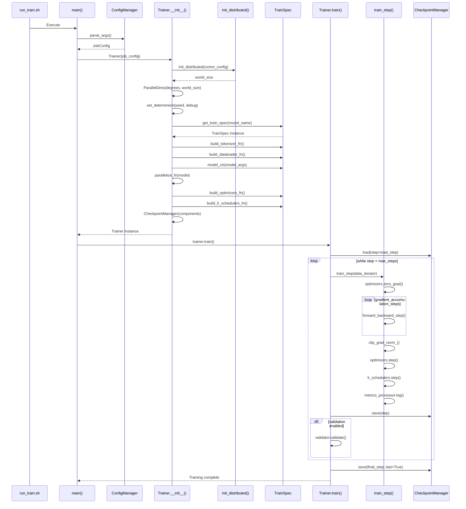

<!-- source: DeepWiki mcp.deepwiki.com · repo pytorch/torchtitan · page 1 Overview · fetched 2026-10-30 -->

# Overview

Relevant source files

The following files were used as context for generating this wiki page:

- [CONTRIBUTING.md](CONTRIBUTING.md)
- [README.md](README.md)
- [docs/composability.md](docs/composability.md)
- [docs/extension.md](docs/extension.md)
- [torchtitan/__init__.py](torchtitan/__init__.py)
- [torchtitan/experiments/README.md](torchtitan/experiments/README.md)
- [torchtitan/experiments/__init__.py](torchtitan/experiments/__init__.py)
- [torchtitan/models/__init__.py](torchtitan/models/__init__.py)

`torchtitan` is a PyTorch-native platform for large-scale training of generative AI models, specifically designed for rapid experimentation and production-scale deployment. It provides a minimal, clean-room implementation of distributed training techniques with flexible extension points for customization. The platform emphasizes ease of understanding, minimal changes to model code, and a bias towards a clean codebase with reusable and swappable components [README.md:32-42]().

For detailed information about specific subsystems, see:
- Architecture details: [Architecture Overview](#1.1)
- Setup and execution: [Installation and Quick Start](#1.2)
- Configuration details: [Configuration System](#2)
- Training loop internals: [Core Training Engine](#3)
- Parallelization techniques: [Parallelization Strategies](#4)
- Model implementations: [Model System](#5)
- Checkpointing: [Checkpoint Management](#6)

**Sources:** [README.md:32-43](), [torchtitan/train.py:39-71]()

## System Architecture

The following diagram maps the major system components to their code entities, bridging the gap between high-level concepts and the implementation.

### System Mapping: Components to Code Entities

```mermaid
graph TB
    subgraph "Entry Point"
        main["main()<br/>torchtitan/train.py:727-776"]
        ConfigMgr["ConfigManager<br/>torchtitan/config/manager.py"]
        run_train["run_train.sh"]
    end
    
    subgraph "Core Training Orchestration"
        Trainer["Trainer<br/>torchtitan/train.py:39-725"]
        JobConfig["JobConfig<br/>torchtitan/config/job_config.py"]
        TrainSpec["TrainSpec Protocol<br/>torchtitan/protocols/train_spec.py"]
    end
    
    subgraph "Distributed Infrastructure"
        ParallelDims["ParallelDims<br/>torchtitan/distributed/parallel_dims.py:19-371"]
        init_distributed["init_distributed()<br/>torchtitan/distributed/utils.py:297-363"]
        DeviceMesh["DeviceMesh<br/>torch.distributed.device_mesh"]
    end
    
    subgraph "Model & Parallelization"
        model_cls["model_cls<br/>from TrainSpec"]
        parallelize_fn["parallelize_fn<br/>from TrainSpec"]
        pipelining_fn["pipelining_fn<br/>from TrainSpec"]
        ModelConverters["ModelConverters<br/>torchtitan/protocols/model_converter.py"]
    end
    
    subgraph "Training Components"
        OptimizersContainer["OptimizersContainer<br/>torchtitan/components/optimizer.py:41-132"]
        LRSchedulersContainer["LRSchedulersContainer<br/>torchtitan/components/lr_scheduler.py"]
        BaseDataLoader["BaseDataLoader<br/>from TrainSpec"]
        LossFunction["LossFunction<br/>from TrainSpec"]
    end
    
    subgraph "State Management"
        CheckpointManager["CheckpointManager<br/>torchtitan/components/checkpoint.py"]
        FTManager["FTManager<br/>torchtitan/components/ft.py"]
    end
    
    subgraph "Monitoring"
        MetricsProcessor["MetricsProcessor<br/>torchtitan/components/metrics.py"]
        Validator["Validator<br/>from TrainSpec"]
    end
    
    run_train --> main
    main --> ConfigMgr
    ConfigMgr --> JobConfig
    main --> Trainer
    
    Trainer --> JobConfig
    Trainer --> TrainSpec
    Trainer --> ParallelDims
    Trainer --> init_distributed
    
    ParallelDims --> DeviceMesh
    init_distributed --> DeviceMesh
    
    Trainer --> model_cls
    Trainer --> parallelize_fn
    Trainer --> pipelining_fn
    Trainer --> ModelConverters
    
    Trainer --> OptimizersContainer
    Trainer --> LRSchedulersContainer
    Trainer --> BaseDataLoader
    Trainer --> LossFunction
    
    Trainer --> CheckpointManager
    Trainer --> FTManager
    Trainer --> MetricsProcessor
    Trainer --> Validator
```

**Sources:** [torchtitan/train.py:39-71](), [torchtitan/train.py:727-776](), [torchtitan/config/job_config.py:1-617](), [torchtitan/distributed/parallel_dims.py:18-371]()

## Core Components

### Trainer Class
The `Trainer` class ([torchtitan/train.py:39-725]()) is the central orchestrator that manages the entire training lifecycle. It is a `Stateful` object that coordinates distributed initialization, model building, parallelization, and the training loop. For details on the internal logic of the training loop and lifecycle, see [Core Training Engine](#3).

### Configuration System
The `JobConfig` dataclass ([torchtitan/config/job_config.py:17-617]()) provides a hierarchical configuration structure. Configuration sources are parsed in order: TOML files → environment variables → CLI arguments, with later sources overriding earlier ones. For a full breakdown of configuration sections, see [Configuration System](#2).

### ParallelDims and Device Mesh
The `ParallelDims` class ([torchtitan/distributed/parallel_dims.py:19-371]()) manages device mesh creation for N-dimensional parallelism (DP, TP, PP, CP, EP). It translates configuration degrees into a structured `DeviceMesh` for distributed operations. For details on how these dimensions are composed, see [Parallelization Strategies](#4).

**Sources:** [torchtitan/train.py:39-71](), [torchtitan/config/job_config.py:17-617](), [torchtitan/distributed/parallel_dims.py:19-371]()

## Training Workflow

The high-level execution flow starts from the CLI and proceeds through environment setup to the iterative training loop.

### Lifecycle: From Launch to Training Step

**Sources:** [torchtitan/train.py:727-776](), [torchtitan/train.py:74-368](), [torchtitan/train.py:621-709](), [torchtitan/train.py:551-619]()

## Extension Points

`torchtitan` provides flexibility through the `TrainSpec` protocol and `ModelSpec` system, which define swappable components for different model architectures and training paradigms [docs/extension.md:6-15]().

| Component | Protocol/Class | Purpose |
|-----------|----------------|---------|
| Model Architecture | `ModelSpec` | Defines model class, config, and parallelization [torchtitan/protocols/model_spec.py:1-20]() |
| Model Conversion | `ModelConverter` | Module rewriting (e.g., Float8) before parallelization |
| Data Pipeline | `BaseDataLoader` | Stateful data iteration |
| Checkpoint | `BaseStateDictAdapter` | Interoperability with other formats (e.g., HF) |

To add a new model, implement the `ModelSpec` protocol and register it via `model_registry`. For detailed guides, see [Model System](#5) and [Extension and Development](#13).

**Sources:** [docs/extension.md:6-24](), [README.md:34-36](), [torchtitan/models/__init__.py:7-9]()

## Key Design Principles

1.  **PyTorch Native**: All parallelization uses PyTorch distributed APIs (DTensor, DeviceMesh, FSDP2, etc.) rather than external frameworks [README.md:5-12]().
2.  **Minimal Model Changes**: Models remain standard `nn.Module` classes; parallelization is applied via external transformation functions [README.md:38-41]().
3.  **Clean Codebase**: Bias towards readability and simplicity over feature completeness [docs/composability.md:1-2]().
4.  **Swappable Components**: The `TrainSpec` and `ModelConverter` protocols enable easy experimentation without modifying the core training engine [docs/extension.md:1-5]().
5.  **Stateful Resumption**: All core components implement the `Stateful` protocol for robust checkpoint/resume [torchtitan/train.py:39]().

## File Structure Overview

- `torchtitan/train.py`: Main `Trainer` class and entry point [torchtitan/train.py:39-71]().
- `torchtitan/config/`: Configuration system (`JobConfig`, `ConfigManager`) [torchtitan/config/job_config.py:17-617]().
- `torchtitan/distributed/`: Distributed utilities (`ParallelDims`, device mesh, NCCL utils) [torchtitan/distributed/parallel_dims.py:19-371]().
- `torchtitan/protocols/`: Protocol definitions (`ModelSpec`, `ModelConverter`) [torchtitan/protocols/model_spec.py:1-20]().
- `torchtitan/components/`: Reusable components (checkpoint, optimizer, metrics, etc.) [torchtitan/components/checkpoint.py:1-50]().
- `torchtitan/models/`: Model implementations (Llama 3/4, DeepSeek, etc.) [torchtitan/models/__init__.py:7-9]().
- `torchtitan/experiments/`: Experimental features and new training paradigms [torchtitan/experiments/README.md:1-23]().
- `run_train.sh`: Single-node training launcher script [torchtitan/train.py:727-776]().

**Sources:** [README.md:84-93](), [torchtitan/experiments/README.md:1-23]()

---

