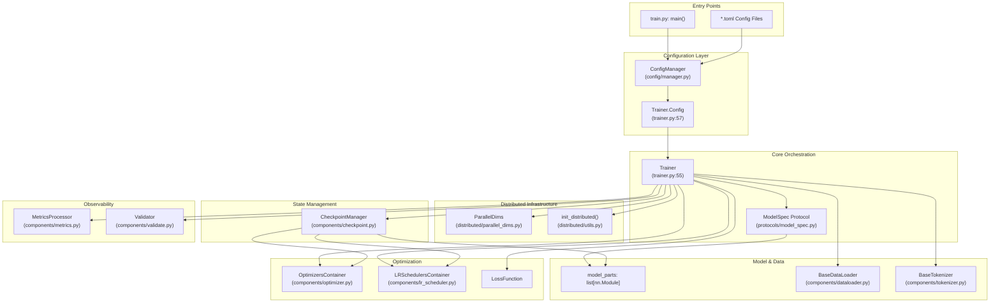

<!-- source: DeepWiki mcp.deepwiki.com · repo pytorch/torchtitan · page 1.1 Architecture Overview · fetched 2026-10-30 -->

# Architecture Overview

<details>
<summary>Relevant source files</summary>

The following files were used as context for generating this wiki page:

- [CONTRIBUTING.md](CONTRIBUTING.md)
- [README.md](README.md)
- [docs/composability.md](docs/composability.md)
- [docs/extension.md](docs/extension.md)
- [torchtitan/__init__.py](torchtitan/__init__.py)
- [torchtitan/components/validate.py](torchtitan/components/validate.py)
- [torchtitan/experiments/README.md](torchtitan/experiments/README.md)
- [torchtitan/experiments/__init__.py](torchtitan/experiments/__init__.py)
- [torchtitan/experiments/forge/engine.py](torchtitan/experiments/forge/engine.py)
- [torchtitan/experiments/forge/example_train.py](torchtitan/experiments/forge/example_train.py)
- [torchtitan/experiments/torchft/trainer.py](torchtitan/experiments/torchft/trainer.py)
- [torchtitan/models/__init__.py](torchtitan/models/__init__.py)
- [torchtitan/trainer.py](torchtitan/trainer.py)

</details>


## Purpose and Scope

This document describes the high-level system architecture of **torchtitan**, a PyTorch-native platform for large-scale generative AI training. It explains the major architectural components, their responsibilities, and how they interact to orchestrate distributed training. 

TorchTitan is designed around three core principles:
1. **Easy to understand and extend** - Minimal abstractions with clear component boundaries [README.md:39]().
2. **Minimal model changes** - Apply multi-dimensional parallelism without extensive model rewrites [README.md:40]().
3. **Clean, reusable components** - Swappable implementations via protocol-based design [README.md:41]().

## System Architecture Overview

The architecture centers on the `Trainer` class, which orchestrates all training subsystems. The system follows a compositional design where configuration flows from `ConfigManager`, components are built via `Configurable.build()`, and parallelism is managed through `ParallelDims`.

### High-Level Component Diagram



**Sources:** [torchtitan/train.py:16-68](), [torchtitan/trainer.py:55-103](), [torchtitan/distributed/parallel_dims.py:19-35]()

---

## Core Architecture Components

### Trainer Class

The `Trainer` class is the central orchestrator defined at [torchtitan/trainer.py:55](). It implements the `torch.distributed.checkpoint.stateful.Stateful` protocol for checkpointing and the `Configurable` protocol for initialization.

**Key Responsibilities:**
- Initialize the distributed environment via `init_distributed` [torchtitan/trainer.py:192]().
- Build and parallelize model components using `ModelSpec` [torchtitan/trainer.py:246]().
- Coordinate the training loop execution, including gradient accumulation [torchtitan/trainer.py:567]().
- Manage checkpointing, metrics collection, and validation [torchtitan/trainer.py:321-365]().

**Core Attributes:**

| Attribute | Type | Purpose |
|-----------|------|---------|
| `config` | `Trainer.Config` | Hierarchical configuration for the job [torchtitan/trainer.py:57-103]() |
| `parallel_dims` | `ParallelDims` | Manages N-D parallelism degrees and device meshes [torchtitan/distributed/parallel_dims.py:19]() |
| `model_parts` | `list[nn.Module]` | Model components (single or per-PP-stage) [torchtitan/trainer.py:170]() |
| `optimizers` | `OptimizersContainer` | Multi-optimizer management for PP/EP [torchtitan/components/optimizer.py:41]() |
| `lr_schedulers` | `LRSchedulersContainer` | Learning rate scheduling [torchtitan/components/lr_scheduler.py:18]() |
| `checkpointer` | `CheckpointManager` | State persistence and recovery [torchtitan/components/checkpoint.py:34]() |
| `metrics_processor` | `MetricsProcessor` | Logging and throughput calculation [torchtitan/components/metrics.py:228]() |

**Sources:** [torchtitan/trainer.py:55-185](), [torchtitan/components/metrics.py:228-251]()

### ModelSpec Protocol

The `ModelSpec` protocol defines how models are registered and built. It separates the model architecture from the training infrastructure [docs/extension.md:6-15]().

**Interface and Lifecycle:**
1. **Model Selection**: The user selects a model (e.g., `llama3`) via configuration [torchtitan/trainer.py:64]().
2. **Configuration**: `ModelSpec.model` provides a `BaseModel.Config` which is updated from the `Trainer.Config` [torchtitan/trainer.py:204-207]().
3. **Materialization**: The model is first built on the **meta device** to save memory [torchtitan/trainer.py:211-215]().
4. **Parallelization**: `ModelSpec.parallelize` is called to apply TP, CP, AC, and FSDP [torchtitan/trainer.py:246]().

**Sources:** [torchtitan/protocols/model_spec.py:13-36](), [torchtitan/trainer.py:198-250]()

### ParallelDims and Device Mesh

`ParallelDims` manages the complexity of multi-dimensional parallelism. It ensures that the product of all degrees matches the total `world_size` [torchtitan/distributed/parallel_dims.py:19-35]().

**Device Mesh Hierarchy:**
Torchtitan builds specialized meshes for different components:
- **`batch` mesh**: For data parallelism (FSDP/DDP).
- **`tp` mesh**: For tensor parallelism.
- **`cp` mesh**: For context parallelism.
- **`pp` mesh**: For pipeline parallelism.
- **`loss` mesh**: A combination of `batch` and `cp` ranks to ensure loss visibility [torchtitan/distributed/parallel_dims.py:225-230]().

**Sources:** [torchtitan/distributed/parallel_dims.py:19-125](), [torchtitan/distributed/parallel_dims.py:220-235]()

---

## Training Execution Flow

### Trainer Initialization Flow

```mermaid
sequenceDiagram
    participant Main as train.py: main()
    participant CM as ConfigManager
    participant T as Trainer.build()
    participant ID as init_distributed()
    participant PD as ParallelDims
    participant MS as ModelSpec
    participant Par as ModelSpec.parallelize()
    
    Main->>CM: parse_args()
    CM-->>Main: Trainer.Config
    Main->>T: config.build()
    
    T->>ID: init_distributed(comm_config)
    
    T->>PD: ParallelDims(degrees, world_size)
    PD->>PD: build_mesh()
    
    T->>MS: model_config.build() (Meta Device)
    
    T->>Par: MS.parallelize(model, parallel_dims, ...)
    Note over Par: TP -> CP -> AC -> Compile -> FSDP
    
    T->>T: build_optimizers()
    T->>T: build_lr_schedulers()
    T->>T: build_checkpointer()
```

**Sources:** [torchtitan/train.py:41](), [torchtitan/trainer.py:187-368](), [torchtitan/distributed/utils.py:297-320]()

### Step Execution Logic

The `train()` method executes the main loop [torchtitan/trainer.py:475](). For each step, it calls `train_step()` which handles:
1. **Data Loading**: Fetches the next batch from the `BaseDataLoader` [torchtitan/trainer.py:551]().
2. **Gradient Accumulation**: Iterates over microbatches if `gradient_accumulation_steps > 1` [torchtitan/trainer.py:567]().
3. **Forward/Backward**:
    - If Pipeline Parallel (PP) is enabled, it uses `pp_schedule.step()` [torchtitan/trainer.py:506]().
    - Otherwise, it performs a standard `model(input).backward()` [torchtitan/trainer.py:540-547]().
4. **Optimization**: Applies gradient clipping and calls `optimizers.step()` [torchtitan/trainer.py:596-602]().

**Sources:** [torchtitan/trainer.py:475-619](), [torchtitan/trainer.py:621-709]()

---

## Experimental Framework

Torchtitan includes an `experiments/` directory for developing new features without impacting the core stable trainer [torchtitan/experiments/README.md:1-5]().

### ForgeEngine
`ForgeEngine` is a stripped-down, reusable base class for custom training loops [torchtitan/experiments/forge/engine.py:34](). It provides the same distributed and parallelization setup as `Trainer` but allows developers to define their own `batch_generator` and `train` logic [torchtitan/experiments/forge/example_train.py:143]().

- **Base Class**: [torchtitan/experiments/forge/engine.py:34]()
- **Example Implementation**: [torchtitan/experiments/forge/example_train.py:31]()

### Validator System
The `Validator` class [torchtitan/components/validate.py:53]() provides a pluggable way to run evaluation during training.
- It uses a separate `validation_dataloader` [torchtitan/components/validate.py:122]().
- It executes a forward-only pass within a `validation_context` [torchtitan/components/validate.py:127]().
- **Base Interface**: [torchtitan/components/validate.py:33]()

**Sources:** [torchtitan/experiments/forge/engine.py:34-95](), [torchtitan/components/validate.py:53-137](), [torchtitan/experiments/README.md:23-32]()

---

## Observability and Monitoring

### MetricsProcessor
The `MetricsProcessor` [torchtitan/components/metrics.py:228]() calculates critical performance metrics:
- **Throughput**: Tokens per second (TPS).
- **Compute**: TFLOPS and Model Flops Utilization (MFU).
- **Memory**: Peak active and reserved memory via `DeviceMemoryMonitor` [torchtitan/components/metrics.py:39]().

### Garbage Collection
To prevent stragglers in distributed training caused by asynchronous Python GC, Torchtitan uses a `GarbageCollection` handler [torchtitan/tools/utils.py:46](). It disables automatic GC and triggers manual collection at a configured frequency [torchtitan/tools/utils.py:59-67]().

**Sources:** [torchtitan/components/metrics.py:39-90](), [torchtitan/components/metrics.py:228-350](), [torchtitan/tools/utils.py:46-74]()

---

