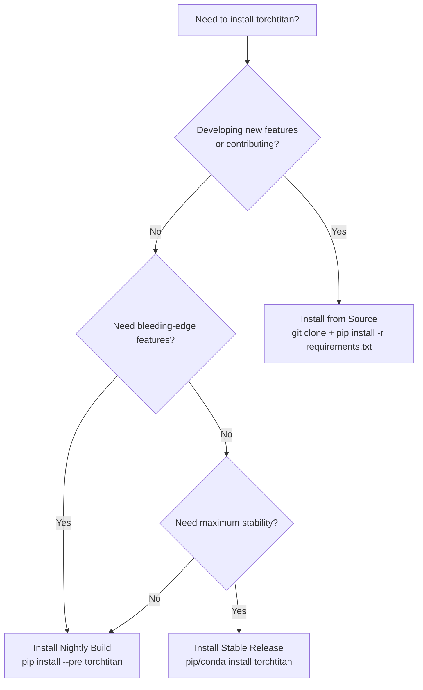
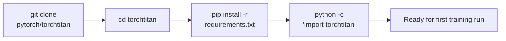
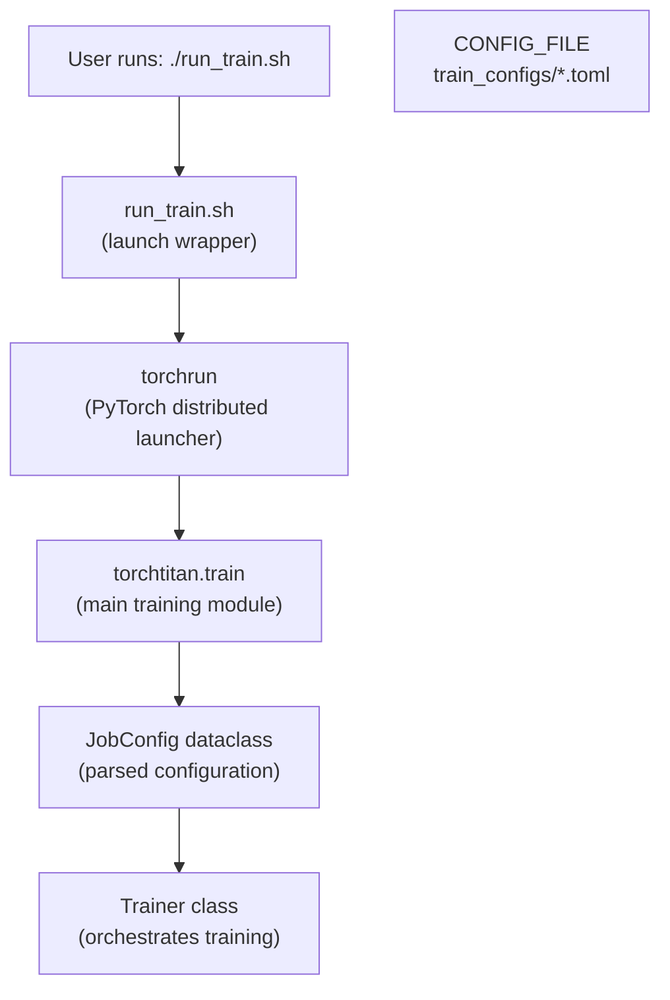

<!-- source: DeepWiki mcp.deepwiki.com · repo pytorch/torchtitan · page 1.2 Installation and Quick Start · fetched 2026-10-30 -->

# Installation and Quick Start

<details>
<summary>Relevant source files</summary>

The following files were used as context for generating this wiki page:

- [.ci/docker/README.md](.ci/docker/README.md)
- [.ci/docker/build.sh](.ci/docker/build.sh)
- [.ci/docker/common/install_base.sh](.ci/docker/common/install_base.sh)
- [.ci/docker/common/install_clang.sh](.ci/docker/common/install_clang.sh)
- [.ci/docker/common/install_conda.sh](.ci/docker/common/install_conda.sh)
- [.ci/docker/common/install_deepep.sh](.ci/docker/common/install_deepep.sh)
- [.ci/docker/common/install_gcc.sh](.ci/docker/common/install_gcc.sh)
- [.ci/docker/common/install_user.sh](.ci/docker/common/install_user.sh)
- [.ci/docker/common/utils.sh](.ci/docker/common/utils.sh)
- [.ci/docker/conda-env-ci.txt](.ci/docker/conda-env-ci.txt)
- [.ci/docker/requirements-transformers-modeling-backend.txt](.ci/docker/requirements-transformers-modeling-backend.txt)
- [.ci/docker/requirements.txt](.ci/docker/requirements.txt)
- [.ci/docker/ubuntu/Dockerfile](.ci/docker/ubuntu/Dockerfile)
- [.flake8](.flake8)
- [.github/workflows/lint.yaml](.github/workflows/lint.yaml)
- [.github/workflows/release.yml](.github/workflows/release.yml)
- [.gitignore](.gitignore)
- [.pre-commit-config.yaml](.pre-commit-config.yaml)
- [pyproject.toml](pyproject.toml)
- [requirements.txt](requirements.txt)
- [tests/unit_tests/test_loss.py](tests/unit_tests/test_loss.py)
- [torchtitan/components/loss.py](torchtitan/components/loss.py)
- [torchtitan/experiments/graph_trainer/chunked_loss.py](torchtitan/experiments/graph_trainer/chunked_loss.py)
- [torchtitan/experiments/graph_trainer/tests/test_chunked_loss.py](torchtitan/experiments/graph_trainer/tests/test_chunked_loss.py)
- [torchtitan/experiments/transformers_modeling_backend/README.md](torchtitan/experiments/transformers_modeling_backend/README.md)
- [torchtitan/experiments/transformers_modeling_backend/__init__.py](torchtitan/experiments/transformers_modeling_backend/__init__.py)

</details>


This document provides step-by-step instructions for installing torchtitan, setting up your environment, and running your first training job. Three installation methods are supported: from source (recommended for development), nightly builds, and stable releases.

For configuration management details, see page 2. For advanced training options and multi-node setup, see page 11.

## Installation Methods Overview

torchtitan supports three installation methods depending on your use case:

| Method | Use Case | PyTorch Version | Installation Time |
|--------|----------|-----------------|-------------------|
| **From Source** | Development, latest features | Nightly or from source | ~2-5 minutes |
| **Nightly Build** | Latest stable features | Nightly | ~1-2 minutes |
| **Stable Release** | Production, stability | Pinned nightly | ~1-2 minutes |

**Installation Method Selection Diagram**



Sources: `pyproject.toml:1-60`(), `requirements.txt:1-11`()

## Prerequisites

Before installing torchtitan, ensure your environment meets these requirements:

| Requirement | Specification | Notes |
|-------------|---------------|-------|
| **Python** | >= 3.10 | Required by `pyproject.toml` [pyproject.toml:6]() |
| **PyTorch** | Nightly recommended | Required for latest distributed features |
| **CUDA** | 13.0 recommended | CI uses CUDA 13.0 [pyproject.toml:60]() |
| **GPUs** | 1+ GPUs | Supports single-node or multi-node distributed training |
| **Operating System** | Linux | Standard CI environment is Ubuntu 22.04 [.ci/docker/build.sh:25]() |

Sources: `pyproject.toml:6`(), `.ci/docker/build.sh:25`()

## Installation Method 1: From Source

Installing from source is recommended for development and to access the latest features. This method requires PyTorch nightly or PyTorch built from source.

### Step-by-Step Installation

**1. Clone the Repository**
```bash
git clone https://github.com/pytorch/torchtitan
cd torchtitan
```

**2. Install Dependencies**
```bash
pip install -r requirements.txt
```

The `requirements.txt` file includes core dependencies:
- `torchdata>=0.8.0` [requirements.txt:1]() - Stateful dataloader for checkpointing
- `datasets>=3.6.0` [requirements.txt:2]() - HuggingFace dataset integration
- `tokenizers>=0.15.0` [requirements.txt:7]() - Text tokenization
- `tyro>=1.0.5` [requirements.txt:6]() - CLI argument parsing
- `tensorboard` & `wandb` [requirements.txt:3-4]() - Training metrics visualization
- `einops` & `safetensors` [requirements.txt:8-9]() - Model and tensor utilities
- `spmd_types==0.2.1` [requirements.txt:11]() - Type checking for distributed operations

**3. Verify Installation**
```bash
# Check that torchtitan can be imported
python -c "import torchtitan"

# Run a quick unit test
pytest tests/unit_tests/test_loss.py
```

**Installation Flow Diagram**



Sources: `pyproject.toml:12-29`(), `requirements.txt:1-12`()

## Installation Method 2: Nightly Builds

Nightly builds provide pre-packaged versions with the latest stable features. This method automatically installs PyTorch nightly.

### Installation Commands

**For CUDA 13.0:**
```bash
pip3 install --pre torch --index-url https://download.pytorch.org/whl/nightly/cu130 --force-reinstall
pip install --pre torchtitan --index-url https://download.pytorch.org/whl/nightly/cu130
```

The `--pre` flag enables pre-release versions (nightly builds), and `--force-reinstall` ensures PyTorch nightly is installed even if a stable version exists.

Sources: `.github/workflows/lint.yaml:60`()

## Installation Method 3: Stable Releases

Stable releases are pinned to specific PyTorch versions and provide maximum stability. Available via pip.

### Via pip
```bash
pip install torchtitan
```

Sources: `pyproject.toml:3`(), `.github/workflows/release.yml:39`()

## Quick Start: Running Your First Training Job

### Single-Node Training (8 GPUs)

The simplest way to start training is using a model configuration on a single node using the `run_train.sh` script.

**Debug Model (Fast Iteration)**
```bash
# Set environment variables and run
CONFIG_FILE="./torchtitan/models/llama3/train_configs/debug_model.toml" ./run_train.sh
```

**Understanding Training Output**
When you launch training, you'll see output metrics like loss, memory usage, and throughput. torchtitan implements a specialized `cross_entropy_loss` [torchtitan/components/loss.py:28]() that handles token-based normalization correctly across distributed ranks.

**Training Script Components**



Sources: `torchtitan/components/loss.py:28-39`(), `tests/unit_tests/test_loss.py:38-45`()

## Docker Setup

For consistent environments, torchtitan provides Docker build scripts supporting both NVIDIA (CUDA) and AMD (ROCm) platforms.

### Building the Image
```bash
# Build the Ubuntu 22.04 image
./.ci/docker/build.sh torchtitan-ubuntu-22.04-clang12 -t my_torchtitan:latest
```

### Dockerfile Structure
The Docker setup in `.ci/docker/ubuntu/Dockerfile` [.ci/docker/ubuntu/Dockerfile:1-47]() follows a modular structure:
- **Base Layers**: Installs system dependencies via `install_base.sh` [.ci/docker/ubuntu/Dockerfile:11]().
- **Compilers**: Sets up Clang and GCC [.ci/docker/ubuntu/Dockerfile:16-21]().
- **Python Environment**: Uses Miniconda to manage the environment and installs dependencies from `requirements.txt` [.ci/docker/ubuntu/Dockerfile:33-40]().
- **Expert Parallelism**: Optionally installs `DeepEP` for MoE training [.ci/docker/ubuntu/Dockerfile:43]().

Sources: `.ci/docker/build.sh:23-37`(), `.ci/docker/ubuntu/Dockerfile:1-47]()

## Development and Testing

### Installing Development Dependencies
To contribute or run the full test suite, install the `dev` optional dependencies defined in `pyproject.toml` [pyproject.toml:37-44]():
```bash
pip install -e ".[dev]"
```
This installs `pytest`, `pytest-cov`, `pre-commit`, and `pyrefly` for type checking.

### Linting and Pre-commit
torchtitan uses `pre-commit` to enforce code quality. Key hooks include:
- `ufmt`: Formats code using `black` and `usort` [.pre-commit-config.yaml:41-44]().
- `flake8`: Checks for PEP8 compliance and common bugs [.pre-commit-config.yaml:29-32]().
- `pyrefly`: Performs static type checking [.pre-commit-config.yaml:67-70]().
- `lychee`: Validates hyperlinks in documentation [.pre-commit-config.yaml:80]().

### Running Tests
| Test Category | Command | File Reference |
|-----------|---------|---------|
| **Loss Functions** | `pytest tests/unit_tests/test_loss.py` | `tests/unit_tests/test_loss.py` |
| **CI Linting** | `pre-commit run --all-files` | `.pre-commit-config.yaml` |

Sources: `pyproject.toml:37-44`(), `.pre-commit-config.yaml:1-118`(), `.github/workflows/lint.yaml:15-78`()

## Summary of Key Files

| File Path | Description |
|-----------|-------------|
| `pyproject.toml` | Project metadata and dependency definitions [pyproject.toml:1-60]() |
| `requirements.txt` | Runtime dependencies for pip and Docker [.ci/docker/requirements.txt:1-12]() |
| `.ci/docker/build.sh` | Orchestration script for Docker image creation [.ci/docker/build.sh:1-50]() |
| `torchtitan/components/loss.py` | Implementation of distributed Cross Entropy loss [torchtitan/components/loss.py:28]() |
| `.pre-commit-config.yaml` | Configuration for local and CI linting tools [.pre-commit-config.yaml:1-118]() |

Sources: `pyproject.toml:1-60`(), `requirements.txt:1-12`(), `.ci/docker/build.sh:1-50`()

---

