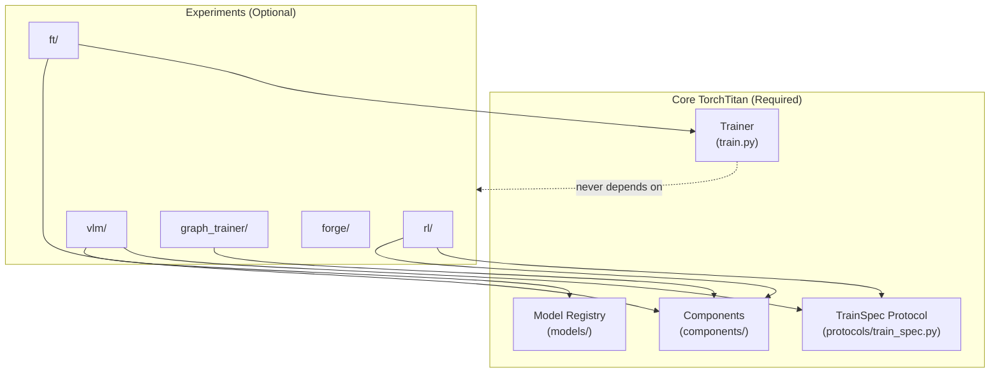
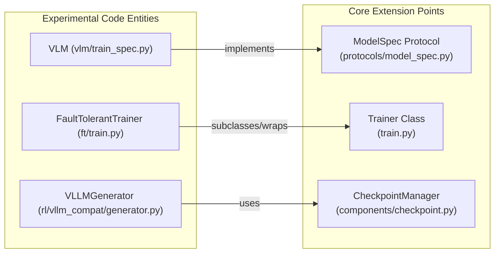
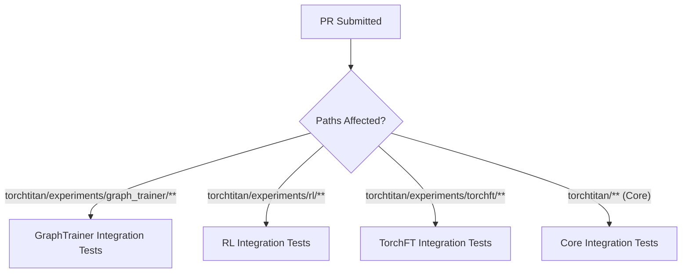

<!-- source: DeepWiki mcp.deepwiki.com · repo pytorch/torchtitan · page 10 Experimental Systems · fetched 2026-10-30 -->

# Experimental Systems

Relevant source files

The following files were used as context for generating this wiki page:

- [torchtitan/__init__.py](torchtitan/__init__.py)
- [torchtitan/experiments/README.md](torchtitan/experiments/README.md)
- [torchtitan/experiments/__init__.py](torchtitan/experiments/__init__.py)
- [torchtitan/models/__init__.py](torchtitan/models/__init__.py)

## Overview

TorchTitan includes several experimental systems that provide alternative implementations or enhancements to core training infrastructure. These systems are located in the `experiments/` directory and follow a one-way dependency model where experiments depend on core components but core never depends on experiments. This allows for rapid innovation in areas like Reinforcement Learning (RL), Vision Language Models (VLM), and advanced compilation without destabilizing the core training engine.

This page provides a high-level overview of the experimental framework, contribution guidelines, and current experiments. For deep dives into specific systems, refer to the child pages:

1.  **Experiments Framework Overview and Guidelines** ([Experiments Framework Overview and Guidelines](#10.1)) - Detailed structure of the `experiments/` folder and principles for adding new experiments.
2.  **Compiler Toolkit and Graph Trainer** ([Compiler Toolkit and Graph Trainer](#10.2)) - Joint graph compilation system with custom passes and `CUDAGraph` integration.
3.  **ForgeEngine and Custom Training Loops** ([ForgeEngine and Custom Training Loops](#10.3)) - A stripped-down alternative to the standard `Trainer` for post-training workflows.
4.  **Reinforcement Learning Experiment** ([Reinforcement Learning Experiment](#10.4)) - GRPO training and vLLM integration for rollout generation.
5.  **Vision Language Model (VLM) Experiment** ([Vision Language Model (VLM) Experiment](#10.5)) - Native support for multimodal training with SigLIP2 and dynamic aspect ratios.
6.  **Fault Tolerance Experiment (TorchFT)** ([Fault Tolerance Experiment (TorchFT)](#10.6)) - Multi-replica training with DiLoCo and quorum-based recovery.
7.  **AutoParallel and Transformers Backend** ([AutoParallel and Transformers Backend Experiments](#10.7)) - Automatic strategy selection and HuggingFace model integration.

**Sources:** [torchtitan/experiments/README.md:1-13](), [torchtitan/experiments/__init__.py:7-20]()

---

## Design Principles and Architecture

### One-Way Dependency Model

The experiments framework enforces a strict architectural boundary. The dependency from `experiments` to `core` is one-way: anything in `experiments` is optional for `core` to run successfully. Development in `core` is not blocked by breakage in `experiments`, though experiment owners are expected to fix breakages by the next official release.

**Figure 1: Experiments Framework Dependency Architecture**

**Sources:** [torchtitan/experiments/README.md:5](), [torchtitan/experiments/README.md:14]()

### Directory Structure

Each experiment is organized as an independent subfolder in `torchtitan/experiments/`. Each experiment:
*   Must have a clear theme (new architecture or infrastructure enhancement).
*   Should reuse existing `torchtitan` code (modules in `components/`) via the `ModelSpec` protocol.
*   Is independent of other experiments and can have its own dependencies (on top of core `requirements.txt`).
*   Must not contain vendor-specific code (e.g., proprietary kernels).

**Sources:** [torchtitan/experiments/README.md:6-13]()

---

## Integration with Core Components

Experiments integrate with the core training system primarily through extension points defined in the TorchTitan architecture.

**Figure 2: Experiment Code Entities and Integration**

### Key Extension Points

1.  **ModelSpec Protocol**: Experiments implement custom `ModelSpec` classes to define how models are built, parallelized, and trained.
2.  **Experiment Registry**: Supported experiments are tracked in `torchtitan/experiments/__init__.py` within the `_supported_experiments` set.
3.  **Custom Trainers**: Some experiments (like `ft` or `forge`) provide alternative entry points to the standard `train.py` loop.

**Sources:** [torchtitan/experiments/README.md:10](), [torchtitan/experiments/__init__.py:7-19]()

---

## Current Experiments Registry

The following table summarizes the experiments currently maintained in the repository and registered in the system:

| Experiment | Registry Identifier | Primary Focus | Owners |
| :--- | :--- | :--- | :--- |
| **Graph Trainer** | `graph_trainer.[model]` | Joint graph compilation and `CUDAGraph` integration | @SherlockNoMad |
| **AutoParallel** | `autoparallel.[model]` | Cost-based automatic parallelism strategy selection | - |
| **TorchFT** | `torchft.llama3` | Fault tolerance and DiLoCo distributed optimization | @tushar00jain, @fegin |
| **RL** | `rl` | Reinforcement Learning (GRPO) with vLLM rollouts | @wwwjn, @felipemello1 |
| **Transformers** | `transformers_modeling_backend` | Training HF Transformers with 4D parallelism | @3outeille, @mreso |
| **Forge** | `forge` | Stripped-down engine for post-training workflows | @felipemello1 |

**Sources:** [torchtitan/experiments/README.md:25-33](), [torchtitan/experiments/__init__.py:7-19]()

---

## Contributing Guidelines

### Ownership and Maintenance

Each experiment must have an owner responsible for:
*   Adapting the experiment to changes in `core` to fix broken tests no later than the next official release.
*   Responding to GitHub issues and questions in a timely manner.
*   Providing documentation, performance reports, and loss convergence results.

### Removal Criteria

The `torchtitan` team reserves the right to remove an experiment if:
1.  It has served its purpose (findings upstreamed to PyTorch or core).
2.  It becomes stale (not maintained or tests remain broken).

**Sources:** [torchtitan/experiments/README.md:9](), [torchtitan/experiments/README.md:15-20]()

### Testing and CI

Experiments utilize GitHub Actions to run integration tests. These tests are triggered via path-filtering to ensure they only run when relevant code changes.

**Figure 3: CI/CD Path Filtering for Experiments**

**Sources:** [torchtitan/experiments/README.md:14](), [torchtitan/experiments/README.md:27-30]()

---

