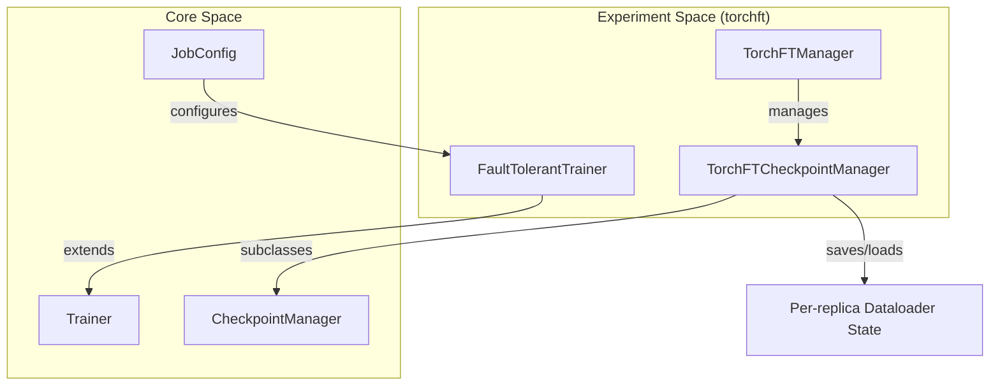
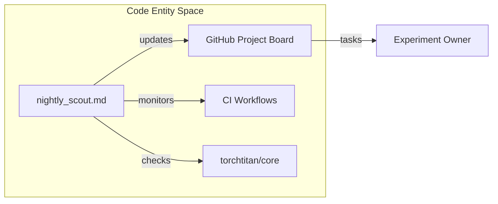

<!-- source: DeepWiki mcp.deepwiki.com · repo pytorch/torchtitan · page 10.1 Experiments Framework Overview and Guidelines · fetched 2026-10-30 -->

# Experiments Framework Overview and Guidelines

Relevant source files

The following files were used as context for generating this wiki page:

- [.github/CODEOWNERS](.github/CODEOWNERS)
- [tests/README.md](tests/README.md)
- [torchtitan/__init__.py](torchtitan/__init__.py)
- [torchtitan/experiments/README.md](torchtitan/experiments/README.md)
- [torchtitan/experiments/__init__.py](torchtitan/experiments/__init__.py)
- [torchtitan/experiments/graph_trainer/.claude/autodev.md](torchtitan/experiments/graph_trainer/.claude/autodev.md)
- [torchtitan/experiments/graph_trainer/.claude/nightly_scout.md](torchtitan/experiments/graph_trainer/.claude/nightly_scout.md)
- [torchtitan/experiments/torchft/README.md](torchtitan/experiments/torchft/README.md)
- [torchtitan/experiments/torchft/__init__.py](torchtitan/experiments/torchft/__init__.py)
- [torchtitan/experiments/torchft/checkpoint.py](torchtitan/experiments/torchft/checkpoint.py)
- [torchtitan/experiments/torchft/config/__init__.py](torchtitan/experiments/torchft/config/__init__.py)
- [torchtitan/models/__init__.py](torchtitan/models/__init__.py)

The `experiments/` framework in `torchtitan` is designed to accelerate innovation by providing a dedicated space for experimental features, new model architectures, and infrastructure enhancements that are not yet part of the core library [torchtitan/experiments/README.md:1-5](). This framework allows contributors to iterate rapidly while maintaining the stability of the `core` codebase.

## Framework Structure and Principles

The framework distinguishes between `core` (the stable training engine) and `experiments` (the incubator for new features) [torchtitan/experiments/README.md:5-6]().

### Core Principles
*   **Independence**: Each experiment is a standalone subfolder and can maintain its own dependencies and tests [torchtitan/experiments/README.md:6-13]().
*   **One-Way Dependency**: Experiments may depend on `core`, but `core` must never depend on `experiments`. Development in `core` is never blocked by breakages in the experimental folder [torchtitan/experiments/README.md:14-15]().
*   **Reuse over Duplication**: Experiments are encouraged to reuse `core` components (e.g., modules in `components/`) via the `ModelSpec` protocol rather than copying code [torchtitan/experiments/README.md:10-12]().
*   **Ownership**: Every experiment must have a designated owner responsible for maintenance, responding to issues, and adapting to `core` changes [torchtitan/experiments/README.md:15-17]().

### Folder Structure
The `experiments/` directory is organized by feature theme:
*   `graph_trainer/`: Focuses on joint graph compilation and `torch.compile` optimizations [torchtitan/experiments/__init__.py:9-11]().
*   `torchft/`: Implements fault-tolerant training using the TorchFT library [torchtitan/experiments/torchft/README.md:1-5]().
*   `rl/`: Contains Reinforcement Learning infrastructure, including GRPO and vLLM integration [torchtitan/experiments/__init__.py:16-16]().
*   `forge/`: A stripped-down training engine for post-training workflows [torchtitan/experiments/README.md:31-31]().

### Experiment Registry
Experiments are registered in `torchtitan/experiments/__init__.py` to define supported experimental configurations [torchtitan/experiments/__init__.py:7-18]().

| Code Entity | Role |
| :--- | :--- |
| `_supported_experiments` | A `frozenset` defining valid experiment strings used for configuration validation [torchtitan/experiments/__init__.py:7-18](). |
| `torchtitan/experiments/README.md` | The primary documentation for contribution guidelines and owner tracking [torchtitan/experiments/README.md:1-32](). |
| `.github/CODEOWNERS` | Defines GitHub review requirements, specifically excluding the general experiments dir but assigning specific owners to subfolders [/.github/CODEOWNERS:9-15](). |

## Contribution and Iteration Workflow

Contributing a new experiment requires justifying its value, providing performance/convergence reports, and ensuring it follows the one-way dependency rule [torchtitan/experiments/README.md:9-14]().

### Implementation and Data Flow
Experiments typically extend the `core` functionality by providing specialized `Trainer` subclasses or custom `ModelSpec` implementations.

**Example: TorchFT Experiment Data Flow**
The `torchft` experiment overrides the standard `CheckpointManager` with `TorchFTCheckpointManager` to handle per-replica dataloader state [torchtitan/experiments/torchft/checkpoint.py:44-56]().

### Experiment Data Flow Diagram
This diagram illustrates how an experiment (using TorchFT as an example) interacts with the core system components.

**Sources:** [torchtitan/experiments/torchft/checkpoint.py:44-56](), [torchtitan/experiments/torchft/manager.py:7-11](), [torchtitan/experiments/README.md:10-12]().

## Current Experiment Registry

The following table tracks the major experiments currently active in the repository:

| Experiment Path | Purpose | Key Components |
| :--- | :--- | :--- |
| `graph_trainer/` | Joint graph compilation | `GraphTrainer`, `GraphTrainerCompileConfig` [torchtitan/experiments/graph_trainer/.claude/nightly_scout.md:99-102]() |
| `torchft/` | Fault tolerance/DiLoCo | `TorchFTManager`, `TorchFTCheckpointManager` [torchtitan/experiments/torchft/checkpoint.py:44-56]() |
| `rl/` | Reinforcement Learning | `PolicyTrainer`, `VLLMGenerator` [torchtitan/experiments/__init__.py:16-16]() |
| `transformers_modeling_backend` | HF Transformers support | Integration with core 4D parallelism [torchtitan/experiments/__init__.py:12-12]() |

### Automated Maintenance (AutoDev)
Some experiments, such as `graph_trainer`, utilize an "AutoDev" workflow. This involves a `nightly_scout.md` prompt that Claude Code uses to discover opportunities, risks, and upstream changes in `core` that affect the experiment [torchtitan/experiments/graph_trainer/.claude/nightly_scout.md:1-5]().

**Sources:** [torchtitan/experiments/graph_trainer/.claude/nightly_scout.md:1-12](), [torchtitan/experiments/graph_trainer/.claude/autodev.md:34-44]().

## Testing and Quality Assurance

Experiments must include their own integration tests. These are typically triggered via GitHub Actions only when the specific experiment directory is modified [torchtitan/experiments/README.md:14-14]().

*   **Integration Tests**: Located in `tests/integration_tests/`, experiments like `graph_trainer` and `torchft` have dedicated workflow files (e.g., `integration_test_8gpu_graph_trainer.yaml`) [torchtitan/experiments/README.md:27-30]().
*   **Manual Testing**: Users can run experiment-specific tests using the `run_tests.py` script by specifying the appropriate `--module` and `--config` [tests/README.md:33-41]().

**Sources:** [torchtitan/experiments/README.md:14-30](), [tests/README.md:33-41]().

---

