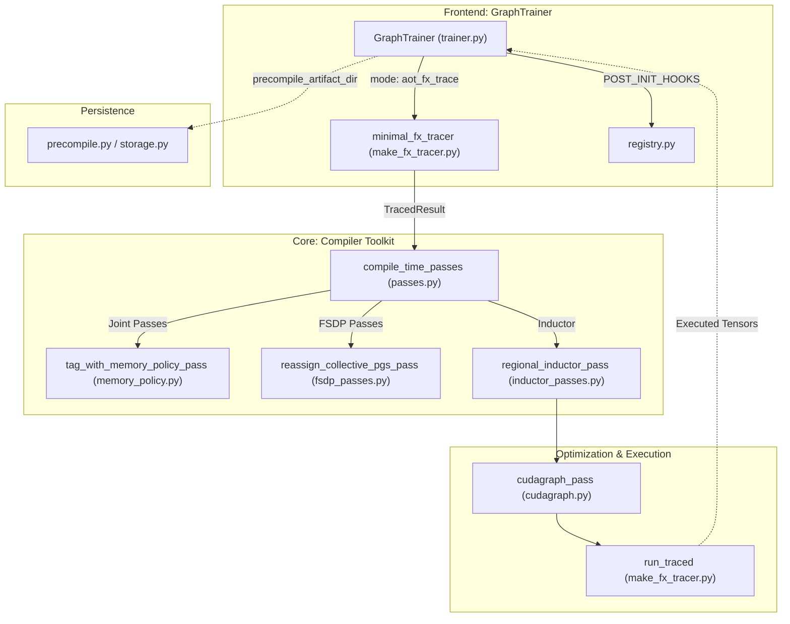
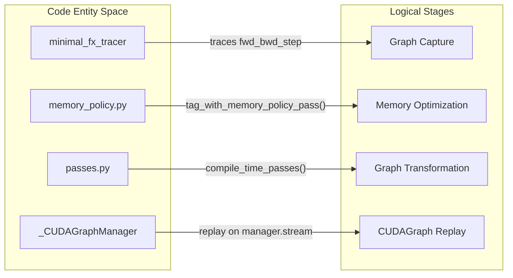

<!-- source: DeepWiki mcp.deepwiki.com · repo pytorch/torchtitan · page 10.2 Compiler Toolkit and Graph Trainer · fetched 2026-10-30 -->

# Compiler Toolkit and Graph Trainer

Relevant source files

The following files were used as context for generating this wiki page:

- [torchtitan/experiments/graph_trainer/.claude/CLAUDE.md](torchtitan/experiments/graph_trainer/.claude/CLAUDE.md)
- [torchtitan/experiments/graph_trainer/README.md](torchtitan/experiments/graph_trainer/README.md)
- [torchtitan/experiments/graph_trainer/compile.py](torchtitan/experiments/graph_trainer/compile.py)
- [torchtitan/experiments/graph_trainer/configs.py](torchtitan/experiments/graph_trainer/configs.py)
- [torchtitan/experiments/graph_trainer/cpu_offload.py](torchtitan/experiments/graph_trainer/cpu_offload.py)
- [torchtitan/experiments/graph_trainer/cudagraph.py](torchtitan/experiments/graph_trainer/cudagraph.py)
- [torchtitan/experiments/graph_trainer/custom_codegen.py](torchtitan/experiments/graph_trainer/custom_codegen.py)
- [torchtitan/experiments/graph_trainer/ep_process_group_pass.py](torchtitan/experiments/graph_trainer/ep_process_group_pass.py)
- [torchtitan/experiments/graph_trainer/fsdp_passes.py](torchtitan/experiments/graph_trainer/fsdp_passes.py)
- [torchtitan/experiments/graph_trainer/graph_utils.py](torchtitan/experiments/graph_trainer/graph_utils.py)
- [torchtitan/experiments/graph_trainer/inductor_passes.py](torchtitan/experiments/graph_trainer/inductor_passes.py)
- [torchtitan/experiments/graph_trainer/jit_backend.py](torchtitan/experiments/graph_trainer/jit_backend.py)
- [torchtitan/experiments/graph_trainer/make_fx_tracer.py](torchtitan/experiments/graph_trainer/make_fx_tracer.py)
- [torchtitan/experiments/graph_trainer/memory_policy.py](torchtitan/experiments/graph_trainer/memory_policy.py)
- [torchtitan/experiments/graph_trainer/passes.py](torchtitan/experiments/graph_trainer/passes.py)
- [torchtitan/experiments/graph_trainer/precompile.py](torchtitan/experiments/graph_trainer/precompile.py)
- [torchtitan/experiments/graph_trainer/precompile_main.py](torchtitan/experiments/graph_trainer/precompile_main.py)
- [torchtitan/experiments/graph_trainer/registry.py](torchtitan/experiments/graph_trainer/registry.py)
- [torchtitan/experiments/graph_trainer/remove_noop_passes.py](torchtitan/experiments/graph_trainer/remove_noop_passes.py)
- [torchtitan/experiments/graph_trainer/selective_activation_remat.py](torchtitan/experiments/graph_trainer/selective_activation_remat.py)
- [torchtitan/experiments/graph_trainer/tests/_trainer_test_utils.py](torchtitan/experiments/graph_trainer/tests/_trainer_test_utils.py)
- [torchtitan/experiments/graph_trainer/tests/run_precompile_tests.py](torchtitan/experiments/graph_trainer/tests/run_precompile_tests.py)
- [torchtitan/experiments/graph_trainer/tests/test_bitwise_deterministic.py](torchtitan/experiments/graph_trainer/tests/test_bitwise_deterministic.py)
- [torchtitan/experiments/graph_trainer/tests/test_cpu_offload.py](torchtitan/experiments/graph_trainer/tests/test_cpu_offload.py)
- [torchtitan/experiments/graph_trainer/tests/test_custom_codegen.py](torchtitan/experiments/graph_trainer/tests/test_custom_codegen.py)
- [torchtitan/experiments/graph_trainer/tests/test_passes.py](torchtitan/experiments/graph_trainer/tests/test_passes.py)
- [torchtitan/experiments/graph_trainer/tests/test_precompile.py](torchtitan/experiments/graph_trainer/tests/test_precompile.py)
- [torchtitan/experiments/graph_trainer/tests/test_profiler.py](torchtitan/experiments/graph_trainer/tests/test_profiler.py)
- [torchtitan/experiments/graph_trainer/tests/test_sac_peak_memory.py](torchtitan/experiments/graph_trainer/tests/test_sac_peak_memory.py)
- [torchtitan/experiments/graph_trainer/tests/test_trace_module.py](torchtitan/experiments/graph_trainer/tests/test_trace_module.py)
- [torchtitan/experiments/graph_trainer/trainer.py](torchtitan/experiments/graph_trainer/trainer.py)
- [torchtitan/models/gpt_oss/README.md](torchtitan/models/gpt_oss/README.md)
- [torchtitan/models/utils.py](torchtitan/models/utils.py)

The Compiler Toolkit and Graph Trainer represent an experimental suite within `torchtitan` designed to provide fine-grained control over PyTorch's compiler stack. This system enables joint forward-backward graph compilation, custom optimization passes, and specialized execution modes like CUDAGraphs and non-strict AOT (Ahead-of-Time) tracing.

For standard JIT compilation, see [torch.compile Integration](#9.2).

## Overview and Purpose

The Compiler Toolkit allows developers to:
- Capture and manipulate the joint forward-backward graph before partitioning.
- Apply custom graph passes for communication-compute overlap (e.g., FSDP bucketing and reordering).
- Utilize a specialized `GraphTrainer` that supports non-strict tracing via `make_fx` to capture the entire training step (fwd+loss+bwd).
- Implement AOT compilation with serialization support (Precompile mode) to skip heavy compilation on subsequent runs.
- Manage memory via unified Selective Activation Checkpointing (SAC) and CPU offload passes at the FX graph level.

**Sources:** [torchtitan/experiments/graph_trainer/passes.py:7-23](), [torchtitan/experiments/graph_trainer/configs.py:19-54](), [torchtitan/experiments/graph_trainer/trainer.py:93-100]()

## System Architecture

The architecture bridges the gap between high-level model definitions and low-level compiler optimizations by providing a custom training loop that executes traced FX graphs.

### Architecture Flow Diagram

Title: Compiler Toolkit Architecture and Data Flow

**Sources:** [torchtitan/experiments/graph_trainer/trainer.py:133-158](), [torchtitan/experiments/graph_trainer/passes.py:108-158](), [torchtitan/experiments/graph_trainer/make_fx_tracer.py:319-338]()

## GraphTrainer and `make_fx` Tracing

The `GraphTrainer` experiment introduces a `aot_fx_trace` mode. Unlike standard `torch.compile`, this mode uses a custom `minimal_fx_tracer` [torchtitan/experiments/graph_trainer/make_fx_tracer.py:228]() to trace the entire training step into a single FX graph.

### Training Step Capture
To facilitate tracing, the trainer uses `make_fwd_bwd_step` [torchtitan/experiments/graph_trainer/trainer.py:65-90](). This function captures the model and loss function in a closure.
- **Loss Annotation**: The loss function is wrapped with `annotate_fn` to tag nodes with a `_MODULE_FQN` of "loss" for downstream passes [torchtitan/experiments/graph_trainer/trainer.py:79-81]().
- **Parameter Handling**: Parameters are threaded as static graph inputs via `minimal_fx_tracer(fn, module=model)` [torchtitan/experiments/graph_trainer/trainer.py:206-210]().

### Tracing Logic and Metadata
- **`minimal_fx_tracer`**: Handles tensor subclasses (like DTensor) by unwrapping them into plain tensors for `make_fx` and re-wrapping them in the resulting graph [torchtitan/experiments/graph_trainer/make_fx_tracer.py:70-156]().
- **Metadata Preservation**: `_copy_fwd_metadata_to_bw_nodes` correlates forward and backward nodes using `seq_nr` metadata to ensure that backward nodes inherit `nn_module_stack` and `stack_trace` for profiling [torchtitan/experiments/graph_trainer/make_fx_tracer.py:158-225]().
- **Dynamic Shapes**: The tracer supports dynamic shapes via `mark_unbacked` and inserts runtime asserts for shape constraints [torchtitan/experiments/graph_trainer/make_fx_tracer.py:245-255]().

**Sources:** [torchtitan/experiments/graph_trainer/trainer.py:188-223](), [torchtitan/experiments/graph_trainer/make_fx_tracer.py:15-22]()

## Compiler Passes and Optimization Strategies

Passes are orchestrated in `compile_time_passes` [torchtitan/experiments/graph_trainer/passes.py:108-196](). They are categorized into default cleanup passes and opt-in performance optimizations.

### Key Optimization Passes

| Pass Name | Implementation | Description |
| :--- | :--- | :--- |
| `tag_with_memory_policy_pass` | `memory_policy.py` | Unified entry point for SAC tagging, CPU offload selection, and recomputation [torchtitan/experiments/graph_trainer/passes.py:55-57](). |
| `reassign_collective_pgs_pass` | `fsdp_passes.py` | Moves all-gathers to a separate CUDA stream/PG to enable overlap with reduce-scatters in backward [torchtitan/experiments/graph_trainer/fsdp_passes.py:129-164](). |
| `regional_inductor_pass` | `inductor_passes.py` | Compiles tagged regions (e.g., FlexAttention) using Inductor while leaving the rest interpreted [torchtitan/experiments/graph_trainer/passes.py:52](). |
| `cudagraph_pass` | `cudagraph.py` | Wraps the graph module with CUDAGraph recording and replay [torchtitan/experiments/graph_trainer/passes.py:36](). |
| `async_tensor_parallel_pass` | `passes.py` | Pipelines TP collectives with matmuls via symmetric memory [torchtitan/experiments/graph_trainer/passes.py:70-105](). |

### CUDAGraph Management
The `CUDAGraphWrapper` [torchtitan/experiments/graph_trainer/cudagraph.py:164]() manages the lifecycle of a CUDA graph recording:
1. **Warmup**: Executes the runnable to initialize kernels [torchtitan/experiments/graph_trainer/cudagraph.py:190]().
2. **Capture**: Records the graph into a global `graph_pool` [torchtitan/experiments/graph_trainer/cudagraph.py:50](). It identifies static inputs (indices provided in `static_input_indices`) whose memory addresses must remain constant [torchtitan/experiments/graph_trainer/cudagraph.py:174-177]().
3. **Replay**: In subsequent steps, dynamic inputs are copied into the captured static buffers, and the graph is replayed on the managed stream [torchtitan/experiments/graph_trainer/cudagraph.py:225-231]().

**Sources:** [torchtitan/experiments/graph_trainer/cudagraph.py:31-101](), [torchtitan/experiments/graph_trainer/passes.py:112-127]()

## Precompile and Persistence

The toolkit supports serializing `aot_fx_trace` artifacts to disk to skip compilation in subsequent runs. This is critical for large-scale jobs where compilation can take minutes.

- **Precompile Entry Point**: `precompile_main.py` provides a single-process entry point that uses a "fake" distributed backend to trace distributed ops without requiring multiple GPUs [torchtitan/experiments/graph_trainer/precompile_main.py:15-21]().
- **Artifact Key**: Traces are saved under the `_FX_TRACE_ARTIFACT_KEY` [torchtitan/experiments/graph_trainer/precompile_main.py:34]().
- **Fingerprinting**: `compute_config_fingerprint` ensures the artifact matches the current model config, parallel dimensions, and compile settings before loading [torchtitan/experiments/graph_trainer/trainer.py:179-181]().

**Sources:** [torchtitan/experiments/graph_trainer/precompile_main.py:75-82](), [torchtitan/experiments/graph_trainer/trainer.py:160-187]()

## Code Entity Map

The following diagram maps logical compilation and execution stages to the specific code entities in the `graph_trainer` experiment.

Title: Logical Stages to Code Entity Mapping

**Sources:** [torchtitan/experiments/graph_trainer/make_fx_tracer.py:228](), [torchtitan/experiments/graph_trainer/memory_policy.py:55](), [torchtitan/experiments/graph_trainer/passes.py:108](), [torchtitan/experiments/graph_trainer/cudagraph.py:31-55]()

## Configuration and Usage

Compilation settings are defined in `GraphTrainerCompileConfig` [torchtitan/experiments/graph_trainer/configs.py:19-106]().

- **`mode`**: Options are `aot_fx_trace` (non-strict tracing) or `jit` (deprecated) [torchtitan/experiments/graph_trainer/configs.py:20]().
- **`memory_policy`**: Controls activation management. Options: `default` (SAC), `full` (full recompute), `sac_and_offload` (mixed SAC + CPU offload) [torchtitan/experiments/graph_trainer/configs.py:46-57]().
- **`inductor_compilation`**: `regional` (default, bitwise identical to eager) or `full` (entire graph compiled to Triton) [torchtitan/experiments/graph_trainer/configs.py:63-71]().
- **`precompile_artifact_dir`**: Enables loading/saving of precompiled FX traces [torchtitan/experiments/graph_trainer/configs.py:95-101]().

### Deterministic Guardrails
The `test_bitwise_deterministic.py` suite ensures that `GraphTrainer` produces bitwise identical losses and gradients to the eager `Trainer` for models like Llama 3 and DeepSeek-V3 [torchtitan/experiments/graph_trainer/tests/test_bitwise_deterministic.py:7-14]().

**Sources:** [torchtitan/experiments/graph_trainer/configs.py:118-167](), [torchtitan/experiments/graph_trainer/trainer.py:100-125]()

---

