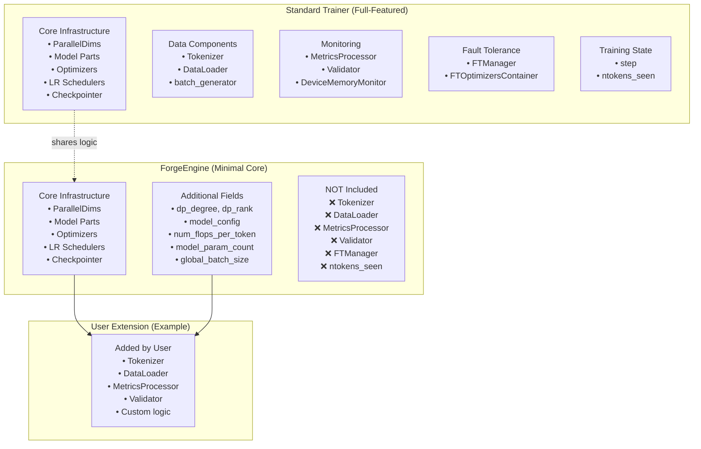
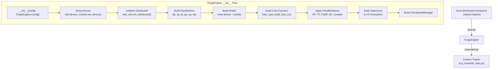
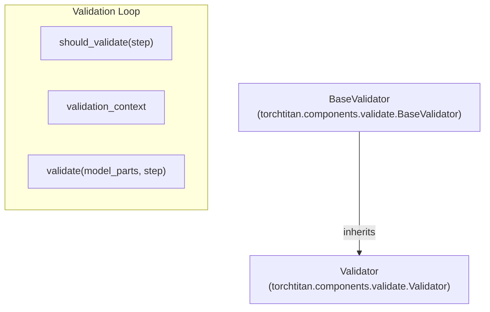

<!-- source: DeepWiki mcp.deepwiki.com · repo pytorch/torchtitan · page 10.3 ForgeEngine and Custom Training Loops · fetched 2026-10-30 -->

# ForgeEngine and Custom Training Loops

<details>
<summary>Relevant source files</summary>

The following files were used as context for generating this wiki page:

- [torchtitan/components/validate.py](torchtitan/components/validate.py)
- [torchtitan/experiments/forge/README.md](torchtitan/experiments/forge/README.md)
- [torchtitan/experiments/forge/__init__.py](torchtitan/experiments/forge/__init__.py)
- [torchtitan/experiments/forge/engine.py](torchtitan/experiments/forge/engine.py)
- [torchtitan/experiments/forge/example_train.py](torchtitan/experiments/forge/example_train.py)
- [torchtitan/experiments/torchft/trainer.py](torchtitan/experiments/torchft/trainer.py)
- [torchtitan/trainer.py](torchtitan/trainer.py)

</details>


## Purpose and Scope

`ForgeEngine` is a stripped-down alternative to the standard `Trainer` class, designed specifically for building custom training loops and post-training workflows. It provides the minimal core infrastructure—distributed initialization, model parallelization, optimization, and checkpointing—while delegating data loading, metrics, and high-level training logic to the user.

**Key Use Cases:**
- Building specialized training loops (e.g., SFT, RLHF, or non-LLM tasks).
- Prototyping new training strategies without the overhead of the full `Trainer` pipeline.
- Creating domain-specific trainers where standard `torchtitan` assumptions (like text-only data) do not apply.
- Educational exploration of the core distributed training components.

**Location:** `torchtitan/experiments/forge/` - This is an experimental framework and may evolve independently of the core `Trainer`.

Sources: [torchtitan/experiments/forge/engine.py:35-61](), [torchtitan/experiments/forge/example_train.py:35-145](), [torchtitan/experiments/forge/README.md:1-13]()

---

## Architecture Overview

ForgeEngine implements the essential "plumbing" for distributed training but omits higher-level features like automated metrics logging, validation loops, and complex fault tolerance managers.

### ForgeEngine vs Trainer Component Comparison



Sources: [torchtitan/trainer.py:57-106](), [torchtitan/experiments/forge/engine.py:35-96](), [torchtitan/experiments/forge/README.md:3-10]()

---

## ForgeEngine Core Components

### Class Structure and Initialization

`ForgeEngine` inherits from `torch.distributed.checkpoint.stateful.Stateful` and `Configurable`. Its initialization sequence follows the standard `torchtitan` pipeline for setting up distributed environments and parallelizing models.



Sources: [torchtitan/experiments/forge/engine.py:35-246]()

### Key Fields for Custom Loops

Unlike the standard `Trainer`, `ForgeEngine` explicitly exposes internal distributed states and model metadata to simplify custom logic:

| Field | Purpose |
|-------|---------|
| `dp_degree` / `dp_rank` | Used for sharding custom dataloaders across the data-parallel mesh. |
| `model_config` | The `BaseModel.Config` used to build the model, useful for accessing architectural parameters. |
| `num_flops_per_token` | Pre-calculated theoretical FLOPs for MFU/TFLOPS reporting. |
| `model_param_count` | Total number of parameters in the model. |
| `global_batch_size` | The effective batch size after accounting for DP degree and accumulation. |

Sources: [torchtitan/experiments/forge/engine.py:87-96]()

---

## Building Custom Training Loops

### The Extension Pattern

Users implement their own training logic by inheriting from `ForgeEngine`. The `torchtitan/experiments/forge/example_train.py` file serves as the reference implementation.

```mermaid
graph LR
    subgraph "1. Inherit ForgeEngine"
        Inherit["class Trainer(ForgeEngine)"]
    end
    
    subgraph "2. Add Components in __init__"
        AddToken["self.tokenizer = config.tokenizer.build()"]
        AddData["self.dataloader = config.dataloader.build()"]
        AddMetrics["self.metrics_processor = config.metrics.build()"]
        AddState["self.step = 0"]
    end
    
    subgraph "3. Implement Training Methods"
        BatchGen["batch_generator()<br/>Data processing"]
        FwdBwd["forward_backward_step()<br/>Loss calculation"]
        TrainStep["train_step()<br/>Grad accum + Optim step"]
        TrainLoop["train()<br/>Main execution loop"]
    end
    
    Inherit --> AddToken
    AddToken --> AddData
    AddData --> AddMetrics
    AddMetrics --> AddState
    AddState --> BatchGen
    BatchGen --> FwdBwd
    FwdBwd --> TrainStep
    TrainStep --> TrainLoop
```



Sources: [torchtitan/experiments/forge/example_train.py:35-330]()

### Detailed Implementation: example_train.py

#### 1. Batch Generation and Data Processing
The `batch_generator` handles the iteration over the `dataloader` and tracks basic metrics like data loading time and tokens processed.

```python
def batch_generator(self, data_iterable):
    data_iterator = iter(data_iterable)
    while True:
        try:
            batch = next(data_iterator)
        except StopIteration as ex:
            raise DataloaderExhaustedError() from ex
        # Unpack and track metrics
        input_dict, labels = batch
        self.metrics_processor.ntokens_since_last_log += labels.numel()
        yield input_dict, labels
```

Sources: [torchtitan/experiments/forge/example_train.py:146-169]()

#### 2. Forward and Backward Logic
The `forward_backward_step` method demonstrates how to handle different parallelization strategies (Pipeline Parallel vs. standard) and context managers (AMP, Context Parallel).

```python
def forward_backward_step(self, input_dict, labels):
    # Setup context parallel and AMP
    # ... (omitted for brevity)
    if self.parallel_dims.pp_enabled:
        # Pipeline Parallel execution
        with self.train_context(optional_context_parallel_ctx):
            self.pp_schedule.step(inputs, target=labels, losses=losses, ...)
    else:
        # Standard execution
        with self.train_context(optional_context_parallel_ctx):
            with self.maybe_enable_amp:
                pred = self.model_parts[0](inputs, **extra_kwargs)
                loss = self.loss_fn(pred, labels)
            loss.backward()
```

Sources: [torchtitan/experiments/forge/example_train.py:171-223]()

#### 3. State Management and Checkpointing
Since `ForgeEngine` is `Stateful`, the custom trainer must define `state_dict` and `load_state_dict` to ensure that custom states (like the current `step`) are persisted.

```python
def state_dict(self) -> dict[str, Any]:
    return {"step": self.step}

def load_state_dict(self, state_dict: dict[str, Any]):
    self.step = state_dict["step"]
```

Sources: [torchtitan/experiments/forge/example_train.py:324-328]()

---

## Validation Integration

Custom trainers can integrate the standard `Validator` class. The `Validator` is designed to be swappable and focuses on correctness during training.

### Validation Architecture



Sources: [torchtitan/components/validate.py:33-51](), [torchtitan/components/validate.py:53-131]()

### Data Handling in Validation
The `Validator` uses a `post_dataloading_process` to prepare inputs for the forward pass, separating main input tensors from auxiliary keyword arguments like attention masks or position IDs. This logic is intentionally similar to the main training flow to ensure consistency.

Sources: [torchtitan/components/validate.py:139-183]()

---

## Summary of Key Differences

| Feature | Standard `Trainer` | `ForgeEngine` + Custom Loop |
| :--- | :--- | :--- |
| **Data Loading** | Built-in via `BaseDataLoader` | User-defined in `__init__` |
| **Metrics** | Automated via `MetricsProcessor` | User-defined logging in `train_step` |
| **Fault Tolerance** | Integrated `FTManager` | Not included by default |
| **Flexibility** | High (via config) | Maximum (via code inheritance) |
| **State Persistence** | Managed `ntokens_seen`, `step`, etc. | User must define in `state_dict` |

Sources: [torchtitan/trainer.py:57-159](), [torchtitan/experiments/forge/engine.py:35-96](), [torchtitan/experiments/forge/example_train.py:42-142]()

---

