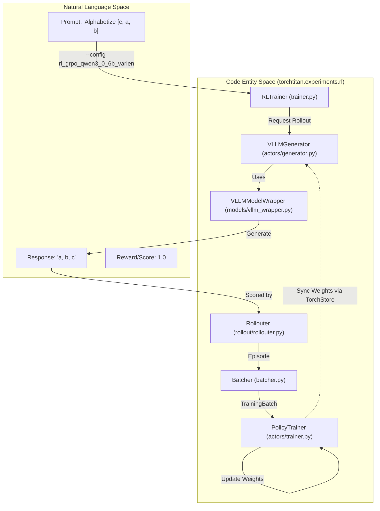
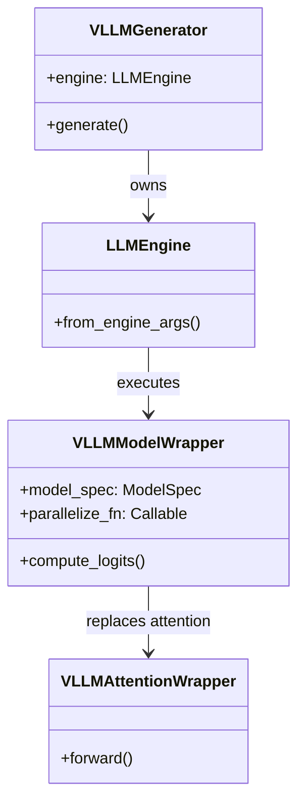

<!-- source: DeepWiki mcp.deepwiki.com · repo pytorch/torchtitan · page 10.4 Reinforcement Learning Experiment · fetched 2026-10-30 -->

# Reinforcement Learning Experiment

Relevant source files

The following files were used as context for generating this wiki page:

- [.github/workflows/integration_test_4gpu_rl.yaml](.github/workflows/integration_test_4gpu_rl.yaml)
- [.github/workflows/integration_test_8gpu_rl_h100.yaml](.github/workflows/integration_test_8gpu_rl_h100.yaml)
- [torchtitan/experiments/rl/README.md](torchtitan/experiments/rl/README.md)
- [torchtitan/experiments/rl/__init__.py](torchtitan/experiments/rl/__init__.py)
- [torchtitan/experiments/rl/actors/generator.py](torchtitan/experiments/rl/actors/generator.py)
- [torchtitan/experiments/rl/actors/trainer.py](torchtitan/experiments/rl/actors/trainer.py)
- [torchtitan/experiments/rl/batcher.py](torchtitan/experiments/rl/batcher.py)
- [torchtitan/experiments/rl/config_registry.py](torchtitan/experiments/rl/config_registry.py)
- [torchtitan/experiments/rl/environment/token.py](torchtitan/experiments/rl/environment/token.py)
- [torchtitan/experiments/rl/examples/alphabet_sort/__init__.py](torchtitan/experiments/rl/examples/alphabet_sort/__init__.py)
- [torchtitan/experiments/rl/examples/alphabet_sort/data.py](torchtitan/experiments/rl/examples/alphabet_sort/data.py)
- [torchtitan/experiments/rl/examples/alphabet_sort/env.py](torchtitan/experiments/rl/examples/alphabet_sort/env.py)
- [torchtitan/experiments/rl/examples/alphabet_sort/rollouter.py](torchtitan/experiments/rl/examples/alphabet_sort/rollouter.py)
- [torchtitan/experiments/rl/examples/alphabet_sort/rubric.py](torchtitan/experiments/rl/examples/alphabet_sort/rubric.py)
- [torchtitan/experiments/rl/generate.py](torchtitan/experiments/rl/generate.py)
- [torchtitan/experiments/rl/generator_router.py](torchtitan/experiments/rl/generator_router.py)
- [torchtitan/experiments/rl/models/vllm_registry.py](torchtitan/experiments/rl/models/vllm_registry.py)
- [torchtitan/experiments/rl/models/vllm_wrapper.py](torchtitan/experiments/rl/models/vllm_wrapper.py)
- [torchtitan/experiments/rl/observability/__init__.py](torchtitan/experiments/rl/observability/__init__.py)
- [torchtitan/experiments/rl/observability/metrics/README.md](torchtitan/experiments/rl/observability/metrics/README.md)
- [torchtitan/experiments/rl/observability/metrics/__init__.py](torchtitan/experiments/rl/observability/metrics/__init__.py)
- [torchtitan/experiments/rl/observability/metrics/console.py](torchtitan/experiments/rl/observability/metrics/console.py)
- [torchtitan/experiments/rl/observability/metrics/processor.py](torchtitan/experiments/rl/observability/metrics/processor.py)
- [torchtitan/experiments/rl/observability/metrics/types.py](torchtitan/experiments/rl/observability/metrics/types.py)
- [torchtitan/experiments/rl/rollout/__init__.py](torchtitan/experiments/rl/rollout/__init__.py)
- [torchtitan/experiments/rl/rollout/rollouter.py](torchtitan/experiments/rl/rollout/rollouter.py)
- [torchtitan/experiments/rl/rollout/types.py](torchtitan/experiments/rl/rollout/types.py)
- [torchtitan/experiments/rl/rollout/utils.py](torchtitan/experiments/rl/rollout/utils.py)
- [torchtitan/experiments/rl/rollout_recorder.py](torchtitan/experiments/rl/rollout_recorder.py)
- [torchtitan/experiments/rl/scripts/__init__.py](torchtitan/experiments/rl/scripts/__init__.py)
- [torchtitan/experiments/rl/scripts/loss_compare.py](torchtitan/experiments/rl/scripts/loss_compare.py)
- [torchtitan/experiments/rl/tests/assets/losses/rl_grpo_cuda.txt](torchtitan/experiments/rl/tests/assets/losses/rl_grpo_cuda.txt)
- [torchtitan/experiments/rl/tests/integration_tests.py](torchtitan/experiments/rl/tests/integration_tests.py)
- [torchtitan/experiments/rl/tests/test_alphabet_sort.py](torchtitan/experiments/rl/tests/test_alphabet_sort.py)
- [torchtitan/experiments/rl/tests/test_bitwise_parity.py](torchtitan/experiments/rl/tests/test_bitwise_parity.py)
- [torchtitan/experiments/rl/tests/test_generator.py](torchtitan/experiments/rl/tests/test_generator.py)
- [torchtitan/experiments/rl/tests/test_generator_router.py](torchtitan/experiments/rl/tests/test_generator_router.py)
- [torchtitan/experiments/rl/tests/test_rollout_recorder.py](torchtitan/experiments/rl/tests/test_rollout_recorder.py)
- [torchtitan/experiments/rl/tests/test_shutdown.py](torchtitan/experiments/rl/tests/test_shutdown.py)
- [torchtitan/experiments/rl/train.py](torchtitan/experiments/rl/train.py)
- [torchtitan/experiments/rl/trainer.py](torchtitan/experiments/rl/trainer.py)
- [torchtitan/experiments/rl/types.py](torchtitan/experiments/rl/types.py)

The Reinforcement Learning (RL) experiment in `torchtitan` provides a high-performance framework for post-training LLMs using algorithms like **Grouped Relative Policy Optimization (GRPO)**. It integrates `torchtitan` model definitions with the **vLLM** inference engine to achieve fast rollout generation while maintaining bitwise identity between training and inference weights.

## Overview and Architecture

The RL framework is designed around a "Unified Model" philosophy, ensuring that the same model code is used for both the `PolicyTrainer` and the `VLLMGenerator`. This eliminates a common class of bugs where subtle implementation differences between training and inference backends lead to divergence.

### System Components
The experiment utilizes **Monarch** actors to distribute roles across a GPU cluster:
1.  **PolicyTrainer**: Manages the trainable policy. It performs the forward/backward passes and optimizer steps using TorchTitan components like `OptimizersContainer` and `LRSchedulersContainer` [torchtitan/experiments/rl/actors/trainer.py:113-138]().
2.  **VLLMGenerator**: Wraps the `torchtitan` model in a vLLM-compatible interface for high-throughput rollout generation [torchtitan/experiments/rl/actors/generator.py:160-200]().
3.  **RLTrainer**: The main entry point that orchestrates the RL loop, managing data flow between generators and trainers, scoring rollouts via a `Rollouter`, and syncing weights via **TorchStore** [torchtitan/experiments/rl/trainer.py:132-150]().

### Data Flow Diagram: GRPO Loop
The following diagram illustrates the interaction between natural language prompts, code entities, and the distributed actors.

Title: GRPO Experiment Data Flow

Sources: [torchtitan/experiments/rl/trainer.py:132-146](), [torchtitan/experiments/rl/actors/trainer.py:113-126](), [torchtitan/experiments/rl/actors/generator.py:160-172](), [torchtitan/experiments/rl/models/vllm_wrapper.py:94-107](), [torchtitan/experiments/rl/batcher.py:28-30](), [torchtitan/experiments/rl/rollout/rollouter.py:40-42]()

---

## vLLM Integration

The integration allows vLLM to run `torchtitan` native models. This is achieved through a wrapper that adapts `torchtitan` models for the vLLM engine.

### VLLMModelWrapper
This class adapts `torchtitan` models for vLLM's engine. It performs several critical transformations:
*   **Attention Replacement**: It replaces the standard `inner_attention` with `VLLMAttentionWrapper`, which utilizes vLLM's paged attention [torchtitan/experiments/rl/models/vllm_wrapper.py:144-169]().
*   **DTensor Handling**: It monkey-patches vLLM's `weak_ref_tensor` and `_node_ref` to safely handle `DTensor` objects during CUDA-graph capture [torchtitan/experiments/rl/models/vllm_wrapper.py:42-85]().
*   **Parallelism Mapping**: It maps `torchtitan`'s `ParallelismConfig` to `ParallelDims` for inference [torchtitan/experiments/rl/models/vllm_wrapper.py:174-182]().

### Custom Attention Backend
The experiment supports both `FlexAttention` and `VarlenAttention` backends. For `FlexAttention`, it can force the `TRITON` backend with fixed tile sizes to ensure numerical consistency [torchtitan/experiments/rl/config_registry.py:44-73]().

Title: vLLM to TorchTitan Model Mapping

Sources: [torchtitan/experiments/rl/actors/generator.py:160-200](), [torchtitan/experiments/rl/models/vllm_wrapper.py:94-132](), [torchtitan/experiments/rl/models/vllm_registry.py:30-33]()

---

## Policy Training and Loss Computation

The `PolicyTrainer` manages the RL optimization step. It computes log probabilities and executes the optimizer step.

### GRPO Loss Implementation
The `GRPOLoss` class implements the clipped surrogate objective:
1.  **Log Probability Calculation**: `compute_logprobs` computes per-position logprobs from logits and pre-shifted labels [torchtitan/experiments/rl/actors/trainer.py:45-65]().
2.  **Clipped Objective**: It computes the PPO-style clipped objective at the token level: `loss_t = -min(ratio_t * A_t, clipped_t * A_t)` [torchtitan/experiments/rl/trainer.py:50-64]().
3.  **Normalization**: The final loss is divided by `num_global_valid_tokens` to ensure gradient accumulation equivalence [torchtitan/experiments/rl/trainer.py:109-111]().

### Configuration Registry
RL experiments are configured via `torchtitan/experiments/rl/config_registry.py`. Typical configs include:
*   **Alphabet Sort Example**: Uses `AlphabetSortRollouter` to train models on sorting characters [torchtitan/experiments/rl/config_registry.py:85-87]().
*   **Parallelism Degrees**: Defines separate TP degrees for trainer (e.g., TP=2) and generator (e.g., TP=4) [torchtitan/experiments/rl/config_registry.py:102-118]().

Sources: [torchtitan/experiments/rl/actors/trainer.py:45-65](), [torchtitan/experiments/rl/trainer.py:49-130](), [torchtitan/experiments/rl/config_registry.py:75-130]()

---

## Bitwise Identity and Verification

A core requirement for RL correctness is that the generator (vLLM) and the trainer (PyTorch) produce identical log probabilities for the same weights.

### Batch Invariant Mode
`batch_invariant_mode` guarantees that a model's output is identical regardless of batch composition. This is critical because the generator and trainer often use different batch sizes [torchtitan/experiments/rl/README.md:90-100]().
*   Replaces standard ops with fixed-tile Triton kernels from `batch_invariant_ops` [torchtitan/experiments/rl/README.md:95-96]().
*   Forces deterministic NCCL collectives and disables reduced-precision reductions [torchtitan/experiments/rl/README.md:97-98]().

### Verification Utility
`verify_logprob_identity` compares generator-produced logprobs with trainer-computed logprobs, calculating mean and max drift [torchtitan/experiments/rl/actors/trainer.py:79-111]().

| Component | Role in Parity |
| :--- | :--- |
| `BatchInvariantFlexConverter` | Pins FlexAttention kernel options (BLOCK_M/N=16) [torchtitan/experiments/rl/config_registry.py:44-73]() |
| `_force_logprobs_fn` | Patches vLLM to use the trainer's logprob code path [torchtitan/experiments/rl/actors/generator.py:107-158]() |
| `TestBitwiseParity` | Integration tests for batch invariance and trainer-vs-vLLM parity [torchtitan/experiments/rl/tests/test_bitwise_parity.py:13-31]() |

Sources: [torchtitan/experiments/rl/README.md:90-110](), [torchtitan/experiments/rl/actors/trainer.py:79-111](), [torchtitan/experiments/rl/actors/generator.py:107-158]()

---

## Execution and Infrastructure

### RL Training Entry Point
`torchtitan/experiments/rl/train.py` is the main entry point. It manages the Monarch actor lifecycle, spawning `ProcMesh` for trainers and generators [torchtitan/experiments/rl/train.py:132-150]().

### Rollout Recording
The `RolloutSampleRecorder` system allows for recording rollout samples to disk for debugging or offline analysis [torchtitan/experiments/rl/rollout_recorder.py:15-30]().

### Infrastructure Components
*   **Batcher**: Packs episodes into `TrainingBatch` objects for the trainer [torchtitan/experiments/rl/batcher.py:28-40]().
*   **GeneratorRouter**: Routes generation requests to available `VLLMGenerator` actors using strategies like `RoundRobinRoutingStrategy` [torchtitan/experiments/rl/generator_router.py:30-50]().
*   **Rubric**: Environment-specific scoring logic (e.g., `AlphabetSortRubric`) [torchtitan/experiments/rl/examples/alphabet_sort/rubric.py:15-20]().

Sources: [torchtitan/experiments/rl/trainer.py:132-150](), [torchtitan/experiments/rl/batcher.py:28-40](), [torchtitan/experiments/rl/generator_router.py:30-50](), [torchtitan/experiments/rl/rollout_recorder.py:15-30]()

---

