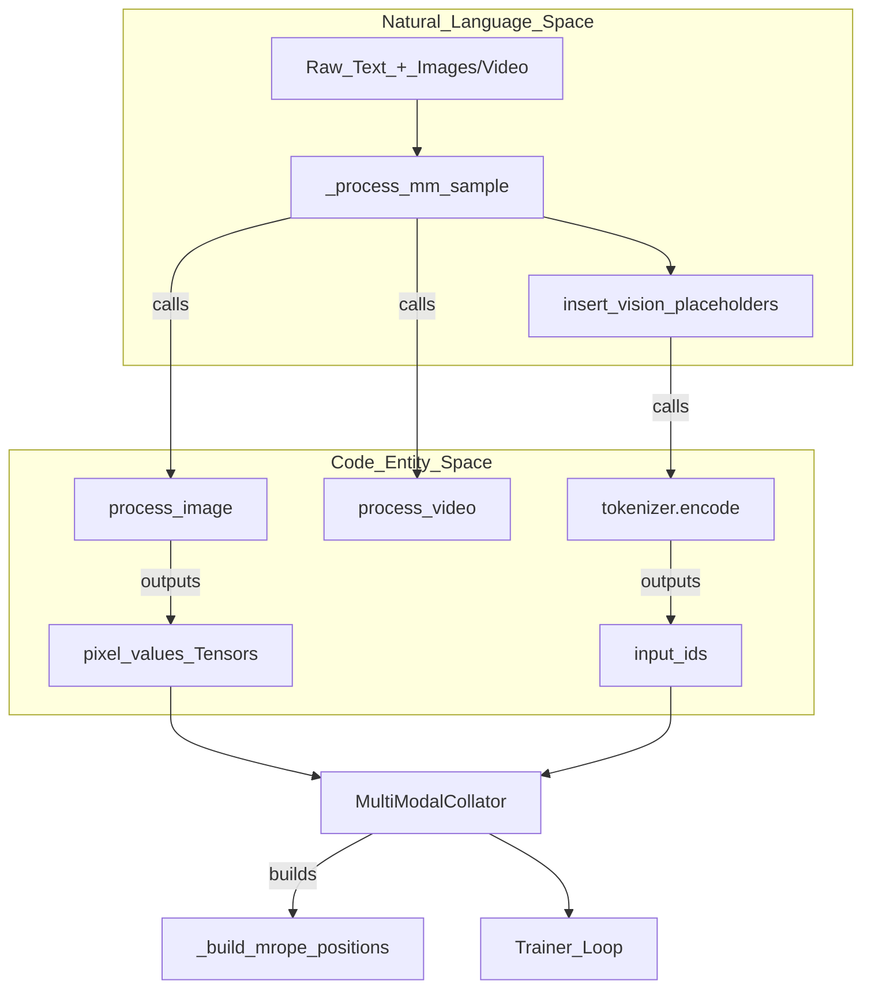
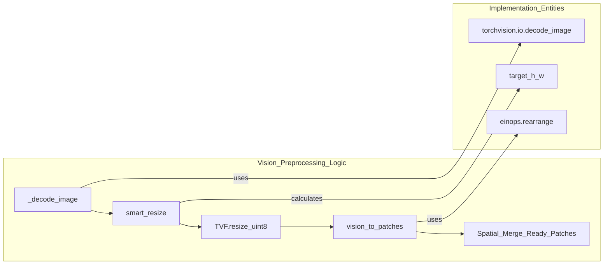
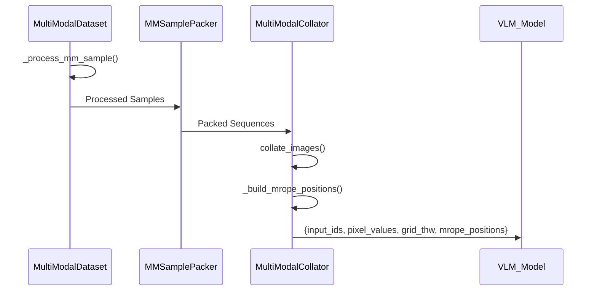

<!-- source: DeepWiki mcp.deepwiki.com · repo pytorch/torchtitan · page 10.5 Vision Language Model (VLM) Experiment · fetched 2026-10-30 -->

# Vision Language Model (VLM) Experiment

Relevant source files

The following files were used as context for generating this wiki page:

- [.ci/docker/requirements-vlm.txt](.ci/docker/requirements-vlm.txt)
- [torchtitan/hf_datasets/multimodal/mm_collator.py](torchtitan/hf_datasets/multimodal/mm_collator.py)
- [torchtitan/hf_datasets/multimodal/mm_datasets.py](torchtitan/hf_datasets/multimodal/mm_datasets.py)
- [torchtitan/hf_datasets/multimodal/utils/image.py](torchtitan/hf_datasets/multimodal/utils/image.py)
- [torchtitan/hf_datasets/multimodal/utils/video.py](torchtitan/hf_datasets/multimodal/utils/video.py)

The Vision Language Model (VLM) experiment in `torchtitan` provides a PyTorch-native framework for training multimodal models. This experiment introduces support for native aspect ratio and resolution handling, efficient image patch embedding scattering, and integration with high-performance vision encoders like SigLIP2. It is designed to bridge the gap between natural language processing and computer vision by aligning visual features into the LLM's token space.

### Overview of VLM Architecture

The VLM experiment utilizes a modular approach to multimodal training. The architecture typically consists of a vision encoder (e.g., SigLIP2) that processes raw pixels into patch embeddings, which are then projected and interleaved with text tokens for processing by a decoder-only Transformer.

**Key Technical Features:**
*   **Native Aspect Ratio Support:** Avoids distortion by processing images at their original ratios using dynamic grid shapes via `smart_resize` [torchtitan/hf_datasets/multimodal/utils/image.py:119-125]().
*   **Video Processing:** Support for sampling and decoding video frames using PyAV, maintaining temporal consistency through `load_video` [torchtitan/hf_datasets/multimodal/utils/video.py:19-24]().
*   **MRoPE (Multimodal Rotary Positional Embeddings):** Implementation of 3D positional IDs (Temporal, Height, Width) to represent visual spatial-temporal structures in the LLM's latent space [torchtitan/hf_datasets/multimodal/mm_collator.py:137-146]().
*   **SigLIP2 Integration:** Uses the SigLIP2 vision encoder architecture with support for 2D positional embedding interpolation.
*   **Interleaved Data Processing:** Supports datasets where images, videos, and text are interleaved using vision placeholder tokens [torchtitan/hf_datasets/multimodal/mm_datasets.py:161-173]().

---

### Implementation and Data Flow

The data flow starts from the `mm_datasets` module, which handles the complex logic of loading images and text, processing them into patches, and generating the final sequence of interleaved tokens.

#### Multimodal Data Pipeline
The `_process_mm_sample` function is the central entry point for multimodal sample processing. It handles image resizing, patchification, and text tokenization.

| Component | Responsibility | Key Reference |
| :--- | :--- | :--- |
| `process_image` | Decodes (SIMD), resizes to pixel budget, and normalizes images. | [torchtitan/hf_datasets/multimodal/utils/image.py:49-57]() |
| `process_video` | Resizes and normalizes video frames for VLM training. | [torchtitan/hf_datasets/multimodal/utils/video.py:98-106]() |
| `vision_to_patches` | Converts image/video tensors to flattened patches in block order for spatial merging. | [torchtitan/hf_datasets/multimodal/utils/image.py:191-196]() |
| `MultiModalCollator` | Collates variable-length multimodal sequences, pads patches, and builds MRoPE positions. | [torchtitan/hf_datasets/multimodal/mm_collator.py:23-38]() |

**Data Flow Diagram: Multimodal Input Processing**

Sources: [torchtitan/hf_datasets/multimodal/mm_datasets.py:87-176](), [torchtitan/hf_datasets/multimodal/mm_collator.py:39-82](), [torchtitan/hf_datasets/multimodal/utils/image.py:49-75]()

---

### Image and Video Preprocessing

The system utilizes `torchvision` v2 APIs for faster SIMD-accelerated (AVX2/NEON) decoding and resizing.

#### Smart Resizing and Patchification
To maintain native aspect ratios while staying within a memory budget, `smart_resize` calculates target dimensions that are multiples of the `patch_size * merge_size` [torchtitan/hf_datasets/multimodal/utils/image.py:119-125](). The `vision_to_patches` function then rearranges the pixels so that spatial groups intended for merging (e.g., 2x2) are contiguous in memory [torchtitan/hf_datasets/multimodal/utils/image.py:197-201]().

#### MRoPE (Multimodal RoPE)
For models like Qwen2-VL or Llama-3-V, the collator generates 3D position IDs. The `_build_mrope_positions` method calculates (T, H, W) coordinates for every visual token based on the `grid_thw` metadata [torchtitan/hf_datasets/multimodal/mm_collator.py:147-166]().

**Vision Processing Logic**

Sources: [torchtitan/hf_datasets/multimodal/utils/image.py:28-46](), [torchtitan/hf_datasets/multimodal/utils/image.py:119-160](), [torchtitan/hf_datasets/multimodal/utils/image.py:191-205]()

---

### Multimodal Datasets and Collating

The experiment supports interleaved multimodal data where text, images, and videos appear in arbitrary order.

| Stage | Responsibility | Code Reference |
| :--- | :--- | :--- |
| **Sample Processor** | Parses raw samples, decodes vision bytes, and inserts `<|vision_start|>` sequences. | [torchtitan/hf_datasets/multimodal/mm_datasets.py:14-32]() |
| **Sample Packer** | Bin-packs short samples into `seq_len` sequences to reduce padding waste using `MMSamplePacker`. | [torchtitan/hf_datasets/multimodal/mm_datasets.py:34-39]() |
| **Collator** | Handles padding of `pixel_values` and `grid_thw` for batched execution. | [torchtitan/hf_datasets/multimodal/mm_collator.py:39-52]() |

#### Video Sampling
Videos are processed by `load_video`, which samples frames at a specific FPS [torchtitan/hf_datasets/multimodal/utils/video.py:19-24](). It uses PyAV to decode only the required frames, avoiding the cost of a full decode for long videos [torchtitan/hf_datasets/multimodal/utils/video.py:79-81]().

---

### VLM-Specific Parallelization

Training VLMs requires coordinating parallelization across both the vision encoder and the language decoder.

1.  **Vision Encoder Sharding:** The vision backbone (e.g., SigLIP2) utilizes Tensor Parallelism (TP) for its linear projections.
2.  **Multimodal Padding:** The `MultiModalCollator` ensures that the `max_num_patch` is divisible by `spatial_merge_size^2` to allow for efficient sharded merging across GPUs [torchtitan/hf_datasets/multimodal/mm_collator.py:63-67]().
3.  **MRoPE Sharding:** MRoPE positions are generated as `(batch, seq_len, 3)` so that Pipeline Parallelism (PP) can chunk the batch dimension and Context Parallelism (CP) can shard the sequence dimension [torchtitan/hf_datasets/multimodal/mm_collator.py:147-153]().

**VLM Training Sequence**

Sources: [torchtitan/hf_datasets/multimodal/mm_datasets.py:34-56](), [torchtitan/hf_datasets/multimodal/mm_collator.py:39-77](), [torchtitan/hf_datasets/multimodal/mm_collator.py:137-166]()

---

