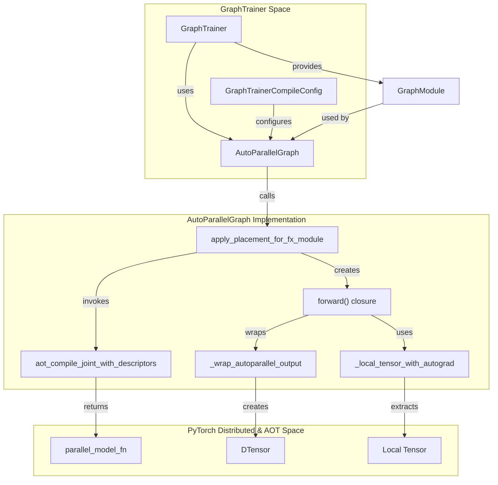
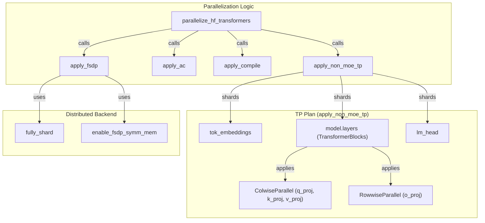

<!-- source: DeepWiki mcp.deepwiki.com · repo pytorch/torchtitan · page 10.7 AutoParallel and Transformers Backend Experiments · fetched 2026-10-30 -->

# AutoParallel and Transformers Backend Experiments

Relevant source files

The following files were used as context for generating this wiki page:

- [.ci/docker/common/install_conda.sh](.ci/docker/common/install_conda.sh)
- [.ci/docker/common/install_deepep.sh](.ci/docker/common/install_deepep.sh)
- [.ci/docker/requirements-transformers-modeling-backend.txt](.ci/docker/requirements-transformers-modeling-backend.txt)
- [.ci/docker/ubuntu/Dockerfile](.ci/docker/ubuntu/Dockerfile)
- [.github/scripts/run_8xgpu_integration_tests.sh](.github/scripts/run_8xgpu_integration_tests.sh)
- [tests/integration_tests/h100.py](tests/integration_tests/h100.py)
- [torchtitan/config/configs.py](torchtitan/config/configs.py)
- [torchtitan/experiments/graph_trainer/autoparallel_api.py](torchtitan/experiments/graph_trainer/autoparallel_api.py)
- [torchtitan/experiments/graph_trainer/llama3/parallelize_autoparallel.py](torchtitan/experiments/graph_trainer/llama3/parallelize_autoparallel.py)
- [torchtitan/experiments/transformers_modeling_backend/README.md](torchtitan/experiments/transformers_modeling_backend/README.md)
- [torchtitan/experiments/transformers_modeling_backend/__init__.py](torchtitan/experiments/transformers_modeling_backend/__init__.py)
- [torchtitan/experiments/transformers_modeling_backend/parallelize.py](torchtitan/experiments/transformers_modeling_backend/parallelize.py)
- [torchtitan/models/deepseek_v3/parallelize.py](torchtitan/models/deepseek_v3/parallelize.py)
- [torchtitan/models/gpt_oss/parallelize.py](torchtitan/models/gpt_oss/parallelize.py)
- [torchtitan/models/llama3/parallelize.py](torchtitan/models/llama3/parallelize.py)
- [torchtitan/models/qwen3/parallelize.py](torchtitan/models/qwen3/parallelize.py)

This page documents two experimental training systems in `torchtitan`: **AutoParallel**, which automates the selection of sharding strategies using cost-based optimization, and the **Transformers Modeling Backend**, which enables training HuggingFace Transformers models with native 4D parallelism support.

## AutoParallel Experiment

The AutoParallel experiment integrates PyTorch's `AutoParallel` framework into the `torchtitan` training pipeline. Its primary purpose is to automatically determine optimal sharding placements for model parameters, activations, and gradients based on a provided device mesh, removing the need for manual configuration of FSDP or Tensor Parallelism layouts.

### AutoParallel for Graph Trainer
A specialized variant, `AutoParallelGraph`, is implemented for the `graph_trainer`'s `aot_fx_trace` pipeline [torchtitan/experiments/graph_trainer/autoparallel_api.py:75-76](). This variant facilitates the creation of an AOT-backed parallel module while keeping the loss computation in the standard training step [torchtitan/experiments/graph_trainer/autoparallel_api.py:78-90]().

The implementation uses `aot_compile_joint_with_descriptors` to compile the joint forward and backward graph [torchtitan/experiments/graph_trainer/autoparallel_api.py:94-98](). It manages sharded parameters and buffers through `make_parallel_module`, ensuring that local tensors are correctly wrapped back into `DTensor` format for components like `loss_parallel()` [torchtitan/experiments/graph_trainer/autoparallel_api.py:56-72](), [torchtitan/experiments/graph_trainer/autoparallel_api.py:132-137]().

### Code Entity Space Mapping: AutoParallel Graph Tracing
The following diagram illustrates how the `AutoParallelGraph` class bridges the `graph_trainer` infrastructure with the underlying `autoparallel` and `AOTAutograd` APIs.

**AutoParallel Graph Tracing Flow**

Sources: [torchtitan/experiments/graph_trainer/autoparallel_api.py:75-137](), [torchtitan/experiments/graph_trainer/autoparallel_api.py:30-31](), [torchtitan/experiments/graph_trainer/autoparallel_api.py:56-72]()

### Model-Specific Implementations
The experiment is applied to various models, often requiring specific sharding logic or mesh resolution:
*   **GPT-OSS**: Uses `full_dtensor` backend to validate configuration and apply sharding via `model.parallelize(parallel_dims)` [torchtitan/models/gpt_oss/parallelize.py:48-50]().
*   **Llama 3**: Supports 2D mesh configurations with FSDP and TP sharding, including validation against `ParallelDims` [torchtitan/models/llama3/parallelize.py:51-53]().
*   **DeepSeek-V3**: Implements complex sharding for MoE architectures, resolving separate meshes for FSDP (`dp_mesh`) and Expert FSDP (`edp_mesh`) [torchtitan/models/deepseek_v3/parallelize.py:78-80]().

Sources: [torchtitan/models/gpt_oss/parallelize.py:27-108](), [torchtitan/models/llama3/parallelize.py:27-105](), [torchtitan/models/deepseek_v3/parallelize.py:28-112]()

## Transformers Modeling Backend Experiment

The Transformers Modeling Backend experiment allows `torchtitan` to train models from the HuggingFace `transformers` library while leveraging `torchtitan`'s advanced 4D parallelism (DP, TP, PP, CP).

### Implementation and Parallelization
The core logic resides in `parallelize_hf_transformers`, which applies Tensor Parallelism (TP), Activation Checkpointing (AC), `torch.compile`, and Fully Sharded Data Parallelism (FSDP) in a specific sequence [torchtitan/experiments/transformers_modeling_backend/parallelize.py:39-48]().

The TP implementation (`apply_non_moe_tp`) handles the following:
1.  **Embeddings**: Shards outputs across the sequence dimension using `RowwiseParallel` [torchtitan/experiments/transformers_modeling_backend/parallelize.py:125-132]().
2.  **Transformer Blocks**: Applies `ColwiseParallel` to projections (Q, K, V) and `RowwiseParallel` to output projections, ensuring hidden states are sharded correctly [torchtitan/experiments/transformers_modeling_backend/parallelize.py:153-189]().
3.  **Loss Parallelism**: Optionally parallelizes the final `lm_head` to reduce memory overhead during loss calculation [torchtitan/experiments/transformers_modeling_backend/parallelize.py:140-148]().

### Code Entity Space Mapping: HF Parallelization
This diagram shows how `torchtitan` applies its distributed strategies to a standard HuggingFace model structure.

**HF Transformers Parallelization Pipeline**

Sources: [torchtitan/experiments/transformers_modeling_backend/parallelize.py:39-108](), [torchtitan/experiments/transformers_modeling_backend/parallelize.py:111-150](), [torchtitan/experiments/transformers_modeling_backend/parallelize.py:153-195]()

### Key Capabilities and Integration
*   **Symmetric Memory**: Supports `enable_fsdp_symm_mem` for optimized FSDP2 communication [torchtitan/experiments/transformers_modeling_backend/parallelize.py:96]().
*   **Mixed Precision**: Configurable via `TrainingConfig`, supporting `bfloat16` and `float32` for parameters and reductions [torchtitan/config/configs.py:58-70]().
*   **CI/CD Support**: The experiment is integrated into the CI pipeline, with specific requirements listed in `requirements-transformers-modeling-backend.txt` [.ci/docker/ubuntu/Dockerfile:36]().

## Comparison of Experiments

| Feature | AutoParallel (Graph) | Transformers Backend |
| :--- | :--- | :--- |
| **Primary Goal** | Automated cost-based sharding | Native 4D parallelism for HF models |
| **Mechanism** | AOT-FX tracing & optimization | Manual TP/FSDP sharding plans |
| **Backend** | `autoparallel.api.AutoParallel` | `torch.distributed.tensor.parallel` |
| **Integration** | `GraphTrainer` [torchtitan/experiments/graph_trainer/autoparallel_api.py:75]() | `Trainer` (via experiment module) |
| **Checkpointing** | DCP (via standard manager) | DCP (with StateDict adapters) |

Sources: [torchtitan/experiments/graph_trainer/autoparallel_api.py:1-137](), [torchtitan/experiments/transformers_modeling_backend/parallelize.py:1-108](), [torchtitan/config/configs.py:85-149]()

---

