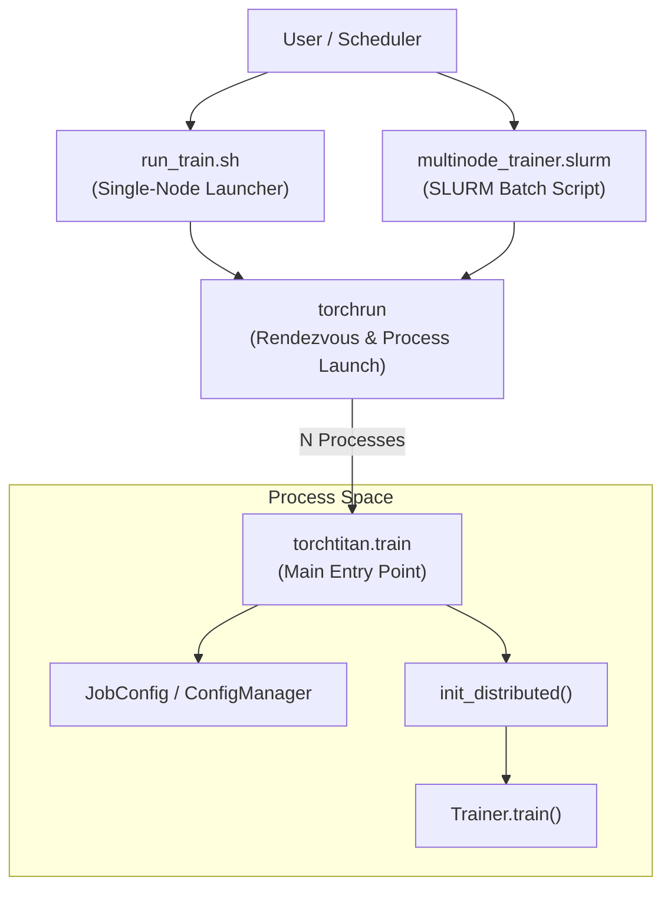
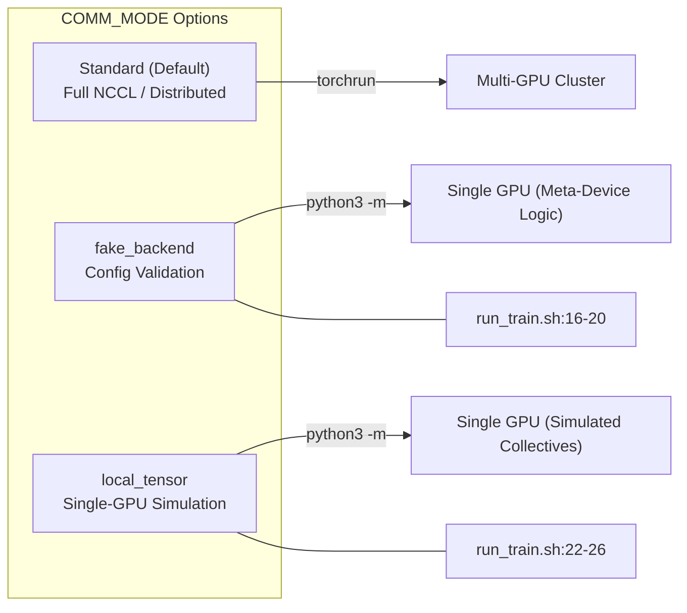

<!-- source: DeepWiki mcp.deepwiki.com · repo pytorch/torchtitan · page 11 Running Training Jobs · fetched 2026-10-30 -->

# Running Training Jobs

<details>
<summary>Relevant source files</summary>

The following files were used as context for generating this wiki page:

- [benchmarks/llama3-8b_h200_202506_trainy-whitefiber.md](benchmarks/llama3-8b_h200_202506_trainy-whitefiber.md)
- [docs/debugging.md](docs/debugging.md)
- [multinode_trainer.slurm](multinode_trainer.slurm)
- [run_train.sh](run_train.sh)

</details>


## Purpose and Scope

This page provides a practical guide to launching and managing training jobs in `torchtitan`. It covers the execution environment for both single-node development and large-scale multi-node production runs, bridging the gap between shell-level orchestration and the internal `Trainer` logic.

**Covered in this page:**
- High-level execution flow for training jobs.
- Launching with `run_train.sh` and `multinode_trainer.slurm`.
- Specialized debugging modes (`fake_backend`, `local_tensor`).
- Reproducibility and determinism settings.
- Configuration overrides and verification.

**Related pages:**
- For local execution and `torchrun` configuration, see [Single-Node Training](#11.1).
- For SLURM cluster deployment and EFA/NCCL tuning, see [Multi-Node Training with SLURM](#11.2).
- For performance analysis, memory snapshots, and Flight Recorder, see [Debugging and Profiling](#11.3).

---

## Training Execution Overview

`torchtitan` uses `torchrun` as the primary entry point for distributed training. The execution flow bridges environment-level configuration (shell scripts) with the Python-level `Trainer` logic.

### Job Launch Architecture

The following diagram illustrates how a training request moves from a shell script to the distributed Python environment, associating system components with their code-level entry points.

**Job Launch Flow**



**Sources:** [run_train.sh:41-47](), [multinode_trainer.slurm:63](), [run_train.sh:1-20]()

---

## Launching Training

### Single-Node Execution
The `run_train.sh` script is the standard way to launch training on a single machine. It abstracts `torchrun` parameters, sets up memory optimizations like `expandable_segments`, and provides easy environment variable overrides.

| Variable | Default | Description |
|----------|---------|-------------|
| `NGPU` | `8` | Number of GPUs to use on the node [run_train.sh:28]() |
| `MODULE` | `llama3` | The model family to train [run_train.sh:30]() |
| `CONFIG` | `llama3_debugmodel` | The specific configuration profile [run_train.sh:31]() |
| `LOG_RANK` | `0` | Which rank's output to show in the console via `--local-ranks-filter` [run_train.sh:29,45]() |

**Example:**
```bash
# Run Llama 3 with 4 GPUs
NGPU=4 MODULE=llama3 CONFIG=llama3_8b ./run_train.sh
```
**Sources:** [run_train.sh:28-47]()

### Multi-Node Execution (SLURM)
For cluster environments, `multinode_trainer.slurm` provides a template for multi-node jobs. It includes AWS-specific optimizations for EFA and NCCL.

**Key SLURM configurations:**
- **Node Discovery:** Uses `scontrol show hostnames` to identify the head node for the `c10d` rendezvous backend [multinode_trainer.slurm:26-29]().
- **Network Tuning:** Sets `NCCL_SOCKET_IFNAME` and `FI_PROVIDER="efa"` for high-performance interconnects [multinode_trainer.slurm:34-53]().
- **Execution:** Uses `srun torchrun` to scale across nodes with a shared `rdzv_endpoint` [multinode_trainer.slurm:63]().

**Sources:** [multinode_trainer.slurm:1-64]()

---

## Specialized Debugging Modes

To facilitate rapid development without requiring a full GPU cluster, `torchtitan` supports `COMM_MODE` environment variables that alter how the distributed backend behaves.

### Debug Mode Architecture



| Mode | Command | Use Case |
|------|---------|----------|
| **Fake Backend** | `COMM_MODE="fake_backend"` | Validates configuration, model initialization, and rank-0 logic on a single GPU without NCCL or data transfer [docs/debugging.md:65-88](). |
| **Local Tensor** | `COMM_MODE="local_tensor"` | Simulates full distributed training (FSDP, TP, PP) on a single shared GPU. Useful for testing gradient synchronization logic locally [docs/debugging.md:89-115](). |

**Sources:** [run_train.sh:14-39](), [docs/debugging.md:59-116]()

---

## Reproducibility and Determinism

Ensuring bit-for-bit reproducibility is critical when debugging complex parallelism interactions.

### Seed Management
`torchtitan` manages random seeds across parallelism dimensions:
- **DP/TP/CP:** All ranks use the same seed to ensure consistent initialization for replicated tensors [docs/debugging.md:141-143]().
- **PP:** Each Pipeline Parallel stage receives a different seed to ensure different weight initializations across layers on different ranks [docs/debugging.md:144-145]().

### Deterministic Flags
Users can force deterministic CUDA kernels via the CLI:
```bash
./run_train.sh --debug.seed 42 --debug.deterministic
```
This enables `torch.use_deterministic_algorithms(True)`, disables CuDNN benchmarking, and configures deterministic workspace settings for CuBLAS [docs/debugging.md:147-159]().

**Sources:** [docs/debugging.md:130-159]()

---

## Configuration Overrides and Verification

Configurations defined in `config_registry.py` or TOML files can be overridden via CLI arguments.

### CLI Syntax for Boolean Flags
Boolean flags in `JobConfig` are treated as actions. To disable a flag that is enabled in the base config, use the `--no` prefix [docs/debugging.md:15-35]().
- **Enable:** `--profiler.enable_memory_snapshot`
- **Disable:** `--profiler.no_enable_memory_snapshot`

### Verification with ConfigManager
To inspect the final resolved configuration (after merges from TOML and CLI) without launching a job, run the `ConfigManager` directly:
```bash
python -m torchtitan.config.manager --module llama3 --config llama3_8b [overrides]
```
This prints the structured configuration to `stdout` for verification [docs/debugging.md:37-57]().

**Sources:** [docs/debugging.md:1-57]()

---

