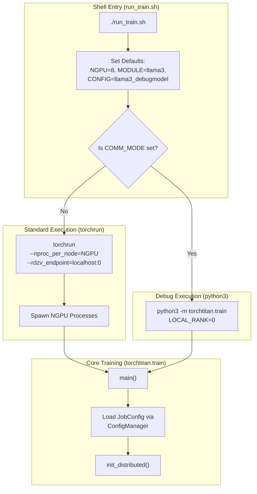

<!-- source: DeepWiki mcp.deepwiki.com · repo pytorch/torchtitan · page 11.1 Single-Node Training · fetched 2026-10-30 -->

# Single-Node Training

<details>
<summary>Relevant source files</summary>

The following files were used as context for generating this wiki page:

- [benchmarks/llama3-8b_h200_202506_trainy-whitefiber.md](benchmarks/llama3-8b_h200_202506_trainy-whitefiber.md)
- [docs/debugging.md](docs/debugging.md)
- [multinode_trainer.slurm](multinode_trainer.slurm)
- [run_train.sh](run_train.sh)

</details>


## Purpose and Scope

This document details the single-node training execution flow in torchtitan, focusing on the `run_train.sh` entry point, `torchrun` configuration, and specialized debugging modes. It explains how environment variables like `MODULE`, `CONFIG`, and `COMM_MODE` control the training lifecycle on a single machine with multiple GPUs.

For multi-node execution details, see [Multi-Node Training with SLURM](11.2). For the internal logic of how these processes initialize distributed groups, see [Distributed Initialization and Communication](3.3).

---

## Single-Node Execution Flow

The `run_train.sh` script serves as the primary wrapper for single-node execution. It manages environment setup, selects the execution engine (standard `torchrun` vs. direct `python3`), and passes configuration to the `torchtitan.train` module.

### Execution Logic


**Diagram: Single-Node Execution Flow**

**Sources:** [run_train.sh:28-47](), [docs/debugging.md:65-115]()

---

## Configuration and Environment Variables

The training behavior is controlled by a set of environment variables that act as local overrides for convenience.

### Primary Variables

| Variable | Default | Role |
| :--- | :--- | :--- |
| `NGPU` | `8` | Number of GPUs/processes to spawn on the local node. [run_train.sh:28]() |
| `MODULE` | `llama3` | The model family folder to use (e.g., `llama3`, `llama4`). [run_train.sh:30]() |
| `CONFIG` | `llama3_debugmodel` | The specific configuration name registered in `config_registry.py`. [run_train.sh:31]() |
| `LOG_RANK` | `0` | Comma-separated ranks that should emit stdout logs. [run_train.sh:29]() |
| `COMM_MODE` | `""` | Enables specialized debugging/dry-run modes. [run_train.sh:32]() |
| `TORCHFT_LIGHTHOUSE` | `http://localhost:29510` | Endpoint for the fault tolerance lighthouse service. [run_train.sh:34]() |

### torchrun Configuration
When running in standard mode, `run_train.sh` invokes `torchrun` with specific flags:
* `--nproc_per_node=${NGPU}`: Sets the number of worker processes to spawn. [run_train.sh:44]()
* `--rdzv_endpoint="localhost:0"`: Uses port `0` to allow the OS to pick a random available port, preventing collisions between concurrent local jobs. [run_train.sh:44]()
* `--local-ranks-filter ${LOG_RANK}`: Filters output so only specified ranks print to the console. [run_train.sh:45]()
* `--tee 3`: Redirects both stdout and stderr. [run_train.sh:45]()
* `PYTORCH_ALLOC_CONF="expandable_segments:True"`: Enabled by default to reduce memory fragmentation. [run_train.sh:42]()

**Sources:** [run_train.sh:28-47]()

---

## Specialized Debugging Modes (`COMM_MODE`)

The `COMM_MODE` environment variable allows developers to validate configurations and debug distributed logic on a single GPU or even without a GPU.

### 1. `fake_backend`
* **Purpose**: Dry-run mode for configuration validation without GPU execution. [run_train.sh:16-20]()
* **Mechanism**: Uses fake process groups that simulate communication without data transfer. [docs/debugging.md:74]()
* **Usage**: `NGPU=32 COMM_MODE="fake_backend" ./run_train.sh`. [run_train.sh:20]()
* **Behavior**: Runs as a single process (`LOCAL_RANK=0`) but pretends to be part of a larger cluster. [run_train.sh:39]()

### 2. `local_tensor`
* **Purpose**: Single-GPU simulation of multi-GPU behavior. [run_train.sh:22-26]()
* **Mechanism**: Executes all collectives (all-reduce, all-gather) locally on one shared GPU. [docs/debugging.md:99]()
* **Use Case**: Debugging FSDP, TP, or PP logic with real data dependencies without needing 8+ GPUs. [docs/debugging.md:104-107]()
* **Note**: Does not support FSDP2 but supports `SimpleFSDP`. [docs/debugging.md:104]()

**Sources:** [run_train.sh:14-27](), [docs/debugging.md:65-115]()

---

## CLI Overrides and Configuration Inspection

While `run_train.sh` sets the base `MODULE` and `CONFIG`, any additional arguments passed to the script are forwarded to the `torchtitan.train` module as CLI overrides.

### Overriding Boolean Flags
Boolean flags in the configuration are treated as actions. To disable a flag that is enabled by default in the TOML or registry, use the `--no` prefix. [docs/debugging.md:17-35]()

* **Enable**: `--profiler.enable_memory_snapshot` [docs/debugging.md:5]()
* **Disable**: `--profiler.no_enable_memory_snapshot` or `--profiler.no-enable-memory-snapshot`. [docs/debugging.md:31-32]()

### Inspecting Config Values
To verify how `JobConfig` is being resolved (merging TOML, registry, and CLI), the `ConfigManager` can be run directly:
```bash
python -m torchtitan.config.manager --module llama3 --config llama3_8b [cli_args]
```
This prints the final structured configuration to `stdout`. [docs/debugging.md:39-57]()

**Sources:** [docs/debugging.md:1-57]()

---

## Reproducibility and Determinism

For single-node debugging, ensuring bit-for-bit reproducibility is critical.

### Seed Management
The `--debug.seed` flag sets consistent random seeds across dimensions. [docs/debugging.md:138]()
* **DP/TP/CP**: All ranks use the same seed for consistent initialization. [docs/debugging.md:142]()
* **PP**: Each pipeline stage gets a different seed to ensure layer diversity across stages. [docs/debugging.md:144]()

### Deterministic Mode
Using `--debug.deterministic` forces CUDA to use deterministic algorithms, disables CuDNN benchmarking, and sets deterministic workspace configurations for CuBLAS. [docs/debugging.md:152-159]()

**Sources:** [docs/debugging.md:130-159]()

---

