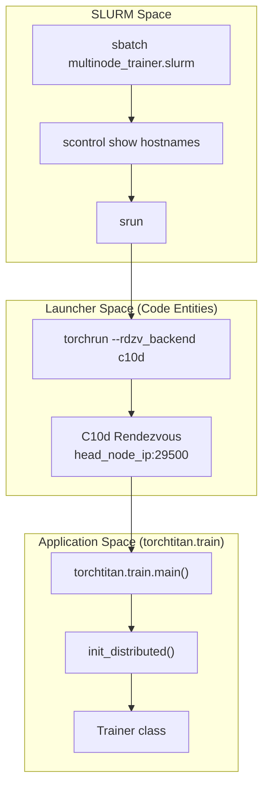
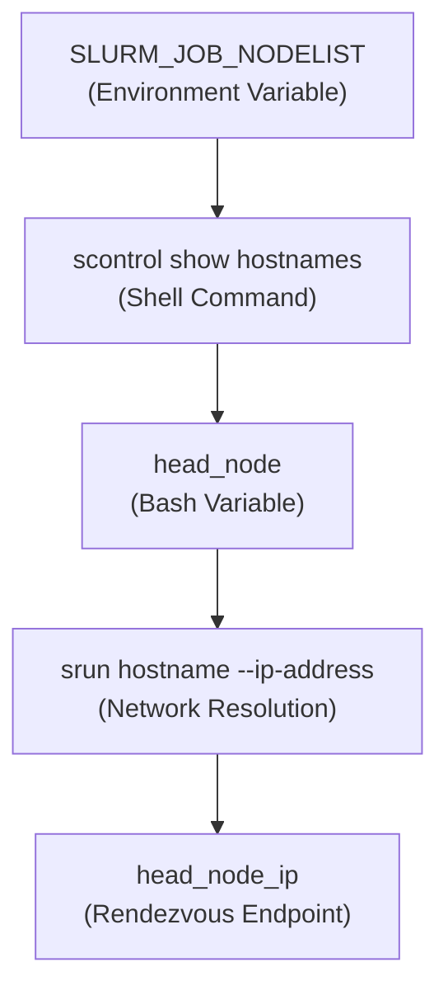

<!-- source: DeepWiki mcp.deepwiki.com · repo pytorch/torchtitan · page 11.2 Multi-Node Training with SLURM · fetched 2026-10-30 -->

# Multi-Node Training with SLURM

<details>
<summary>Relevant source files</summary>

The following files were used as context for generating this wiki page:

- [benchmarks/llama3-8b_h200_202506_trainy-whitefiber.md](benchmarks/llama3-8b_h200_202506_trainy-whitefiber.md)
- [docs/debugging.md](docs/debugging.md)
- [multinode_trainer.slurm](multinode_trainer.slurm)
- [run_train.sh](run_train.sh)

</details>


## Purpose and Scope

This document describes how to launch torchtitan training jobs across multiple nodes using the SLURM workload manager. It details the implementation of the `multinode_trainer.slurm` script, SLURM job configuration, network setup for high-performance interconnects (EFA, InfiniBand), and the coordination between SLURM and PyTorch's distributed training infrastructure.

For single-node training on a local machine, see page 11.1. For information about distributed initialization after processes launch (ParallelDims, DeviceMesh construction), see page 3.3.

---

## Overview

Multi-node training in torchtitan uses SLURM to orchestrate job allocation across compute nodes, with each node running multiple GPU processes coordinated through PyTorch's `torchrun` utility. The `multinode_trainer.slurm` script serves as the entry point, configuring SLURM resource allocation, network communication settings, and launching training processes across the cluster [multinode_trainer.slurm:1-64]().

**Key Components:**
- **SLURM**: Workload manager that allocates nodes and resources [multinode_trainer.slurm:13-24]().
- **srun**: SLURM command to execute commands across allocated nodes [multinode_trainer.slurm:63]().
- **torchrun**: PyTorch elastic launcher that spawns and coordinates GPU processes [multinode_trainer.slurm:63]().
- **NCCL**: NVIDIA Collective Communications Library for GPU-to-GPU communication [multinode_trainer.slurm:40-44]().
- **EFA/InfiniBand**: High-speed network interconnects for inter-node communication [multinode_trainer.slurm:8-10]().

**Sources:** [multinode_trainer.slurm:1-64]()

---

## Multi-Node Launch Architecture

The following diagram bridges the high-level SLURM concepts to the specific code entities and execution flow used in torchtitan.

### Diagram: SLURM to Code Entity Mapping



**Sources:** [multinode_trainer.slurm:26-63](), [run_train.sh:44-47]()

---

## SLURM Job Configuration

The `multinode_trainer.slurm` script begins with SBATCH directives that define resource allocation and job parameters. These directives are processed by SLURM when the script is submitted via `sbatch multinode_trainer.slurm` [multinode_trainer.slurm:13-24]().

```bash
#SBATCH --job-name=torchtitan_multi_node
#SBATCH --ntasks=4
#SBATCH --nodes=4
#SBATCH --gpus-per-task=8
#SBATCH --cpus-per-task=96
#SBATCH --partition=train
```

| Directive | Value | Description |
|-----------|-------|-------------|
| `--job-name` | `torchtitan_multi_node` | Job identifier in SLURM queue [multinode_trainer.slurm:13]() |
| `--ntasks` | `4` | Number of tasks (should equal nodes) [multinode_trainer.slurm:15]() |
| `--nodes` | `4` | Number of compute nodes to allocate [multinode_trainer.slurm:17]() |
| `--gpus-per-task` | `8` | GPUs per task (8x A100/H100 per node) [multinode_trainer.slurm:19]() |
| `--cpus-per-task` | `96` | CPU cores per task [multinode_trainer.slurm:21]() |
| `--partition` | `train` | SLURM partition to use [multinode_trainer.slurm:23]() |

**Important:** The `--ntasks` and `--nodes` values must match, and both must equal the `--nnodes` parameter passed to `torchrun` later in the script [multinode_trainer.slurm:61-63]().

**Sources:** [multinode_trainer.slurm:13-24](), [multinode_trainer.slurm:61-63]()

---

## Head Node Discovery and Rendezvous Setup

For distributed training, all processes must agree on a rendezvous endpoint where they synchronize. SLURM provides the `SLURM_JOB_NODELIST` environment variable containing all allocated nodes. The script extracts the first node as the head node and resolves its IP address [multinode_trainer.slurm:26-29]().



**Diagram: Head Node IP Discovery Process**

The corresponding code in `multinode_trainer.slurm`:

```bash
nodes=( $( scontrol show hostnames $SLURM_JOB_NODELIST ) )
nodes_array=($nodes)
head_node=${nodes_array[0]}
head_node_ip=$(srun --nodes=1 --ntasks=1 -w "$head_node" hostname --ip-address)
```

This IP address is used as `--rdzv_endpoint "$head_node_ip:29500"` when launching `torchrun`, ensuring all processes connect to the same rendezvous point [multinode_trainer.slurm:63]().

**Sources:** [multinode_trainer.slurm:26-31](), [multinode_trainer.slurm:63]()

---

## Network and Communication Configuration

The `multinode_trainer.slurm` script configures multiple layers of the networking stack for optimal inter-node communication. This is critical for achieving high throughput in large-scale generative AI training [multinode_trainer.slurm:8-10]().

### AWS EFA (Elastic Fabric Adapter) Configuration

For AWS instances with EFA, the script configures libfabric and EFA-specific settings [multinode_trainer.slurm:34-55]():

| Variable | Value | Purpose |
|----------|-------|---------|
| `FI_PROVIDER` | `"efa"` | Selects EFA as the libfabric provider [multinode_trainer.slurm:34]() |
| `FI_EFA_SET_CUDA_SYNC_MEMOPS` | `0` | Disables synchronous CUDA memory operations for performance [multinode_trainer.slurm:55]() |
| `LD_LIBRARY_PATH` | `/opt/amazon/efa/lib:...` | Prepends EFA library path for runtime linking [multinode_trainer.slurm:46]() |

### NCCL Configuration

NCCL (NVIDIA Collective Communications Library) handles GPU-to-GPU communication. The script configures NCCL for optimal performance and debugging [multinode_trainer.slurm:40-53]():

| Variable | Value | Purpose |
|----------|-------|---------|
| `NCCL_SOCKET_IFNAME` | `"eth0,en,eth,em,bond"` | Network interface pattern for NCCL socket communication [multinode_trainer.slurm:52]() |
| `NCCL_BUFFSIZE` | `2097152` | NCCL internal buffer size. Adjust for memory/performance tuning [multinode_trainer.slurm:53]() |
| `NCCL_DEBUG` | `WARN` | NCCL logging verbosity [multinode_trainer.slurm:40]() |

**Sources:** [multinode_trainer.slurm:34-55](), [multinode_trainer.slurm:8-10]()

---

## Launching Distributed Training

After environment configuration, the script launches training using SLURM's `srun` to execute `torchrun` across all allocated nodes [multinode_trainer.slurm:63]().

```bash
MODULE=${MODULE:-"llama3"}
CONFIG=${CONFIG:-"llama3_debugmodel"}

dcgmi profile --pause
srun torchrun --nnodes 4 --nproc_per_node 8 --rdzv_id 101 --rdzv_backend c10d --rdzv_endpoint "$head_node_ip:29500" -m torchtitan.train --module ${MODULE} --config ${CONFIG} "$@"
dcgmi profile --resume
```

### torchrun Parameters

| Parameter | Value | Description |
|-----------|-------|-------------|
| `--nnodes` | `4` | Total number of nodes [multinode_trainer.slurm:63]() |
| `--nproc_per_node` | `8` | GPUs per node [multinode_trainer.slurm:63]() |
| `--rdzv_id` | `101` | Unique ID for the rendezvous session [multinode_trainer.slurm:63]() |
| `--rdzv_backend` | `c10d` | PyTorch collective communication backend [multinode_trainer.slurm:63]() |
| `--rdzv_endpoint` | `$head_node_ip:29500` | The head node address for synchronization [multinode_trainer.slurm:63]() |

### Debugging with COMM_MODE

For validating multi-node configurations without requiring a full multi-node cluster, torchtitan provides `COMM_MODE` environment variables used in `run_train.sh` [run_train.sh:14-26](). These can be adapted for SLURM testing:

- **`fake_backend`**: Dry-run mode for config validation without GPU execution [run_train.sh:16-20]().
- **`local_tensor`**: Single-GPU debugging mode with simulated multi-GPU behavior [run_train.sh:22-26]().

**Sources:** [multinode_trainer.slurm:57-64](), [run_train.sh:14-47](), [docs/debugging.md:65-116]()

---

## Reproducibility and Debugging

When running at scale, ensuring reproducibility is critical. torchtitan provides flags to manage randomness and debug hangs [docs/debugging.md:122-159]().

### Flight Recorder

If a multi-node job times out, **Flight Recorder** automatically generates dump files in the `dump_folder` directory on every rank [docs/debugging.md:124-126]().

### Deterministic Training

To ensure bit-for-bit reproducibility across runs, use the deterministic flag [docs/debugging.md:147-159]():

```bash
# Example override via CLI
srun torchrun ... -m torchtitan.train ... --debug.deterministic
```

This forces CUDA operations to use deterministic algorithms and disables CuDNN benchmarking [docs/debugging.md:155-158]().

**Sources:** [docs/debugging.md:122-159](), [multinode_trainer.slurm:41]()

---

