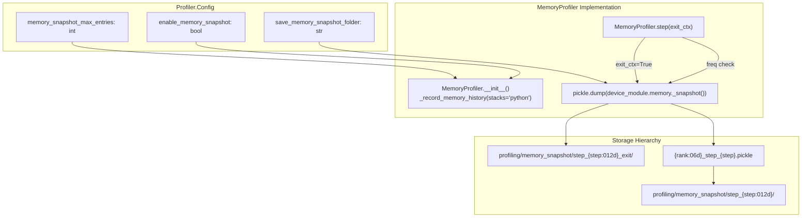
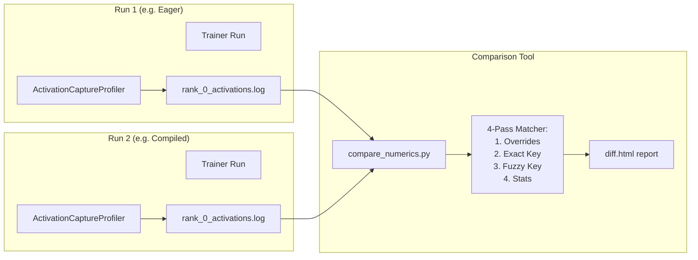

<!-- source: DeepWiki mcp.deepwiki.com · repo pytorch/torchtitan · page 11.3 Debugging and Profiling · fetched 2026-10-30 -->

# Debugging and Profiling

<details>
<summary>Relevant source files</summary>

The following files were used as context for generating this wiki page:

- [.claude/skills/numerics_debugging/SKILL.md](.claude/skills/numerics_debugging/SKILL.md)
- [.claude/skills/numerics_debugging/references/customization.md](.claude/skills/numerics_debugging/references/customization.md)
- [.claude/skills/numerics_debugging/references/patching.md](.claude/skills/numerics_debugging/references/patching.md)
- [agent_tooling/numerics_debugging/activation_tracer.py](agent_tooling/numerics_debugging/activation_tracer.py)
- [agent_tooling/numerics_debugging/compare_numerics.py](agent_tooling/numerics_debugging/compare_numerics.py)
- [benchmarks/llama3-8b_h200_202506_trainy-whitefiber.md](benchmarks/llama3-8b_h200_202506_trainy-whitefiber.md)
- [docs/debugging.md](docs/debugging.md)
- [multinode_trainer.slurm](multinode_trainer.slurm)
- [run_train.sh](run_train.sh)
- [tests/unit_tests/observability/__init__.py](tests/unit_tests/observability/__init__.py)
- [tests/unit_tests/test_profiler.py](tests/unit_tests/test_profiler.py)
- [torchtitan/observability/__init__.py](torchtitan/observability/__init__.py)
- [torchtitan/observability/structured_logger/README.md](torchtitan/observability/structured_logger/README.md)
- [torchtitan/tools/profiler.py](torchtitan/tools/profiler.py)

</details>


## Purpose and Scope

This document covers debugging modes, profiling tools, and reproducibility features in TorchTitan. It explains how to debug distributed training configurations, profile memory and performance, and ensure deterministic behavior across runs.

TorchTitan provides specialized tools for diagnosing distributed training issues, including single-GPU simulation modes, memory snapshotting for OOM (Out-of-Memory) analysis, and bit-exact numerics comparison between different execution backends.

---

## Communication Modes for Debugging

TorchTitan provides two specialized debugging modes through the `COMM_MODE` environment variable, enabling rapid iteration without requiring full multi-GPU distributed execution. These are handled in the training entry point and the launch script.

### Debugging Mode Architecture

```mermaid
graph TB
    subgraph "Normal Training (no COMM_MODE)"
        NormalEntry["torchrun --nproc_per_node=N"]
        NormalInit["init_distributed()<br/>Real NCCL/Gloo"]
        NormalPG["ProcessGroupNCCL<br/>Actual communication"]
        NormalGPU["N GPUs"]
    end
    
    subgraph "fake_backend Mode"
        FakeEntry["python3 -m torchtitan.train<br/>NGPU=32 COMM_MODE=fake_backend"]
        FakeInit["init_distributed()<br/>comm.mode=fake_backend"]
        FakePG["FakeProcessGroup<br/>No communication"]
        FakeSingle["Single GPU<br/>Rank 0 only"]
        FakeValidate["Config validation<br/>Model setup check"]
    end
    
    subgraph "local_tensor Mode"
        LocalEntry["python3 -m torchtitan.train<br/>NGPU=32 COMM_MODE=local_tensor"]
        LocalInit["init_distributed()<br/>comm.mode=local_tensor"]
        LocalPG["ProcessGroupGloo<br/>with local_tensor backend"]
        LocalSingle["Single GPU<br/>All ranks share GPU"]
        LocalSim["Simulated distributed<br/>Full training workflow"]
    end
    
    NormalEntry --> NormalInit
    NormalInit --> NormalPG
    NormalPG --> NormalGPU
    
    FakeEntry --> FakeInit
    FakeInit --> FakePG
    FakePG --> FakeSingle
    FakeSingle --> FakeValidate
    
    LocalEntry --> LocalInit
    LocalInit --> LocalPG
    LocalPG --> LocalSingle
    LocalSingle --> LocalSim
```



**Sources:** [run_train.sh:14-47](), [docs/debugging.md:59-114]()

### fake_backend Mode

The `fake_backend` mode validates configuration and model setup without actual GPU execution:

```bash
NGPU=32 COMM_MODE="fake_backend" ./run_train.sh
```

**Behavior:**
- Uses fake process groups that simulate distributed communication without actual data transfer ([docs/debugging.md:74]()).
- Runs on a single GPU without `torchrun` or NCCL initialization ([run_train.sh:18]()).
- Useful for validating configuration and model setup ([run_train.sh:19]()).
- Executes only one training step by default via CLI override `--training.steps 1` ([run_train.sh:39]()).

**Sources:** [run_train.sh:16-20,36-39](), [docs/debugging.md:65-88]()

### local_tensor Mode

The `local_tensor` mode simulates full distributed training on a single GPU:

```bash
NGPU=32 COMM_MODE="local_tensor" ./run_train.sh \
  --parallelism.tensor_parallel_degree 8 \
  --parallelism.data_parallel_shard_degree 2
```

**Behavior:**
- All communication and computation execute on a single shared GPU ([run_train.sh:23]()).
- Simulates the full training workflow without actual distributed communication ([run_train.sh:24]()).
- **Note:** Neither mode provides accurate performance metrics; local tensor runs require significantly more memory on a single GPU than actual distributed runs ([docs/debugging.md:119-121]()).

**Sources:** [run_train.sh:22-26,36-39](), [docs/debugging.md:89-117]()

---

## Memory Profiling and Monitoring

### Memory Profiler System

The `MemoryProfiler` class records periodic memory snapshots during training to diagnose allocation patterns and OOM errors.



**Sources:** [torchtitan/tools/profiler.py:38-97](), [docs/debugging.md:1-14]()

#### Enabling Memory Snapshots

Memory profiling captures allocation/free history to visualize the GPU memory timeline:

```bash
./run_train.sh --profiler.enable_memory_snapshot --profiler.save_memory_snapshot_folder memory_snapshot
```

**Implementation details:**
- Managed by `Profiler` class ([torchtitan/tools/profiler.py:99]()).
- Records only Python frames (`stacks="python"`) to keep snapshot dumps from taking minutes ([torchtitan/tools/profiler.py:55-62]()).
- **Snapshot output locations:**
  - Regular snapshots: Taken every `profiler.profile_freq` iterations in `memory_snapshot/step_{step}` ([torchtitan/tools/profiler.py:31](), [docs/debugging.md:10]()).
  - OOM snapshots: In case of OOM, snapshots are dumped with an `_exit` suffix ([torchtitan/tools/profiler.py:32](), [docs/debugging.md:9]()).
- **Visualization:** Snapshot `.pickle` files (Protocol 4) can be dragged and dropped into [pytorch.org/memory_viz](https://pytorch.org/memory_viz) ([torchtitan/tools/profiler.py:92-93](), [docs/debugging.md:13]()).

**Sources:** [torchtitan/tools/profiler.py:38-178](), [docs/debugging.md:1-14]()

---

## Performance Profiling

### torch.profiler Integration

TorchTitan integrates the Kineto profiler via the `Profiler` class to capture Chrome traces.

#### Profiler Configuration

Enable CPU and GPU profiling via CLI or config:

```bash
./run_train.sh --profiler.enable_profiling --profiler.profile_freq 10
```

**Configuration parameters ([torchtitan/tools/profiler.py:121-188]()):**
- `enable_profiling`: Whether to enable the PyTorch profiler.
- `save_traces_folder`: Trace files location (default: `profiling/traces`).
- `profile_freq`: Cycle frequency for the profiler schedule.
- `profiler_warmup`: Number of warmup steps before the active step.
- `profiler_active`: Number of steps the profiler remains active.
- `trace_post_processor`: Optional hook (Function.Config) invoked after each export.

**Sources:** [torchtitan/tools/profiler.py:121-188](), [tests/unit_tests/test_profiler.py:13-42]()

---

## Numerics Debugging

TorchTitan includes an experimental toolkit in `agent_tooling/numerics_debugging/` for bit-exact comparison between different execution modes (e.g., Eager vs. `torch.compile` AOT_FX).

### Activation Capture and Comparison



**Sources:** [agent_tooling/numerics_debugging/activation_tracer.py:7-48](), [agent_tooling/numerics_debugging/compare_numerics.py:8-35]()

**Implementation Details:**
- **ActivationCaptureProfiler:** Built on `torch.utils._debug_mode.DebugMode`. Captures per-op stats (Shape, L2 norm, Min/Max/Mean) and norm-hashes of input/output tensors ([agent_tooling/numerics_debugging/activation_tracer.py:17-26]()).
- **Matcher Logic:** Aligns operations between logs even if FQNs or counters shift using fuzzy key matching and numeric stats ([agent_tooling/numerics_debugging/compare_numerics.py:19-27]()).
- **Excluded Ops:** Infrastructure ops like `view`, `reshape`, `clone`, and `detach` are filtered out by default to focus on compute ([agent_tooling/numerics_debugging/activation_tracer.py:153-184]()).

**Sources:** [agent_tooling/numerics_debugging/activation_tracer.py:1-184](), [agent_tooling/numerics_debugging/compare_numerics.py:1-81]()

---

## Reproducibility and Troubleshooting

### Flight Recorder for Timeout Debugging

If jobs timeout, Flight Recorder generates diagnostic dumps.

**Behavior:**
- Continuously collects diagnostic information about the training job ([docs/debugging.md:124]()).
- Automatically generates dump files on every rank in the `dump_folder` upon timeout ([docs/debugging.md:125]()).

**Sources:** [docs/debugging.md:122-127]()

### NCCL and Distributed Debugging

The multi-node SLURM script provides common debugging environment variables:

- `NCCL_DEBUG=WARN`: Standard log level for NCCL ([multinode_trainer.slurm:40]()).
- `PYTHONFAULTHANDLER=1`: Enables Python's fault handler for segfaults ([multinode_trainer.slurm:41]()).
- `CUDA_LAUNCH_BLOCKING=0`: Can be set to 1 to synchronize CUDA kernels for error pinpointing ([multinode_trainer.slurm:48]()).

**Sources:** [multinode_trainer.slurm:32-55]()

### Seed and Deterministic Modes

TorchTitan provides mechanisms to ensure deterministic training runs.

- **Seed Configuration:** `./run_train.sh --debug.seed 42`.
  - Data Parallel (DP/FSDP), Tensor Parallel (TP), and Context Parallel (CP) ranks use the same seed ([docs/debugging.md:142]()).
  - Pipeline Parallel (PP) stages get different seeds for layer initialization ([docs/debugging.md:144]()).
- **Deterministic Mode:** `./run_train.sh --debug.deterministic`.
  - Forces CUDA operations to use deterministic algorithms and disables CuDNN benchmarking ([docs/debugging.md:156-157]()).

**Sources:** [docs/debugging.md:130-160]()

### Configuration Debugging

- **Inspecting Config Values:** To verify how TOML files and CLI overrides are interpreted:
  ```bash
  python -m torchtitan.config.manager --module llama3 --config llama3_debugmodel [args...]
  ```
  This prints the final structured configuration to `stdout` ([docs/debugging.md:39-58]()).
- **Boolean Flag Overrides:** Boolean flags are actions. To disable a flag enabled in config, use the `--no` prefix ([docs/debugging.md:15-17]()).
  - Example: `--profiler.no_enable_memory_snapshot` ([docs/debugging.md:31]()).

**Sources:** [docs/debugging.md:15-58]()

---

