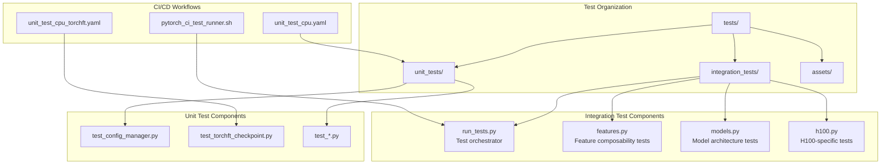
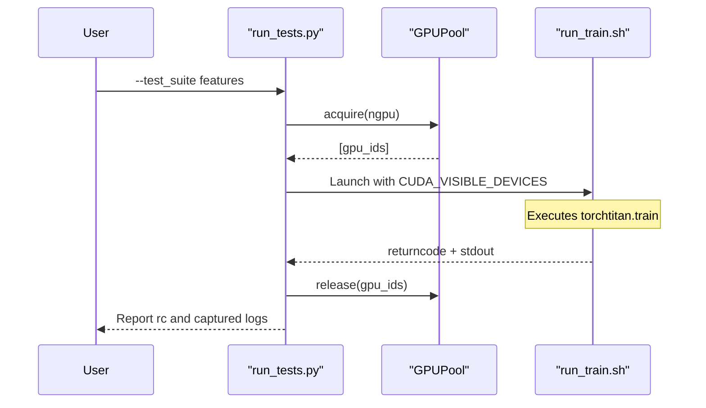

<!-- source: DeepWiki mcp.deepwiki.com · repo pytorch/torchtitan · page 12 Testing and Quality Assurance · fetched 2026-10-30 -->

# Testing and Quality Assurance

<details>
<summary>Relevant source files</summary>

The following files were used as context for generating this wiki page:

- [.github/workflows/unit_test_cpu.yaml](.github/workflows/unit_test_cpu.yaml)
- [.github/workflows/unit_test_cpu_torchft.yaml](.github/workflows/unit_test_cpu_torchft.yaml)
- [scripts/ci/pytorch_ci_test_runner.sh](scripts/ci/pytorch_ci_test_runner.sh)
- [tests/integration_tests/__init__.py](tests/integration_tests/__init__.py)
- [tests/integration_tests/run_tests.py](tests/integration_tests/run_tests.py)

</details>


This document covers the testing infrastructure and quality assurance mechanisms in torchtitan. It describes the test suite organization, integration and unit test frameworks, CI/CD pipeline, and how to run tests locally across different GPU architectures (CUDA and ROCm).

For information about debugging and profiling running training jobs, see [Debugging and Profiling](#11.3).

## Purpose and Scope

The torchtitan project maintains a comprehensive testing infrastructure to ensure correctness and reliability of training features across different hardware configurations and parallelism strategies. The testing system consists of:

- **Integration tests**: End-to-end training tests that validate feature combinations and model architectures.
- **Unit tests**: Component-level tests for individual classes and functions, primarily executed on CPU.
- **CI/CD pipeline**: Automated testing on H100 and AMD (ROCm) GPUs via GitHub Actions.

The testing infrastructure is designed to catch regressions early, validate new features, and ensure that the composability of parallelism strategies works correctly.

## Test Structure Overview

The testing codebase is divided into unit tests and integration tests, with dedicated assets for validation.



**Sources:** [tests/integration_tests/run_tests.py:23-27](), [.github/workflows/unit_test_cpu.yaml:41-41](), [scripts/ci/pytorch_ci_test_runner.sh:33-46]()

## Integration Test Framework

### Test Suite Architecture

The integration test framework is built around a test orchestrator ([tests/integration_tests/run_tests.py]()) that executes training runs and validates behavior. It uses a `GPUPool` [tests/integration_tests/run_tests.py:34-58]() to manage physical GPU allocation for concurrent test execution. Test suites are defined in separate modules and registered in `_TEST_SUITES_FUNCTION` [tests/integration_tests/run_tests.py:23-27]().

| Test Suite | Module | Purpose |
|------------|------|---------|
| `features` | `build_features_test_list` | Tests feature composability and parallelism strategies |
| `models` | `build_model_tests_list` | Tests specific model architectures (Llama, etc.) |
| `h100` | `build_h100_tests_list` | Tests H100-specific features and optimizations |

### Integration Test Execution Flow

The `run_tests.py` script uses `OverrideDefinitions` [tests/integration_tests/__init__.py:16-28]() to specify how to modify training parameters for each test case.



**Sources:** [tests/integration_tests/run_tests.py:34-58](), [tests/integration_tests/run_tests.py:105-175](), [tests/integration_tests/__init__.py:16-28]()

### Running Integration Tests

Integration tests are typically executed via the `run_tests.py` orchestrator or the CI entrypoint `pytorch_ci_test_runner.sh` [scripts/ci/pytorch_ci_test_runner.sh:8-10](). For details on configuration and matrix testing, see [Integration Testing](#12.1).

```bash
# Example CI execution for feature tests
python -m tests.integration_tests.run_tests \
    --test_suite features \
    --ngpu 8 \
    artifacts-to-be-uploaded
```

**Sources:** [scripts/ci/pytorch_ci_test_runner.sh:34-40]()

## Unit Test Framework

### Unit Test Structure

Unit tests are designed to run on CPU-only environments. They use `pytest` and often include coverage reporting [ .github/workflows/unit_test_cpu.yaml:40-41](). For details on writing and running unit tests, see [Unit Testing](#12.2).

**Key Coverage Areas:**
- **JobConfig**: Validating TOML parsing and CLI overrides.
- **ParallelDims**: Testing device mesh creation.
- **Checkpointing**: Verifying state persistence.
- **Experiments**: Specific unit tests for experimental features like `torchft` [ .github/workflows/unit_test_cpu_torchft.yaml:41-41]().

**Sources:** [.github/workflows/unit_test_cpu.yaml:34-41](), [.github/workflows/unit_test_cpu_torchft.yaml:36-41]()

## CI/CD Pipeline

The CI/CD pipeline is built on GitHub Actions and provides automated validation for both core features and experimental systems. For details on the workflow structure and runner configuration, see [CI/CD Pipeline](#12.3).

### Workflow Configuration

Workflows are triggered on pushes to `main` and pull requests, often with path filtering to avoid unnecessary runs (e.g., ignoring `torchtitan/experiments/**` for core CPU tests [ .github/workflows/unit_test_cpu.yaml:6-10]()).

### Environment Setup

The CI environment uses specialized Docker images (e.g., `torchtitan-ubuntu-22.04-clang12`) and installs nightly versions of PyTorch and `torchao` to ensure compatibility with the latest features [ .github/workflows/unit_test_cpu.yaml:23-36]().

### Experimental System CI

Experimental systems have dedicated workflows to ensure they remain functional:
- **TorchFT**: CPU unit tests for fault-tolerant checkpointing [ .github/workflows/unit_test_cpu_torchft.yaml:1-42]().
- **Integration Runners**: Stable entrypoints for PyTorch CI to call torchtitan tests without modifying the main PyTorch repository [scripts/ci/pytorch_ci_test_runner.sh:8-10]().

**Sources:** [.github/workflows/unit_test_cpu.yaml:1-42](), [.github/workflows/unit_test_cpu_torchft.yaml:1-42](), [scripts/ci/pytorch_ci_test_runner.sh:1-53]()

---

