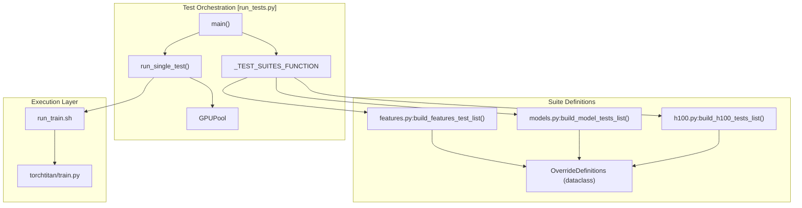
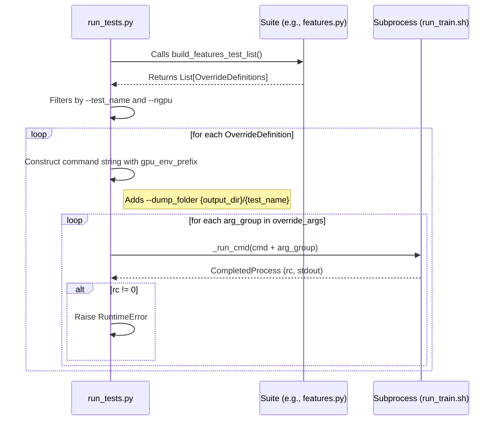

<!-- source: DeepWiki mcp.deepwiki.com · repo pytorch/torchtitan · page 12.1 Integration Testing · fetched 2026-10-30 -->

# Integration Testing

<details>
<summary>Relevant source files</summary>

The following files were used as context for generating this wiki page:

- [scripts/ci/pytorch_ci_test_runner.sh](scripts/ci/pytorch_ci_test_runner.sh)
- [scripts/loss_compare.py](scripts/loss_compare.py)
- [tests/assets/losses/llama3_cuda.txt](tests/assets/losses/llama3_cuda.txt)
- [tests/integration_tests/__init__.py](tests/integration_tests/__init__.py)
- [tests/integration_tests/features.py](tests/integration_tests/features.py)
- [tests/integration_tests/models.py](tests/integration_tests/models.py)
- [tests/integration_tests/run_tests.py](tests/integration_tests/run_tests.py)
- [torchtitan/experiments/graph_trainer/deepseek_v3/config_registry.py](torchtitan/experiments/graph_trainer/deepseek_v3/config_registry.py)
- [torchtitan/experiments/transformers_modeling_backend/config_registry.py](torchtitan/experiments/transformers_modeling_backend/config_registry.py)
- [torchtitan/models/deepseek_v3/config_registry.py](torchtitan/models/deepseek_v3/config_registry.py)
- [torchtitan/models/gpt_oss/config_registry.py](torchtitan/models/gpt_oss/config_registry.py)
- [torchtitan/models/llama3/config_registry.py](torchtitan/models/llama3/config_registry.py)
- [torchtitan/models/qwen3/config_registry.py](torchtitan/models/qwen3/config_registry.py)

</details>


## Purpose and Scope

This document describes TorchTitan's integration testing framework, which validates the correct interaction of multiple components and parallelization strategies across distributed GPU configurations. Integration tests verify end-to-end training scenarios, feature composability, model architecture correctness, and hardware-specific optimizations.

The framework is centered around `run_tests.py`, which orchestrates the execution of various test suites by invoking the main training entry point (`run_train.sh`) with specific configuration overrides.

Sources: [tests/integration_tests/run_tests.py:1-24](), [tests/integration_tests/features.py:83-89]()

## Test Organization Structure

TorchTitan organizes integration tests into modular suites that separate test cases by functionality, model architecture, and hardware requirements.

### Directory Layout

```
tests/
├── integration_tests/
│   ├── __init__.py           # Defines OverrideDefinitions dataclass
│   ├── run_tests.py          # Main test runner entry point
│   ├── features.py           # Feature composability (TP, PP, CP, Checkpoint)
│   ├── models.py             # Model architecture specific tests (DeepSeek, Qwen)
│   ├── h100.py               # H100-specific features (Float8, MXFP8)
│   └── ft.py                 # Fault Tolerance (TorchFT) integration tests
└── unit_tests/               # Component-level unit tests
```

### Key Test Suites

| Suite | File | Purpose |
|-------|------|---------|
| **Features** | `features.py` | Tests parallelization composability (2D/3D), `torch.compile`, activation checkpointing, and checkpoint save/load logic. |
| **Models** | `models.py` | Validates training stability for different model families (DeepSeek-V3, Qwen3, GPT-OSS) using debug model configurations. |
| **H100** | `h100.py` | Tests hardware-specific optimizations like `Float8` training and `MXFP8` on NVIDIA H100 GPUs. |
| **FT** | `ft.py` | Validates Fault Tolerance mechanisms, multi-replica training, and quorum-based recovery. |

Sources: [tests/integration_tests/run_tests.py:23-27](), [tests/integration_tests/features.py:89-210](), [tests/integration_tests/models.py:11-20]()

## Test Execution Architecture

The integration testing framework uses a "Configuration Override" pattern. It takes a base model and module (defaulting to `llama3` and `llama3_debugmodel`) and applies command-line argument overrides to test specific feature combinations.

### Code Entity Relationship Diagram

This diagram shows how the `run_tests.py` script interacts with the suite definition files and the underlying training infrastructure.


Sources: [tests/integration_tests/run_tests.py:23-27](), [tests/integration_tests/run_tests.py:34-58](), [tests/integration_tests/run_tests.py:105-177](), [tests/integration_tests/__init__.py:15-28]()

## Test Configuration and Overrides

The core of the testing logic resides in the `OverrideDefinitions` class. Each test case defines a list of command-line arguments that are appended to the `./run_train.sh` command.

### OverrideDefinitions Structure
The `OverrideDefinitions` class (defined in `tests/integration_tests/__init__.py`) contains:
* `override_args`: A sequence of argument sequences. If multiple inner sequences are provided, `run_tests.py` runs them sequentially (e.g., to test Save then Load). [tests/integration_tests/__init__.py:21]()
* `test_descr`: A human-readable description. [tests/integration_tests/__init__.py:22]()
* `test_name`: A unique identifier used for the dump folder. [tests/integration_tests/__init__.py:23]()
* `ngpu`: The number of GPUs required (default 4). [tests/integration_tests/__init__.py:24]()
* `timeout`: Optional timeout for the test execution. [tests/integration_tests/__init__.py:27]()

### Data Flow: From Definition to Execution


Sources: [tests/integration_tests/run_tests.py:60-88](), [tests/integration_tests/run_tests.py:105-177](), [tests/integration_tests/features.py:83-100]()

## Integration Test Scenarios

### 1. Parallelism and Compilation (features.py)
The `features` suite validates the composability of different parallelism dimensions.
* **1D/2D Eager & Compile**: Tests basic `torch.compile` and Tensor Parallelism (TP) combinations. [tests/integration_tests/features.py:100-151]()
* **Full DTensor**: The framework automatically injects `--parallelism.spmd_backend full_dtensor` for supported variants to test the DTensor-based SPMD backend. [tests/integration_tests/features.py:52-67]()
* **Selective AC**: Tests `torch.compile` combined with selective activation checkpointing. [tests/integration_tests/features.py:109-118]()

### 2. Checkpoint Save/Load (features.py)
Checkpoint tests typically involve two stages defined in `override_args`:
1. **Save**: Run training for a few steps and save a checkpoint. [tests/integration_tests/features.py:168-169]()
2. **Load**: Initialize from the saved checkpoint and continue training. [tests/integration_tests/features.py:170-173]()

Special cases include:
* **Model-only HF format**: Saving in HuggingFace compatible format and loading back via `initial_load_in_hf`. [tests/integration_tests/features.py:178-195]()
* **Precision Export**: Saving model-only checkpoints in `fp32`. [tests/integration_tests/features.py:196-205]()

### 3. Model-Specific Parallelism (models.py)
The `models` suite tests complex 4D parallelism patterns on modern architectures:
* **DeepSeek-V3**: Validates combinations of `FSDP+EP+TP+PP+compile` and `Interleaved1F1B` schedules. [tests/integration_tests/models.py:22-77]()
* **Qwen3**: Tests MoE parameter groups, fused QKV, and `FSDP+TP+CP` configurations. [tests/integration_tests/models.py:78-121]()
* **GPT-OSS**: Validates MoE training with `FSDP+TP+EP`. [tests/integration_tests/models.py:140-153]()

## Loss Comparison Tool

For numerical regression testing, TorchTitan provides `scripts/loss_compare.py`. This script compares training losses between different git commits or training configurations to ensure parity.

* **Deterministic Training**: Always enables `--debug.deterministic` and `--debug.seed`. [scripts/loss_compare.py:81]()
* **TensorBoard Extraction**: Automatically extracts full-precision loss values from TensorBoard event files using `TB_LOSS_TAG`. [scripts/loss_compare.py:78](), [scripts/loss_compare.py:146-199]()
* **CI Integration**: The `--assert-equal` flag allows the script to be used in CI to fail if losses diverge. [scripts/loss_compare.py:18-20]()

Sources: [scripts/loss_compare.py:9-61](), [scripts/loss_compare.py:104-113]()

## How to Run Integration Tests

Tests are executed via the `run_tests.py` script. It requires an output directory to store logs and artifacts.

### Basic Usage
```bash
# Run all feature tests using up to 8 GPUs
python tests/integration_tests/run_tests.py ./test_outputs --test_suite features --ngpu 8
```

### Running a Specific Test
```bash
# Run only the deepseek_v3_fsdp+ep+compile test
python tests/integration_tests/run_tests.py ./test_outputs --test_name deepseek_v3_fsdp+ep+compile
```

### Configuration Options
* `--test_suite`: Choose from `features`, `models`, `h100`, or `ft`. [tests/integration_tests/run_tests.py:23-27]()
* `--parallel`: Enables concurrent execution of tests by partitioning available GPUs via `GPUPool`. [tests/integration_tests/run_tests.py:34-58]()
* `--gpu_arch_type`: Specify `cuda` or `rocm` to filter architecture-specific tests. [tests/integration_tests/run_tests.py:197-200]()

Sources: [tests/integration_tests/run_tests.py:178-204]()

## Artifacts and Logging

For every test case, `run_tests.py` creates a sub-directory in the specified output directory.

* **Dump Folder**: Passed via `--dump_folder`. Contains training logs and metrics. [tests/integration_tests/run_tests.py:116]()
* **Compile Traces**: The runner automatically sets `TORCH_TRACE` to capture Inductor debug information for compiled runs. [tests/integration_tests/run_tests.py:143]()
* **Atomic Output**: The runner uses `_OUTPUT_LOCK` and `_emit_block` to ensure that logs from concurrent tests do not interleave in the console. [tests/integration_tests/run_tests.py:29-31](), [tests/integration_tests/run_tests.py:90-102]()

Sources: [tests/integration_tests/run_tests.py:149-161]()

---

