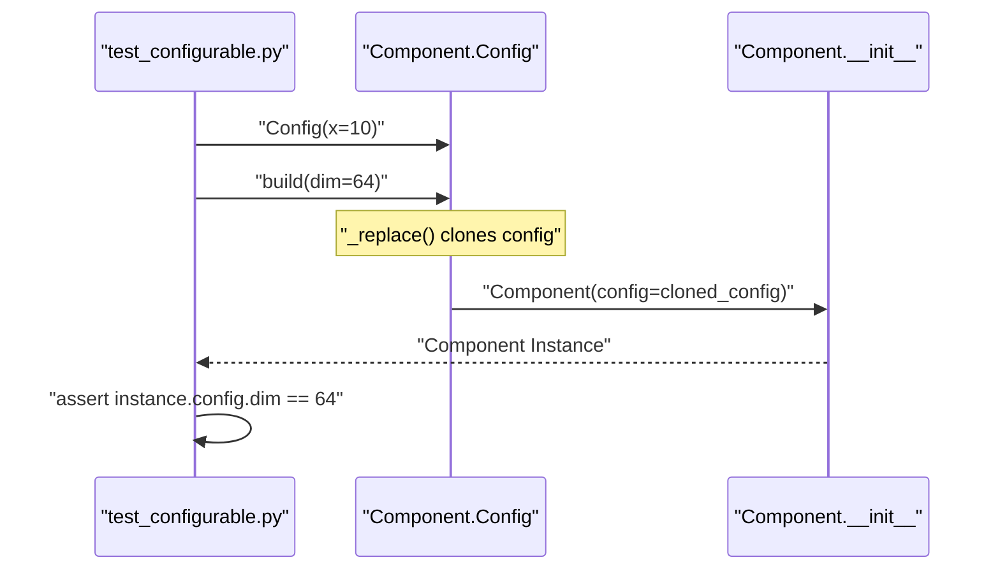
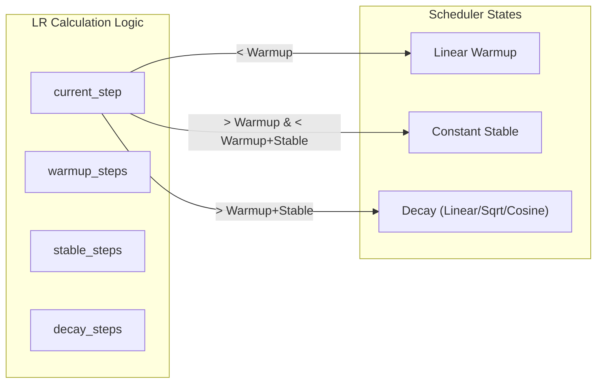
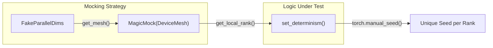

<!-- source: DeepWiki mcp.deepwiki.com · repo pytorch/torchtitan · page 12.2 Unit Testing · fetched 2026-10-30 -->

# Unit Testing

<details>
<summary>Relevant source files</summary>

The following files were used as context for generating this wiki page:

- [.github/workflows/unit_test_cpu.yaml](.github/workflows/unit_test_cpu.yaml)
- [.github/workflows/unit_test_cpu_torchft.yaml](.github/workflows/unit_test_cpu_torchft.yaml)
- [scripts/checkpoint_compat_test.py](scripts/checkpoint_compat_test.py)
- [tests/unit_tests/test_activation_checkpoint.py](tests/unit_tests/test_activation_checkpoint.py)
- [tests/unit_tests/test_lr_scheduler.py](tests/unit_tests/test_lr_scheduler.py)
- [tests/unit_tests/test_optimizer_param_groups.py](tests/unit_tests/test_optimizer_param_groups.py)
- [tests/unit_tests/test_state_dict_keys.py](tests/unit_tests/test_state_dict_keys.py)
- [tests/unit_tests/test_train_spec.py](tests/unit_tests/test_train_spec.py)
- [torchtitan/components/checkpoint_utils.py](torchtitan/components/checkpoint_utils.py)
- [torchtitan/components/lr_scheduler.py](torchtitan/components/lr_scheduler.py)
- [torchtitan/components/optimizer.py](torchtitan/components/optimizer.py)
- [torchtitan/distributed/activation_checkpoint.py](torchtitan/distributed/activation_checkpoint.py)
- [torchtitan/experiments/torchft/optimizer.py](torchtitan/experiments/torchft/optimizer.py)
- [torchtitan/overrides/fused_swiglu.py](torchtitan/overrides/fused_swiglu.py)

</details>


## Purpose and Scope

This page documents the unit testing infrastructure in `torchtitan`, including test organization, execution, common testing patterns, and guidelines for writing tests. Unit tests in `torchtitan` verify individual components in isolation, ensuring correctness of core functionality like configuration parsing, model building, parallelization utilities, learning rate schedulers, and activation checkpointing.

For information about end-to-end integration tests that verify complete training workflows, see [Integration Testing](12.1). For documentation on the CI/CD pipeline that runs these tests automatically, see [CI/CD Pipeline](12.3).

Sources: [tests/README.md:1-8]()

---

## Test Organization and Structure

### Test Directory Layout

Unit tests in `torchtitan` are organized in the `tests/unit_tests/` directory. The structure is flat, with test files targeting specific modules or functional areas. Experimental features, such as `torchft`, maintain their own local test suites within the `experiments/` directory.

```mermaid
graph TB
    subgraph "Source Code Structure"
        torchtitan["torchtitan/"]
        config["torchtitan/config/"]
        dist["torchtitan/distributed/"]
        models["torchtitan/models/"]
        components["torchtitan/components/"]
        experiments["torchtitan/experiments/"]
    end
    
    subgraph "Unit Test Directory"
        unit_tests["tests/unit_tests/"]
        test_config["test_config_manager.py"]
        test_configurable["test_configurable.py"]
        test_dims["test_parallel_dims.py"]
        test_rope["test_rope.py"]
        test_train_spec["test_train_spec.py"]
        test_ac["test_activation_checkpoint.py"]
        test_lrs["test_lr_scheduler.py"]
        test_pg["test_optimizer_param_groups.py"]
    end

    subgraph "Experimental Tests"
        ft_tests["torchtitan/experiments/torchft/tests/test_torchft_checkpoint.py"]
    end
    
    config -->|"tests"| test_config
    config -->|"tests"| test_configurable
    dist -->|"tests"| test_dims
    dist -->|"tests"| test_ac
    models -->|"tests"| test_rope
    models -->|"tests"| test_train_spec
    components -->|"tests"| test_lrs
    components -->|"tests"| test_pg
    experiments -->|"local tests"| ft_tests
```



**Unit Test Mapping**: Associates core library components and experiments with their corresponding unit test files.

Sources: [tests/unit_tests/](), [tests/README.md:7-13](), [.github/workflows/unit_test_cpu_torchft.yaml:41-41]()

---

## Running Unit Tests

### Basic Test Execution

Unit tests are executed using `pytest`. It is recommended to install development dependencies from `requirements-dev.txt` before running tests.

```bash
# Run all unit tests
pytest -s tests/unit_tests/

# Run a specific test file
pytest -s tests/unit_tests/test_config_manager.py

# Run a specific test class/function
pytest -s tests/unit_tests/test_config_manager.py::TestConfigManager::test_cli_overrides
```

### CI Execution
The `CPU Unit Test` workflow runs on every push and pull request (excluding changes to `experiments/`). It installs the latest PyTorch nightlies and runs `pytest` with coverage reporting. A separate workflow, `TorchFT CPU Unit Test`, handles testing for the fault-tolerance experiment.

```bash
# Command used in main CI
pytest tests/unit_tests --cov=. --cov-report=xml:/tmp/coverage.xml --durations=20 -vv

# Command used for TorchFT experiment
pytest torchtitan/experiments/torchft/tests/test_torchft_checkpoint.py -v
```

Sources: [tests/README.md:17-82](), [.github/workflows/unit_test_cpu.yaml:40-41](), [.github/workflows/unit_test_cpu_torchft.yaml:41-41]()

---

## Common Testing Patterns

### Configurable Component Pattern
Tests for the `Configurable` base class verify the lifecycle of components built via nested `Config` dataclasses. This includes testing "new-style" absorption (where kwargs are absorbed into the config) and "old-style" forwarding (where kwargs are passed to `__init__`).



**Configurable Lifecycle**: Demonstrates how `build()` clones the configuration and initializes the owner class.

Sources: [torchtitan/config/configurable.py:17-142](), [tests/unit_tests/test_configurable.py:13-112]()

### Model Spec and Registry Pattern
Tests in `test_train_spec.py` verify that models registered via `model_registry` correctly map to their `ModelSpec`, including parallelization functions and loss builders. It also verifies that `post_optimizer_build_fn` correctly applies hooks to the `OptimizersContainer`.

```python
def test_model_registry(self):
    spec = model_registry("debugmodel")
    assert isinstance(spec, ModelSpec)
    assert spec.name == "llama3"
    assert spec.parallelize_fn == parallelize_llama
```

Sources: [tests/unit_tests/test_train_spec.py:58-66](), [tests/unit_tests/test_train_spec.py:81-131]()

---

## Coverage Areas

### 1. Activation Checkpointing (AC)
Tests in `test_activation_checkpoint.py` verify the FLOPs and memory trade-offs of different AC modes using `FlopCounterMode`. The tests ensure that `selective` and `full` AC modes result in the expected increase in backward FLOPs compared to no AC.

| AC Mode | Verification Logic | Expected FLOPs Scale |
| :--- | :--- | :--- |
| `none` | Baseline backward pass | 8.0 (Reference) |
| `selective` | Save every other `mm` | 9.0 |
| `full` | Recompute all layers | 12.0 |

Sources: [torchtitan/distributed/activation_checkpoint.py:12-167](), [tests/unit_tests/test_activation_checkpoint.py:48-127]()

### 2. LR Schedulers
`LRSchedulersContainer` tests verify the Warmup-Stable-Decay (WSD) schedule. The tests use `MagicMock` to simulate `OptimizersContainer` and verify that the learning rate follows the calculated multiplicative factors at each step, including the "virtual last step" to prevent the LR from dropping to 0.



Sources: [torchtitan/components/lr_scheduler.py:130-163](), [tests/unit_tests/test_lr_scheduler.py:76-118]()

### 3. Optimizer Param Groups
`TestParamGroupConfig` ensures that parameters are assigned to the correct optimizer instances based on regex patterns. It verifies the "first-match-wins" rule and checks that specific kwargs (like `weight_decay: 0.0` for biases) are correctly applied.

| Test Case | Verification |
| :--- | :--- |
| `test_default_no_param_groups` | Single group with all params |
| `test_first_match_wins` | Overlapping patterns resolve to the first match |
| `test_lr_override` | Specific regex overrides global LR |

Sources: [torchtitan/components/optimizer.py:149-170](), [tests/unit_tests/test_optimizer_param_groups.py:76-204]()

---

## Writing New Unit Tests

### Guidelines for Components
When adding a new `Configurable` component, follow the structure established in `test_configurable.py`:
1.  **Define a Test Class**: Inherit from `unittest.TestCase`.
2.  **Test Config Validation**: Ensure `kw_only=True` and `slots=True` are enforced.
3.  **Verify `to_dict`**: Ensure nested configurations serialize correctly and skip unset `field(init=False)` slots.

### Testing Distributed Logic on CPU
For logic that depends on distributed state but should run in unit tests (CPU), use mocks or fake implementations as seen in `test_set_determinism.py`. For activation checkpointing, `ToyModule` and `TransformerBlock` are used to simulate model structures without requiring a full GPU mesh.



**Mocking Distributed State**: Pattern for testing distributed utilities without a live NCCL backend.

Sources: [tests/unit_tests/test_set_determinism.py:16-95](), [tests/unit_tests/test_activation_checkpoint.py:18-46]()

---

