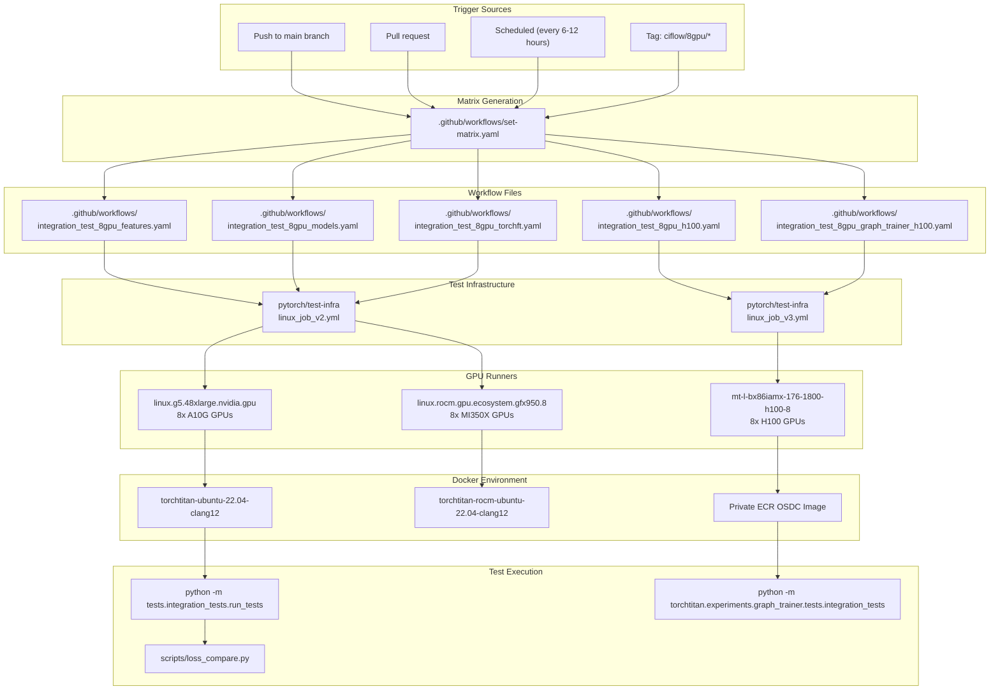

<!-- source: DeepWiki mcp.deepwiki.com · repo pytorch/torchtitan · page 12.3 CI/CD Pipeline · fetched 2026-10-30 -->

# CI/CD Pipeline

<details>
<summary>Relevant source files</summary>

The following files were used as context for generating this wiki page:

- [.flake8](.flake8)
- [.github/scripts/todo_debt_tracker.py](.github/scripts/todo_debt_tracker.py)
- [.github/scripts/update_version.sh](.github/scripts/update_version.sh)
- [.github/workflows/build_whl_and_publish.yaml](.github/workflows/build_whl_and_publish.yaml)
- [.github/workflows/docker-builds.yml](.github/workflows/docker-builds.yml)
- [.github/workflows/integration_test_8gpu_features.yaml](.github/workflows/integration_test_8gpu_features.yaml)
- [.github/workflows/integration_test_8gpu_graph_trainer.yaml](.github/workflows/integration_test_8gpu_graph_trainer.yaml)
- [.github/workflows/integration_test_8gpu_graph_trainer_h100.yaml](.github/workflows/integration_test_8gpu_graph_trainer_h100.yaml)
- [.github/workflows/integration_test_8gpu_h100.yaml](.github/workflows/integration_test_8gpu_h100.yaml)
- [.github/workflows/integration_test_8gpu_models.yaml](.github/workflows/integration_test_8gpu_models.yaml)
- [.github/workflows/integration_test_8gpu_torchft.yaml](.github/workflows/integration_test_8gpu_torchft.yaml)
- [.github/workflows/integration_test_8gpu_transformers_modeling_backend.yaml](.github/workflows/integration_test_8gpu_transformers_modeling_backend.yaml)
- [.github/workflows/lint.yaml](.github/workflows/lint.yaml)
- [.github/workflows/release.yml](.github/workflows/release.yml)
- [.github/workflows/set-matrix.yaml](.github/workflows/set-matrix.yaml)
- [.github/workflows/todo_debt_tracker.yaml](.github/workflows/todo_debt_tracker.yaml)
- [.gitignore](.gitignore)
- [.pre-commit-config.yaml](.pre-commit-config.yaml)
- [requirements.txt](requirements.txt)

</details>


This document describes TorchTitan's continuous integration and continuous deployment (CI/CD) infrastructure. The CI/CD pipeline validates code changes through automated testing on multiple GPU configurations, ensuring correctness across parallelism strategies, model architectures, and hardware platforms.

## Overview

TorchTitan's CI/CD system consists of GitHub Actions workflows that execute integration tests on different GPU hardware configurations. The pipeline runs automatically on code changes, pull requests, and scheduled intervals to catch regressions early. Tests are organized into suites that validate specific functionality areas (features, models, hardware-specific optimizations, and experimental features like `GraphTrainer`).

Sources: [.github/workflows/integration_test_8gpu_features.yaml:1-17](), [.github/workflows/integration_test_8gpu_graph_trainer.yaml:1-16]()

## GitHub Actions Workflow Architecture



**TorchTitan CI/CD Workflow Architecture**: GitHub Actions workflows utilize a dynamic matrix generator (`set-matrix.yaml`) to provision runners across NVIDIA (A10G, H100) and AMD (MI350X) hardware. The pipeline executes standard integration tests, loss parity checks via `loss_compare.py`, and specialized experimental tests for `GraphTrainer` and `TorchFT`.

Sources: [.github/workflows/integration_test_8gpu_features.yaml:31-48](), [.github/workflows/set-matrix.yaml:1-108](), [.github/workflows/integration_test_8gpu_h100.yaml:31-40](), [.github/workflows/integration_test_8gpu_graph_trainer_h100.yaml:32-41]()

## Dynamic Matrix Configuration

TorchTitan uses a centralized `set-matrix.yaml` workflow to determine the execution environment based on the trigger type.

| Trigger Condition | Target Matrix | Runner Type |
|-------------------|---------------|-------------|
| **Push to Main / Schedule** | CUDA + ROCm | G5 (NVIDIA) / MI350X (AMD) |
| **8GPU Tag / PR Label** | ROCm | MI350X (AMD) |
| **Normal Pull Request** | CUDA | G5 (NVIDIA) |
| **H100 Label (ciflow/h100.8)** | CUDA (H100) | H100 (NVIDIA) |

The matrix defines `gpu-arch-type`, `gpu-arch-version` (e.g., 13.0 for CUDA, 7.2 for ROCm), and the corresponding `docker-image`. For H100 runners, it also computes a `docker-hash` based on the `.ci/docker` directory to pull specific images from a private ECR [ .github/workflows/set-matrix.yaml:61-63]().

Sources: [.github/workflows/set-matrix.yaml:41-100](), [.github/workflows/integration_test_8gpu_h100.yaml:31-36]()

## Integration Test Suites

The test infrastructure is partitioned into several specialized workflows to balance execution time and coverage.

### Feature and Accuracy Tests
The `8 GPU Feature Tests` workflow performs critical validations:
1.  **Loss Parity**: Uses `scripts/loss_compare.py` to ensure `FSDP` and `HSDP` configurations yield identical results [ .github/workflows/integration_test_8gpu_features.yaml:116-123]().
2.  **MoE Accuracy**: Verifies Qwen3 MoE (FSDP+TP+EP) deterministic losses match reference values [ .github/workflows/integration_test_8gpu_features.yaml:133-140]().
3.  **Feature Matrix**: Executes the `features` suite via `run_tests.py` [ .github/workflows/integration_test_8gpu_features.yaml:142]().

### H100 Hardware Tests
The `8 GPU Integration Test on H100` workflow executes a full suite of integration tests specifically on H100 hardware to validate performance and hardware-specific features (like FP8 or specialized NCCL kernels) [ .github/workflows/integration_test_8gpu_h100.yaml:59-63]().

### GraphTrainer and Compilation Tests
The `GraphTrainer` workflows (`integration_test_8gpu_graph_trainer.yaml` and `integration_test_8gpu_graph_trainer_h100.yaml`) validate the compiler-based training engine:
*   **AOT FX Tracing**: Validates `llama3` and `deepseek_v3` tracing vs eager mode [ .github/workflows/integration_test_8gpu_graph_trainer.yaml:79](), [ .github/workflows/integration_test_8gpu_graph_trainer_h100.yaml:92]().
*   **Precompile Tests**: Validates pre-compilation logic for FSDP+TP+EP configurations [ .github/workflows/integration_test_8gpu_graph_trainer_h100.yaml:95]().
*   **AutoParallel**: Tests the automatic parallelism strategy selection on 4-GPU and 8-GPU configurations [ .github/workflows/integration_test_8gpu_graph_trainer_h100.yaml:88]().

### Experimental Workflows
Experimental features have dedicated CI paths:
*   **TorchFT**: Starts a `torchft_lighthouse` discovery service before running fault tolerance integration tests [ .github/workflows/integration_test_8gpu_torchft.yaml:86-90]().
*   **Transformers Modeling Backend**: Validates training HuggingFace models with 4D parallelism [ .github/workflows/integration_test_8gpu_transformers_modeling_backend.yaml:86]().

Sources: [.github/workflows/integration_test_8gpu_features.yaml:93-142](), [.github/workflows/integration_test_8gpu_graph_trainer_h100.yaml:81-98](), [.github/workflows/integration_test_8gpu_torchft.yaml:84-90]()

## Linting and Quality Control

The `lint.yaml` workflow ensures code style and link integrity on every pull request. It utilizes:
*   **Pre-commit**: Runs hooks defined in `.pre-commit-config.yaml`, including `flake8`, `ufmt` (black/usort), and `codespell` [ .pre-commit-config.yaml:7-66]().
*   **Lychee**: A link checker that validates all documentation and code comments for broken URLs [ .github/workflows/lint.yaml:73-78]().
*   **Pyrefly**: Performs static type checking [ .pre-commit-config.yaml:67-75]().

Sources: [.github/workflows/lint.yaml:1-78](), [.pre-commit-config.yaml:1-118]()

## Release and Distribution

TorchTitan automates the release process to PyPI through OpenID Connect (OIDC).

### Build and Publish Workflow
The `release.yml` workflow triggers on a GitHub release event:
1.  **release-build**: Builds the source distribution and wheels using `python -m build` [ .github/workflows/release.yml:21-23]().
2.  **pypi-publish**: Uses `pypa/gh-action-pypi-publish` to upload artifacts to PyPI [ .github/workflows/release.yml:48-49]().

This workflow requires the `id-token: write` permission to authenticate with PyPI without static secrets [ .github/workflows/release.yml:36]().

Sources: [.github/workflows/release.yml:1-50]()

## Implementation Details for ROCm

For AMD hardware (ROCm), CI workflows include environment setup to handle library paths for `hipBLASLt`:
```bash
if [[ "${{ matrix.gpu-arch-type }}" == "rocm" ]]; then
  export HIPBLASLT_TENSILE_LIBPATH="$(python -c 'import os, torch; print(os.path.join(os.path.dirname(torch.__file__), "lib", "hipblaslt", "library"))')"
  echo "HIPBLASLT_TENSILE_LIBPATH=${HIPBLASLT_TENSILE_LIBPATH}"
fi
```
This ensures that `hipBLASLt` can find its required tensile libraries within the PyTorch installation on AMD MI350X runners [ .github/workflows/integration_test_8gpu_features.yaml:78-81]().

Sources: [.github/workflows/integration_test_8gpu_features.yaml:78-81](), [.github/workflows/set-matrix.yaml:94-96]()

---

