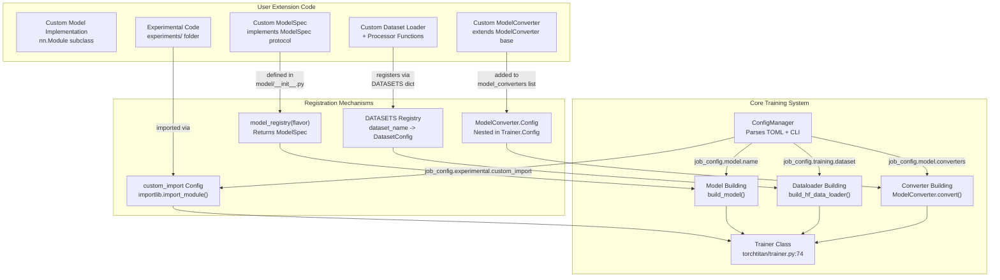
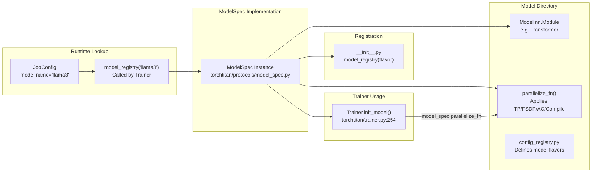

<!-- source: DeepWiki mcp.deepwiki.com · repo pytorch/torchtitan · page 13 Extension and Development · fetched 2026-10-30 -->

# Extension and Development

<details>
<summary>Relevant source files</summary>

The following files were used as context for generating this wiki page:

- [CONTRIBUTING.md](CONTRIBUTING.md)
- [README.md](README.md)
- [docs/composability.md](docs/composability.md)
- [docs/extension.md](docs/extension.md)
- [torchtitan/__init__.py](torchtitan/__init__.py)
- [torchtitan/experiments/README.md](torchtitan/experiments/README.md)
- [torchtitan/experiments/__init__.py](torchtitan/experiments/__init__.py)
- [torchtitan/models/__init__.py](torchtitan/models/__init__.py)

</details>


This document provides a comprehensive guide to extending torchtitan with custom models, datasets, quantization schemes, and experimental features. It covers the primary extension points in the codebase and how to leverage them to support rapid innovation while maintaining a clean core training infrastructure.

For information about the core training system architecture, see [Architecture Overview](#1.1). For details on the `ModelSpec` protocol's role in model selection, see [Model Selection and TrainSpec Protocol](#2.3). For specifics on supported model architectures, see [Model System](#5).

---

## Extension Points Overview

torchtitan provides four primary extension mechanisms:

1.  **`ModelSpec` Protocol**: Add new model architectures by implementing a protocol interface [torchtitan/protocols/model_spec.py:1-50]().
2.  **Dataset Registry**: Register custom datasets with loader and processor functions in `DATASETS` [torchtitan/datasets/hf_datasets/text_datasets.py:1-100]().
3.  **`ModelConverter` System**: Add custom quantization schemes or model transformations [torchtitan/protocols/model_converter.py:1-35]().
4.  **Experiments Framework**: A dedicated `experiments/` folder for features with independent dependencies and ownership [torchtitan/experiments/README.md:1-21]().

**Architecture: Extension Points and Registration Flow**



Sources: [docs/extension.md:1-15](), [torchtitan/experiments/README.md:5-14](), [torchtitan/train.py:81-82](), [torchtitan/config/job_config.py:34-38]()

---

## Contributing New Models

The `ModelSpec` protocol is the primary interface for adding new model architectures. It defines a contract for high-level components including model class, parallelization functions, and loss functions [docs/extension.md:8-13]().

For a step-by-step guide on implementing `ModelSpec`, organizing the model folder, and integrating it into the registry, see **[Contributing New Models](#13.1)**.

### Implementation Pattern
To register a model, define a `model_registry(flavor)` function in your model's `__init__.py` that returns a `ModelSpec`. Training configurations should be defined in a `config_registry.py` module [docs/extension.md:15-16]().

**Model Registration and Registry Flow**



Sources: [docs/extension.md:8-16](), [torchtitan/protocols/model_spec.py:12-48]()

---

## Adding Custom Datasets

Custom datasets are integrated by providing a `DatasetConfig` which includes a loader function and a sample processor. This system supports streaming HuggingFace datasets and stateful loading for checkpointing [torchtitan/datasets/hf_datasets/text_datasets.py:1-50]().

For a guide on implementing loader functions, registering datasets, and handling SFT/chat patterns, see **[Adding Custom Datasets](#13.2)**.

### DatasetConfig Structure
A `DatasetConfig` typically defines how to fetch data from a source (like HuggingFace) and how to extract the text field from the raw samples.

```python
# Example structure in torchtitan/datasets/hf_datasets/text_datasets.py
@dataclass
class DatasetConfig:
    path: str
    loader: Callable
    sample_processor: Callable
```

Sources: [torchtitan/datasets/hf_datasets/text_datasets.py:20-40](), [torchtitan/train.py:126-131]()

---

## Model Converters and Quantization

The `ModelConverter` protocol defines a general interface for module rewriting (e.g., Float8 module swapping) and post-optimizer step operations [docs/extension.md:18-24]().

For details on implementing custom `ModelConverter` classes, the `convert()` method, and `post_optimizer_hook()`, see **[Model Converters and Quantization](#13.3)**.

### Converter Lifecycle
1.  **`convert`**: Called after model definition and meta-device initialization, but before parallelization [docs/extension.md:21]().
2.  **`post_optimizer_hook`**: Registered to the optimizer to perform operations like calculating dynamic scales after a step [docs/extension.md:22]().

Sources: [docs/extension.md:18-24](), [torchtitan/protocols/model_converter.py:12-35]()

---

## Experiments Framework

The `experiments/` folder hosts significant enhancements and new training paradigms (e.g., RL, VLM, GraphTrainer) while keeping the `core` codebase clean [torchtitan/experiments/README.md:1-9]().

For guidelines on experiment ownership, dependency management, and how to contribute to the experiment registry, see **[Experiments Framework and Contributing](#13.4)**.

### Experiment Principles
*   **Independence**: Each experiment is independent and can have its own dependencies [torchtitan/experiments/README.md:13]().
*   **One-way Dependency**: `experiments` depend on `core`, but `core` must run successfully without `experiments` [torchtitan/experiments/README.md:14]().
*   **Ownership**: Each experiment must have an owner responsible for maintenance and responding to issues [torchtitan/experiments/README.md:15-17]().

**Current Experiment Registry**
The following experiments are currently supported in the framework:
*   `graph_trainer`: Compiler-based training [torchtitan/experiments/__init__.py:9]().
*   `transformers_modeling_backend`: Training HF models with 4D parallelism [torchtitan/experiments/__init__.py:12]().
*   `rl`: Reinforcement Learning (GRPO/vLLM) [torchtitan/experiments/__init__.py:16-17]().
*   `torchft`: Fault Tolerance integration [torchtitan/experiments/__init__.py:15]().
*   `autoparallel`: Automatic parallelism strategy selection [torchtitan/experiments/__init__.py:13]().

Sources: [torchtitan/experiments/README.md:1-32](), [torchtitan/experiments/__init__.py:7-19]()

---

## Extending Trainer and Configuration

To add custom configuration for an experiment, developers can subclass `Trainer.Config` (or `Trainer` itself) and add new fields [docs/extension.md:34-36]().

### Example Pattern
```python
# torchtitan/experiments/your_folder/trainer.py
class MyTrainer(Trainer):
    @dataclass(kw_only=True, slots=True)
    class Config(Trainer.Config):
        custom_config: CustomConfig = field(default_factory=CustomConfig)
```

Custom configurations are then selected via the `MODULE` and `CONFIG` environment variables when running `run_train.sh` [docs/extension.md:73-77]().

Sources: [docs/extension.md:34-77](), [torchtitan/trainer.py:74-150]()

---

