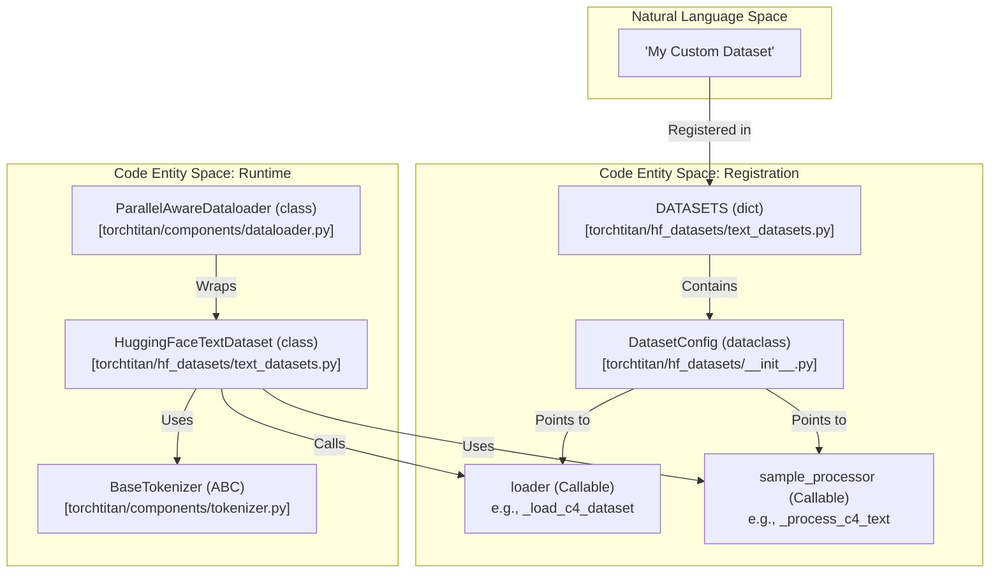
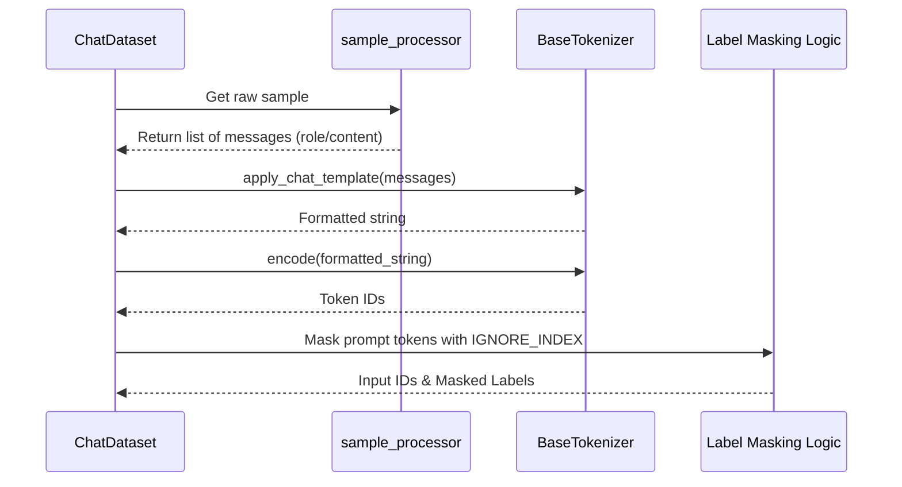

<!-- source: DeepWiki mcp.deepwiki.com · repo pytorch/torchtitan · page 13.2 Adding Custom Datasets · fetched 2026-10-30 -->

# Adding Custom Datasets

<details>
<summary>Relevant source files</summary>

The following files were used as context for generating this wiki page:

- [docs/datasets.md](docs/datasets.md)
- [tests/assets/losses/sft_debugmodel_cuda.txt](tests/assets/losses/sft_debugmodel_cuda.txt)
- [tests/assets/sft_test/data.json](tests/assets/sft_test/data.json)
- [tests/assets/tokenizer/tokenizer_config.json](tests/assets/tokenizer/tokenizer_config.json)
- [tests/unit_tests/test_chat_dataset.py](tests/unit_tests/test_chat_dataset.py)
- [tests/unit_tests/test_dataloader.py](tests/unit_tests/test_dataloader.py)
- [tests/unit_tests/test_dataset_checkpointing.py](tests/unit_tests/test_dataset_checkpointing.py)
- [tests/unit_tests/test_dataset_interleaving.py](tests/unit_tests/test_dataset_interleaving.py)
- [tests/unit_tests/test_tokenizer.py](tests/unit_tests/test_tokenizer.py)
- [torchtitan/components/tokenizer.py](torchtitan/components/tokenizer.py)
- [torchtitan/hf_datasets/__init__.py](torchtitan/hf_datasets/__init__.py)
- [torchtitan/hf_datasets/interleaved.py](torchtitan/hf_datasets/interleaved.py)
- [torchtitan/hf_datasets/text_datasets.py](torchtitan/hf_datasets/text_datasets.py)

</details>


This document provides a technical guide to adding custom datasets to `torchtitan`. It covers the dataset registration system, the implementation of loader and processor functions, and the patterns for SFT/chat and interleaved datasets.

## Dataset System Architecture

`torchtitan` uses a registry-based system for managing datasets. The `DATASETS` dictionary in `torchtitan/hf_datasets/text_datasets.py` serves as the central registry. At runtime, the `HuggingFaceTextDataLoader` uses this registry to look up the appropriate `DatasetConfig` based on the configuration [torchtitan/hf_datasets/text_datasets.py:38-54]().

### Data Flow: From Registry to Active Pipeline
The following diagram illustrates how a custom dataset definition moves from the registration space into the active training pipeline.

**Diagram: Dataset Registration and Code Entity Mapping**


**Sources**: [torchtitan/hf_datasets/text_datasets.py:38-54](), [torchtitan/hf_datasets/__init__.py:13-18](), [torchtitan/hf_datasets/text_datasets.py:73-83]()

## Implementing a Custom Dataset

Adding a dataset requires three components: a loader, a processor, and a registration entry.

### 1. Dataset Loader Function
The loader function must return a HuggingFace `Dataset` or `IterableDataset`. It typically specifies the split and whether to use streaming [torchtitan/hf_datasets/text_datasets.py:27-29]().

```python
def load_wikipedia_dataset(dataset_path: str, **kwargs):
    from datasets import load_dataset
    return load_dataset(
        dataset_path,
        name="20220301.en",
        split="train",
        streaming=True
    )
```
**Sources**: [torchtitan/hf_datasets/text_datasets.py:27-29](), [docs/datasets.md:23-31]()

### 2. Sample Processor Function
The processor converts a raw dictionary sample from the HF dataset into a plain string. This string is then passed to the tokenizer [torchtitan/hf_datasets/text_datasets.py:32-34]().

```python
def process_wikipedia_text(sample: dict[str, Any]) -> str:
    """Process Wikipedia dataset sample text."""
    return f"{sample['title']}\n\n{sample['text']}"
```
**Sources**: [torchtitan/hf_datasets/text_datasets.py:32-34](), [docs/datasets.md:37-39]()

### 3. Registration
Add an entry to the `DATASETS` dictionary in `torchtitan/hf_datasets/text_datasets.py` using the `DatasetConfig` dataclass [torchtitan/hf_datasets/__init__.py:14-18]().

```python
DATASETS = {
    "wikipedia": DatasetConfig(
        path="wikipedia",
        loader=load_wikipedia_dataset,
        sample_processor=process_wikipedia_text,
    ),
}
```
**Sources**: [torchtitan/hf_datasets/text_datasets.py:38-54](), [docs/datasets.md:45-52]()

## SFT and Chat Dataset Patterns

For Supervised Fine-Tuning (SFT), `torchtitan` provides `ChatDataLoader` and `ChatDataset` which handle single-turn `[user, assistant]` message pairs [docs/datasets.md:66-68]().

### Chat Template Integration
The `BaseTokenizer` includes methods to compile and apply Jinja2 chat templates [torchtitan/components/tokenizer.py:43-91](). `HuggingFaceTokenizer` automatically attempts to load templates from `tokenizer_config.json` or a standalone `chat_template.jinja` file [torchtitan/components/tokenizer.py:151-161]().

### Label Masking in ChatDataset
In `ChatDataset`, prompt tokens (the user message) are masked in the labels using `IGNORE_INDEX` (-100), ensuring the model is only trained to predict the assistant's response [tests/unit_tests/test_chat_dataset.py:56-81]().

**Diagram: Chat Dataset Processing Flow**


**Sources**: [tests/unit_tests/test_chat_dataset.py:40-70](), [torchtitan/components/tokenizer.py:80-91](), [torchtitan/components/loss.py:20]()

## Multi-Source Interleaved Dataloaders

`torchtitan` supports interleaving multiple datasets with configurable sampling weights via `InterleavedDataset` [torchtitan/hf_datasets/interleaved.py:27-47]().

- **Weight Semantics**: Weights are sampling probabilities. A weight of `3.0` vs `1.0` means the first source is drawn three times as often on average [docs/datasets.md:156-161]().
- **Stopping Strategy**: Supports `on_first_exhausted` (stops when any source finishes) or `all_exhausted` (re-loops sources until every source has finished at least once) [torchtitan/hf_datasets/interleaved.py:125-134]().
- **Implementation**: The interleaver uses a internal RNG to select source indices based on normalized probabilities [torchtitan/hf_datasets/interleaved.py:111-116]().

**Sources**: [torchtitan/hf_datasets/interleaved.py:109-134](), [docs/datasets.md:91-113]()

## Checkpointing and Statefulness

Datasets in `torchtitan` are designed to be fully stateful for byte-identical resumption.

- **State Tracking**: `HuggingFaceTextDataset` tracks `_sample_idx`, `_epoch`, `_inputs_buffer`, and `_positions_buffer` [torchtitan/hf_datasets/text_datasets.py:102-106]().
- **Resumption Logic**: For map-style datasets, it skips to the correct index. For iterable datasets, it relies on the underlying iterator state [torchtitan/hf_datasets/text_datasets.py:108-117]().
- **Interleaved State**: `InterleavedDataset` snapshots the interleaver RNG state and the `state_dict` of every underlying source [torchtitan/hf_datasets/interleaved.py:136-141]().

**Sources**: [torchtitan/hf_datasets/text_datasets.py:73-106](), [torchtitan/hf_datasets/interleaved.py:136-148](), [tests/unit_tests/test_dataset_checkpointing.py:35-70]()

## Summary Table: Dataset Components

| Component | Class/Function | Responsibility |
| :--- | :--- | :--- |
| **Registry** | `DATASETS` | Maps strings to `DatasetConfig` objects. |
| **Config** | `DatasetConfig` | Stores path, loader, and processor references. |
| **Loader** | `loader` | Interfaces with HuggingFace `datasets` library. |
| **Processor** | `sample_processor` | Formats raw data into strings for tokenization. |
| **Dataloader** | `ParallelAwareDataloader` | Handles batching and distributed iteration. |
| **Interleaver** | `InterleavedDataset` | Manages weighted sampling across multiple sources. |
| **Tokenizer** | `HuggingFaceTokenizer` | Converts strings to IDs and manages chat templates. |

**Sources**: [torchtitan/hf_datasets/text_datasets.py](), [torchtitan/components/tokenizer.py](), [torchtitan/hf_datasets/interleaved.py](), [torchtitan/components/dataloader.py]()

---

