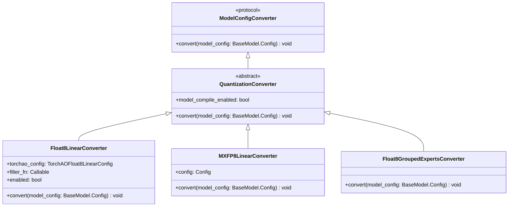
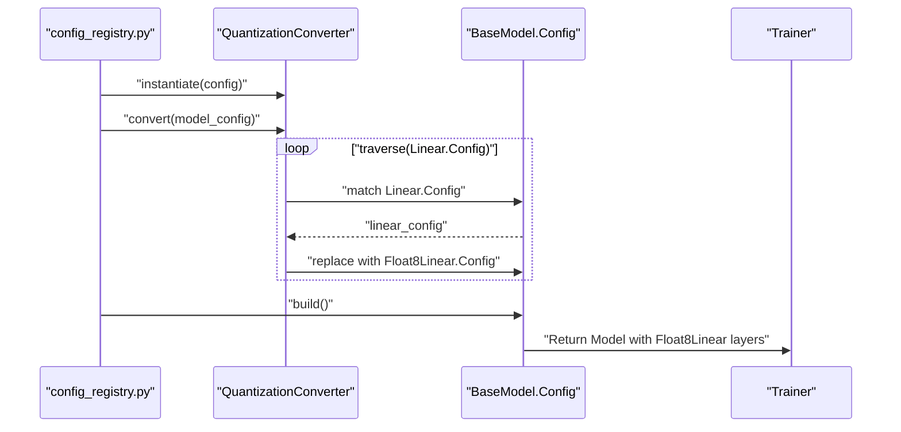

<!-- source: DeepWiki mcp.deepwiki.com · repo pytorch/torchtitan · page 13.3 Model Converters and Quantization · fetched 2026-10-30 -->

# Model Converters and Quantization

Relevant source files

The following files were used as context for generating this wiki page:

- [scripts/checkpoint_conversion/convert_from_hf.py](scripts/checkpoint_conversion/convert_from_hf.py)
- [scripts/checkpoint_conversion/convert_to_hf.py](scripts/checkpoint_conversion/convert_to_hf.py)
- [scripts/download_hf_assets.py](scripts/download_hf_assets.py)
- [tests/unit_tests/test_quantization.py](tests/unit_tests/test_quantization.py)
- [torchtitan/components/quantization/__init__.py](torchtitan/components/quantization/__init__.py)
- [torchtitan/components/quantization/float8.py](torchtitan/components/quantization/float8.py)
- [torchtitan/components/quantization/mx.py](torchtitan/components/quantization/mx.py)
- [torchtitan/protocols/__init__.py](torchtitan/protocols/__init__.py)
- [torchtitan/protocols/state_dict_adapter.py](torchtitan/protocols/state_dict_adapter.py)

## Purpose and Scope

This page documents TorchTitan's **ModelConverter** system, which provides a plugin architecture for applying transformations to models after construction but before training begins. The primary use case is **quantization** (Float8, MXFP8), but the system is extensible to any model transformation (pruning, knowledge distillation hooks, etc.).

The ModelConverter system enables users to implement custom quantization schemes or model transformations by writing a class that implements the `ModelConfigConverter` protocol. Unlike standard module transformations that act on initialized `nn.Module` objects, these converters operate on the **Model Config tree**, allowing for modification of the model's structure (e.g., swapping layer types) before parameters are materialized.

For information about model architecture and building, see [Model Selection and TrainSpec Protocol](#2.3). For parallelization strategies that interact with quantization (FSDP, TP), see [Parallelization Strategies](#4).

---

## ModelConverter Protocol and Architecture

The system utilizes a hierarchy of protocols and base classes to manage model transformations.

### Class Hierarchy and Protocols

**Sources:** [torchtitan/components/quantization/__init__.py:21-32](), [torchtitan/components/quantization/float8.py:53-166](), [torchtitan/components/quantization/mx.py:50-96]()

### Converter Lifecycle

ModelConverters are typically invoked during the model initialization phase. They traverse the configuration tree and swap out standard component configurations (like `Linear.Config`) for quantized variants (like `Float8Linear.Config`).

**Sources:** [torchtitan/components/quantization/float8.py:146-166](), [torchtitan/components/quantization/mx.py:79-96](), [tests/unit_tests/test_quantization.py:31-46]()

---

## QuantizationConverter Base Class

The `QuantizationConverter` class provides a common base for all quantization-related transformations. It ensures that the model's compilation state is known, as many quantization kernels (especially those in `torchao`) require `torch.compile` for optimal performance.

### Configuration

The base `QuantizationConverter.Config` includes:
- `model_compile_enabled`: A boolean indicating if `torch.compile` is active, which influences kernel selection and optimization warnings.

**Sources:** [torchtitan/components/quantization/__init__.py:21-32]()

---

## Float8 Quantization

TorchTitan supports Float8 quantization via `torchao`. It provides converters for both standard linear layers and Mixture of Experts (MoE) grouped experts.

### Float8LinearConverter

The `Float8LinearConverter` replaces `Linear.Config` with `Float8Linear.Config`. At build time, this results in `Float8Linear` modules which inherit from `TorchAOFloat8Linear`.

#### Key Features
- **Recipes**: Supports `rowwise` and `rowwise_with_gw_hp` recipes via `TorchAOFloat8LinearConfig`.
- **Filtering**: Supports manual FQN filtering and `_auto_filter_for_recipe` to skip small layers that don't benefit from Float8.
- **Emulation**: Can run on non-SM89 hardware if `emulate=True` is set (eager mode only).

**Sources:** [torchtitan/components/quantization/float8.py:53-144](), [torchtitan/components/quantization/float8.py:27-48]()

### Float8 MoE Support

The `Float8GroupedExpertsConverter` targets MoE architectures. It uses a dynamic subclassing mechanism (`_get_float8_grouped_experts_cls`) to wrap existing `GroupedExperts` implementations with Float8 quantization logic while preserving their original configuration fields (like `swiglu_limit` in GPT-OSS).

**Sources:** [torchtitan/components/quantization/float8.py:171-215](), [tests/unit_tests/test_quantization.py:48-67]()

---

## MXFP8 Quantization

MXFP8 (Microscaling Float8) is supported for SM100 (Blackwell) and later architectures.

### MXFP8LinearConverter
Similar to the Float8 variant, it replaces `Linear.Config` with `MXFP8Linear.Config`. It requires `torch.compile` for dynamic quantization performance.

**Sources:** [torchtitan/components/quantization/mx.py:50-96]()

### MXFP8 Grouped Experts
The `MXFP8GroupedExpertsConverter` applies MXFP8 dynamic quantization to MoE grouped GEMMs.
- **Padding**: Includes `pad_multiple` (default 32) to align per-expert token groups for MXFP8 kernel requirements.
- **Rounding**: Supports `mxfp8_rceil` rounding mode for scale factor computation.

**Sources:** [torchtitan/components/quantization/mx.py:139-188]()

---

## State Dict Adaptation

Quantized models often require specialized state dict handling for checkpoint interoperability (e.g., converting between native and HuggingFace formats).

### BaseStateDictAdapter
The `BaseStateDictAdapter` protocol defines the interface for these transformations:
- `to_hf()`: Converts native state dict to HF format.
- `from_hf()`: Converts HF format back to native.
- `get_hf_storage_reader()`: Provides a reader for loading HF checkpoints.

**Sources:** [torchtitan/protocols/state_dict_adapter.py:20-80]()

### QKV Fusion/Splitting
The `StateDictAdapter` provides utility methods `fused_to_separate_qkv` and `separate_to_fused_qkv` to handle the transformation between fused layouts (often used in optimized training) and separate Q, K, V tensors (common in HF).

**Sources:** [torchtitan/protocols/state_dict_adapter.py:136-173]()

---

## Performance and Hardware Requirements

| Feature | Requirement | Notes |
| :--- | :--- | :--- |
| **Float8** | SM89+ (H100) | `torchao` required; `torch.compile` recommended. |
| **MXFP8** | SM100+ (Blackwell) | Requires `torch.compile` for performance. |
| **Emulation** | `float8.emulate=True` | For testing on older hardware; incompatible with `torch.compile`. |

**Sources:** [torchtitan/components/quantization/float8.py:85-92](), [torchtitan/components/quantization/mx.py:70-78](), [torchtitan/components/quantization/__init__.py:13-15]()

---

## Implementing a Custom ModelConverter

To implement a new quantization or transformation scheme:

1.  **Define a Config Class**: Inherit from `QuantizationConverter.Config` or `ModelConfigConverter.Config`.
2.  **Implement `convert(model_config)`**:
    *   Use `model_config.traverse(TargetConfig)` to find components to transform.
    *   Replace `TargetConfig` instances with your custom configuration classes.
3.  **Implement the Module**: Ensure the module built by your new config implements the `Module` protocol (e.g., `init_states`).
4.  **Register**: Add the converter to the `model_registry` in the relevant model's `config_registry.py`.

**Sources:** [torchtitan/components/quantization/float8.py:146-166](), [torchtitan/components/quantization/mx.py:79-96](), [torchtitan/protocols/module.py:11-17]()

---

