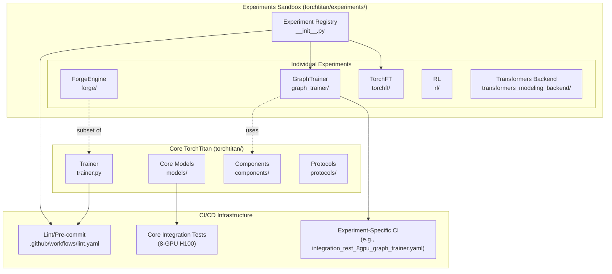
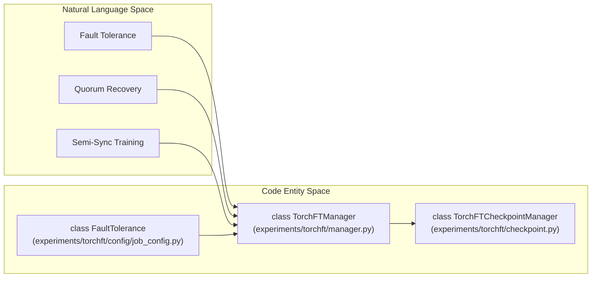
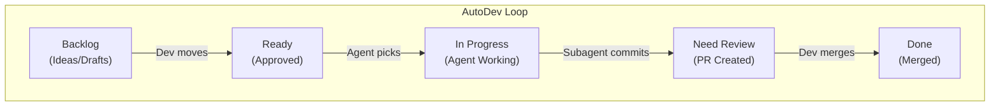

<!-- source: DeepWiki mcp.deepwiki.com · repo pytorch/torchtitan · page 13.4 Experiments Framework and Contributing · fetched 2026-10-30 -->

# Experiments Framework and Contributing

Relevant source files

The following files were used as context for generating this wiki page:

- [.github/CODEOWNERS](.github/CODEOWNERS)
- [tests/README.md](tests/README.md)
- [torchtitan/__init__.py](torchtitan/__init__.py)
- [torchtitan/experiments/README.md](torchtitan/experiments/README.md)
- [torchtitan/experiments/__init__.py](torchtitan/experiments/__init__.py)
- [torchtitan/experiments/graph_trainer/.claude/autodev.md](torchtitan/experiments/graph_trainer/.claude/autodev.md)
- [torchtitan/experiments/graph_trainer/.claude/nightly_scout.md](torchtitan/experiments/graph_trainer/.claude/nightly_scout.md)
- [torchtitan/experiments/torchft/README.md](torchtitan/experiments/torchft/README.md)
- [torchtitan/experiments/torchft/__init__.py](torchtitan/experiments/torchft/__init__.py)
- [torchtitan/experiments/torchft/checkpoint.py](torchtitan/experiments/torchft/checkpoint.py)
- [torchtitan/experiments/torchft/config/__init__.py](torchtitan/experiments/torchft/config/__init__.py)
- [torchtitan/models/__init__.py](torchtitan/models/__init__.py)

## Purpose and Scope

The `experiments/` framework in `torchtitan` serves as a dedicated sandbox for accelerating contributions and innovations without compromising the stability of the `core` codebase. It allows developers to prototype new model architectures, alternative training infrastructures, and advanced parallelization strategies with a faster iteration cycle and flexible dependency rules.

**Sources:** [torchtitan/experiments/README.md:1-5]()

## Experiments Folder Architecture

The `experiments/` directory is structured to maintain strict one-way dependency: experimental code can depend on `core`, but `core` must remain functional even if `experiments/` is removed or broken.

### Structural Overview

### Key Implementation Details
- **Isolation**: Development in `core` is not blocked by breakage in `experiments`. [torchtitan/experiments/README.md:14-14]()
- **Registry**: Supported experiments are tracked in a `frozenset` named `_supported_experiments` within the `experiments` module. [torchtitan/experiments/__init__.py:7-18]()
- **Ownership**: Each experiment must have a designated owner responsible for maintaining quality and adapting to `core` changes. [torchtitan/experiments/README.md:15-17]()
- **Code Ownership**: The `CODEOWNERS` file explicitly excludes the base experiments directory and assigns specific reviewers to individual sub-folders. [.github/CODEOWNERS:9-15]()

**Sources:** [torchtitan/experiments/README.md:5-17](), [torchtitan/experiments/__init__.py:7-19](), [.github/CODEOWNERS:9-15]()

## Contributing Guidelines

### Principles of Experimentation
1. **Reuse**: Experiments must reuse existing `components/` and `protocols/` (like `ModelSpec`) as much as possible to avoid code duplication. [torchtitan/experiments/README.md:10-12]()
2. **Justification**: Contributors must provide documentation showcasing motivation, performance reports, and loss convergence. [torchtitan/experiments/README.md:9-9]()
3. **Dependencies**: Experiments can have their own dependencies beyond `requirements.txt`, but must not contain vendor-specific proprietary code (e.g., kernels in proprietary languages). [torchtitan/experiments/README.md:13-13]()
4. **Lifecycle**: Experiments may be removed if they become stale (not maintained) or if their features are successfully upstreamed to `core` or PyTorch. [torchtitan/experiments/README.md:18-20]()

### Testing and QA
- **CI Triggers**: Experiments utilize GitHub's path-based CI to run tests only when the experiment folder itself is modified. [torchtitan/experiments/README.md:14-14]()
- **Hardware Coverage**: Major experiments like `graph_trainer` and `rl` are tested across multiple hardware tiers, including H100 8-GPU clusters. [torchtitan/experiments/README.md:27-30]()
- **Integration Test Suite**: Experiments are integrated into the main `run_tests.py` framework, allowing users to specify experimental modules via the `--module` argument. [tests/README.md:33-41]()

**Sources:** [torchtitan/experiments/README.md:9-20](), [torchtitan/experiments/README.md:27-30](), [tests/README.md:33-41]()

## Current Experiment Registry

The following table summarizes the active experiments as of the current release:

| Experiment | Path | Purpose | Key Symbols |
| :--- | :--- | :--- | :--- |
| **GraphTrainer** | `graph_trainer/` | Joint graph compilation, AOT/JIT modes, and specialized sharding. | `GraphTrainer`, `simple_fsdp` |
| **TorchFT** | `torchft/` | Fault-tolerant training with quorum-based recovery and semi-sync DiLoCo. | `TorchFTManager`, `TorchFTCheckpointManager` |
| **RL** | `rl/` | Reinforcement Learning (GRPO) with vLLM integration and rollout management. | `PolicyTrainer`, `VLLMGenerator` |
| **Transformers Backend** | `transformers_modeling_backend/` | Support for HuggingFace Transformers models with 4D parallelism. | `transformers_modeling_backend` |
| **ForgeEngine** | `forge/` | Lightweight, stripped-down alternative for custom training loops. | `ForgeEngine` |
| **AutoParallel** | `autoparallel/` | Cost-based automatic parallelism strategy selection. | `autoparallel.llama3` |

**Sources:** [torchtitan/experiments/README.md:25-31](), [torchtitan/experiments/__init__.py:7-18]()

## Implementation Example: TorchFT (Fault Tolerance)

The `torchft` experiment demonstrates how to extend core functionality (Checkpointing and Trainer) to support multi-replica fault tolerance.

### TorchFT Architecture
- **Manager Integration**: `TorchFTManager` handles the lifecycle of replica groups and communication with the `torchft_lighthouse` service. [torchtitan/experiments/torchft/manager.py:7-11]()
- **State Transfer**: `TorchFTCheckpointManager` implements in-memory state transfer between replicas using `ft_manager.set_state_dict_fns`. [torchtitan/experiments/torchft/checkpoint.py:129-130]()
- **Participating Ranks**: The manager identifies which replica is the "primary" (rank 0) to gate global operations like persistent checkpoint saving. [torchtitan/experiments/torchft/checkpoint.py:150-154]()

**Sources:** [torchtitan/experiments/torchft/README.md:1-55](), [torchtitan/experiments/torchft/checkpoint.py:44-162](), [torchtitan/experiments/torchft/manager.py:7-11]()

## Iteration Workflow (GraphTrainer Example)

The `graph_trainer` experiment utilizes a structured "AutoDev" workflow to manage contributions via GitHub Projects.

### Key Workflow Rules
- **Nightly Scout**: A nightly process (`nightly_scout.md`) scans for upstream `core` changes and unblocked TODOs to create new Backlog items. [torchtitan/experiments/graph_trainer/.claude/nightly_scout.md:1-5]()
- **Branching Policy**: Agents must always branch from `main` to avoid carrying unrelated changes from other experimental sessions. [torchtitan/experiments/graph_trainer/.claude/autodev.md:113-117]()
- **Self-Review**: Agents are required to perform a full diff review and verify test coverage before moving items to "Need Review". [torchtitan/experiments/graph_trainer/.claude/autodev.md:130-133]()

**Sources:** [torchtitan/experiments/graph_trainer/.claude/autodev.md:36-150](), [torchtitan/experiments/graph_trainer/.claude/nightly_scout.md:1-49]()

---

