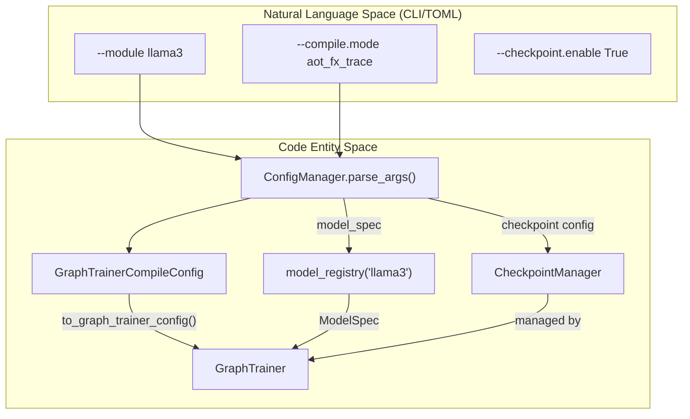
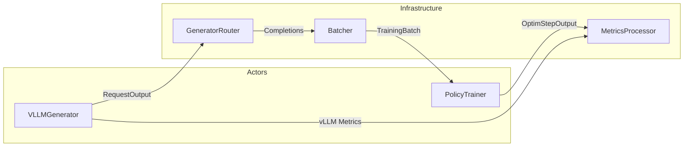

<!-- source: DeepWiki mcp.deepwiki.com · repo pytorch/torchtitan · page 14 Glossary · fetched 2026-10-30 -->

# Glossary

Relevant source files

The following files were used as context for generating this wiki page:

- [CONTRIBUTING.md](CONTRIBUTING.md)
- [README.md](README.md)
- [docs/checkpoint.md](docs/checkpoint.md)
- [docs/composability.md](docs/composability.md)
- [docs/extension.md](docs/extension.md)
- [tests/unit_tests/test_checkpoint.py](tests/unit_tests/test_checkpoint.py)
- [tests/unit_tests/test_parallel_dims.py](tests/unit_tests/test_parallel_dims.py)
- [tests/unit_tests/test_set_determinism.py](tests/unit_tests/test_set_determinism.py)
- [torchtitan/components/checkpoint.py](torchtitan/components/checkpoint.py)
- [torchtitan/components/dataloader.py](torchtitan/components/dataloader.py)
- [torchtitan/components/lora.py](torchtitan/components/lora.py)
- [torchtitan/components/metrics.py](torchtitan/components/metrics.py)
- [torchtitan/distributed/full_dtensor.py](torchtitan/distributed/full_dtensor.py)
- [torchtitan/distributed/parallel_dims.py](torchtitan/distributed/parallel_dims.py)
- [torchtitan/distributed/spmd_types.py](torchtitan/distributed/spmd_types.py)
- [torchtitan/distributed/utils.py](torchtitan/distributed/utils.py)
- [torchtitan/experiments/graph_trainer/configs.py](torchtitan/experiments/graph_trainer/configs.py)
- [torchtitan/experiments/graph_trainer/passes.py](torchtitan/experiments/graph_trainer/passes.py)
- [torchtitan/experiments/graph_trainer/tests/_trainer_test_utils.py](torchtitan/experiments/graph_trainer/tests/_trainer_test_utils.py)
- [torchtitan/experiments/graph_trainer/tests/test_bitwise_deterministic.py](torchtitan/experiments/graph_trainer/tests/test_bitwise_deterministic.py)
- [torchtitan/experiments/rl/actors/generator.py](torchtitan/experiments/rl/actors/generator.py)
- [torchtitan/experiments/rl/actors/trainer.py](torchtitan/experiments/rl/actors/trainer.py)
- [torchtitan/experiments/rl/config_registry.py](torchtitan/experiments/rl/config_registry.py)
- [torchtitan/experiments/rl/tests/test_bitwise_parity.py](torchtitan/experiments/rl/tests/test_bitwise_parity.py)
- [torchtitan/models/common/moe.py](torchtitan/models/common/moe.py)
- [torchtitan/models/common/token_dispatcher.py](torchtitan/models/common/token_dispatcher.py)
- [torchtitan/models/gpt_oss/moe.py](torchtitan/models/gpt_oss/moe.py)
- [torchtitan/tools/utils.py](torchtitan/tools/utils.py)
- [torchtitan/train.py](torchtitan/train.py)

This page provides definitions for codebase-specific terms, jargon, and domain concepts used throughout the `torchtitan` project. It serves as a reference for onboarding engineers to understand the implementation details and data flow of the platform's core components.

## Core Training Entities

### Trainer
The central class that orchestrates the training lifecycle, including model initialization, distributed setup, and the execution of the training loop [torchtitan/train.py:14-14](). It is built using the `ConfigManager` and encapsulates the `CheckpointManager`, `OptimizersContainer`, and `LRSchedulersContainer` [torchtitan/train.py:28-51]().

### ConfigManager
The utility responsible for parsing configuration from TOML files, CLI arguments, and environment variables [torchtitan/train.py:28-29](). It produces a configuration object which is used to build the `Trainer` instance [torchtitan/train.py:51-51]().

### ModelSpec
A protocol that defines how a model is registered, built, and parallelized within the framework [torchtitan/experiments/rl/actors/generator.py:38-38](). It allows the trainer to remain model-agnostic by delegating architecture-specific logic to the model's own definition and parallelization scripts [README.md:89-93]().

### ParallelDims
A helper class used to manage the dimensions of the `DeviceMesh` [torchtitan/distributed/utils.py:32-32](). It tracks degrees for Data Parallel (sharded and replicated), Tensor Parallel, Pipeline Parallel, Context Parallel, and Expert Parallel [torchtitan/distributed/utils.py:124-129]().

---

## Distributed Training Jargon

### DeviceMesh
A PyTorch abstraction used to represent the layout of accelerators (GPUs/CPUs). `torchtitan` uses nested meshes to compose different parallelism strategies (e.g., a 2D mesh for DP and TP) [torchtitan/distributed/utils.py:24-24]().

### FSDP2 (Fully Sharded Data Parallel)
The second-generation implementation of FSDP in PyTorch, which provides per-parameter sharding and improved integration with `torch.compile` [README.md:57-57](). In `graph_trainer`, it involves specific bucketing and reordering passes [torchtitan/experiments/graph_trainer/passes.py:44-48]().

### DTensor (Distributed Tensor)
The underlying tensor type used for SPMD (Single Program, Multiple Data) parallelisms like Tensor Parallel. `torchtitan` uses DTensor to manage sharding and synchronization across the `DeviceMesh` [torchtitan/distributed/utils.py:25-25]().

### Meta Device
A virtual device used to initialize large models without allocating actual GPU memory. This allows `torchtitan` to calculate memory requirements and apply sharding before materializing weights on the physical device [README.md:61-61](), [torchtitan/experiments/graph_trainer/tests/test_bitwise_deterministic.py:127-129]().

---

## Checkpointing & State Management

### DCP (Distributed Checkpoint)
The primary format used by `torchtitan` for saving and loading model states across distributed ranks. Unlike traditional `.pt` files, DCP handles sharded states efficiently and supports resharding [torchtitan/components/checkpoint.py:22-22]().

### Stateful
A protocol implemented by components (like `ModelWrapper` or `OptimizersContainer`) that need to save and load their state during checkpointing [torchtitan/components/checkpoint.py:33-33]().

### Async Checkpointing
A feature that allows the training loop to continue while the checkpoint is being written to storage in the background, minimizing "bubbles" in training throughput. Modes include `ASYNC` and `ASYNC_WITH_PINNED_MEM` [torchtitan/components/checkpoint.py:50-53]().

---

## System Architecture Diagrams

### From Configuration to Execution
The following diagram illustrates how natural language configuration flags translate into the instantiation of core code entities, specifically showing the flow for the `GraphTrainer` experimental path.

**Diagram: Config to Code Mapping**

**Sources:** [torchtitan/train.py:28-51](), [torchtitan/experiments/graph_trainer/configs.py:19-25](), [torchtitan/experiments/graph_trainer/configs.py:118-132]()

### RL Training Actor Orchestration
This diagram shows the relationship between the `RLTrainer`, its constituent actors, and the data flow between them during Reinforcement Learning experiments.

**Diagram: RL Actor Data Flow**

**Sources:** [torchtitan/experiments/rl/config_registry.py:75-130](), [torchtitan/experiments/rl/actors/generator.py:50-65](), [torchtitan/experiments/rl/actors/trainer.py:113-142]()

---

## Performance & Monitoring Terms

### MFU (Model Flops Utilization)
A metric representing the efficiency of the training process by comparing the actual throughput to the theoretical peak performance of the hardware [README.md:75-75](). Theoretical peaks are calculated based on device name [torchtitan/tools/utils.py:91-140]().

### GarbageCollection (Custom Class)
A utility used to synchronize Python's garbage collection across all distributed ranks to avoid "stragglers" (ranks that pause for GC at different times, causing others to wait) [torchtitan/tools/utils.py:51-80]().

### DeviceMemoryMonitor
A class that tracks peak memory usage (active and reserved) on the device, providing statistics in GiB and percentage of total capacity.

---

## Summary Table of Key Classes

| Class | File Path | Role |
| :--- | :--- | :--- |
| `Trainer` | [torchtitan/train.py:14]() | Main training loop coordinator. |
| `GraphTrainer` | [torchtitan/experiments/graph_trainer/trainer.py]() | Experimental trainer for graph-based execution. |
| `CheckpointManager` | [torchtitan/components/checkpoint.py:135]() | Handles saving/loading DCP and HF checkpoints. |
| `ModelWrapper` | [torchtitan/components/checkpoint.py:56]() | Wraps model parts for consistent `state_dict` access. |
| `ParallelDims` | [torchtitan/distributed/parallel_dims.py]() | Validates and stores parallelism degrees. |
| `GarbageCollection` | [torchtitan/tools/utils.py:51]() | Synchronizes GC across distributed ranks. |
| `PolicyTrainer` | [torchtitan/experiments/rl/actors/trainer.py:113]() | Updates RL policy models using TorchTitan components. |

**Sources:** [torchtitan/train.py:14-14](), [torchtitan/components/checkpoint.py:135-176](), [torchtitan/components/checkpoint.py:56-80](), [torchtitan/tools/utils.py:51-80](), [torchtitan/experiments/rl/actors/trainer.py:113-152]()