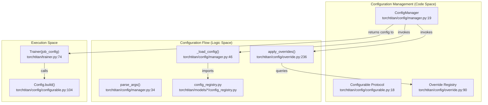

<!-- source: DeepWiki mcp.deepwiki.com · repo pytorch/torchtitan · page 2 Configuration System · fetched 2026-10-30 -->

# Configuration System

Relevant source files

The following files were used as context for generating this wiki page:

- [tests/unit_tests/test_config_manager.py](tests/unit_tests/test_config_manager.py)
- [tests/unit_tests/test_configurable.py](tests/unit_tests/test_configurable.py)
- [tests/unit_tests/test_override.py](tests/unit_tests/test_override.py)
- [torchtitan/config/OVERRIDE.md](torchtitan/config/OVERRIDE.md)
- [torchtitan/config/__init__.py](torchtitan/config/__init__.py)
- [torchtitan/config/configurable.py](torchtitan/config/configurable.py)
- [torchtitan/config/manager.py](torchtitan/config/manager.py)
- [torchtitan/config/override.py](torchtitan/config/override.py)
- [torchtitan/models/flux/flux_datasets.py](torchtitan/models/flux/flux_datasets.py)
- [torchtitan/models/flux/inference/sampling.py](torchtitan/models/flux/inference/sampling.py)
- [torchtitan/models/flux/tokenizer.py](torchtitan/models/flux/tokenizer.py)
- [torchtitan/models/flux/validate.py](torchtitan/models/flux/validate.py)
- [torchtitan/overrides/__init__.py](torchtitan/overrides/__init__.py)
- [torchtitan/protocols/model_spec.py](torchtitan/protocols/model_spec.py)

## Purpose and Scope

The Configuration System in TorchTitan provides a hierarchical, type-safe approach to configuring all aspects of distributed training. It centralizes configuration management through a structured system of nested sub-configurations, enabling users to specify training parameters via code-based registries and command-line arguments with clear precedence rules.

This document covers the high-level architecture of the configuration system, including the `ConfigManager`, the `Configurable` protocol, and the new `Override` mechanism. For information about the `ModelSpec` protocol and model-specific configuration, see [Model Selection and TrainSpec Protocol](#2.3). For details on the parameters within specific config sections, see [JobConfig Structure](#2.1).

## Configuration Architecture

TorchTitan's configuration system is built around three core components: `ConfigManager` for parsing and merging configuration sources, the `Configurable` protocol for component-level settings, and the `Override` mechanism for non-intrusive implementation swaps.

### Natural Language to Code Entity Mapping

The following diagram maps high-level configuration concepts to their corresponding classes and file locations within the codebase.

**Sources:** [torchtitan/config/manager.py:19-46](), [torchtitan/config/configurable.py:18-104](), [torchtitan/config/override.py:90-236](), [torchtitan/trainer.py:74-80]()

## Configurable Protocol

The `Configurable` class is the base for all components that require structured settings (e.g., tokenizers, dataloaders, optimizers). It enforces a pattern where every component defines a nested `Config` dataclass [torchtitan/config/configurable.py:18-41]().

Key features of the `Configurable` system:
- **Auto-wiring**: The `build()` method is automatically wired to construct the owning class via `__init_subclass__` [torchtitan/config/configurable.py:132-150]().
- **Type Safety**: Enforces the use of `@dataclass(kw_only=True, slots=True)` for all configuration definitions [torchtitan/config/configurable.py:137-142]().
- **Serialization**: Provides `to_dict()` for serializing complex nested configurations into plain dictionaries [torchtitan/config/configurable.py:46-73]().

For more details on the `Configurable` protocol and how it integrates with different components, see [Configuration Sources and Overrides](#2.2).

**Sources:** [torchtitan/config/configurable.py:18-151]()

## Configuration Sources and Precedence

TorchTitan utilizes a `config_registry` system where model-specific defaults are defined in code, rather than static YAML/TOML files.

### Precedence Rules
1. **CLI Arguments** (Highest priority): Arguments like `--training.batch_size 32` override registry values [torchtitan/config/manager.py:23-28]().
2. **Config Registry Defaults**: The specific configuration function selected via the `--config` flag [torchtitan/config/manager.py:136-150]().
3. **Dataclass Defaults** (Lowest priority): Values defined directly in the `Config` dataclass fields.

### Override Mechanism
TorchTitan includes an advanced `Override` mechanism that allows swapping any `Configurable` component (e.g., a standard RoPE with a Triton-based RoPE) without modifying the core codebase [torchtitan/config/override.py:7-12]().
- **Registration**: Uses the `@override` decorator to map a target `Config` class to a factory function [torchtitan/config/override.py:93-122]().
- **Targeting**: Supports fine-grained targeting via FQN (Fully Qualified Name) globs, allowing an override to apply only to specific layers or modules [torchtitan/config/override.py:106-110]().
- **Derivation**: The `derive()` utility helps create replacement configs by copying shared fields, ensuring version robustness [torchtitan/config/override.py:154-190]().

For detailed documentation on the override system and FQN patterns, see [Configuration Sources and Overrides](#2.2).

**Sources:** [torchtitan/config/manager.py:19-151](), [torchtitan/config/override.py:7-190](), [torchtitan/config/OVERRIDE.md:1-152]()

## Model-Specific Configuration

Configuration for specific models is organized within the `torchtitan/models/` directory. Each model family (e.g., Llama, Flux, DeepSeek) provides a `config_registry.py` that `ConfigManager` dynamically imports based on the `--module` flag [torchtitan/config/manager.py:103-133]().

### Example: Flux Configuration
The Flux model demonstrates the hierarchical nature of the system, involving:
- `FluxTokenizerContainer.Config` for tokenizer paths [torchtitan/models/flux/tokenizer.py:28-34]().
- `FluxValidator.Config` for validation steps and image saving parameters [torchtitan/models/flux/validate.py:49-68]().
- `FluxDataLoader.Config` for dataset selection [torchtitan/models/flux/validate.py:50-55]().

For more on how models are registered and selected, see [Model Selection and TrainSpec Protocol](#2.3).

**Sources:** [torchtitan/config/manager.py:103-133](), [torchtitan/models/flux/tokenizer.py:28-34](), [torchtitan/models/flux/validate.py:49-68]()

## Configuration Consumption

The finalized configuration object is consumed by the `Trainer` to orchestrate the training lifecycle.

| Consumer | Config Section / Protocol | Role |
|----------|---------------------------|------|
| **Trainer** | `JobConfig` | Root configuration container passed to `Trainer.__init__` [torchtitan/trainer.py:74](). |
| **Model Building** | `ModelSpec` | Bundles architecture config with parallelization functions [torchtitan/protocols/model_spec.py:33-47](). |
| **Data Pipeline** | `BaseDataLoader.Config` | Defines dataset loading and processing [torchtitan/models/flux/validate.py:50-55](). |
| **Validation** | `Validator.Config` | Controls validation frequency and metrics [torchtitan/models/flux/validate.py:49-68](). |

**Sources:** [torchtitan/trainer.py:74](), [torchtitan/protocols/model_spec.py:33-47](), [torchtitan/models/flux/validate.py:49-68]()

---

