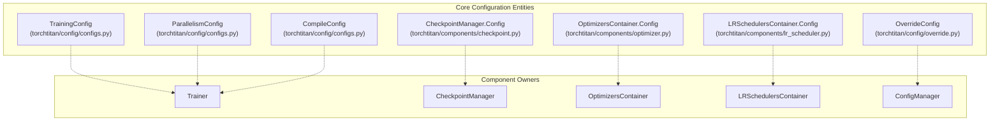
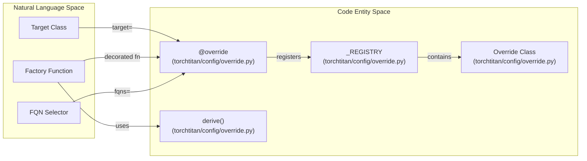
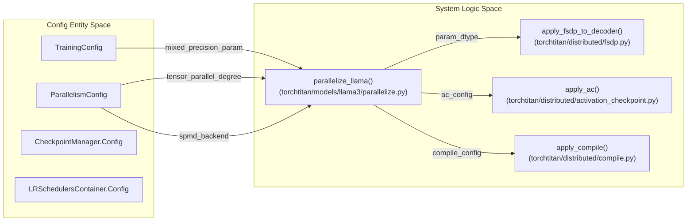

<!-- source: DeepWiki mcp.deepwiki.com · repo pytorch/torchtitan · page 2.1 JobConfig Structure · fetched 2026-10-30 -->

# JobConfig Structure

Relevant source files

The following files were used as context for generating this wiki page:

- [.github/scripts/run_8xgpu_integration_tests.sh](.github/scripts/run_8xgpu_integration_tests.sh)
- [tests/integration_tests/h100.py](tests/integration_tests/h100.py)
- [tests/unit_tests/test_override.py](tests/unit_tests/test_override.py)
- [torchtitan/config/OVERRIDE.md](torchtitan/config/OVERRIDE.md)
- [torchtitan/config/__init__.py](torchtitan/config/__init__.py)
- [torchtitan/config/configs.py](torchtitan/config/configs.py)
- [torchtitan/config/override.py](torchtitan/config/override.py)
- [torchtitan/experiments/transformers_modeling_backend/parallelize.py](torchtitan/experiments/transformers_modeling_backend/parallelize.py)
- [torchtitan/models/deepseek_v3/parallelize.py](torchtitan/models/deepseek_v3/parallelize.py)
- [torchtitan/models/gpt_oss/parallelize.py](torchtitan/models/gpt_oss/parallelize.py)
- [torchtitan/models/llama3/parallelize.py](torchtitan/models/llama3/parallelize.py)
- [torchtitan/models/qwen3/parallelize.py](torchtitan/models/qwen3/parallelize.py)
- [torchtitan/overrides/__init__.py](torchtitan/overrides/__init__.py)
- [torchtitan/protocols/model_spec.py](torchtitan/protocols/model_spec.py)

## Purpose and Scope

This document describes the `JobConfig` dataclass hierarchy, which serves as the central configuration container for all torchtitan training jobs. The `JobConfig` aggregates multiple subsystem-specific configuration dataclasses that control every aspect of training execution: model selection, parallelization strategies, optimization parameters, checkpointing policies, and more.

This page focuses on the **structure and fields** of the configuration system. torchtitan utilizes a hierarchical configuration pattern where base components inherit from `Configurable` and define a nested `Config` dataclass.

**Sources:** [torchtitan/config/configurable.py:17-44](), [torchtitan/config/configs.py:22-167]()

---

## JobConfig Hierarchy Overview

The configuration system is built upon the `Configurable` base class. Every configurable component in torchtitan defines a nested `Config` dataclass using `@dataclass(kw_only=True, slots=True)`. This enforcement ensures that configuration fields are strictly managed and serializable.

### The Configurable Protocol

The `Configurable` class [torchtitan/config/configurable.py:17-44]() provides the infrastructure for building components from configurations.

| Method | Description |
|--------|-------------|
| `Config.to_dict()` | Serializes the configuration to a dictionary, safely handling unset `field(init=False)` slots. [torchtitan/config/configurable.py:79-108]() |
| `Config.build(**kwargs)` | Constructs the owning class. It auto-detects if arguments should be absorbed into the config or forwarded to `__init__`. [torchtitan/config/configurable.py:134-184]() |

**Sources:** [torchtitan/config/configurable.py:46-132]()

### Top-Level Configuration Structure

**Sources:** [torchtitan/config/configs.py:7-20](), [torchtitan/config/override.py:46-60](), [torchtitan/config/manager.py:25-26]()

---

## Training and Parallelism Configurations

### TrainingConfig

The `TrainingConfig` [torchtitan/config/configs.py:27-81]() manages dataset-level parameters and hardware-specific training settings.

| Field | Type | Default | Description |
|-------|------|---------|-------------|
| `local_batch_size` | `int` | `8` | Per-device batch size. [torchtitan/config/configs.py:29-29]() |
| `global_batch_size` | `int` | `-1` | Defaults to `local_batch_size * DP degree`. [torchtitan/config/configs.py:32-35]() |
| `seq_len` | `int` | `2048` | Sequence length for training. [torchtitan/config/configs.py:37-38]() |
| `dtype` | `Literal` | `"float32"` | Full training dtype (parameters, grads, and optimizer states). [torchtitan/config/configs.py:51-56]() |
| `mixed_precision_param` | `Literal` | `"bfloat16"` | Parameter dtype for FSDP/autocast mixed precision. [torchtitan/config/configs.py:58-64]() |
| `gc_freq` | `int` | `50` | Python garbage collection interval in steps. [torchtitan/config/configs.py:72-73]() |

**Sources:** [torchtitan/config/configs.py:27-81]()

### ParallelismConfig

The `ParallelismConfig` [torchtitan/config/configs.py:84-167]() defines the multi-dimensional parallelism strategy.

| Field | Type | Default | Description |
|-------|------|---------|-------------|
| `data_parallel_replicate_degree` | `int` | `1` | Degree for weight replication (DDP/HSDP). [torchtitan/config/configs.py:86-95]() |
| `data_parallel_shard_degree` | `int` | `-1` | Degree for weight sharding (FSDP/HSDP). `-1` uses leftover ranks. [torchtitan/config/configs.py:97-107]() |
| `tensor_parallel_degree` | `int` | `1` | TP degree for intra-layer parallelism. [torchtitan/config/configs.py:130-131]() |
| `pipeline_parallel_degree` | `int` | `1` | Number of physical ranks for PP. [torchtitan/config/configs.py:151-156]() |
| `enable_sequence_parallel` | `bool` | `True` | Use SequenceParallel as part of TP. [torchtitan/config/configs.py:139-140]() |
| `spmd_backend` | `Literal` | `"default"` | Backend selector: `"default"`, `"full_dtensor"`, or `"spmd_types"`. [torchtitan/config/configs.py:142-149]() |

**Sources:** [torchtitan/config/configs.py:84-167]()

---

## Performance and Debugging

### CompileConfig
Controls the `torch.compile` integration.

| Field | Type | Default | Description |
|-------|------|---------|-------------|
| `enable` | `bool` | `False` | Global toggle for compilation. |
| `components` | `str` | `"model"` | Comma-separated list of components to compile (e.g., `"model,loss"`). |

**Sources:** [torchtitan/config/configs.py:11-11](), [torchtitan/models/llama3/parallelize.py:66-68]()

### DebugConfig
Configuration for debugging and profiling tools.

| Field | Type | Default | Description |
|-------|------|---------|-------------|
| `enable_profiler` | `bool` | `False` | Whether to enable the PyTorch Profiler. |
| `memory_snapshot` | `bool` | `False` | Whether to capture memory snapshots. |

**Sources:** [torchtitan/config/__init__.py:19-19]()

---

## The Override Mechanism

torchtitan includes a powerful `OverrideConfig` system that allows swapping any `Configurable` component (like model layers or kernels) without modifying the core repository.

### OverrideConfig
| Field | Type | Default | Description |
|-------|------|---------|-------------|
| `imports` | `list[str]` | `[]` | List of Python module paths to import for override registration. [torchtitan/config/override.py:48-59]() |

### Code Entity Association: Override Logic
The following diagram maps the override registration entities to their runtime behavior.

**Sources:** [torchtitan/config/override.py:63-151](), [torchtitan/config/override.py:154-190]()

---

## Configuration Mapping: Code to Logic

This diagram associates configuration symbols with the logical components they initialize within the training engine.

**Sources:** [torchtitan/models/llama3/parallelize.py:27-104](), [torchtitan/models/gpt_oss/parallelize.py:27-106](), [torchtitan/models/deepseek_v3/parallelize.py:28-111]()

---

