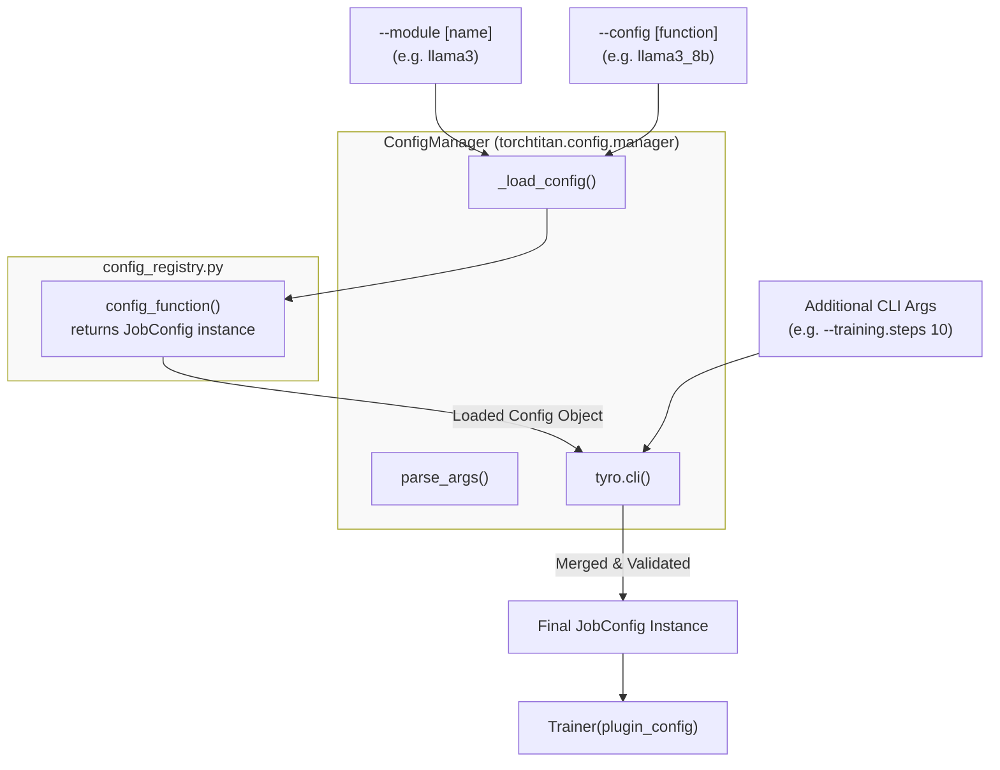

<!-- source: DeepWiki mcp.deepwiki.com · repo pytorch/torchtitan · page 2.2 Configuration Sources and Overrides · fetched 2026-10-30 -->

# Configuration Sources and Overrides

<details>
<summary>Relevant source files</summary>

The following files were used as context for generating this wiki page:

- [tests/unit_tests/test_config_manager.py](tests/unit_tests/test_config_manager.py)
- [tests/unit_tests/test_configurable.py](tests/unit_tests/test_configurable.py)
- [torchtitan/config/configurable.py](torchtitan/config/configurable.py)
- [torchtitan/config/manager.py](torchtitan/config/manager.py)
- [torchtitan/models/flux/flux_datasets.py](torchtitan/models/flux/flux_datasets.py)
- [torchtitan/models/flux/inference/sampling.py](torchtitan/models/flux/inference/sampling.py)
- [torchtitan/models/flux/tokenizer.py](torchtitan/models/flux/tokenizer.py)
- [torchtitan/models/flux/validate.py](torchtitan/models/flux/validate.py)

</details>


## Purpose and Scope

This page documents how TorchTitan's configuration system loads, merges, and applies configuration values. It covers the `ConfigManager` implementation, the precedence rules for configuration overrides, the `Configurable` protocol, and the syntax for CLI arguments. TorchTitan uses a dynamic configuration system where configuration is driven by a `module` (model or experiment) and a specific `config` function defined in a `config_registry.py`.

For information about the structure and parameters of the base `JobConfig`, see [JobConfig Structure (2.1)](). For information about selecting models and the `ModelSpec` protocol, see [Model Selection and TrainSpec Protocol (2.3)]().

---

## Configuration Architecture

TorchTitan uses a hierarchical configuration system. Unlike static TOML-only systems, it dynamically loads a base configuration object from a Python module and then applies CLI overrides.

### Configuration Precedence

| Priority | Source | Mechanism | Use Case |
|----------|--------|-----------|----------|
| 1 (Highest) | CLI Arguments | `tyro.cli` overrides | Runtime overrides (e.g., `--training.steps 50`) |
| 2 (Lowest) | `config_registry` | Python function defaults | Base templates (e.g., `llama3_debugmodel`) |

### Data Flow Overview



**Sources:** [torchtitan/config/manager.py:19-45](), [torchtitan/config/manager.py:46-151]()

---

## The Configurable Protocol

Most major components in TorchTitan (tokenizers, dataloaders, models) implement the `Configurable` protocol. This provides a unified way to instantiate objects from their configuration dataclasses.

### Implementation Details
*   **Nested Config Class**: Every `Configurable` class defines a nested `Config` class inheriting from `Configurable.Config` [torchtitan/config/configurable.py:40-41]().
*   **Automatic Registration**: Using `__init_subclass__`, the `Config` class is automatically linked to its "owner" class [torchtitan/config/configurable.py:132-151]().
*   **The `build()` Method**: The `Config.build()` method instantiates the owner class. It supports two modes:
    1.  **Direct**: `cfg.build()` clones the config and passes it to the owner's `__init__` [torchtitan/config/configurable.py:120-121]().
    2.  **With Runtime Kwargs**: `cfg.build(dim=64)` forwards additional runtime objects (like device or process groups) to the constructor [torchtitan/config/configurable.py:130]().

### Component Configuration Example: Flux
The `FluxTokenizerContainer` demonstrates this protocol by nesting its `Config` and using it to initialize internal T5 and CLIP tokenizers [torchtitan/models/flux/tokenizer.py:19-49]().

```mermaid
classDiagram
    class Configurable {
        <<Interface>>
        +__init_subclass__(cls)
    }
    class Config {
        +_owner: ClassVar
        +build(**kwargs) Object
        +to_dict() dict
        +traverse(config_cls) Iterator
    }
    class FluxTokenizerContainer {
        +__init__(config)
    }
    class FluxTokenizerConfig {
        +t5_tokenizer_path: str
        +clip_tokenizer_path: str
    }
    Configurable <|-- FluxTokenizerContainer
    Config <|-- FluxTokenizerConfig
    FluxTokenizerContainer +-- FluxTokenizerConfig : nested
```

**Sources:** [torchtitan/config/configurable.py:18-38](), [torchtitan/config/configurable.py:104-131](), [torchtitan/models/flux/tokenizer.py:19-36]()

---

## The ConfigManager

The `ConfigManager` class is the central entity responsible for resolving the final configuration state. It utilizes `tyro` for robust CLI parsing and type enforcement.

### Key Functions

*   **`__init__`**: Registers custom `tyro` rules for specific types like `torch.device` or `torch.dtype` [torchtitan/config/manager.py:31-32]().
*   **`_load_config(args)`**: 
    1.  Extracts `--module` and `--config` from the argument list [torchtitan/config/manager.py:52-81]().
    2.  Locates the corresponding `config_registry.py` within `torchtitan.models` or `torchtitan.experiments` [torchtitan/config/manager.py:103-133]().
    3.  Calls the specified configuration function to get the base `JobConfig` object [torchtitan/config/manager.py:136-151]().
*   **`parse_args(args)`**: Takes the base object from `_load_config` and uses `tyro.cli` to apply any remaining command-line overrides [torchtitan/config/manager.py:34-44]().

**Sources:** [torchtitan/config/manager.py:19-45](), [torchtitan/config/manager.py:46-151]()

---

## Configuration Sources

### The Config Registry (`--module` and `--config`)

Every model family (e.g., Llama, DeepSeek) or experiment includes a `config_registry.py`. This file contains functions that return a pre-configured `JobConfig` (or a subclass).

**Example Usage:**
```bash
# Selects torchtitan/models/llama3/config_registry.py -> llama3_debugmodel()
./run_train.sh --module llama3 --config llama3_debugmodel
```

**Sources:** [torchtitan/config/manager.py:26-29](), [tests/unit_tests/test_config_manager.py:15-24]()

### Command-Line Overrides

CLI arguments provide the highest-priority overrides and use dot notation to access nested configuration fields. `tyro` ensures that these overrides match the types defined in the dataclasses.

**Syntax:**
```bash
# Overriding nested fields
--training.steps 5000
--parallelism.tensor_parallel_degree 8

# Overriding list fields (comma-separated)
--checkpoint.exclude_from_loading "optimizer,lr_scheduler"
```

**Boolean Flag Handling:**
`tyro` handles booleans as flags. To set a value to `False`, use the `--no-` prefix.
```bash
--checkpoint.enable      # Sets to True
--checkpoint.no-enable   # Sets to False
```

**Sources:** [torchtitan/config/manager.py:28-29](), [tests/unit_tests/test_config_manager.py:64-78](), [tests/unit_tests/test_config_manager.py:102-124]()

### Environment Variables

While `ConfigManager` primarily handles CLI args, the `run_train.sh` script (or equivalent launch scripts) often maps environment variables to the required CLI flags for convenience.

| Env Var | CLI Mapping |
|---------|-------------|
| `MODULE` | `--module` |
| `CONFIG` | `--config` |

**Sources:** [torchtitan/config/manager.py:26-29](), [tests/unit_tests/test_config_manager.py:15-24]()

---

## Configuration Merging and Validation

### Deprecated Merging
The `ConfigManager._merge_configs` static method is currently deprecated in favor of using `JobConfig` subclasses within the `config_registry` system [torchtitan/config/manager.py:154-163]().

### Validation Logic
After parsing, `_validate_config()` is called to perform sanity checks. For example, it validates the existence of paths for components like the tokenizer [torchtitan/config/manager.py:42](), [torchtitan/config/manager.py:193-196]().

---

## Summary of Precedence Rules

The following table demonstrates how values are resolved if defined in multiple places:

| Field | Registry Default | CLI Override | Final Value |
|-------|------------------|--------------|-------------|
| `training.steps` | `10` | `--training.steps 100` | `100` |
| `checkpoint.enable` | `False` | `--checkpoint.enable` | `True` |
| `parallelism.tp` | `1` | (None) | `1` |
| `dump_folder` | `"./outputs"` | `--dump_folder "/tmp"` | `"/tmp"` |

**Sources:** [torchtitan/config/manager.py:23-24](), [tests/unit_tests/test_config_manager.py:64-92]()

---

