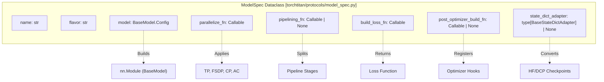
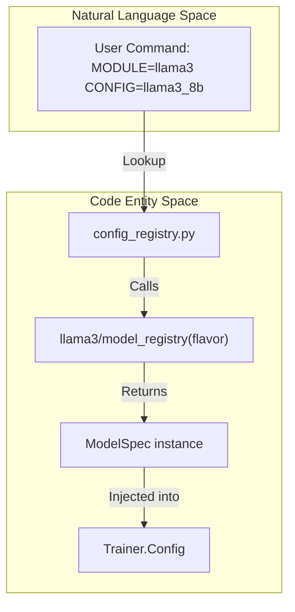
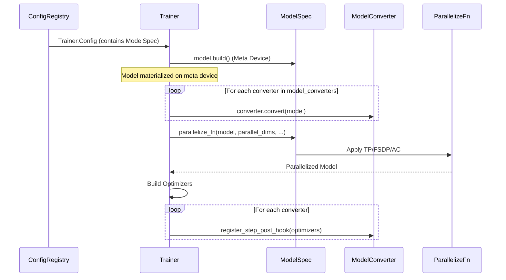

<!-- source: DeepWiki mcp.deepwiki.com · repo pytorch/torchtitan · page 2.3 Model Selection and TrainSpec Protocol · fetched 2026-10-30 -->

# Model Selection and TrainSpec Protocol

Relevant source files

The following files were used as context for generating this wiki page:

- [tests/integration_tests/features.py](tests/integration_tests/features.py)
- [tests/integration_tests/models.py](tests/integration_tests/models.py)
- [tests/unit_tests/test_override.py](tests/unit_tests/test_override.py)
- [torchtitan/config/OVERRIDE.md](torchtitan/config/OVERRIDE.md)
- [torchtitan/config/__init__.py](torchtitan/config/__init__.py)
- [torchtitan/config/override.py](torchtitan/config/override.py)
- [torchtitan/experiments/graph_trainer/deepseek_v3/config_registry.py](torchtitan/experiments/graph_trainer/deepseek_v3/config_registry.py)
- [torchtitan/experiments/transformers_modeling_backend/config_registry.py](torchtitan/experiments/transformers_modeling_backend/config_registry.py)
- [torchtitan/models/common/config_utils.py](torchtitan/models/common/config_utils.py)
- [torchtitan/models/deepseek_v3/__init__.py](torchtitan/models/deepseek_v3/__init__.py)
- [torchtitan/models/deepseek_v3/config_registry.py](torchtitan/models/deepseek_v3/config_registry.py)
- [torchtitan/models/gpt_oss/__init__.py](torchtitan/models/gpt_oss/__init__.py)
- [torchtitan/models/gpt_oss/config_registry.py](torchtitan/models/gpt_oss/config_registry.py)
- [torchtitan/models/llama3/__init__.py](torchtitan/models/llama3/__init__.py)
- [torchtitan/models/llama3/config_registry.py](torchtitan/models/llama3/config_registry.py)
- [torchtitan/models/qwen3/__init__.py](torchtitan/models/qwen3/__init__.py)
- [torchtitan/models/qwen3/config_registry.py](torchtitan/models/qwen3/config_registry.py)
- [torchtitan/overrides/__init__.py](torchtitan/overrides/__init__.py)
- [torchtitan/protocols/model_spec.py](torchtitan/protocols/model_spec.py)

## Purpose and Scope

This page documents the `ModelSpec` protocol, which serves as the interface between model definitions and the training infrastructure in torchtitan. The `ModelSpec` protocol standardizes how models expose their configuration, parallelization strategies, and loss functions to the `Trainer` class, enabling a clean separation between model-specific logic and generic training orchestration.

The system utilizes a registration mechanism via `config_registry.py` and a swappable component system including `ModelConverter` for model transformations like quantization.

---

## ModelSpec Protocol Overview

The `ModelSpec` protocol is defined in [torchtitan/protocols/model_spec.py:16-32]() as a dataclass that aggregates model-specific components. It acts as a factory pattern, providing configuration objects and functions that the `Trainer` calls during initialization.

**Core Concept**: Rather than hardcoding model-specific logic in the `Trainer`, each model provides a `ModelSpec` that specifies:
- The model configuration object (`model`)
- How to parallelize it (`parallelize_fn`)
- How to apply pipeline parallelism (`pipelining_fn`)
- How to build its loss function (`build_loss_fn`)
- Post-optimizer hooks and state dict adapters

### ModelSpec Structure

**Diagram: ModelSpec Structure and Responsibilities**

Sources: [torchtitan/protocols/model_spec.py:16-32](), [torchtitan/models/deepseek_v3/__init__.py:34-38]()

---

## Model Selection and Registration

Models are selected via the `config_registry.py` system, which maps a module name and configuration flavor to a specific `Trainer.Config`.

### Registration via config_registry.py

To register a model, a `model_registry(flavor)` function is defined in the model's `__init__.py` (e.g., [torchtitan/models/llama3/__init__.py:27-31]()). This function returns a `ModelSpec`. Training configurations are then defined in a `config_registry.py` module within the model or experiment folder.

**Diagram: Mapping CLI Selection to Code Entities**

The model registry is invoked within the model-specific `config_registry.py` files to populate the `model_spec` field of the `Trainer.Config` object:
- `llama3_debugmodel` calls `model_registry("debugmodel")` [torchtitan/models/llama3/config_registry.py:34]().
- `deepseek_v3_16b` calls `model_registry("16B", attn_backend="flex")` [torchtitan/models/deepseek_v3/config_registry.py:92]().
- `qwen3_debugmodel` calls `model_registry("debugmodel")` [torchtitan/models/qwen3/config_registry.py:35]().

Sources: [torchtitan/models/llama3/config_registry.py:30-35](), [torchtitan/models/deepseek_v3/config_registry.py:88-92](), [torchtitan/models/qwen3/config_registry.py:30-35]()

---

## Swappable Component System

Torchtitan employs a protocol-based system for swapping core components without modifying the main training loop.

### ModelConverter Protocol

The `ModelConverter` protocol (defined via `ModelConfigConverter` in model protocols [torchtitan/protocols/model.py:33]()) allows for general module rewrites after model initialization but before parallelization. This is primarily used for quantization (e.g., Float8).

| Method | Timing | Purpose |
|--------|--------|---------|
| `convert` | After meta-init, before parallelization | Rewrites modules (e.g., swapping `nn.Linear` for `Float8Linear`) |
| `post_optimizer_hook` | After `optimizer.step()` | Performs post-step operations (e.g., calculating dynamic scales) |

DeepSeek-V3 utilizes specialized converters like `Float8LinearConverter` and `Float8GroupedExpertsConverter` for its 671B model configuration [torchtitan/models/deepseek_v3/config_registry.py:160-168]().

Sources: [torchtitan/models/deepseek_v3/config_registry.py:12-15](), [torchtitan/models/deepseek_v3/config_registry.py:160-168]()

### Optimizer Containers

The system uses specialized containers to handle complex optimizer behaviors, such as parameter grouping or MoE load balancing.

- **`OptimizersContainer`**: Wraps multiple optimizers or complex parameter groups. In `qwen3_debugmodel_moe_param_groups`, it is used to apply different learning rates and weight decay to `tok_embeddings`, `router.gate`, and other parameters [torchtitan/models/qwen3/config_registry.py:61-89]().
- **MoE Load Balancing**: Models like DeepSeek-V3 and GPT-OSS register load balancing hooks via `register_moe_load_balancing_hook` to manage expert utilization [torchtitan/models/deepseek_v3/__init__.py:14](), [torchtitan/models/gpt_oss/__init__.py:13]().

---

## TrainSpec Execution Flow

The `Trainer` class orchestrates the lifecycle of these components. The data flow from configuration to a materialized, parallelized model follows a strict sequence.

**Diagram: Model Materialization and Transformation Flow**

### Model Building and Parallelization

1. **Layer Construction**: Models use helper functions like `_build_llama3_layers` [torchtitan/models/llama3/__init__.py:68]() or `_build_dsv3_layers` [torchtitan/models/deepseek_v3/__init__.py:160]() to construct the transformer backbone.
2. **Parallelization Function**: Each model provides a specific parallelization entry point, such as `parallelize_llama` [torchtitan/models/llama3/parallelize.py](), `parallelize_deepseekv3` [torchtitan/models/deepseek_v3/parallelize.py](), or `parallelize_qwen3` [torchtitan/models/qwen3/parallelize.py]().
3. **Pipeline Parallelism**: If enabled, the `pipelining_fn` (e.g., `pipeline_llm` [torchtitan/models/llama3/__init__.py:12]()) is used to split the model into stages across the pipeline mesh.

Sources: [torchtitan/models/llama3/__init__.py:68-107](), [torchtitan/models/deepseek_v3/__init__.py:160-194](), [torchtitan/models/qwen3/config_registry.py:190-195]()

---

