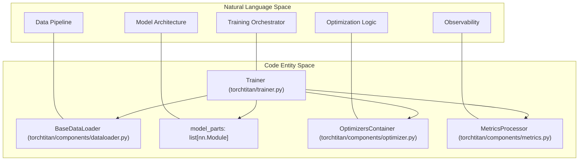

<!-- source: DeepWiki mcp.deepwiki.com · repo pytorch/torchtitan · page 3 Core Training Engine · fetched 2026-10-30 -->

# Core Training Engine

<details>
<summary>Relevant source files</summary>

The following files were used as context for generating this wiki page:

- [tests/unit_tests/test_set_determinism.py](tests/unit_tests/test_set_determinism.py)
- [torchtitan/components/dataloader.py](torchtitan/components/dataloader.py)
- [torchtitan/components/metrics.py](torchtitan/components/metrics.py)
- [torchtitan/components/validate.py](torchtitan/components/validate.py)
- [torchtitan/distributed/utils.py](torchtitan/distributed/utils.py)
- [torchtitan/experiments/forge/engine.py](torchtitan/experiments/forge/engine.py)
- [torchtitan/experiments/forge/example_train.py](torchtitan/experiments/forge/example_train.py)
- [torchtitan/experiments/torchft/trainer.py](torchtitan/experiments/torchft/trainer.py)
- [torchtitan/tools/utils.py](torchtitan/tools/utils.py)
- [torchtitan/train.py](torchtitan/train.py)
- [torchtitan/trainer.py](torchtitan/trainer.py)

</details>


The Core Training Engine is the central orchestration layer of TorchTitan, responsible for coordinating all aspects of the distributed training process. The engine is implemented primarily in the `Trainer` class, which manages initialization, training loop execution, metrics collection, and integration with all subsystems.

This page focuses on the training orchestration infrastructure. For details on specific sub-topics, see the following child pages:
- [Trainer Initialization and Lifecycle](#3.1) — Detailed breakdown of the `Trainer` class, component building, and model materialization.
- [Training Loop Execution](#3.2) — Deep dive into the `train()` method, gradient accumulation, and step-level logic.
- [Distributed Initialization and Communication](#3.3) — Documentation on process group setup, device meshes, and NCCL configuration.
- [Metrics Collection and Monitoring](#3.4) — Explanation of throughput calculation, memory monitoring, and logging backends.
- [Validation System](#3.5) — Overview of the `Validator` class and integration with the training loop.

**Sources:** [torchtitan/train.py:1-68](), [torchtitan/trainer.py:1-170]()

---

## Trainer Class Architecture

### Core Class Structure

The `Trainer` class ([torchtitan/trainer.py:55-725]()) serves as the main orchestrator and extends `torch.distributed.checkpoint.stateful.Stateful` to enable checkpoint/resume functionality. It centralizes all training components and state.

**Core Components:**
- **Configuration:** Managed via `Trainer.Config` ([torchtitan/trainer.py:57-159]()), a comprehensive dataclass covering parallelism, optimization, and training hyperparameters.
- **Swappable Components:** Built based on the `ModelSpec` ([torchtitan/protocols/model_spec.py]()), including the `tokenizer`, `dataloader`, `model_parts`, `loss_fn`, `optimizers`, and `lr_schedulers`.
- **Infrastructure:** Non-swappable utilities including `checkpointer` ([torchtitan/components/checkpoint.py]()), `metrics_processor` ([torchtitan/components/metrics.py]()), and `gc_handler` ([torchtitan/tools/utils.py:51-88]()).

### Code Entity Relationship Diagram

The following diagram associates the logical training components with their specific class implementations in the codebase.



**Sources:** [torchtitan/trainer.py:55-150](), [torchtitan/components/dataloader.py:38-54](), [torchtitan/components/metrics.py:1-35]()

---

## Training Lifecycle and Loop

The training process follows a strict lifecycle: initialization, execution, and teardown.

### Execution Flow Diagram

This diagram maps the high-level training phases to the specific methods executed within the `Trainer` and the main entry point.

```mermaid
sequenceDiagram
    participant Main as train.py:main()
    participant Trainer as trainer.py:Trainer
    participant Loop as trainer.py:train()
    participant Step as trainer.py:train_step()

    Main->>Trainer: build() [via Config]
    Note over Trainer: __init__ performs<br/>Distributed Setup &<br/>Model Parallelization
    Main->>Loop: trainer.train()
    
    loop for step in range(max_steps)
        Loop->>Step: train_step(data_iterator)
        Note over Step: Forward -> Backward -><br/>Optimizer Step
        Loop->>Loop: checkpointer.save()
        Loop->>Loop: validator.validate()
    end

    Main->>Trainer: trainer.close()
    Note over Main: destroy_process_group()
```

**Sources:** [torchtitan/train.py:17-75](), [torchtitan/trainer.py:551-709]()

### Initialization Highlights
The `Trainer` is initialized after the `ConfigManager` parses arguments. A key feature is the materialization of models on the `meta` device first ([torchtitan/trainer.py:214-217]()) to save memory before parallelization strategies (FSDP, TP, etc.) are applied. Determinism is also established early via `dist_utils.set_determinism` ([torchtitan/trainer.py:186-191]()). For details, see [Trainer Initialization and Lifecycle](#3.1).

### Training Loop Highlights
The main `train()` method ([torchtitan/trainer.py:611-709]()) manages the outer loop, while `train_step()` ([torchtitan/trainer.py:551-609]()) handles micro-batching for gradient accumulation. It coordinates the `OptimizersContainer` and `LRSchedulersContainer` to update model weights. For details, see [Training Loop Execution](#3.2).

**Sources:** [torchtitan/train.py:41-65](), [torchtitan/trainer.py:172-369]()

---

## Infrastructure and Monitoring

The training engine integrates several specialized utilities to ensure performance and reliability at scale.

### Distributed Infrastructure
Distributed training is initialized via `init_distributed` ([torchtitan/distributed/utils.py:297-363]()), which sets up the backend (usually NCCL) and establishes the `ParallelDims` used for sharding. For details, see [Distributed Initialization and Communication](#3.3).

### Monitoring and Profiling
- **Metrics:** The `MetricsProcessor` tracks throughput (TPS), FLOPs utilization (MFU), and memory usage.
- **Memory Monitoring:** The `DeviceMemoryMonitor` ([torchtitan/components/metrics.py:38-93]()) captures peak active and reserved bytes to identify potential OOM risks.
- **Garbage Collection:** To prevent stragglers caused by asynchronous Python GC, the `GarbageCollection` utility ([torchtitan/tools/utils.py:51-88]()) provides coordinated, periodic collection.

For details, see [Metrics Collection and Monitoring](#3.4).

### Validation and Correctness
The `Validator` ([torchtitan/components/validate.py:53-137]()) runs a separate evaluation loop at configured intervals to track model convergence on validation sets. It implements the `BaseValidator` protocol. For details, see [Validation System](#3.5).

**Sources:** [torchtitan/tools/utils.py:51-88](), [torchtitan/components/metrics.py:38-93](), [torchtitan/components/validate.py:33-51]()

---

## Experimental Variations

TorchTitan provides alternative engines and specialized trainers for experimental use cases:
- **ForgeEngine:** A stripped-down version of the trainer ([torchtitan/experiments/forge/engine.py:34-186]()) designed for simpler workflows or post-training.
- **FaultTolerantTrainer:** An extension of the base `Trainer` ([torchtitan/experiments/torchft/trainer.py:34-190]()) that integrates `TorchFTManager` for quorum-based recovery and fault tolerance.

| Component | Trainer (Core) | ForgeEngine (Experimental) | FaultTolerantTrainer |
|-----------|----------------|---------------------------|----------------------|
| **Complexity** | High (Feature Complete) | Low (Simplified) | High (Fault Tolerant) |
| **Use Case** | Large-scale Pre-training | Prototyping / Post-training | Unreliable Clusters |
| **State Management** | Stateful (DCP) | Stateful (DCP) | Multi-replica Stateful |

**Sources:** [torchtitan/experiments/forge/engine.py:34-186](), [torchtitan/experiments/forge/example_train.py:31-142](), [torchtitan/experiments/torchft/trainer.py:34-190]()

---

